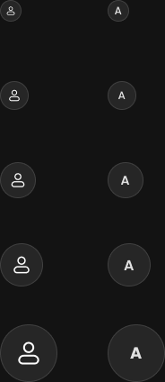

<!-- GEN:BEGIN 本段由 tools/gen-component-docs.py 依据 Figma 导出生成，勿手改；改 Figma 后重新生成 -->

## 概览

| 项 | 值 |
|---|---|
| Figma 组件集 | `Avatar`（node `56061:6443`） |
| 分类 | 展示类 |
| 变体数 | 10 |
| 默认变体 | `Size=xs, Type=icon` |
| 参考尺寸 | 24×24 px（默认变体） |
| 主题 | 主库（深色中性 + 品牌砂色） |
| 预览图 | [assets/previews/avatar.png](../../assets/previews/avatar.png) |
| 代码实现 | [`components/Avatar/Avatar.tsx`](../../components/Avatar/Avatar.tsx) |
| Figma 链接 | [在 Figma 打开](https://www.figma.com/design/ZO4WH3sbVCj7lZIFMpiwV9/VibeMe-App---Web-Design-%E5%A4%87%E4%BB%BD?node-id=56061-6443) |



## 变体与属性

| Figma 属性 | 类型 | 取值 | 默认 | 代码 prop |
|---|---|---|---|---|
| `initial` | TEXT（内容插槽） | — | — | `children` |
| `Size` | VARIANT | `xs` / `sm` / `md` / `lg` / `xl` | `xs` | `size` |
| `Type` | VARIANT | `icon` / `initial` | `icon` | `type` |

变体是属性轴的笛卡尔积：**10 = 5 × 2**（`Size` × `Type`）。

内嵌组件：`Property 1=icon, Property 2=user-line`×5

## 各变体的事实

> 填充栈按 Figma 图层顺序排列（**靠右的是上层**，hover/pressed 的叠加层在最后）。
> `⚠无cssVar` 表示该组件引用了历史遗留变量，代码里不要照抄，按 `foundations.md` 的规则换成语义 token。

| 变体 | 尺寸 | 填充栈 | 描边 | 圆角 | 内边距 上/右/下/左 | 不透明度 |
|---|---|---|---|---|---|---|
| `Size=xs, Type=icon` | 24×24 | `Neutral/Neutral-700` #262626 `--vm-neutral-700` | `Background/border-default` #FFFFFF 12% `--vm-border-default` | 999 | 0/0/0/0 | — |
| `Size=xs, Type=initial` | 24×24 | `Neutral/Neutral-700` #262626 `--vm-neutral-700` | `Background/border-default` #FFFFFF 12% `--vm-border-default` | 999 | 0/0/0/0 | — |
| `Size=sm, Type=icon` | 32×32 | `Neutral/Neutral-700` #262626 `--vm-neutral-700` | `Background/border-default` #FFFFFF 12% `--vm-border-default` | 999 | 0/0/0/0 | — |
| `Size=sm, Type=initial` | 32×32 | `Neutral/Neutral-700` #262626 `--vm-neutral-700` | `Background/border-default` #FFFFFF 12% `--vm-border-default` | 999 | 0/0/0/0 | — |
| `Size=md, Type=icon` | 40×40 | `Neutral/Neutral-700` #262626 `--vm-neutral-700` | `Background/border-default` #FFFFFF 12% `--vm-border-default` | 999 | 0/0/0/0 | — |
| `Size=md, Type=initial` | 40×40 | `Neutral/Neutral-700` #262626 `--vm-neutral-700` | `Background/border-default` #FFFFFF 12% `--vm-border-default` | 999 | 0/0/0/0 | — |
| `Size=lg, Type=icon` | 48×48 | `Neutral/Neutral-700` #262626 `--vm-neutral-700` | `Background/border-default` #FFFFFF 12% `--vm-border-default` | 999 | 0/0/0/0 | — |
| `Size=lg, Type=initial` | 48×48 | `Neutral/Neutral-700` #262626 `--vm-neutral-700` | `Background/border-default` #FFFFFF 12% `--vm-border-default` | 999 | 0/0/0/0 | — |
| `Size=xl, Type=icon` | 64×64 | `Neutral/Neutral-700` #262626 `--vm-neutral-700` | `Background/border-default` #FFFFFF 12% `--vm-border-default` | 999 | 0/0/0/0 | — |
| `Size=xl, Type=initial` | 64×64 | `Neutral/Neutral-700` #262626 `--vm-neutral-700` | `Background/border-default` #FFFFFF 12% `--vm-border-default` | 999 | 0/0/0/0 | — |

## 结构（默认变体）

### Size=xs, Type=icon

```text
`COMPONENT` Size=xs, Type=icon 24×24 HORIZONTAL gap 0 pad 0/0/0/0 填充 `Neutral/Neutral-700` #262626 `--vm-neutral-700` 描边 `Background/border-default` #FFFFFF 12% `--vm-border-default` 圆角 999
└─ `INSTANCE` Line icon 12×12 实例=Property 1=icon, Property 2=user-line
  └─ `VECTOR` icon 8.72×9.35 填充 #FFFFFF
```

### Size=lg, Type=initial

```text
`COMPONENT` Size=lg, Type=initial 48×48 HORIZONTAL gap 0 pad 0/0/0/0 填充 `Neutral/Neutral-700` #262626 `--vm-neutral-700` 描边 `Background/border-default` #FFFFFF 12% `--vm-border-default` 圆角 999
└─ `TEXT` A 12×24 填充 `Neutral/Neutral-100` #E0E0E0 `--vm-neutral-100` 文字样式 `Heading/M`（16 SemiBold /24） 内容 'A'
```

### Size=md, Type=initial

```text
`COMPONENT` Size=md, Type=initial 40×40 HORIZONTAL gap 0 pad 0/0/0/0 填充 `Neutral/Neutral-700` #262626 `--vm-neutral-700` 描边 `Background/border-default` #FFFFFF 12% `--vm-border-default` 圆角 999
└─ `TEXT` A 11×20 填充 `Neutral/Neutral-100` #E0E0E0 `--vm-neutral-100` 文字样式 `Heading/S`（14 SemiBold /20） 内容 'A'
```

### Size=sm, Type=initial

```text
`COMPONENT` Size=sm, Type=initial 32×32 HORIZONTAL gap 0 pad 0/0/0/0 填充 `Neutral/Neutral-700` #262626 `--vm-neutral-700` 描边 `Background/border-default` #FFFFFF 12% `--vm-border-default` 圆角 999
└─ `TEXT` A 9×18 填充 `Neutral/Neutral-100` #E0E0E0 `--vm-neutral-100` 文字样式 `Caption/Caption`（12 Medium /18） 内容 'A'
```

### Size=xl, Type=initial

```text
`COMPONENT` Size=xl, Type=initial 64×64 HORIZONTAL gap 0 pad 0/0/0/0 填充 `Neutral/Neutral-700` #262626 `--vm-neutral-700` 描边 `Background/border-default` #FFFFFF 12% `--vm-border-default` 圆角 999
└─ `TEXT` A 14×26 填充 `Neutral/Neutral-100` #E0E0E0 `--vm-neutral-100` 文字样式 `Heading/L`（18 Bold /26） 内容 'A'
```


## 设计 token

| Figma 变量 | CSS 变量 | 值 |
|---|---|---|
| `Background/border-default` | `--vm-border-default` | `rgba(255, 255, 255, 0.12)` |
| `Neutral/Neutral-100` | `--vm-neutral-100` | `#E0E0E0` |
| `Neutral/Neutral-700` | `--vm-neutral-700` | `#262626` |
| `Semantic Radius/radius-avatar` | `--vm-radius-avatar` | `999px` |
| `border/width/thin` | `--vm-border-width-thin` | `1px` |

<!-- GEN:END -->


## 交互与状态

Avatar 在 Figma 里**没有 `State` 轴**（`defs` 只有 `Size`、`Type`、`initial#56061:34`），所以它没有 hover / pressed / focus 变体，也没有 disabled 或 loading 态。代码因此**不提供任何交互态 prop**，`:hover`、`:active`、`:focus-visible` 一律不写在 `.vm-avatar` 上——它是一块纯展示的圆形底。

需要「可点击的头像」时，把 Avatar 放进 `<button>` 或 `<a>`，由外层负责 `:hover` 反馈、焦点环（`--vm-focus-ring-width` + `--vm-border-selected`）与 `cursor: pointer`；Avatar 自身保持静止。同理，需要「不可用」语义时用外层的 `disabled` / `aria-disabled`，**不要**自己给 Avatar 加 `opacity: var(--vm-opacity-disabled)`：Figma 的 10 个变体里没有一个绑定了 `opacity/disabled`，凭空降透明度会让头像看起来像加载失败。

唯一的「状态」来自数据本身：`type="icon"` 走缺省图标（填充 `--vm-text-primary`），`type="initial"` 走首字母（`--vm-neutral-100`）。两者底色恒为 `--vm-neutral-700`（`Neutral/Neutral-700`），描边恒为 `--vm-border-default`（`Background/border-default`，12% 白）1px（`--vm-border-width-thin`），切档位只改外框尺寸与字号。

## 代码用法

```tsx
import { Avatar } from '../components/Avatar';

// 1) 缺省图标（Figma 默认变体 Size=xs, Type=icon）：24×24，内嵌 user-line 图标
<Avatar aria-label="未登录用户" />

// 2) 首字母：Size=md（40×40），文字样式 Heading/S（14 SemiBold / 20）
<Avatar size="md" type="initial" initial="A" aria-label="Alice" />

// 3) 用 children 覆盖 initial（children 优先）
<Avatar size="lg" type="initial" aria-label="Bob">B</Avatar>

// 4) 最大档：Size=xl（64×64），Heading/L（18 Bold / 26），图标 32×32
<Avatar size="xl" type="icon" aria-label="机器人" />

// 5) 放进可点击容器，交互态交给外层
<button type="button" className="profile-trigger">
  <Avatar size="sm" type="initial" initial="Z" aria-hidden />
</button>
```

```css
/* 调用方页面里只需引一次 tokens；组件自带 import './Avatar.css' */
@import '../vibeme-design-system/components/tokens.css';
```

尺寸与图标的对应关系（全部来自 Figma 实测，图标恒为外框的 50%）：`xs` 24/12、`sm` 32/16、`md` 40/20、`lg` 48/24、`xl` 64/32（外框 px / 图标 px）。首字母字号档位：`xs`、`sm` 用 `Caption/Caption`（`--vm-type-caption-caption-size` 12px / 18px），`md` 用 `Heading/S`，`lg` 用 `Heading/M`，`xl` 用 `Heading/L`。

## 可访问性

根节点是 `<span>`。当调用方传入 `aria-label` 或 `aria-labelledby` 时，组件自动补 `role="img"`，让读屏把整个头像当成一个有名字的图像（"Alice"）；不传时保持无语义，等价于装饰元素——这正是「头像紧挨着用户名重复出现」的正确做法，避免读屏把同一个名字念两遍。

`type="icon"` 时内联 SVG 带 `aria-hidden="true"` 与 `focusable="false"`，不会进入 Tab 序；`type="initial"` 时首字母文本在根节点有可访问名的情况下也标 `aria-hidden`，否则读屏会念出孤立的字母 "A"。纯装饰用法请显式写 `aria-hidden`。

Avatar 本身不可聚焦、不响应键盘；要可点击就把 `aria-label`/可见文案留在外层 `<button>`/`<a>` 上，并保证外层的焦点环可见。首字母只是视觉兜底，**不要**把它当作唯一的可访问名称（"A" 无法区分 Alice 和 Amy），真实姓名要写在 `aria-label` 或旁边的文本里。

## 不要这样做

1. **不要发明 `disabled` / `loading` / `src` 这些 prop。** Figma 的 Avatar 只有 `Size` × `Type` 两个轴，没有图片型变体、没有加载骨架；需要照片头像请在业务层用 `` 自行实现（并保留 `--vm-radius-avatar` 圆形裁切），不要塞进这个组件。
2. **不要用 `--vm-radius-full` 或 `border-radius: 50%` 代替 `--vm-radius-avatar`。** Figma 四角绑定的就是 `Semantic Radius/radius-avatar`（999px），照抄 50% 会在非正方形场景（后续加徽标、拉伸）下变形。
3. **不要把描边写成 `#FFFFFF1F` 之类的字面量。** 那是 `Background/border-default` = `--vm-border-default`（12% 白，别名 `White/White-6`）；1px 线宽走 `--vm-border-width-thin`，两者都别硬编码。
4. **不要把 `initial` 的首字母颜色和图标颜色混为一谈。** Figma 里首字母绑 `Neutral/Neutral-100`（`--vm-neutral-100` #E0E0E0），而 user-line 图标是无变量绑定的纯白填充（导出里只有 `#FFFFFF`）——代码里图标用 `--vm-text-primary`，**不要**把 `#FFFFFF` 写进 CSS，也不要为了"统一"把首字母改成纯白。
5. **不要用 emoji、文字缩写组合或第三方图标库当兜底。** 缺省图标就是 `Line icon / user-line`（导出里 `instances` 记录为 `Property 1=icon, Property 2=user-line`×5），已从 Figma 取真实矢量内联；换别的图标等于换设计。
6. **不要给同一个用户同时挂 `type="initial"` 和不透传 `aria-label`。** 只显示一个字母时读屏只能念字母，务必补 `aria-label`。

## 相关组件

- **Card / MenuItem / List**：头像最常见的落点是卡片头部、列表项左侧、评论行——用 `size="sm"`（32）或 `xs`（24），左侧间距接 `--vm-space-2`，别自己写 margin 数字。
- **Table**：表格「用户」列用 `xs`/`sm` 头像 + 姓名文本横排，头像与文字之间用 `--vm-space-2`（8px）。
- **Button / Input**：头像可以出现在按钮内部（如账户切换）或输入框前的前缀位；此时 Avatar 必须 `aria-hidden`，可访问名由按钮/输入框承担。
- **Modal / Drawer**：用户详情弹层顶部用 `xl`（64）档，视觉重心最大；不要在弹层里同时堆两个 `xl` 头像。
- 与 **Badge/Tooltip** 之类的叠加件组合时，圆形裁切由 Avatar 的 `--vm-radius-avatar` 负责，叠加件用绝对定位放在外层包装元素上，不要把内外边距写进 `.vm-avatar`。
