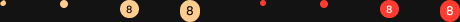

<!-- GEN:BEGIN 本段由 tools/gen-component-docs.py 依据 Figma 导出生成，勿手改；改 Figma 后重新生成 -->

## 概览

| 项 | 值 |
|---|---|
| Figma 组件集 | `Badge`（node `56061:6417`） |
| 分类 | 展示类 |
| 变体数 | 8 |
| 默认变体 | `Type=dot, Tone=brand, Size=sm` |
| 参考尺寸 | 6×6 px（默认变体） |
| 主题 | 主库（深色中性 + 品牌砂色） |
| 预览图 | [assets/previews/badge.png](../../assets/previews/badge.png) |
| 代码实现 | [`components/Badge/Badge.tsx`](../../components/Badge/Badge.tsx) |
| Figma 链接 | [在 Figma 打开](https://www.figma.com/design/ZO4WH3sbVCj7lZIFMpiwV9/VibeMe-App---Web-Design-%E5%A4%87%E4%BB%BD?node-id=56061-6417) |



## 变体与属性

| Figma 属性 | 类型 | 取值 | 默认 | 代码 prop |
|---|---|---|---|---|
| `count` | TEXT（内容插槽） | — | — | `children` |
| `Type` | VARIANT | `dot` / `count` | `dot` | `type` |
| `Tone` | VARIANT | `brand` / `error` | `brand` | `tone` |
| `Size` | VARIANT | `sm` / `md` | `sm` | `size` |

变体是属性轴的笛卡尔积：**8 = 2 × 2 × 2**（`Type` × `Tone` × `Size`）。

## 各变体的事实

> 填充栈按 Figma 图层顺序排列（**靠右的是上层**，hover/pressed 的叠加层在最后）。
> `⚠无cssVar` 表示该组件引用了历史遗留变量，代码里不要照抄，按 `foundations.md` 的规则换成语义 token。

| 变体 | 尺寸 | 填充栈 | 描边 | 圆角 | 内边距 上/右/下/左 | 不透明度 |
|---|---|---|---|---|---|---|
| `Type=dot, Tone=brand, Size=sm` | 6×6 | `Brand/Brand` #FFCC90 `--vm-brand` | — | 999 | 0/0/0/0 | — |
| `Type=dot, Tone=brand, Size=md` | 8×8 | `Brand/Brand` #FFCC90 `--vm-brand` | — | 999 | 0/0/0/0 | — |
| `Type=dot, Tone=error, Size=sm` | 6×6 | `状态色/Error` #FF3B30 `--vm-status-error` | — | 999 | 0/0/0/0 | — |
| `Type=dot, Tone=error, Size=md` | 8×8 | `状态色/Error` #FF3B30 `--vm-status-error` | — | 999 | 0/0/0/0 | — |
| `Type=count, Tone=brand, Size=sm` | 19×18 | `Brand/Brand` #FFCC90 `--vm-brand` | — | 999 | 2/6/2/6 | — |
| `Type=count, Tone=brand, Size=md` | 20×22 | `Brand/Brand` #FFCC90 `--vm-brand` | — | 999 | 2/6/2/6 | — |
| `Type=count, Tone=error, Size=sm` | 19×18 | `状态色/Error` #FF3B30 `--vm-status-error` | — | 999 | 2/6/2/6 | — |
| `Type=count, Tone=error, Size=md` | 20×22 | `状态色/Error` #FF3B30 `--vm-status-error` | — | 999 | 2/6/2/6 | — |

## 结构（默认变体）

### Type=dot, Tone=brand, Size=sm

```text
`COMPONENT` Type=dot, Tone=brand, Size=sm 6×6 HORIZONTAL gap 0 pad 0/0/0/0 填充 `Brand/Brand` #FFCC90 `--vm-brand` 圆角 999
```

### Type=count, Tone=error, Size=md

```text
`COMPONENT` Type=count, Tone=error, Size=md 20×22 HORIZONTAL gap 0 pad 2/6/2/6 填充 `状态色/Error` #FF3B30 `--vm-status-error` 圆角 999
└─ `TEXT` 8 8×18 填充 `White/White-0` #FFFFFF `--vm-white-0` 文字样式 `Caption/Caption`（12 Medium /18） 内容 '8'
```


## 设计 token

| Figma 变量 | CSS 变量 | 值 |
|---|---|---|
| `Brand/Brand` | `--vm-brand` | `#FFCC90` |
| `Radious/radius-full` | `--vm-radius-full` | `999px` |
| `White/White-0` | `--vm-white-0` | `#FFFFFF` |
| `space/space-0-5` | `--vm-space-0-5` | `2px` |
| `space/space-1-5` | `--vm-space-1-5` | `6px` |
| `状态色/Error` | `--vm-status-error` | `#FF3B30` |

<!-- GEN:END -->

## 交互与状态

**Badge 没有 `State` 轴**，也没有任何可交互行为：8 个变体全部是 `Type` × `Tone` × `Size`，
Figma 里没有 hover / pressed / focus / disabled 任何一档，所以代码里也没有一条 `:hover` / `:active` 规则。
Badge 不能点，需要点击的「红点入口」请把 Badge 放进 Button 内部，由 Button 负责交互与焦点。

真正的差异只有三处：

- **`type`**：`dot` 是 FIXED 的实心圆（`sm` 6×6、`md` 8×8，内边距全是 0，**没有文本子节点**）；
  `count` 是 HUG 的胶囊（`sm` 19×18、`md` 20×22 —— 这只是单个字符 "8" 的渲染结果，
  多位数会横向变长），内边距 `--vm-space-0-5`（`space/space-0-5`，2px）上下、
  `--vm-space-1-5`（`space/space-1-5`，6px）左右。
- **`tone`**：`brand` 用 `--vm-brand`（`Brand/Brand`，#FFCC90）底 + `--vm-neutral-950`（`Neutral/Neutral-950`，#0E0E0E）深色字；
  `error` 用 `--vm-status-error`（`状态色/Error`，#FF3B30）底 + `--vm-white-0`（`White/White-0`）白字。
  两档的对比度都是 Figma 里配好的，**不要互换文字色**。
- **`size`**：`dot` 只改直径；`count` 改文字样式 —— `sm` = `.vm-type-caption-label`（`Caption/Label`，10 Medium/14），
  `md` = `.vm-type-caption-caption`（`Caption/Caption`，12 Medium/18）。高度由此自然得到 18 / 22。

圆角 8 个变体完全一致：`--vm-radius-full`（`Radious/radius-full`，999px）。
`dot` 因此是正圆，`count` 是两端半圆的胶囊——`count` 千万别改成 `--vm-radius-badge`（4px），那会变成方角小方块。

## 代码用法

```tsx
import { Badge } from './components/Badge';

export function BadgeDemo() {
  return (
    <div style={{ display: 'flex', alignItems: 'center', gap: 16 }}>
      <Badge />                                        {/* dot / brand / sm → 6×6 砂色圆点 */}
      <Badge size="md" tone="error" />                 {/* dot / error / md → 8×8 红点 */}
      <Badge type="count" count={5} />                 {/* count / brand / sm */}
      <Badge type="count" tone="error" size="md" count={128} />
      <Badge type="count">{unreadCount}</Badge>        {/* children 优先于 count */}
      <button type="button" aria-label={`通知，${unreadCount} 条未读`}>
        <Badge type="count" tone="error" count={unreadCount} />
      </button>
    </div>
  );
}
```

props 就 4 个：`type`（默认 `dot`）、`tone`（默认 `brand`）、`size`（默认 `sm`）与数字插槽
`count` / `children`（对应 Figma 的 TEXT 属性 `count`，默认文案 `8`；两者同时给出时 **`children` 优先**）。
其余原生属性（`id`、`aria-*`、`title`…）透传到 `<span>`，`className` 合并到 `.vm-badge`；
样式随 `components/Badge/Badge.css` 一起引入。`type="dot"` 时 `count` / `children` 一律不渲染（Figma 的 dot 没有文本节点）。

## 可访问性

`Badge` 渲染成 `<span>`，没有角色。`type="count"` 时里面的数字会被朗读，但**数字本身没有含义**——
「3」到底是没有读的消息还是失败次数，屏幕阅读器无从判断，所以必须由外层元素补上说明，
例如 `<button aria-label="通知，3 条未读">` 包住 Badge，或者旁边放可见文字。
`type="dot"` 更极端：它**完全没有文本内容**，可访问性树里等于不存在，
所以纯圆点绝不能作为唯一的信息载体，必须靠 `aria-label` 或相邻文字说明它代表什么。
不要给 Badge 加 `role="status"` / `aria-live`——实时播报应该由承载它的容器负责，否则页面里每个 Badge 都会抢着播报。
`tone` 的差异只体现在颜色上，不要用「红点＝错误、砂点＝成功」这种只靠颜色的约定；
Badge 不接收焦点（没有 `tabIndex`），所以也不需要焦点样式。
最后，装饰性的圆点（旁边已有文字说明）建议直接对调用方可见的容器加 `aria-hidden="true"` 包一层，
避免读屏重复报数。

## 不要这样做

1. **不要给 Badge 加 `:hover` / `:active` / `cursor: pointer`**。Figma 里它没有 `State` 轴，
   也不是按钮；需要点击就把 Badge 放进 Button 里，让 Button 去表达交互态。
2. **不要写死 `count` 的宽度**。Figma 的 `count` 是 HUG（19×18 只是单个 "8" 的渲染结果），
   两位数、三位数会自然变宽；只有 `dot` 是 FIXED 6×6 / 8×8，可以写死。
3. **不要把圆角写成 `--vm-radius-badge`（4px）**。Badge 用的是 `--vm-radius-full`（999px）；
   另外注意 Figma 变量名本身有笔误，叫 `Radious/radius-full`（少了 d 后面的 i），
   在 Figma 里搜 `Radius/radius-full` 是搜不到的。
4. **不要给 `dot` 加内边距或文字**。Figma 的 dot 是 `pad 0/0/0/0` 且没有 TEXT 子节点；
   传了 `count` 也不会渲染（这是刻意的），要显示数字请显式写 `type="count"`。
5. **不要互换两档的文字色**。`brand` 底 `#FFCC90` 必须配 `--vm-neutral-950` 深色字，
   `error` 底 `#FF3B30` 配 `--vm-white-0`；把白字放到砂色底上会直接不可读。
6. **不要自造「99+」截断或最小值逻辑**。Figma 只定义了「这里显示一段文本」，
   没有任何计数规则；要截断请在调用方算好（`count={n > 99 ? '99+' : n}`）。
7. **不要用 Badge 代替 Tag**。Badge 只有圆点或极短数字、没有语义色以外的东西；
   带文字的完整状态标签（「已发布」「待审核」）请用 `Tag`，它才有 6 色调与 4px 圆角的那套规范。
8. **不要塞长文案进 `count`**。HUG 胶囊会被撑得很宽，Badge 只放 1–3 个字符（数字或 `99+`）。

## 相关组件

- **Tag**：最直接的分工——**Badge 只有颜色（dot）或极短数字（count）**，
  **Tag 是带文字的完整标签**，两者不能互相替代；Badge 的 `tone` 只有 `brand` / `error` 两档，Tag 有 6 档。
- **Button**：红点入口的标准组合是 `<Button>` 里嵌一个 `<Badge type="dot" tone="error" />`，
  交互、焦点、`aria-label` 都由 Button 承担；Badge 自己永远不是焦点目标。
- **Avatar**：头像右上角挂 Badge 表示在线/未读，用 `Avatar` 的容器相对定位 + Badge 绝对定位，
  Badge 不需要自己写 `position: absolute`（那属于组合层，不属于组件本身）。
- **List / ListItem**：列表项右侧的未读数用 `type="count"`；如果那一行同时还需要文字状态，就用 Tag 而不是两个 Badge。
- **Notification / Toast**：这三者共享 `--vm-status-error`；
  但 Notification 是完整的一条消息（有标题、正文、时间），Badge 只是它的一个很小的计数标记。
- **Table / TableCell**：单元格里的数字统计可以用 Badge 的 `count` 强调，
  但如果这个数字需要参与排序或对齐，直接用 `.vm-type-*` 文字而不是 Badge 胶囊。
