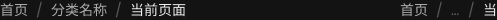

<!-- GEN:BEGIN 本段由 tools/gen-component-docs.py 依据 Figma 导出生成，勿手改；改 Figma 后重新生成 -->

## 概览

| 项 | 值 |
|---|---|
| Figma 组件集 | `Breadcrumb`（node `56064:6664`） |
| 分类 | 导航类 |
| 变体数 | 2 |
| 默认变体 | `Type=3levels` |
| 参考尺寸 | 186×20 px（默认变体） |
| 主题 | 主库（深色中性 + 品牌砂色） |
| 预览图 | [assets/previews/breadcrumb.png](../../assets/previews/breadcrumb.png) |
| 代码实现 | [`components/Breadcrumb/Breadcrumb.tsx`](../../components/Breadcrumb/Breadcrumb.tsx) |
| Figma 链接 | [在 Figma 打开](https://www.figma.com/design/ZO4WH3sbVCj7lZIFMpiwV9/VibeMe-App---Web-Design-%E5%A4%87%E4%BB%BD?node-id=56064-6664) |



## 变体与属性

| Figma 属性 | 类型 | 取值 | 默认 | 代码 prop |
|---|---|---|---|---|
| `Type` | VARIANT | `3levels` / `collapsed` | `3levels` | `type` |

变体是属性轴的笛卡尔积：**2 = 2**（`Type`）。

## 各变体的事实

> 填充栈按 Figma 图层顺序排列（**靠右的是上层**，hover/pressed 的叠加层在最后）。
> `⚠无cssVar` 表示该组件引用了历史遗留变量，代码里不要照抄，按 `foundations.md` 的规则换成语义 token。

| 变体 | 尺寸 | 填充栈 | 描边 | 圆角 | 内边距 上/右/下/左 | 不透明度 |
|---|---|---|---|---|---|---|
| `Type=3levels` | 186×20 | — | — | — | 0/0/0/0 | — |
| `Type=collapsed` | 139×20 | — | — | — | 0/0/0/0 | — |

## 结构（默认变体）

### Type=3levels

```text
`COMPONENT` Type=3levels 186×20 HORIZONTAL gap 8 pad 0/0/0/0
└─ `TEXT` 首页 28×20 填充 `Text/Text-Secondary` #FFFFFF 64% `--vm-text-secondary` 文字样式 `Heading/Body/S/Regular`（14 Regular /20） 内容 '首页'
└─ `TEXT` / 7×20 填充 `Text/Text-Tertiary` #FFFFFF 30% `--vm-text-tertiary` 文字样式 `Heading/Body/S/Regular`（14 Regular /20） 内容 '/'
└─ `TEXT` 分类名称 56×20 填充 `Text/Text-Secondary` #FFFFFF 64% `--vm-text-secondary` 文字样式 `Heading/Body/S/Regular`（14 Regular /20） 内容 '分类名称'
└─ `TEXT` / 7×20 填充 `Text/Text-Tertiary` #FFFFFF 30% `--vm-text-tertiary` 文字样式 `Heading/Body/S/Regular`（14 Regular /20） 内容 '/'
└─ `TEXT` 当前页面 56×20 填充 `Text/Text-Primary` #FFFFFF 92% `--vm-text-primary` 文字样式 `Heading/Body/S/Regular`（14 Regular /20） 内容 '当前页面'
```

### Type=collapsed

```text
`COMPONENT` Type=collapsed 139×20 HORIZONTAL gap 8 pad 0/0/0/0
└─ `TEXT` 首页 28×20 填充 `Text/Text-Secondary` #FFFFFF 64% `--vm-text-secondary` 文字样式 `Heading/Body/S/Regular`（14 Regular /20） 内容 '首页'
└─ `TEXT` / 7×20 填充 `Text/Text-Tertiary` #FFFFFF 30% `--vm-text-tertiary` 文字样式 `Heading/Body/S/Regular`（14 Regular /20） 内容 '/'
└─ `TEXT` … 9×20 填充 `Text/Text-Tertiary` #FFFFFF 30% `--vm-text-tertiary` 文字样式 `Heading/Body/S/Regular`（14 Regular /20） 内容 '…'
└─ `TEXT` / 7×20 填充 `Text/Text-Tertiary` #FFFFFF 30% `--vm-text-tertiary` 文字样式 `Heading/Body/S/Regular`（14 Regular /20） 内容 '/'
└─ `TEXT` 当前页面 56×20 填充 `Text/Text-Primary` #FFFFFF 92% `--vm-text-primary` 文字样式 `Heading/Body/S/Regular`（14 Regular /20） 内容 '当前页面'
```


## 设计 token

| Figma 变量 | CSS 变量 | 值 |
|---|---|---|
| `Text/Text-Primary` | `--vm-text-primary` | `rgba(255, 255, 255, 0.92)` |
| `Text/Text-Secondary` | `--vm-text-secondary` | `rgba(255, 255, 255, 0.64)` |
| `Text/Text-Tertiary` | `--vm-text-tertiary` | `rgba(255, 255, 255, 0.3)` |
| `space/space-2` | `--vm-space-2` | `8px` |

<!-- GEN:END -->


## 交互与状态

Figma 的 `Breadcrumb` **没有 `State` 轴**，也没有 focus / hover 变体，只有 `Type=3levels | collapsed`。
所以这里没有 `state` prop，交互全部由 CSS 伪类和原生元素承担：

- **祖先层级（非当前页）**是真实 `<a href>`（没有 `href` 时退化成 `<span>`，不假装成链接）。
  默认文字色 `--vm-text-secondary`（Figma `Text/Text-Secondary`，64% 白）。
  `:hover` 时**只换前景 token**：`color` 变成 `--vm-text-primary`（Figma `Text/Text-Primary`，92% 白）——
  与同族文字型组件 Tabs `Type=line` 的手法一致；Breadcrumb 在 Figma 里**没有任何填充层或描边**
  （两个变体的填充栈、描边、圆角都是空的），所以**绝不能**给它加 `--vm-white-7` 的 hover 叠加层或
  换描边，那是 Button / Input 一族的手法。
- **分隔符 `/`** 是固定的装饰文字，颜色 `--vm-text-tertiary`（Figma `Text/Text-Tertiary`，30% 白），
  不可点、不参与交互，用 `aria-hidden="true"` 从无障碍树里摘掉。
- **当前页**（数组最后一项）文字色 `--vm-text-primary`，并且**不可点**：渲染成 `<span aria-current="page">`，
  即使调用方传了 `href` 也不生成 `<a>`——这是 ARIA 面包屑的硬要求，避免“当前位置还能再点进去”。
- **`:focus-visible`** 由无障碍底线补：Figma 没有 focus 变体，实现里给可点元素加
  `box-shadow: 0 0 0 var(--vm-focus-ring-width) var(--vm-border-selected)`（50% 白 ring）并去掉默认 outline；
  因为文字型元素没有底色，ring 是唯一足够明显的焦点指示。
- **禁用**：Figma 没有 disabled 变体，所以**不提供 `disabled` prop**。要表达“不可达层级”就不要给 `href`。
- **`Type=collapsed` 的展开**：省略号默认是装饰性 `<span aria-hidden="true">…</span>`，颜色走
  `--vm-text-tertiary`；只有当调用方传了 `onExpand` 时才升级成真正的 `<button type="button">`
  （可聚焦、可 Enter/Space 触发，`aria-label` 说明“展开隐藏层级”）。中间被隐藏的层级在折叠态下
  不进入 DOM，所以**调用方必须传 `onExpand` 才能让键盘与读屏用户到达被折叠的层级**。
- 过渡统一 `transition: color var(--vm-duration-fast)`，并在 `prefers-reduced-motion: reduce` 下关掉。

## 代码用法

```tsx
import { Breadcrumb, type BreadcrumbItem } from './components/Breadcrumb';
import './components/tokens.css'; // 必须在最外层引入一次，Breadcrumb.css 依赖其中的 --vm-* 变量

const items: BreadcrumbItem[] = [
  { label: '首页', href: '/' },
  { label: '分类名称', href: '/category' },
  { label: '当前页面' }, // 最后一项自动成为当前页，渲染成 aria-current="page"
];

// 1) Type=3levels：完整列出所有层级（Figma 的 3 层只是视觉样本，items 可以多于 3 项）
<Breadcrumb items={items} />

// 2) Type=collapsed：首项 + … + 末项；传了 onExpand 省略号才可交互
<Breadcrumb type="collapsed" items={items} onExpand={() => setExpanded(true)} />

<Breadcrumb aria-label="当前位置" items={items} className="my-crumb" />
```

`items` 里每一项形如 `{ label, href?, onClick?, current? }`：`label` 是内容插槽（对应 Figma 里
`首页` / `分类名称` / `当前页面` 三个 TEXT 节点），`current` 只在“当前页不是最后一项”时才需要显式给。

`items` 可省略（`@default []`）：此时只渲染 `<nav aria-label="面包屑">` 骨架（`ref` / `className` /
其余原生属性照常可用），**不输出空的 `<ol>`**，也没有任何分隔符 —— 分隔符是逐项生成的。

## 可访问性

- 根元素是 `<nav aria-label="面包屑">`（`aria-label` 可被 `...rest` 覆盖，建议传“当前位置”这类可读名），
  内部是 `<ol>` + `<li>`——**有序**列表，因为层级顺序本身有语义，不要用 `div` 堆。
- 当前页用 `aria-current="page"`，且渲染成不可点的 `<span>`；不要给它 `role="link"` 或保留 `href`
  再靠 `preventDefault` 假装禁用。
- 分隔符 `/` 是纯装饰，`aria-hidden="true"`；读屏用户听到的是“首页、分类名称、当前页面”，不会听到斜杠。
- 折叠态下省略号若不是 `<button>`（没传 `onExpand`），被隐藏的层级既不渲染也不可读，
  所以要么传 `onExpand` 让省略号可聚焦展开，要么在折叠态额外提供等价的导航入口（侧边栏 / 站点地图）。
- 键盘：可点层级是原生 `<a>`，Tab 逐项前进、Enter 触发；展开按钮是原生 `<button>`，Enter / Space 触发。
  焦点样式由 `.vm-breadcrumb__link:focus-visible` 的 `--vm-border-selected` ring 提供，不要 `outline: none` 后不给替代。

## 不要这样做

1. **不要给 Breadcrumb 加 hover 叠加层**。Button 一族用 `--vm-white-7` / `--vm-white-6` 叠加，是因为它们
   在 Figma 里有实体底色；Breadcrumb 两个变体的填充栈与描边**都是空的**，它是文字型组件，
   hover 只能换前景（`--vm-text-secondary` → `--vm-text-primary`）。混用会让面包屑出现一块莫名的灰底。
2. **不要把 `Type=3levels` 理解成“最多显示三项”**。Figma 里那 3 项只是示例内容；`3levels` 的语义是
   **不折叠**，有多少层级就渲染多少。只有 `collapsed` 才折叠中间层级（首项 + `…` + 末项）。
3. **不要把最后一项做成可点链接**。Figma 里 `当前页面` 用的是 `Text/Text-Primary`（92% 白）而不是
   `Text/Text-Secondary`（64%），这就是“当前位置不可点”的视觉表达；实现里必须同时落到
   `<span aria-current="page">`，只改颜色不改元素等于没做。
4. **不要用 `--vm-text-action`（品牌色 `Brand/Brand` #FFCC90）给面包屑上色**。Figma 的 Breadcrumb 里
   **没有**任何品牌色绑定，可点层级是 `Text/Text-Secondary`。品牌色是链接/可点强调色，这里用了会与
   Tabs `selected`、Tag 等抢视觉焦点。
5. **不要手写 `font-size` / `line-height`**。五个 TEXT 节点全部挂 `Heading/Body/S/Regular`
   （14 Regular / 20 行高），代码里用 `.vm-type-heading-body-s-regular` 或
   `--vm-type-heading-body-s-regular-size` / `-line-height`；20px 的行高正是变体 20px 高的来源。
6. **不要引用历史遗留变量**。本组件只用到 `Text/Text-Primary`、`Text/Text-Secondary`、
   `Text/Text-Tertiary`、`space/space-2` 四个；`Color` / `分割线` / `Text/灰/*` 之类一律不要碰。

## 相关组件

- **`Tabs`（`Type=line`）**：同一套“文字型导航”手法——默认 `--vm-text-secondary`、hover 换
  `--vm-text-primary`、当前位置用 `--vm-brand` + 指示条。做页头时二者常上下相邻，**颜色语义要分工**：
  Tabs 表示“同层视图切换”，Breadcrumb 表示“层级路径”，不要互相借用颜色。
- **`ListItem`**：面包屑某一层无法跳转时的降级展示可参考 ListItem 的文字层级用法，但**不要**把
  ListItem 塞进面包屑——那会带来多余的底色与内边距，破坏 20px 的行高与 8px 间距。
- **`Button` / `IconButton`**：折叠态省略号若要做成显式按钮，语义与键盘行为参考 Button 的
  `type="ghost"` 用法，但视觉上仍保持纯文字（无底色、无描边），不要引入按钮的 `--vm-radius-button` 圆角。
- **`Divider`**：面包屑与页面标题之间若需要分隔线，用 `Divider` 组件而不是给 Breadcrumb 自己加 `border-bottom`。
- 布局上它是页头的一行（Figma 参考尺寸默认变体 186×20、折叠变体 139×20，间距 `space/space-2` = 8px），
  与页面标题、`Tabs` 一起构成页面头部区域。
