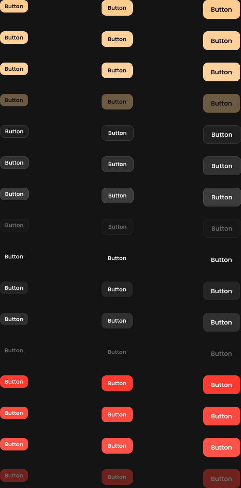

<!-- GEN:BEGIN 本段由 tools/gen-component-docs.py 依据 Figma 导出生成，勿手改；改 Figma 后重新生成 -->

## 概览

| 项 | 值 |
|---|---|
| Figma 组件集 | `Button`（node `56058:5617`） |
| 分类 | 表单控件 |
| 变体数 | 48 |
| 默认变体 | `Type=primary, Size=sm, State=default` |
| 参考尺寸 | 72×32 px（默认变体） |
| 主题 | 主库（深色中性 + 品牌砂色） |
| 预览图 | [assets/previews/button.png](../../assets/previews/button.png) |
| 代码实现 | [`components/Button/Button.tsx`](../../components/Button/Button.tsx) |
| Figma 链接 | [在 Figma 打开](https://www.figma.com/design/ZO4WH3sbVCj7lZIFMpiwV9/VibeMe-App---Web-Design-%E5%A4%87%E4%BB%BD?node-id=56058-5617) |



## 变体与属性

| Figma 属性 | 类型 | 取值 | 默认 | 代码 prop |
|---|---|---|---|---|
| `label` | TEXT（内容插槽） | — | — | `children` |
| `Type` | VARIANT | `primary` / `secondary` / `ghost` / `danger` | `primary` | `type` |
| `Size` | VARIANT | `sm` / `md` / `lg` | `sm` | `size` |
| `State` | VARIANT | `default` / `hover` / `pressed` / `disabled` | `default` | `state` |

变体是属性轴的笛卡尔积：**48 = 4 × 3 × 4**（`Type` × `Size` × `State`）。

## 各变体的事实

> 填充栈按 Figma 图层顺序排列（**靠右的是上层**，hover/pressed 的叠加层在最后）。
> `⚠无cssVar` 表示该组件引用了历史遗留变量，代码里不要照抄，按 `foundations.md` 的规则换成语义 token。

| 变体 | 尺寸 | 填充栈 | 描边 | 圆角 | 内边距 上/右/下/左 | 不透明度 |
|---|---|---|---|---|---|---|
| `Type=primary, Size=sm, State=default` | 72×32 | `Brand/Brand` #FFCC90 `--vm-brand` | — | 12 | 0/12/0/12 | — |
| `Type=primary, Size=sm, State=hover` | 72×32 | `Brand/Brand` #FFCC90 `--vm-brand` ＋ `White/White-7` #FFFFFF 8% `--vm-white-7` | — | 12 | 0/12/0/12 | — |
| `Type=primary, Size=sm, State=pressed` | 72×32 | `Brand/Brand` #FFCC90 `--vm-brand` ＋ `White/White-6` #FFFFFF 12% `--vm-white-6` | — | 12 | 0/12/0/12 | — |
| `Type=primary, Size=sm, State=disabled` | 72×32 | `Brand/Brand` #FFCC90 `--vm-brand` | — | 12 | 0/12/0/12 | 0.38 |
| `Type=primary, Size=md, State=default` | 80×40 | `Brand/Brand` #FFCC90 `--vm-brand` | — | 12 | 0/16/0/16 | — |
| `Type=primary, Size=md, State=hover` | 80×40 | `Brand/Brand` #FFCC90 `--vm-brand` ＋ `White/White-7` #FFFFFF 8% `--vm-white-7` | — | 12 | 0/16/0/16 | — |
| `Type=primary, Size=md, State=pressed` | 80×40 | `Brand/Brand` #FFCC90 `--vm-brand` ＋ `White/White-6` #FFFFFF 12% `--vm-white-6` | — | 12 | 0/16/0/16 | — |
| `Type=primary, Size=md, State=disabled` | 80×40 | `Brand/Brand` #FFCC90 `--vm-brand` | — | 12 | 0/16/0/16 | 0.38 |
| `Type=primary, Size=lg, State=default` | 95×48 | `Brand/Brand` #FFCC90 `--vm-brand` | — | 12 | 0/20/0/20 | — |
| `Type=primary, Size=lg, State=hover` | 95×48 | `Brand/Brand` #FFCC90 `--vm-brand` ＋ `White/White-7` #FFFFFF 8% `--vm-white-7` | — | 12 | 0/20/0/20 | — |
| `Type=primary, Size=lg, State=pressed` | 95×48 | `Brand/Brand` #FFCC90 `--vm-brand` ＋ `White/White-6` #FFFFFF 12% `--vm-white-6` | — | 12 | 0/20/0/20 | — |
| `Type=primary, Size=lg, State=disabled` | 95×48 | `Brand/Brand` #FFCC90 `--vm-brand` | — | 12 | 0/20/0/20 | 0.38 |
| `Type=secondary, Size=sm, State=default` | 74×32 | `Background/bg-card` #202020 `--vm-bg-card` | `Background/border-default` #FFFFFF 12% `--vm-border-default` | 12 | 0/12/0/12 | — |
| `Type=secondary, Size=sm, State=hover` | 74×32 | `Background/bg-card` #202020 `--vm-bg-card` ＋ `White/White-7` #FFFFFF 8% `--vm-white-7` | `Background/border-default` #FFFFFF 12% `--vm-border-default` | 12 | 0/12/0/12 | — |
| `Type=secondary, Size=sm, State=pressed` | 74×32 | `Background/bg-card` #202020 `--vm-bg-card` ＋ `White/White-6` #FFFFFF 12% `--vm-white-6` | `Background/border-default` #FFFFFF 12% `--vm-border-default` | 12 | 0/12/0/12 | — |
| `Type=secondary, Size=sm, State=disabled` | 74×32 | `Background/bg-card` #202020 `--vm-bg-card` | `Background/border-default` #FFFFFF 12% `--vm-border-default` | 12 | 0/12/0/12 | 0.38 |
| `Type=secondary, Size=md, State=default` | 82×40 | `Background/bg-card` #202020 `--vm-bg-card` | `Background/border-default` #FFFFFF 12% `--vm-border-default` | 12 | 0/16/0/16 | — |
| `Type=secondary, Size=md, State=hover` | 82×40 | `Background/bg-card` #202020 `--vm-bg-card` ＋ `White/White-7` #FFFFFF 8% `--vm-white-7` | `Background/border-default` #FFFFFF 12% `--vm-border-default` | 12 | 0/16/0/16 | — |
| `Type=secondary, Size=md, State=pressed` | 82×40 | `Background/bg-card` #202020 `--vm-bg-card` ＋ `White/White-6` #FFFFFF 12% `--vm-white-6` | `Background/border-default` #FFFFFF 12% `--vm-border-default` | 12 | 0/16/0/16 | — |
| `Type=secondary, Size=md, State=disabled` | 82×40 | `Background/bg-card` #202020 `--vm-bg-card` | `Background/border-default` #FFFFFF 12% `--vm-border-default` | 12 | 0/16/0/16 | 0.38 |
| `Type=secondary, Size=lg, State=default` | 97×48 | `Background/bg-card` #202020 `--vm-bg-card` | `Background/border-default` #FFFFFF 12% `--vm-border-default` | 12 | 0/20/0/20 | — |
| `Type=secondary, Size=lg, State=hover` | 97×48 | `Background/bg-card` #202020 `--vm-bg-card` ＋ `White/White-7` #FFFFFF 8% `--vm-white-7` | `Background/border-default` #FFFFFF 12% `--vm-border-default` | 12 | 0/20/0/20 | — |
| `Type=secondary, Size=lg, State=pressed` | 97×48 | `Background/bg-card` #202020 `--vm-bg-card` ＋ `White/White-6` #FFFFFF 12% `--vm-white-6` | `Background/border-default` #FFFFFF 12% `--vm-border-default` | 12 | 0/20/0/20 | — |
| `Type=secondary, Size=lg, State=disabled` | 97×48 | `Background/bg-card` #202020 `--vm-bg-card` | `Background/border-default` #FFFFFF 12% `--vm-border-default` | 12 | 0/20/0/20 | 0.38 |
| `Type=ghost, Size=sm, State=default` | 72×32 | — | — | 12 | 0/12/0/12 | — |
| `Type=ghost, Size=sm, State=hover` | 72×32 | `White/White-7` #FFFFFF 8% `--vm-white-7` | — | 12 | 0/12/0/12 | — |
| `Type=ghost, Size=sm, State=pressed` | 72×32 | `White/White-6` #FFFFFF 12% `--vm-white-6` | — | 12 | 0/12/0/12 | — |
| `Type=ghost, Size=sm, State=disabled` | 72×32 | — | — | 12 | 0/12/0/12 | 0.38 |
| `Type=ghost, Size=md, State=default` | 80×40 | — | — | 12 | 0/16/0/16 | — |
| `Type=ghost, Size=md, State=hover` | 80×40 | `White/White-7` #FFFFFF 8% `--vm-white-7` | — | 12 | 0/16/0/16 | — |
| `Type=ghost, Size=md, State=pressed` | 80×40 | `White/White-6` #FFFFFF 12% `--vm-white-6` | — | 12 | 0/16/0/16 | — |
| `Type=ghost, Size=md, State=disabled` | 80×40 | — | — | 12 | 0/16/0/16 | 0.38 |
| `Type=ghost, Size=lg, State=default` | 95×48 | — | — | 12 | 0/20/0/20 | — |
| `Type=ghost, Size=lg, State=hover` | 95×48 | `White/White-7` #FFFFFF 8% `--vm-white-7` | — | 12 | 0/20/0/20 | — |
| `Type=ghost, Size=lg, State=pressed` | 95×48 | `White/White-6` #FFFFFF 12% `--vm-white-6` | — | 12 | 0/20/0/20 | — |
| `Type=ghost, Size=lg, State=disabled` | 95×48 | — | — | 12 | 0/20/0/20 | 0.38 |
| `Type=danger, Size=sm, State=default` | 72×32 | `状态色/Error` #FF3B30 `--vm-status-error` | — | 12 | 0/12/0/12 | — |
| `Type=danger, Size=sm, State=hover` | 72×32 | `状态色/Error` #FF3B30 `--vm-status-error` ＋ `White/White-7` #FFFFFF 8% `--vm-white-7` | — | 12 | 0/12/0/12 | — |
| `Type=danger, Size=sm, State=pressed` | 72×32 | `状态色/Error` #FF3B30 `--vm-status-error` ＋ `White/White-6` #FFFFFF 12% `--vm-white-6` | — | 12 | 0/12/0/12 | — |
| `Type=danger, Size=sm, State=disabled` | 72×32 | `状态色/Error` #FF3B30 `--vm-status-error` | — | 12 | 0/12/0/12 | 0.38 |
| `Type=danger, Size=md, State=default` | 80×40 | `状态色/Error` #FF3B30 `--vm-status-error` | — | 12 | 0/16/0/16 | — |
| `Type=danger, Size=md, State=hover` | 80×40 | `状态色/Error` #FF3B30 `--vm-status-error` ＋ `White/White-7` #FFFFFF 8% `--vm-white-7` | — | 12 | 0/16/0/16 | — |
| `Type=danger, Size=md, State=pressed` | 80×40 | `状态色/Error` #FF3B30 `--vm-status-error` ＋ `White/White-6` #FFFFFF 12% `--vm-white-6` | — | 12 | 0/16/0/16 | — |
| `Type=danger, Size=md, State=disabled` | 80×40 | `状态色/Error` #FF3B30 `--vm-status-error` | — | 12 | 0/16/0/16 | 0.38 |
| `Type=danger, Size=lg, State=default` | 95×48 | `状态色/Error` #FF3B30 `--vm-status-error` | — | 12 | 0/20/0/20 | — |
| `Type=danger, Size=lg, State=hover` | 95×48 | `状态色/Error` #FF3B30 `--vm-status-error` ＋ `White/White-7` #FFFFFF 8% `--vm-white-7` | — | 12 | 0/20/0/20 | — |
| `Type=danger, Size=lg, State=pressed` | 95×48 | `状态色/Error` #FF3B30 `--vm-status-error` ＋ `White/White-6` #FFFFFF 12% `--vm-white-6` | — | 12 | 0/20/0/20 | — |
| `Type=danger, Size=lg, State=disabled` | 95×48 | `状态色/Error` #FF3B30 `--vm-status-error` | — | 12 | 0/20/0/20 | 0.38 |

## 结构（默认变体）

### Type=primary, Size=sm, State=default

```text
`COMPONENT` Type=primary, Size=sm, State=default 72×32 HORIZONTAL gap 0 pad 0/12/0/12 填充 `Brand/Brand` #FFCC90 `--vm-brand` 圆角 12
└─ `TEXT` Button 48×20 填充 `Neutral/Neutral-950` #0E0E0E `--vm-neutral-950` 文字样式 `Heading/S`（14 SemiBold /20） 内容 'Button'
```

### Type=secondary, Size=md, State=hover

```text
`COMPONENT` Type=secondary, Size=md, State=hover 82×40 HORIZONTAL gap 0 pad 0/16/0/16 填充 `Background/bg-card` #202020 `--vm-bg-card` ＋ `White/White-7` #FFFFFF 8% `--vm-white-7` 描边 `Background/border-default` #FFFFFF 12% `--vm-border-default` 圆角 12
└─ `TEXT` Button 48×20 填充 `Text/Text-Primary` #FFFFFF 92% `--vm-text-primary` 文字样式 `Heading/S`（14 SemiBold /20） 内容 'Button'
```

### Type=primary, Size=lg, State=default

```text
`COMPONENT` Type=primary, Size=lg, State=default 95×48 HORIZONTAL gap 0 pad 0/20/0/20 填充 `Brand/Brand` #FFCC90 `--vm-brand` 圆角 12
└─ `TEXT` Button 55×24 填充 `Neutral/Neutral-950` #0E0E0E `--vm-neutral-950` 文字样式 `Heading/M`（16 SemiBold /24） 内容 'Button'
```


## 设计 token

| Figma 变量 | CSS 变量 | 值 |
|---|---|---|
| `Background/bg-card` | `--vm-bg-card` | `#202020` |
| `Background/border-default` | `--vm-border-default` | `rgba(255, 255, 255, 0.12)` |
| `Brand/Brand` | `--vm-brand` | `#FFCC90` |
| `Neutral/Neutral-950` | `--vm-neutral-950` | `#0E0E0E` |
| `Semantic Radius/radius-button` | `--vm-radius-button` | `12px` |
| `Semantic Space/padding-button-lg-x` | `--vm-padding-button-lg-x` | `20px` |
| `Semantic Space/padding-button-md-x` | `--vm-padding-button-md-x` | `16px` |
| `Semantic Space/padding-button-sm-x` | `--vm-padding-button-sm-x` | `12px` |
| `Text/Text-Primary` | `--vm-text-primary` | `rgba(255, 255, 255, 0.92)` |
| `White/White-6` | `--vm-white-6` | `rgba(255, 255, 255, 0.12)` |
| `White/White-7` | `--vm-white-7` | `rgba(255, 255, 255, 0.08)` |
| `border/width/thin` | `--vm-border-width-thin` | `1px` |
| `opacity/disabled` | `--vm-opacity-disabled` | `0.38` |
| `状态色/Error` | `--vm-status-error` | `#FF3B30` |

<!-- GEN:END -->


## 交互与状态

Figma 的 `State` 轴分两类处理：`default` / `hover` / `pressed` 是**交互态，不做 prop**，由 CSS 伪类触发；
`disabled` 是应用态，做成 prop 并直接落到原生 `disabled` 属性。

- **default**：`primary` = `--vm-brand` 实底 + `--vm-neutral-950` 文字；`secondary` = `--vm-bg-card` 实底 +
  1px `--vm-border-default` 描边 + `--vm-text-primary` 文字；`ghost` = 无底无描边；
  `danger` = `--vm-status-error` 实底 + `--vm-white-0` 纯白文字。
- **hover**（CSS `:hover`，`disabled` 时不生效）：Figma 的实体事实是**同一填充栈追加 `White/White-7`（8% 白）**，
  底色变量本身不变，所以实现用 `background-image: linear-gradient(var(--vm-white-7), var(--vm-white-7))`
  叠加一层，而不是把 `--vm-brand` 换成 `--vm-brand-hover`。注意 `ghost` 的 hover 只有这一层叠加，没有底。
- **pressed**（CSS `:active`）：叠加层换成 `--vm-white-6`（12% 白）`White/White-6`，其余同上。
- **focus**（CSS `:focus-visible`）：Figma 的 Button **没有 focus 变体**，这一条是按 `foundations.md` 的无障碍底线
  补的——只加 `box-shadow: 0 0 0 var(--vm-focus-ring-width) var(--vm-border-selected)` 的 2px 外环，
  不动底色、不动描边，避免和 hover 的叠加层打架。
- **disabled**（原生 `disabled` 属性）：`opacity: var(--vm-opacity-disabled)`（38%）+ `cursor: not-allowed`。
  底色、描边、文字色**一个都不换**——不要改成灰色，也不要用 `Text/Text-Disable` 顶替。
- 所有颜色过渡走 `transition: … var(--vm-duration-fast)`（100ms），`prefers-reduced-motion: reduce` 时整体关闭。

## 代码用法

```tsx
import { Button } from '../../components'; // 桶文件已 import './tokens.css'
// 只引单个组件时要自己先加载 tokens.css：
// import '../../components/tokens.css';
// import { Button } from '../../components/Button';

export function Actions() {
  return (
    <>
      {/* Figma: Type=primary, Size=md, State=default */}
      <Button type="primary" size="md" onClick={() => console.log('save')}>
        保存
      </Button>

      {/* Figma: Type=secondary, Size=md —— 只当次要操作，不抢主操作的位置 */}
      <Button type="secondary" size="md">
        取消
      </Button>

      {/* Figma: Type=ghost —— 无底无描边，用于工具栏/行内 */}
      <Button type="ghost" size="sm">
        更多
      </Button>

      {/* Figma: Type=danger —— 破坏性操作必须二次确认 */}
      <Button type="danger" size="md">
        删除
      </Button>

      {/* 应用态：State=disabled 走原生 disabled，不需要 state prop */}
      <Button type="primary" size="sm" disabled>
        提交中
      </Button>

      {/* 原生 submit 行为用 htmlType（Figma 的 Type 已占用 type 这个名字） */}
      <form onSubmit={(e) => e.preventDefault()}>
        <Button type="primary" size="sm" htmlType="submit">
          登录
        </Button>
      </form>
    </>
  );
}
```

`Button.tsx` 自己 `import './Button.css'`；`className` 会与内部类合并而不是覆盖，外部要加宽时传
`className="w-full"` 之类的排版类即可（组件本身不写死宽度，`HUG` 由内容 + 内边距决定）。

## 可访问性

- 渲染的是**真实 `<button>` 元素**，不是样式化的 `div`；键盘 `Space` / `Enter` 触发由浏览器原生提供，
  不要自己监听 `keydown` 再 `preventDefault`。
- `disabled` 走原生属性：自动移出 tab 序列、读屏播报「不可用」。**不要**用 `aria-disabled="true"`
  加 `onClick` 拦截来替代它，那会让按钮仍可聚焦却无反馈。
- 纯图标按钮（Figma 没有这个变体，但 `children` 允许只放图标）必须显式给 `aria-label`，
  同时图标 SVG 要 `aria-hidden="true"`，否则读屏会把图标名念出来。
- 焦点可见性靠 `:focus-visible` + `--vm-border-selected` 的 2px 环；不要 `outline: none` 之后不给替代视觉。
- `danger` 只表达「视觉警示」，不替调用方做二次确认：真正删除前请在业务层加确认弹窗（`Modal`），
  并在文案里写清操作对象。
- 按钮内不要再嵌可聚焦元素（`<a>`、`<input>`），否则会出现嵌套交互元素、破坏 tab 顺序与读屏语义。

## 不要这样做

1. **不要给 hover / pressed 另造实体色，也不要把它们做成 prop**。Figma 记的是叠加层：
   hover 追加 `White/White-7`（`--vm-white-7`，8% 白）、pressed 追加 `White/White-6`（`--vm-white-6`，12% 白），
   底色变量不变。写成 `background-color: var(--vm-brand-hover)` 是错的——`Brand/Brand-Hover` 在 Button 的 48 个变体里
   一次都没被绑定（它属于链接/文字类 hover）。
2. **不要把 `danger` 的文字换成 `--vm-text-primary`**。Figma 给 danger 的文字绑的是 `White/White-0`（纯白 `#FFFFFF`），
   而 `--vm-text-primary` 是 92% 白；在 `#FF3B30` 上这两者对比度不同，照 92% 写会偏灰。
3. **不要用 `box-shadow` 假冒 secondary 的描边，或干脆去掉它**。secondary 的 1px 描边让外框比 primary 宽 2px
   （sm 档 74 vs 72），这是 Figma 的既定尺寸；换成 inset shadow 会把宽度吃回去，视觉上和设计稿对不上。
4. **不要把 `disabled` 做成灰色**：不要换 `--vm-text-disable`、不要换 `--vm-bg-app` 底、不要降对比的实色。
   统一 `opacity: var(--vm-opacity-disabled)`（38%），让底色和描边一起变淡。
5. **不要照抄文件里那个旧版胶囊按钮**：同一份 Figma 文件里还有 999 圆角、蓝底、MiSans 的历史按钮组件，
   它不属于本库。本库按钮圆角是 `Semantic Radius/radius-button` = `--vm-radius-button`（12px）。
6. **不要把 md 档文字写成 16px**。实测 `Size=md` 的 label 仍是 `Heading/S`（14 SemiBold/20），
   只有 `Size=lg` 才升到 `Heading/M`（16 SemiBold/24）；手写 `font-size` 会绕过这一点。

## 相关组件

- **Modal / Drawer / Toast / Notification**：底部操作区由它们内嵌 Button——一个 `primary` 主操作，
  `secondary` 或 `ghost` 作次操作；`danger` 只留给不可逆操作。
- **Input / Textarea / Select / Search / Checkbox / Radio / Switch**：同一个表单里与 Button 配对，
  提交按钮用 `htmlType="submit"` 把值交给 `<form>`。
- **Dropdown / MenuItem · Popover · Tooltip**：这些组件的触发点（trigger）通常就是一个 `ghost` 或
  `secondary` 的 Button；不要为触发点另造一套样式。
- **Empty / Table / ListItem**：空状态的主行动按钮、表格行内操作（`ghost` + `sm`）都复用 Button，
  不要在业务里新写一个按钮类。
- 结构上没有子组件：Button 只接收 `children`，不内嵌其他组件集；需要图标时按 `tools/AUTHORING-CONVENTIONS.md` §6
  从 Figma `Line icon` / `Filled icon` 取矢量内联，不要引图标库。
