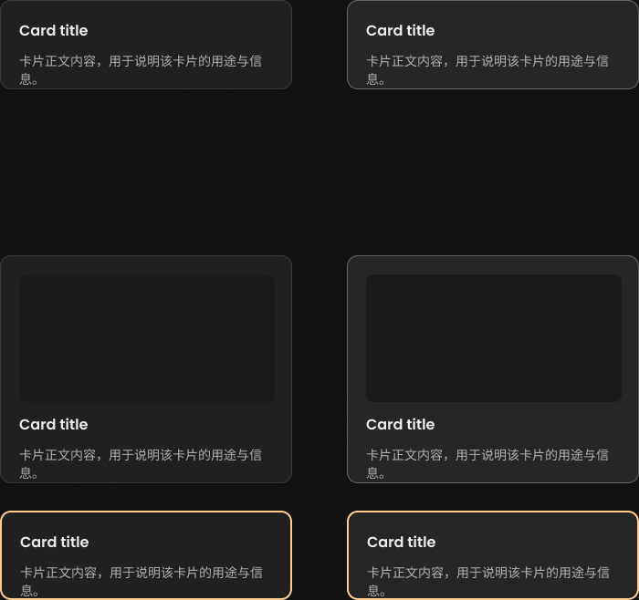

<!-- GEN:BEGIN 本段由 tools/gen-component-docs.py 依据 Figma 导出生成，勿手改；改 Figma 后重新生成 -->

## 概览

| 项 | 值 |
|---|---|
| Figma 组件集 | `Card`（node `56061:6466`） |
| 分类 | 展示类 |
| 变体数 | 6 |
| 默认变体 | `Type=plain, State=default` |
| 参考尺寸 | 320×98 px（默认变体） |
| 主题 | 主库（深色中性 + 品牌砂色） |
| 预览图 | [assets/previews/card.png](../../assets/previews/card.png) |
| 代码实现 | [`components/Card/Card.tsx`](../../components/Card/Card.tsx) |
| Figma 链接 | [在 Figma 打开](https://www.figma.com/design/ZO4WH3sbVCj7lZIFMpiwV9/VibeMe-App---Web-Design-%E5%A4%87%E4%BB%BD?node-id=56061-6466) |



## 变体与属性

| Figma 属性 | 类型 | 取值 | 默认 | 代码 prop |
|---|---|---|---|---|
| `Type` | VARIANT | `plain` / `media` / `selected` | `plain` | `type` |
| `State` | VARIANT | `default` / `hover` | `default` | `state` |

变体是属性轴的笛卡尔积：**6 = 3 × 2**（`Type` × `State`）。

## 各变体的事实

> 填充栈按 Figma 图层顺序排列（**靠右的是上层**，hover/pressed 的叠加层在最后）。
> `⚠无cssVar` 表示该组件引用了历史遗留变量，代码里不要照抄，按 `foundations.md` 的规则换成语义 token。

| 变体 | 尺寸 | 填充栈 | 描边 | 圆角 | 内边距 上/右/下/左 | 不透明度 |
|---|---|---|---|---|---|---|
| `Type=plain, State=default` | 320×98 | `Background/bg-card` #202020 `--vm-bg-card` | `Background/border-default` #FFFFFF 12% `--vm-border-default` | 12 | 20/20/20/20 | — |
| `Type=plain, State=hover` | 320×98 | `Background/Surface-hover` #262626 `--vm-surface-hover` | `White/White-4` #FFFFFF 30% `--vm-white-4` | 12 | 20/20/20/20 | — |
| `Type=media, State=default` | 320×250 | `Background/bg-card` #202020 `--vm-bg-card` | `Background/border-default` #FFFFFF 12% `--vm-border-default` | 12 | 20/20/20/20 | — |
| `Type=media, State=hover` | 320×250 | `Background/Surface-hover` #262626 `--vm-surface-hover` | `White/White-4` #FFFFFF 30% `--vm-white-4` | 12 | 20/20/20/20 | — |
| `Type=selected, State=default` | 320×98 | `Background/bg-card` #202020 `--vm-bg-card` | `Brand/Brand` #FFCC90 `--vm-brand` | 12 | 20/20/20/20 | — |
| `Type=selected, State=hover` | 320×98 | `Background/Surface-hover` #262626 `--vm-surface-hover` | `Brand/Brand` #FFCC90 `--vm-brand` | 12 | 20/20/20/20 | — |

## 结构（默认变体）

### Type=plain, State=default

```text
`COMPONENT` Type=plain, State=default 320×98 VERTICAL gap 12 pad 20/20/20/20 填充 `Background/bg-card` #202020 `--vm-bg-card` 描边 `Background/border-default` #FFFFFF 12% `--vm-border-default` 圆角 12
└─ `TEXT` Card title 76×24 填充 `Text/Text-Primary` #FFFFFF 92% `--vm-text-primary` 文字样式 `Heading/M`（16 SemiBold /24） 内容 'Card title'
└─ `TEXT` 卡片正文内容，用于说明该卡片的用途与信息。 280×40 填充 `Text/Text-Secondary` #FFFFFF 64% `--vm-text-secondary` 文字样式 `Heading/Body/S/Regular`（14 Regular /20） 内容 '卡片正文内容，用于说明该卡片的用途与信息。'
```

### Type=media, State=default

```text
`COMPONENT` Type=media, State=default 320×250 VERTICAL gap 12 pad 20/20/20/20 填充 `Background/bg-card` #202020 `--vm-bg-card` 描边 `Background/border-default` #FFFFFF 12% `--vm-border-default` 圆角 12
└─ `FRAME` Frame 280×140 填充 `Background/bg-panel` #1A1A1A `--vm-bg-panel` 圆角 8
└─ `TEXT` Card title 76×24 填充 `Text/Text-Primary` #FFFFFF 92% `--vm-text-primary` 文字样式 `Heading/M`（16 SemiBold /24） 内容 'Card title'
└─ `TEXT` 卡片正文内容，用于说明该卡片的用途与信息。 280×40 填充 `Text/Text-Secondary` #FFFFFF 64% `--vm-text-secondary` 文字样式 `Heading/Body/S/Regular`（14 Regular /20） 内容 '卡片正文内容，用于说明该卡片的用途与信息。'
```


## 设计 token

| Figma 变量 | CSS 变量 | 值 |
|---|---|---|
| `Background/Surface-hover` | `--vm-surface-hover` | `#262626` |
| `Background/bg-card` | `--vm-bg-card` | `#202020` |
| `Background/bg-panel` | `--vm-bg-panel` | `#1A1A1A` |
| `Background/border-default` | `--vm-border-default` | `rgba(255, 255, 255, 0.12)` |
| `Brand/Brand` | `--vm-brand` | `#FFCC90` |
| `Radious/radius-md` | `--vm-radius-md` | `8px` |
| `Semantic Radius/radius-card` | `--vm-radius-card` | `12px` |
| `Semantic Space/padding-card-md` | `--vm-padding-card-md` | `20px` |
| `Text/Text-Primary` | `--vm-text-primary` | `rgba(255, 255, 255, 0.92)` |
| `Text/Text-Secondary` | `--vm-text-secondary` | `rgba(255, 255, 255, 0.64)` |
| `White/White-4` | `--vm-white-4` | `rgba(255, 255, 255, 0.3)` |
| `border/width/thin` | `--vm-border-width-thin` | `1px` |
| `focus/ring-width` | `--vm-focus-ring-width` | `2px` |
| `space/space-3` | `--vm-space-3` | `12px` |

<!-- GEN:END -->

## 交互与状态

Card 的 `State` 只有 `default` / `hover` 两个值，`hover` 是**交互态**，所以代码里由 CSS `:hover` 触发，**不做成 prop**。事实（见「各变体的事实」）：hover 时底色从 `--vm-bg-card`（`Background/bg-card` #202020）换成 `--vm-surface-hover`（`Background/Surface-hover` #262626），同时描边从 `--vm-border-default`（12% 白）换成 `--vm-white-4`（`White/White-4`，30% 白）。**这是 Card 自己的第三种组合**：既不是 Button 一族的「底色 + `--vm-white-7` 叠加层」，也不是 Input 一族「底色不动、只换描边」，两条都不要往这里套。

`type="selected"` 是**应用态**，做成 prop：描边换成 `--vm-brand`（`Brand/Brand` #FFCC90）且加粗到 2px。这个 2px 在 Figma 里绑定的变量是 `focus/ring-width`（`--vm-focus-ring-width`），和 `border/width/thick` 数值相同但不是同一个变量——代码按 Figma 的绑定走，并且**不要**因此以为 selected 卡有焦点环。selected + hover 时描边保持 brand 不变，只有底色变成 `--vm-surface-hover`。

Card **没有** `disabled`、`focus`、`loading`、`dragover` 变体：不要加 `opacity: var(--vm-opacity-disabled)`，也不要在 `.vm-card` 上写 `:focus-visible` 焦点环。整卡可点击时，把焦点环与键盘行为交给内层的 `<a>` / `<button>`（或调用方自己给可聚焦元素加 `--vm-border-selected` + `--vm-focus-ring-width` 的 ring），`.vm-card` 自身永远只是容器。`type="media"` 的媒体框（`--vm-bg-panel` 底、`--vm-radius-md` 圆角、`overflow: hidden`）在 hover 时不变。

## 代码用法

```tsx
import { Card } from '../components/Card';
import { Button } from '../components/Button';

// 1) 最简：Type=plain, State=default（320 参考宽，内边距 --vm-padding-card-md 20）
<Card title="Card title">卡片正文内容，用于说明该卡片的用途与信息。</Card>

// 2) Type=media：顶部 280×140 媒体框（2:1），底色 --vm-bg-panel、圆角 --vm-radius-md
<Card type="media" title="Card title" media={}>
  卡片正文内容，用于说明该卡片的用途与信息。
</Card>

// 3) Type=selected：品牌色 2px 描边，用在「已选中」的卡片上
<Card type="selected" title="已选中的方案">
  描边换成 --vm-brand，hover 时描边不变、底色变 --vm-surface-hover。
</Card>

// 4) 需要标题语义 / 卡内有动作时，自己传节点 + 用真实的 button
<Card
  title={<h3>项目周报</h3>}
  className="report-card"
  aria-labelledby="report-title"
>
  <p>本周完成了 12 个组件的落地。</p>
  <Button size="sm" variant="secondary">查看详情</Button>
</Card>
```

```css
/* 调用方只需引一次 token 变量表；组件自带 import './Card.css' */
@import '../vibeme-design-system/components/tokens.css';
```

`title` 与 `children` 分别对应 Figma 里的 `Card title` 文本层（`Heading/M`：`--vm-type-heading-m-size` 16 / `--vm-type-heading-m-line-height` 24，色 `--vm-text-primary`）与正文文本层（`Heading/Body/S/Regular`：`--vm-type-heading-body-s-regular-size` 14 / `--vm-type-heading-body-s-regular-line-height` 20，色 `--vm-text-secondary`）；`media` 对应 `Type=media` 里的 `Frame`（280×140，`--vm-bg-panel` + `--vm-radius-md`）。

## 可访问性

根节点是 `<div>`：静态卡片不需要角色，**不要**给它硬塞 `role="article"` 或 `role="button"`——`role="button"` 会连带要求 Enter/Space 键盘行为，用 `<div>` 伪装按钮是最常见的可访问性事故。整卡可点击时推荐两种做法：外层直接换成 `<a>`/`<button>`（把 Card 当纯展示容器用），或者卡片内放一个真实链接并用 stretched-link 覆盖点击区；无论哪种，键盘焦点都要落在那个真实可聚焦元素上。

标题语义由调用方决定：`title` 接收任意 `ReactNode`，需要大纲层级时传 `<h3>`（或按页面层级选 h2/h4）；只传字符串时渲染成不参与大纲的普通文本，避免出现「到处都是一级标题」。`media` 里放真实内容时用 ``，纯装饰图给 `alt=""` 让读屏跳过；媒体框本身 `overflow: hidden` 裁切，装饰性图形不要放可交互元素。

`type="selected"` 只是视觉态：读屏不会因为描边变品牌色就知道卡片被选中。放进 `listbox` / `grid` 这类容器时，由调用方通过 `...rest` 传 `aria-selected`（并保证容器有正确的 `role` 与键盘方向键行为）；放进普通表单场景时，把「选中」语义写在卡内的真实控件上（如 `Radio` / `Checkbox`），不要只靠颜色。

## 不要这样做

1. **不要照抄 Button 的 hover 手法。** Card 的 `State=hover` 变体没有追加 `White/White-7` 叠加层，而是把 `fills` 换成 `Background/Surface-hover`、`strokes` 换成 `White/White-4`；写成「底色 + `--vm-white-7`」会得到偏亮的 #2C2C2C 而不是 Figma 的 #262626。
2. **不要给 `.vm-card` 写死 `height: 98px` / `250px`。** Figma 默认变体是 FIXED 320×98，但内部 `pad 20 + 标题 24 + gap 12 + 正文 40 + pad 20 = 116` 已经超出 98，`Type=media` 的 250 同样装不下 20+140+12+24+12+40+20；代码只固定参考宽 320，高度按内容自然生长（`--vm-padding-card-md` 与 `--vm-space-3` 撑开）。
3. **不要自己写 `border: 2px` 当选中态。** `Type=selected` 的线宽绑的是 `focus/ring-width` 变量（`--vm-focus-ring-width` = 2px），颜色是 `--vm-brand`；写死 2px 会在该变量调整时漂移，而且它**不是**焦点环，别顺手再加一层 ring。
4. **不要把圆角和媒体框圆角混用。** 卡片本体是 `Semantic Radius/radius-card`（`--vm-radius-card` 12px），媒体框是 `Radious/radius-md`（`--vm-radius-md` 8px）；两者数值不同，也不能用 `--vm-radius-button` 代替。
5. **不要硬编码阴影。** Figma 的效果样式是 `Elevation/1`，对应 `--vm-elevation-1`（`0 2px 4px rgba(0,0,0,.24)`）；手写 `box-shadow` 会绕过海拔体系（`--vm-elevation-2/3/4` 是留给 Modal、Popover 的）。
6. **不要给 Card 加 `disabled` / `loading` / `error`。** 组件集只有 `Type` × `State` 两个轴、6 个变体，没有这些状态；需要「不可用」的卡片就在业务层降低交互层级（去掉链接/按钮），不要凭空加 `--vm-opacity-disabled`。
7. **不要把文字颜色写在卡片根上期望继承。** 标题与正文颜色不同（`--vm-text-primary` vs `--vm-text-secondary`），必须分别挂 `.vm-card__title` / `.vm-card__body`（或各自的 `.vm-type-*` 工具类）。

## 相关组件

- **Avatar**：卡片头部最常见的组合——`<Avatar size="sm" />` 放在标题左边，横向排布时用 `--vm-space-2` 做间距，不要写死 margin。
- **Button / IconButton**：卡片底部的动作区；主次按钮并排用 `--vm-space-2`，整卡可点击时就不要再放「查看」按钮（两个点击目标会互相抢焦点）。
- **Divider**：卡片内部把标题区与正文区切成两段时用 `<Divider orientation="horizontal" />`，不要用 `border-top` 私造分隔线（那会绕开 `--vm-border-default`）。
- **ListItem / Table**：列表与表格里出现的「卡片化行」应优先用 ListItem / Table 的既有变体，只有在需要媒体图 + 多行正文时才用 `Card type="media"`，避免两套容器样式并存。
- **Radio / Checkbox**：可选中的卡片把真实控件放进卡内（`type="selected"` 只负责描边），保证键盘与读屏可用。
- **VibeMe AI / Response Card**：AI 回复卡片是独立组件集，属于 VibeMe AI 主题，**不要**用 Card 拼出来（token 前缀与配色体系都不同）。
