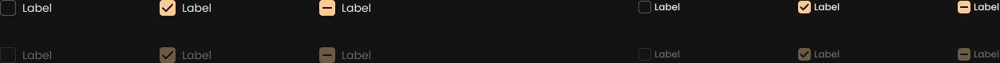

<!-- GEN:BEGIN 本段由 tools/gen-component-docs.py 依据 Figma 导出生成，勿手改；改 Figma 后重新生成 -->

## 概览

| 项 | 值 |
|---|---|
| Figma 组件集 | `Checkbox`（node `56059:6442`） |
| 分类 | 表单控件 |
| 变体数 | 12 |
| 默认变体 | `Size=md, Checked=false, State=default` |
| 参考尺寸 | 66×20 px（默认变体） |
| 主题 | 主库（深色中性 + 品牌砂色） |
| 预览图 | [assets/previews/checkbox.png](../../assets/previews/checkbox.png) |
| 代码实现 | [`components/Checkbox/Checkbox.tsx`](../../components/Checkbox/Checkbox.tsx) |
| Figma 链接 | [在 Figma 打开](https://www.figma.com/design/ZO4WH3sbVCj7lZIFMpiwV9/VibeMe-App---Web-Design-%E5%A4%87%E4%BB%BD?node-id=56059-6442) |



## 变体与属性

| Figma 属性 | 类型 | 取值 | 默认 | 代码 prop |
|---|---|---|---|---|
| `label` | TEXT（内容插槽） | — | — | `children` |
| `Size` | VARIANT | `sm` / `md` | `sm` | `size` |
| `Checked` | VARIANT | `false` / `true` / `indeterminate` | `false` | `checked` |
| `State` | VARIANT | `default` / `disabled` | `default` | `state` |

变体是属性轴的笛卡尔积：**12 = 2 × 3 × 2**（`Size` × `Checked` × `State`）。

## 各变体的事实

> 填充栈按 Figma 图层顺序排列（**靠右的是上层**，hover/pressed 的叠加层在最后）。
> `⚠无cssVar` 表示该组件引用了历史遗留变量，代码里不要照抄，按 `foundations.md` 的规则换成语义 token。

| 变体 | 尺寸 | 填充栈 | 描边 | 圆角 | 内边距 上/右/下/左 | 不透明度 |
|---|---|---|---|---|---|---|
| `Size=sm, Checked=false, State=default` | 53×18 | — | — | — | 0/0/0/0 | — |
| `Size=sm, Checked=false, State=disabled` | 53×18 | — | — | — | 0/0/0/0 | 0.38 |
| `Size=sm, Checked=true, State=default` | 53×18 | — | — | — | 0/0/0/0 | — |
| `Size=sm, Checked=true, State=disabled` | 53×18 | — | — | — | 0/0/0/0 | 0.38 |
| `Size=sm, Checked=indeterminate, State=default` | 53×18 | — | — | — | 0/0/0/0 | — |
| `Size=sm, Checked=indeterminate, State=disabled` | 53×18 | — | — | — | 0/0/0/0 | 0.38 |
| `Size=md, Checked=false, State=default` | 66×20 | — | — | — | 0/0/0/0 | — |
| `Size=md, Checked=false, State=disabled` | 66×20 | — | — | — | 0/0/0/0 | 0.38 |
| `Size=md, Checked=true, State=default` | 66×20 | — | — | — | 0/0/0/0 | — |
| `Size=md, Checked=true, State=disabled` | 66×20 | — | — | — | 0/0/0/0 | 0.38 |
| `Size=md, Checked=indeterminate, State=default` | 66×20 | — | — | — | 0/0/0/0 | — |
| `Size=md, Checked=indeterminate, State=disabled` | 66×20 | — | — | — | 0/0/0/0 | 0.38 |

## 结构（默认变体）

### Size=md, Checked=false, State=default

```text
`COMPONENT` Size=md, Checked=false, State=default 66×20 HORIZONTAL gap 8 pad 0/0/0/0
└─ `FRAME` Frame 20×20 HORIZONTAL gap 0 pad 0/0/0/0 描边 `White/White-4` #FFFFFF 30% `--vm-white-4` 圆角 4
└─ `TEXT` Label 38×20 填充 `Text/Text-Primary` #FFFFFF 92% `--vm-text-primary` 文字样式 `Heading/Body/S/Regular`（14 Regular /20） 内容 'Label'
```

### Size=sm, Checked=true, State=default

```text
`COMPONENT` Size=sm, Checked=true, State=default 53×18 HORIZONTAL gap 4 pad 0/0/0/0
└─ `FRAME` Frame 16×16 HORIZONTAL gap 0 pad 0/0/0/0 填充 `Brand/Brand` #FFCC90 `--vm-brand` 圆角 4
  └─ `VECTOR` Vector 9×6.5 描边 `Neutral/Neutral-950` #0E0E0E `--vm-neutral-950`
└─ `TEXT` Label 33×18 填充 `Text/Text-Primary` #FFFFFF 92% `--vm-text-primary` 文字样式 `Caption/Caption`（12 Medium /18） 内容 'Label'
```


## 设计 token

| Figma 变量 | CSS 变量 | 值 |
|---|---|---|
| `Brand/Brand` | `--vm-brand` | `#FFCC90` |
| `Neutral/Neutral-950` | `--vm-neutral-950` | `#0E0E0E` |
| `Radious/radius-xs` | `--vm-radius-xs` | `4px` |
| `Text/Text-Primary` | `--vm-text-primary` | `rgba(255, 255, 255, 0.92)` |
| `White/White-4` | `--vm-white-4` | `rgba(255, 255, 255, 0.3)` |
| `border/width/thick` | `--vm-border-width-thick` | `2px` |
| `border/width/thin` | `--vm-border-width-thin` | `1px` |
| `opacity/disabled` | `--vm-opacity-disabled` | `0.38` |
| `space/space-1` | `--vm-space-1` | `4px` |
| `space/space-2` | `--vm-space-2` | `8px` |

<!-- GEN:END -->


## 交互与状态

Figma 的 `State` 轴只有 `default` / `disabled` 两档，**没有** `hover` / `focus` / `pressed` 变体，
所以本实现不给 hover、pressed 追加任何高亮：鼠标悬停时方块仍是「透明底 + 1px `--vm-white-4` 描边」
或「`--vm-brand` 填充 + `--vm-neutral-950` 前景」，与默认态逐像素一致。这与有 `State=hover` 变体的
Input / Search / Select（那里 hover 把描边换成 `--vm-white-4`）不是一回事，不要互相套用。

| 状态 | 代码里由什么触发 | 视觉上变了什么 |
|---|---|---|
| 未选中 | `checked` 不给或为 `false` | 方块透明底、1px `--vm-white-4` 描边、圆角 `--vm-radius-xs`；勾与横线都是 `scale(0)` |
| 选中 | `checked` / `defaultChecked` 为 `true`（原生 `:checked`） | 方块填充 `--vm-brand`、描边转 `transparent`，前景色换成 `--vm-neutral-950`，勾 `scale(1)` |
| 半选 | `checked="indeterminate"` | 组件在 `useLayoutEffect` 里写 `input.indeterminate = true`；填充与前景同选中态，勾 `scale(0)`、横线 `scaleX(1)`（横线高 `--vm-border-width-thick`、圆角 `--vm-radius-full`） |
| 键盘聚焦 | 原生 `:focus-visible` | 方块外圈加 `0 0 0 var(--vm-focus-ring-width) var(--vm-border-selected)` 光环；不改描边宽度，方块尺寸不跳动 |
| 禁用 | 原生 `disabled` | 根节点 `opacity: var(--vm-opacity-disabled)`（0.38）+ `cursor: not-allowed`，描边、填充、文字**都不换色** |

尺寸与排版两档：`size="md"` 方块 20×20、方块到文字 `--vm-space-2`（8px）、文字 `Heading/Body/S/Regular`
（14 Regular / 20）；`size="sm"` 方块 16×16、间距 `--vm-space-1`（4px）、文字 `Caption/Caption`（12 Medium / 18）。
两档圆角相同，都是 `Radious/radius-xs` → `--vm-radius-xs`（4px）。

## 代码用法

```tsx
import { useState } from 'react';
import {
  Checkbox,
  type CheckboxProps,
} from '../vibeme-design-system/components/Checkbox';
import '../vibeme-design-system/components/Checkbox/Checkbox.css';

export function SubscribeForm() {
  const [all, setAll] = useState<boolean | 'indeterminate'>('indeterminate');
  const [news, setNews] = useState(true);

  return (
    <>
      <Checkbox
        size="md"
        checked={all}
        onChange={(e) => setAll(e.target.checked)}
      >
        全选
      </Checkbox>

      <Checkbox
        size="sm"
        checked={news}
        name="subscribe"
        value="news"
        onChange={(e) => {
          setNews(e.target.checked);
          setAll(false);
        }}
      >
        订阅产品更新
      </Checkbox>

      <Checkbox size="md" disabled defaultChecked>
        已停用的选项
      </Checkbox>
    </>
  );
}
```

props 一览：`size?: 'sm' | 'md'`（默认 `md`，Figma 默认变体）、`checked?: boolean | 'indeterminate'`、
`children`（标签文字，对应 Figma 的 TEXT 属性 `label`），其余 `input[type=checkbox]` 的原生属性
（`name` / `value` / `disabled` / `required` / `onChange` / `defaultChecked`）全部透传，
`className` 会与内部类名合并。样式可以单个组件引 `Checkbox.css`，也可以统一引
`components/index.ts`（它已经包含 `tokens.css`）。

## 可访问性

- 语义元素是真实的 `<input type="checkbox">`，外层用 `<label>` 包裹：点标签文字即可切换，
  不需要额外传 `id` + `htmlFor`（传了也不会出错，但属于重复劳动）。
- 键盘：`Tab` 聚焦、`Space` 切换；原生 input 用 `position: absolute` + `opacity: 0` 视觉隐藏，
  **没有**用 `display: none`，所以焦点、表单提交与读屏都不受影响。
- 半选不用手写 `aria-checked="mixed"`，而是设 DOM 属性 `indeterminate`：浏览器与读屏会自动报「混合」，
  手写 `aria-checked` 反而容易和原生状态打架。
- 焦点可见性：只有 `:focus-visible`（键盘）才画 `--vm-focus-ring-width`（2px）`--vm-border-selected`
  光环，鼠标点击不出环；不要用 `outline: none` 直接干掉焦点。
- 对比度：标签 `--vm-text-primary`（92% 白）在 `--vm-bg-app` 与 `--vm-bg-card` 上都达标；
  勾与横线是**深色压亮色**——`--vm-neutral-950`（#0E0E0E）压 `--vm-brand`（#FFCC90），不要反过来用白勾。
- 组语义：同名复选框用同一个 `name` 提交，彼此**不互斥**；真正的互斥选择请用 [Radio](radio.md)。

## 不要这样做

1. **不要给 Checkbox 加 hover / pressed 高亮。** Figma 的 `State` 轴只有 `default` / `disabled`，
   加一层 `--vm-white-7` 叠加或把描边换成 `--vm-border-selected`，都等于发明了一套 Figma 里不存在的状态；
   需要区分可点性时，用光标与 focus 光环表达就够了。
2. **不要把 `State=disabled` 做成 `state` prop，也不要换灰色。** 用原生 `disabled`，视觉只加
   `opacity: var(--vm-opacity-disabled)`（38%）；换灰会让同一个禁用态出现两套颜色。
3. **不要用 `div` + `role="checkbox"` + `onClick` 自己画一个方块**，也不要在根 `<label>` 上再挂
   `role="checkbox"`：前者丢掉键盘与表单提交，后者和内部真实 input 重复声明语义，读屏会念两遍。
4. **不要照搬「白勾」。** 选中态在 Figma 里是 `Brand/Brand`（#FFCC90）填充 + `Neutral/Neutral-950`
   （#0E0E0E）勾；把勾改成 `--vm-text-primary` 或 `--vm-white-0` 会明显掉对比度，也不符合导出事实。
5. **半选横线的宽度与圆角在 Figma 里没有单独导出**（同一勾槽位，导出只给了勾的 9×6.5）。本实现取
   勾的 9/16 ≈ 56% 与 `--vm-radius-full`；改比例时请说明这是本实现的取值，不要声称来自 Figma。
6. 不要把方块描边换成 `--vm-border-default`（12% 白）：Figma 的 Checkbox 描边绑的是
   `White/White-4`（30% 白，`--vm-white-4`），比 Input 一族更亮，换错会明显偏暗。

## 相关组件

- [Radio](radio.md)：形状结构几乎同构（`Size` × 布尔态 × `State`(default/disabled)，同一套
  `--vm-white-4` 描边 / `--vm-brand` 选中 / 38% 禁用规则），区别是 Radio 只有圆点且用 `name` 互斥，
  Checkbox 是方形 + 勾/横线且可多选。并排放在同一张表单里时，两者的 `min-height` 都对齐到 32px。
- [Switch](switch.md)：语义是「立即生效」的开关（整条轨道换色），Checkbox 是「提交时生效」的勾选，
  同一份需求里不要用 Switch 代替 Checkbox 做多项选择。
- `Table` / `TableRow` / `TableCell`：表格首列的批量选择用 Checkbox，表头用
  `checked="indeterminate"` 表达「部分选中」，行内用 `checked={true}`。Figma 的 Table 变体里已经内嵌了
  这些控件，代码里直接用 `Checkbox`，不要另写一套复选框样式。
- [Input](input.md) / [Textarea](textarea.md) / [Select](select.md)：同属表单控件族，圆角与尺寸档位
  （sm 32 / md 40 / lg 48）不同——表单里垂直排列时按各自规范取值，不要把 Checkbox 的 4px 圆角套到输入框上。
