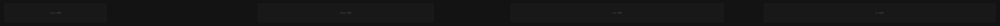

<!-- GEN:BEGIN 本段由 tools/gen-component-docs.py 依据 Figma 导出生成，勿手改；改 Figma 后重新生成 -->

## 概览

| 项 | 值 |
|---|---|
| Figma 组件集 | `Container`（node `56066:6255`） |
| 分类 | 布局类 |
| 变体数 | 4 |
| 默认变体 | `Type=narrow` |
| 参考尺寸 | 720×168 px（默认变体） |
| 主题 | 主库（深色中性 + 品牌砂色） |
| 预览图 | [assets/previews/container.png](../../assets/previews/container.png) |
| 代码实现 | [`components/Container/Container.tsx`](../../components/Container/Container.tsx) |
| Figma 链接 | [在 Figma 打开](https://www.figma.com/design/ZO4WH3sbVCj7lZIFMpiwV9/VibeMe-App---Web-Design-%E5%A4%87%E4%BB%BD?node-id=56066-6255) |



## 变体与属性

| Figma 属性 | 类型 | 取值 | 默认 | 代码 prop |
|---|---|---|---|---|
| `Type` | VARIANT | `narrow` / `default` / `wide` / `full` | `narrow` | `type` |

变体是属性轴的笛卡尔积：**4 = 4**（`Type`）。

## 各变体的事实

> 填充栈按 Figma 图层顺序排列（**靠右的是上层**，hover/pressed 的叠加层在最后）。
> `⚠无cssVar` 表示该组件引用了历史遗留变量，代码里不要照抄，按 `foundations.md` 的规则换成语义 token。

| 变体 | 尺寸 | 填充栈 | 描边 | 圆角 | 内边距 上/右/下/左 | 不透明度 |
|---|---|---|---|---|---|---|
| `Type=narrow` | 720×168 | — | — | — | 24/32/24/32 | — |
| `Type=default` | 1200×168 | — | — | — | 24/32/24/32 | — |
| `Type=wide` | 1440×168 | — | — | — | 24/32/24/32 | — |
| `Type=full` | 1560×168 | — | — | — | 24/32/24/32 | — |

## 结构（默认变体）

### Type=narrow

```text
`COMPONENT` Type=narrow 720×168 VERTICAL gap 0 pad 24/32/24/32
└─ `FRAME` Frame 656×120 HORIZONTAL gap 0 pad 0/0/0/0 填充 `White/White-9` #FFFFFF 2% `--vm-white-9` 描边 `Background/border-default` #FFFFFF 12% `--vm-border-default` 圆角 8
  └─ `TEXT` narrow · 内容区 74×14 填充 `Text/Text-Tertiary` #FFFFFF 30% `--vm-text-tertiary` 文字样式 `Caption/Label`（10 Medium /14） 内容 'narrow · 内容区'
```


## 设计 token

| Figma 变量 | CSS 变量 | 值 |
|---|---|---|
| `Background/border-default` | `--vm-border-default` | `rgba(255, 255, 255, 0.12)` |
| `Radious/radius-md` | `--vm-radius-md` | `8px` |
| `Text/Text-Tertiary` | `--vm-text-tertiary` | `rgba(255, 255, 255, 0.3)` |
| `White/White-9` | `--vm-white-9` | `rgba(255, 255, 255, 0.02)` |
| `border/width/thin` | `--vm-border-width-thin` | `1px` |
| `space/space-6` | `--vm-space-6` | `24px` |
| `space/space-8` | `--vm-space-8` | `32px` |

<!-- GEN:END -->

## 交互与状态

`Container` 的 4 个变体只有 `Type`（narrow / default / wide / full）一条轴，**没有 `State` 轴**：
没有 hover / pressed / focus / disabled 变体，组件本身也**没有任何填充、描边与圆角**——
`container.variants.json` 里 4 条记录的 `fills` / `strokes` / `radius` 全是空，只有 `w` 与 `pad` 不同。
所以这个组件在代码里不写任何伪类样式，它的全部职责就是「限宽 ＋ 居中 ＋ 给内容留边」。

| Type | Figma 宽（FIXED） | 代码 max-width | 说明 |
|---|---|---|---|
| `narrow` | 720 | 720px | **Figma 的 defaultVariant 就是它**（注意不是名叫 `default` 的那档） |
| `default` | 1200 | 1200px | 常规页面主内容宽 |
| `wide` | 1440 | 1440px | 宽屏表格 / 多列栅格 |
| `full` | 1560 | 1560px | 设计稿里的最大画布宽，**不等于 100%** |

四档的纵向与横向内边距**完全一致**，来自同一个绑定：上下 `24px` 绑 `space/space-6`（`--vm-space-6`），
左右 `32px` 绑 `space/space-8`（`--vm-space-8`）；根部 Auto Layout 的 gap 是 `0`，
也就是说相邻子元素的间距完全由内容自己决定，Container 不额外插空隙。
窗口变窄时只有「可用宽度」变，padding 与 max-width 都不缩放——这套变量里没有断点定义，别自己加媒体查询改 padding。

## 代码用法

```tsx
import { Container } from '../components/Container';
import { Card } from '../components/Card';

export function Page() {
  return (
    <>
      {/* 默认 Type=narrow（720）：窄内容，阅读型页面 */}
      <Container>
        <Card title="项目概览">…</Card>
      </Container>

      {/* 常规宽 1200 */}
      <Container type="default">…</Container>

      {/* 宽屏 1440 */}
      <Container type="wide">…</Container>

      {/* 最大 1560；仍保留 max-width，小视口会自然收缩 */}
      <Container type="full">…</Container>

      {/* 需要别的标签语义时在外层包真实元素，Container 自己永远是 div */}
      <main>
        <Container type="default">
          <h1>标题</h1>
        </Container>
      </main>
    </>
  );
}
```

CSS 引入方式：`import '../components/Container/Container.css'`（或整包 `import '../components/index'`，桶文件已 `import './tokens.css'`）。
实现是 `box-sizing: border-box; width: 100%; margin-inline: auto; padding-block: var(--vm-space-6); padding-inline: var(--vm-space-8)`，
再按 `type` 给 `max-width`。注意与 Figma 的唯一差别：Figma 是 FIXED 宽（画布多宽就是多宽），
代码用 `max-width` 让它在窄视口下能收缩到 100%（`full` 的 1560 同理），这是为了可用性做的必要偏差。

## 可访问性

- 语义：渲染成一个中性的 `<div>`，**不带任何 role、不改 landmark**。页面骨架该用 `<main>` / `<nav>` / `<aside>` 时请真的用它们，
  把 `Container` 套在里面或外面都行；不要用 `role="main"` 给 `Container` 贴标签。
- 键盘与焦点：组件内没有可聚焦元素，不拦截任何键盘事件，`Tab` 顺序完全由子内容决定；也不会产生 tabindex。
- 缩放与重排：只用 `max-width` ＋ 自适应，不锁死高度（Figma 的高度是 HUG，示例的 168px 是演示内容撑出来的）。
  200% 缩放或窄视口下内容按自身规则换行，`--vm-space-8` 的左右留白保持不变，不会出现横向滚动条。
- 阅读顺序：DOM 顺序就是阅读顺序，Container 不参与排序；不要靠 `order` / `float` 视觉重排来「对齐」。
- 底色：Container 自身透明，对比度由它里面的组件负责（页面底 `--vm-bg-app`、卡片 `--vm-bg-card`）。

## 不要这样做

1. **不要把 Figma 里的演示框当成 Container 的视觉**。`container.tree.json` 里那个 656×120 的 `Frame`（`White/White-9` 2% 白底 ＋
   `Background/border-default` 12% 白描边 ＋ `Radious/radius-md` 8px 圆角 ＋ `Caption/Label` 的「narrow · 内容区」文字）
   只是标注「内容放这里」的样本层；Container 本身 fills / strokes / radius 全为空，照抄这个框会让每个页面都多一层灰底。
2. **不要以为 `type` 默认是 `default`（1200）**。Figma 的 `defaultVariant` 是 `Type=narrow`（720），
   代码默认值也必须是 `narrow`；把默认写成 1200 会让所有不传 `type` 的阅读型页面意外变宽。
3. **不要把 `full` 理解成 `width: 100%`**。1560 是 FIXED 上限，`width: 100vw` 会在超宽屏上把正文拉到难以阅读的行长，
   也会让 `--vm-space-8` 的留白失效；正确做法是 `max-width: 1560px; width: 100%`。
4. **不要改内边距**。上下 `--vm-space-6`（`space/space-6` 24px）、左右 `--vm-space-8`（`space/space-8` 32px）是绑定变量；
   尤其不要换成 `--vm-padding-card-md`（20px，那是 Card 的）或 `--vm-padding-input-x`（16px）。
5. **不要用 Container 代替 Card / Panel**。需要底色、描边、圆角、阴影时用 `Card`；Container 只负责宽度与留白，
   两者是嵌套关系（Container 里排 Card 栅格），不是替代关系。
6. **不要加媒体查询改宽度或 padding**。这套 token 里没有断点变量，Figma 也没有响应式变体；
   需要多栏就用内容自身的自适应栅格，不要给 Container 发明 `sm` / `md` / `lg` 档位。
7. **不要用 `margin-top` / `margin-bottom` 拉区块间距**。Container 的职责是水平限宽，垂直间距交给 `Stack` / `Grid` 与 `--vm-space-*`；
   给 Container 加外边距会在不同页面里叠出不一致的节奏。

## 相关组件

- **Card**：最常见的子内容。`Container` 给宽度与 32px 留白，`Card` 给底色描边圆角；标准页面就是 `Container` 里排 `Card` 栅格。
- **Descriptions**：Figma 里 Descriptions 是 FIXED 720，正好等于 `Container type="narrow"`；
  页面上用 `narrow` 包住它就不用手写任何宽度。
- **Statistic**：一排指标卡放进 `Container type="default"` / `wide`，指标之间用 `--vm-space-6` 排开。
- **Grid / Stack**：Container 只管水平限宽，Container 内部的栏数与垂直节奏交给 `Grid` / `Stack`；
  两层叠加时先 Container 再 Grid，不要反过来。
- **ListItem / Table**（宽内容）：用 `Container type="wide"` / `full`，避免在 720 里横向挤压表格。
- **Modal / Drawer**：它们有自己的宽度与遮罩，**不要**再用 `Container` 包裹，否则会被额外加一层 32px 留白。
- **Divider**：作为 Container 内的整宽分隔线使用时，注意它会被左右各 32px 内边距「切进来」；
  需要通栏分割线请放到 `Container` 外面。
