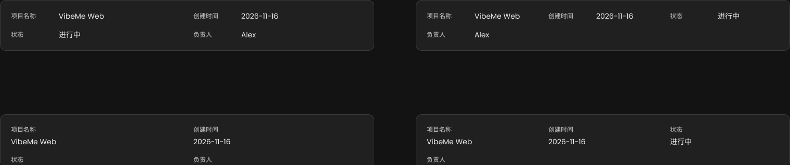

<!-- GEN:BEGIN 本段由 tools/gen-component-docs.py 依据 Figma 导出生成，勿手改；改 Figma 后重新生成 -->

## 概览

| 项 | 值 |
|---|---|
| Figma 组件集 | `Descriptions`（node `56065:7035`） |
| 分类 | 数据展示类 |
| 变体数 | 4 |
| 默认变体 | `Layout=horizontal, Columns=2` |
| 参考尺寸 | 720×98 px（默认变体） |
| 主题 | 主库（深色中性 + 品牌砂色） |
| 预览图 | [assets/previews/descriptions.png](../../assets/previews/descriptions.png) |
| 代码实现 | [`components/Descriptions/Descriptions.tsx`](../../components/Descriptions/Descriptions.tsx) |
| Figma 链接 | [在 Figma 打开](https://www.figma.com/design/ZO4WH3sbVCj7lZIFMpiwV9/VibeMe-App---Web-Design-%E5%A4%87%E4%BB%BD?node-id=56065-7035) |



## 变体与属性

| Figma 属性 | 类型 | 取值 | 默认 | 代码 prop |
|---|---|---|---|---|
| `Layout` | VARIANT | `horizontal` / `vertical` | `horizontal` | `layout` |
| `Columns` | VARIANT | `2` / `3` | `2` | `columns` |

变体是属性轴的笛卡尔积：**4 = 2 × 2**（`Layout` × `Columns`）。

## 各变体的事实

> 填充栈按 Figma 图层顺序排列（**靠右的是上层**，hover/pressed 的叠加层在最后）。
> `⚠无cssVar` 表示该组件引用了历史遗留变量，代码里不要照抄，按 `foundations.md` 的规则换成语义 token。

| 变体 | 尺寸 | 填充栈 | 描边 | 圆角 | 内边距 上/右/下/左 | 不透明度 |
|---|---|---|---|---|---|---|
| `Layout=horizontal, Columns=2` | 720×98 | `Background/bg-card` #202020 `--vm-bg-card` | `Background/border-default` #FFFFFF 12% `--vm-border-default` | 12 | 20/20/20/20 | — |
| `Layout=horizontal, Columns=3` | 720×98 | `Background/bg-card` #202020 `--vm-bg-card` | `Background/border-default` #FFFFFF 12% `--vm-border-default` | 12 | 20/20/20/20 | — |
| `Layout=vertical, Columns=2` | 720×142 | `Background/bg-card` #202020 `--vm-bg-card` | `Background/border-default` #FFFFFF 12% `--vm-border-default` | 12 | 20/20/20/20 | — |
| `Layout=vertical, Columns=3` | 720×142 | `Background/bg-card` #202020 `--vm-bg-card` | `Background/border-default` #FFFFFF 12% `--vm-border-default` | 12 | 20/20/20/20 | — |

## 结构（默认变体）

### Layout=horizontal, Columns=2

```text
`COMPONENT` Layout=horizontal, Columns=2 720×98 VERTICAL gap 16 pad 20/20/20/20 填充 `Background/bg-card` #202020 `--vm-bg-card` 描边 `Background/border-default` #FFFFFF 12% `--vm-border-default` 圆角 12
└─ `FRAME` Frame 678×20 HORIZONTAL gap 24 pad 0/0/0/0
  └─ `FRAME` Frame 327×20 HORIZONTAL gap 12 pad 0/0/0/0
    └─ `TEXT` 项目名称 80×18 填充 `Text/Text-Secondary` #FFFFFF 64% `--vm-text-secondary` 文字样式 `Caption/Caption`（12 Medium /18） 内容 '项目名称'
    └─ `TEXT` VibeMe Web 235×20 填充 `Text/Text-Primary` #FFFFFF 92% `--vm-text-primary` 文字样式 `Heading/Body/S/Regular`（14 Regular /20） 内容 'VibeMe Web'
  └─ `FRAME` Frame 327×20 HORIZONTAL gap 12 pad 0/0/0/0
    └─ `TEXT` 创建时间 80×18 填充 `Text/Text-Secondary` #FFFFFF 64% `--vm-text-secondary` 文字样式 `Caption/Caption`（12 Medium /18） 内容 '创建时间'
    └─ `TEXT` 2026-11-16 235×20 填充 `Text/Text-Primary` #FFFFFF 92% `--vm-text-primary` 文字样式 `Heading/Body/S/Regular`（14 Regular /20） 内容 '2026-11-16'
└─ `FRAME` Frame 678×20 HORIZONTAL gap 24 pad 0/0/0/0
  └─ `FRAME` Frame 327×20 HORIZONTAL gap 12 pad 0/0/0/0
    └─ `TEXT` 状态 80×18 填充 `Text/Text-Secondary` #FFFFFF 64% `--vm-text-secondary` 文字样式 `Caption/Caption`（12 Medium /18） 内容 '状态'
    └─ `TEXT` 进行中 235×20 填充 `Text/Text-Primary` #FFFFFF 92% `--vm-text-primary` 文字样式 `Heading/Body/S/Regular`（14 Regular /20） 内容 '进行中'
  └─ `FRAME` Frame 327×20 HORIZONTAL gap 12 pad 0/0/0/0
    └─ `TEXT` 负责人 80×18 填充 `Text/Text-Secondary` #FFFFFF 64% `--vm-text-secondary` 文字样式 `Caption/Caption`（12 Medium /18） 内容 '负责人'
    └─ `TEXT` Alex 235×20 填充 `Text/Text-Primary` #FFFFFF 92% `--vm-text-primary` 文字样式 `Heading/Body/S/Regular`（14 Regular /20） 内容 'Alex'
```

### Layout=vertical, Columns=2

```text
`COMPONENT` Layout=vertical, Columns=2 720×142 VERTICAL gap 16 pad 20/20/20/20 填充 `Background/bg-card` #202020 `--vm-bg-card` 描边 `Background/border-default` #FFFFFF 12% `--vm-border-default` 圆角 12
└─ `FRAME` Frame 678×42 HORIZONTAL gap 24 pad 0/0/0/0
  └─ `FRAME` Frame 327×42 VERTICAL gap 4 pad 0/0/0/0
    └─ `TEXT` 项目名称 48×18 填充 `Text/Text-Secondary` #FFFFFF 64% `--vm-text-secondary` 文字样式 `Caption/Caption`（12 Medium /18） 内容 '项目名称'
    └─ `TEXT` VibeMe Web 88×20 填充 `Text/Text-Primary` #FFFFFF 92% `--vm-text-primary` 文字样式 `Heading/Body/S/Regular`（14 Regular /20） 内容 'VibeMe Web'
  └─ `FRAME` Frame 327×42 VERTICAL gap 4 pad 0/0/0/0
    └─ `TEXT` 创建时间 48×18 填充 `Text/Text-Secondary` #FFFFFF 64% `--vm-text-secondary` 文字样式 `Caption/Caption`（12 Medium /18） 内容 '创建时间'
    └─ `TEXT` 2026-11-16 72×20 填充 `Text/Text-Primary` #FFFFFF 92% `--vm-text-primary` 文字样式 `Heading/Body/S/Regular`（14 Regular /20） 内容 '2026-11-16'
└─ `FRAME` Frame 678×42 HORIZONTAL gap 24 pad 0/0/0/0
  └─ `FRAME` Frame 327×42 VERTICAL gap 4 pad 0/0/0/0
    └─ `TEXT` 状态 24×18 填充 `Text/Text-Secondary` #FFFFFF 64% `--vm-text-secondary` 文字样式 `Caption/Caption`（12 Medium /18） 内容 '状态'
    └─ `TEXT` 进行中 42×20 填充 `Text/Text-Primary` #FFFFFF 92% `--vm-text-primary` 文字样式 `Heading/Body/S/Regular`（14 Regular /20） 内容 '进行中'
  └─ `FRAME` Frame 327×42 VERTICAL gap 4 pad 0/0/0/0
    └─ `TEXT` 负责人 36×18 填充 `Text/Text-Secondary` #FFFFFF 64% `--vm-text-secondary` 文字样式 `Caption/Caption`（12 Medium /18） 内容 '负责人'
    └─ `TEXT` Alex 29×20 填充 `Text/Text-Primary` #FFFFFF 92% `--vm-text-primary` 文字样式 `Heading/Body/S/Regular`（14 Regular /20） 内容 'Alex'
```


## 设计 token

| Figma 变量 | CSS 变量 | 值 |
|---|---|---|
| `Background/bg-card` | `--vm-bg-card` | `#202020` |
| `Background/border-default` | `--vm-border-default` | `rgba(255, 255, 255, 0.12)` |
| `Semantic Radius/radius-card` | `--vm-radius-card` | `12px` |
| `Semantic Space/padding-card-md` | `--vm-padding-card-md` | `20px` |
| `Text/Text-Primary` | `--vm-text-primary` | `rgba(255, 255, 255, 0.92)` |
| `Text/Text-Secondary` | `--vm-text-secondary` | `rgba(255, 255, 255, 0.64)` |
| `border/width/thin` | `--vm-border-width-thin` | `1px` |
| `space/space-1` | `--vm-space-1` | `4px` |
| `space/space-3` | `--vm-space-3` | `12px` |
| `space/space-4` | `--vm-space-4` | `16px` |
| `space/space-6` | `--vm-space-6` | `24px` |

<!-- GEN:END -->

## 交互与状态

`Descriptions` 的 4 个变体只有 `Layout`（horizontal / vertical）与 `Columns`（2 / 3）两条轴，**没有任何 `State` 轴**，
所以它在代码里不注册 `:hover` / `:active` / `:focus-visible` 的任何样式，也不是焦点目标——它是纯展示块，没有可交互态可讲。

真正会变的只有两件事：

| 变化来源 | 触发方式 | 视觉上变了什么 |
|---|---|---|
| 布局方向 | prop `layout` | `horizontal` 时每个「标签-值」单元是横排（label 左、value 右，间距 `--vm-space-3` 12px，`space/space-3`），纵向居中；`vertical` 时单元改竖排（label 上、value 下，间距 `--vm-space-1` 4px，`space/space-1`）。参考高度 98 → 142（720 宽 2 列） |
| 列数 | prop `columns` | 只改 CSS grid 的列数与单元跨度：列间距固定 `--vm-space-6`（`space/space-6` 24px）、行间距固定 `--vm-space-4`（`space/space-4` 16px）。Figma 只给了 2/3 两个样本 |

卡片壳本身（`--vm-bg-card` 底、1px `--vm-border-default` 描边、`--vm-radius-card` 圆角、`--vm-padding-card-md` 四边 20px）
在 4 个变体里**完全一致**：`descriptions.variants.json` 里四条记录的 `fills` / `strokes` / `radius` / `pad` 逐字段相同，
所以不要为「某个列数」单独换底色或描边。如果业务上要把某一行的值做成链接或按钮，焦点环需要调用方自己给
（`:focus-visible` + `--vm-border-selected` + `--vm-focus-ring-width`），组件不提供。

## 代码用法

```tsx
import { Descriptions } from '../components/Descriptions';

export function ProjectSummary() {
  return (
    <>
      {/* 默认：Layout=horizontal, Columns=2 */}
      <Descriptions
        items={[
          { label: '项目名称', value: 'VibeMe Web' },
          { label: '创建时间', value: '2026-11-16' },
          { label: '状态', value: '进行中' },
          { label: '负责人', value: 'Alex' },
        ]}
      />

      {/* 标签在上：Layout=vertical，3 列 */}
      <Descriptions
        layout="vertical"
        columns={3}
        items={[
          { label: '项目名称', value: 'VibeMe Web' },
          { label: '创建时间', value: '2026-11-16' },
          { label: '状态', value: '进行中' },
        ]}
      />

      {/* 值里嵌别的组件（示例：状态点 / Tag）时用 ReactNode，不要拼字符串 */}
      <Descriptions
        items={[{ label: '负责人', value: <strong>Alex</strong>, key: 'owner' }]}
        columns={2}
      />
    </>
  );
}
```

CSS 引入方式：`import '../components/Descriptions/Descriptions.css'`（或整包 `import '../components/index'`，
桶文件已 `import './tokens.css'`，token 与 `.vm-type-*` 工具类会一起加载）。
渲染结果是 `<dl>` ＋ 每个单元一组 `<dt>`/`<dd>`；`children` 存在时会**整段替换** `items` 渲染的内容（想完全自控结构时才用）。
组件**不锁宽**：Figma 的 720px 是 FIXED 参考宽，页面上通常放进 `Container type="narrow"`（同为 720）或栅格里自适应。

## 可访问性

- 语义：根节点是真实的 `<dl>`（描述列表），每格是 `<dt>`（术语/标签）＋ `<dd>`（描述/值）。**不要**用 `role="table"` 或 `<table>` 冒充数据表格——
  这是键值对，读屏会按「定义列表」浏览；真正的多行多列数据请用表格组件。
- 顺序：`items` 的顺序就是 DOM 顺序，也就是读屏顺序；grid 只做视觉排序，不会重排阅读顺序，所以「项目名称、创建时间…」要按期望的朗读顺序传。
- 键盘：组件内没有任何可聚焦元素，`Tab` 会直接跳过整块（这也意味着它不该承担交互职责）。值里若嵌了链接/按钮，键盘行为完全由那个原生元素负责。
- 对比度：label 用 `--vm-text-secondary`（`Text/Text-Secondary` 64% 白，在 `--vm-bg-card` #202020 上约 8:1），值用 `--vm-text-primary`（92% 白）；
  两者都远超 4.5:1，但不要把 label 改成 `--vm-white-4`（30% 白）——那是描边用的档位，做文字会不达标。
- 语义文字：label 是「项目名称」这类短语，值可能是日期或状态；若值本身是状态，请用 `<Tag>` 或补一段文字，不要只靠颜色区分（本组件也没有颜色可区分）。

## 不要这样做

1. **不要给它加 hover/pressed 叠加层**。`--vm-white-7` / `--vm-white-6` 是 Button、Card 一族的「填充叠加」手法；
   Descriptions 在 Figma 里连 `State` 轴都没有，4 个变体的填充栈只有 `Background/bg-card` 一条，加叠加层就是自造状态。
2. **不要把 `Columns` 写死成 2/3 的枚举**。Figma 的 2/3 只是样本，代码收真实数值并按 `Number.isFinite(columns) ? Math.max(1, Math.floor(columns)) : 1` 钳制；
   反向的错误是照抄 Figma 的窄卡片宽度——`width: 720px` 是 FIXED 参考宽，页面里应由容器决定。
3. **不要手写字号/字重**。label 必须是 `.vm-type-caption-caption`（`Caption/Caption` 12 Medium / 行高 18），
   值必须是 `.vm-type-heading-body-s-regular`（`Heading/Body/S/Regular` 14 Regular / 行高 20）；写 `font-size: 12px` 会绕过 token 校验。
4. **不要给 `<dd>` 留浏览器默认的 `margin-inline-start: 40px`**。实现里已把它重置为 0，标签与值的对齐靠 flex/grid 的 gap，
   否则会出现 Figma 里不存在的 40px 缩进，且在 `layout="vertical"` 时彻底错位。
5. **不要把行间分隔做成 1px 分割线**。Figma 的单元间距是 `--vm-space-4`（16px）空白，不是 `Divider`；
   需要分割线是页面层的决定，不要改组件默认视觉。
6. **不要在只有一列数据时硬塞 `columns={2}`**。空出来的格子会让读屏读到空 `<dd>`；数据条数少于列数时按实际条数传，或让单元 `span` 跨列。
7. **不要用 `Descriptions` 承载操作**（按钮组、开关）。它不是表单控件容器，交互元素请放在 `<ListItem>` 或 `<Card>` 的尾部。

## 相关组件

- **Container**：Figma 里 Descriptions 是 FIXED 720 宽，正好等于 `Container type="narrow"` 的内容宽；页面里优先由 `Container` 给宽度，别在 Descriptions 上写死 720。
- **Card**：同一个卡片壳（`--vm-bg-card` + `--vm-border-default` + `--vm-radius-card` + `--vm-padding-card-md`）。若一块区域既要键值对又要标题与操作，用 `Card` 包一层，而不是给 Descriptions 加 `title`。
- **Statistic**：统计摘要通常放在 Descriptions 上方，`Statistic` 管大数字，Descriptions 管明细，两者共用 `type="default"` 这一档的次要文字色。
- **List / ListItem**：逐条平铺的列表用它们；Descriptions 强调「标签→值」的成对关系，别用 ListItem 拼两组文字冒充。
- **Tag / Badge**：值位置的常见内嵌物（状态、数量）。内嵌时它们自己带颜色语义，Descriptions 只负责对齐与字号。
- **Divider**：跨区块分隔用 Divider；Descriptions 内部单元之间**不用**分割线，靠 `--vm-space-4` 间距。
