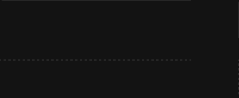

<!-- GEN:BEGIN 本段由 tools/gen-component-docs.py 依据 Figma 导出生成，勿手改；改 Figma 后重新生成 -->

## 概览

| 项 | 值 |
|---|---|
| Figma 组件集 | `Divider`（node `56061:6471`） |
| 分类 | 展示类 |
| 变体数 | 4 |
| 默认变体 | `Orientation=horizontal, Style=solid` |
| 参考尺寸 | 320×1 px（默认变体） |
| 主题 | 主库（深色中性 + 品牌砂色） |
| 预览图 | [assets/previews/divider.png](../../assets/previews/divider.png) |
| 代码实现 | [`components/Divider/Divider.tsx`](../../components/Divider/Divider.tsx) |
| Figma 链接 | [在 Figma 打开](https://www.figma.com/design/ZO4WH3sbVCj7lZIFMpiwV9/VibeMe-App---Web-Design-%E5%A4%87%E4%BB%BD?node-id=56061-6471) |



## 变体与属性

| Figma 属性 | 类型 | 取值 | 默认 | 代码 prop |
|---|---|---|---|---|
| `Orientation` | VARIANT | `horizontal` / `vertical` | `horizontal` | `orientation` |
| `Style` | VARIANT | `solid` / `dashed` | `solid` | `style` |

变体是属性轴的笛卡尔积：**4 = 2 × 2**（`Orientation` × `Style`）。

## 各变体的事实

> 填充栈按 Figma 图层顺序排列（**靠右的是上层**，hover/pressed 的叠加层在最后）。
> `⚠无cssVar` 表示该组件引用了历史遗留变量，代码里不要照抄，按 `foundations.md` 的规则换成语义 token。

| 变体 | 尺寸 | 填充栈 | 描边 | 圆角 | 内边距 上/右/下/左 | 不透明度 |
|---|---|---|---|---|---|---|
| `Orientation=horizontal, Style=solid` | 320×1 | `Background/border-default` #FFFFFF 12% `--vm-border-default` | — | — | — | — |
| `Orientation=horizontal, Style=dashed` | 320×1 | — | `Background/border-default` #FFFFFF 12% `--vm-border-default` | — | — | — |
| `Orientation=vertical, Style=solid` | 1×64 | `Background/border-default` #FFFFFF 12% `--vm-border-default` | — | — | — | — |
| `Orientation=vertical, Style=dashed` | 1×64 | — | `Background/border-default` #FFFFFF 12% `--vm-border-default` | — | — | — |

## 结构（默认变体）

### Orientation=horizontal, Style=solid

```text
`COMPONENT` Orientation=horizontal, Style=solid 320×1 填充 `Background/border-default` #FFFFFF 12% `--vm-border-default`
```

### Orientation=vertical, Style=dashed

```text
`COMPONENT` Orientation=vertical, Style=dashed 1×64 描边 `Background/border-default` #FFFFFF 12% `--vm-border-default`
```


## 设计 token

| Figma 变量 | CSS 变量 | 值 |
|---|---|---|
| `Background/border-default` | `--vm-border-default` | `rgba(255, 255, 255, 0.12)` |
| `border/width/thin` | `--vm-border-width-thin` | `1px` |

<!-- GEN:END -->


## 交互与状态

Divider 在 Figma 里只有 `Orientation` × `Style` 两条轴、4 个变体，**没有 `State` 轴**：没有 hover、pressed、focus、disabled 变体，`variablesUsed` 里也只有 `Background/border-default` 与 `border/width/thin` 两个变量。因此代码里 `.vm-divider` 上**不写任何伪类**、不提供任何交互 prop，也不做「可拖动分隔条」那种增强——那属于另一种组件（Split Pane / Resizer），不要塞进 Divider。

需要交互时由调用方处理：它可以把 Divider 放进按钮、菜单项之间的分隔位，但反馈（底色变化、焦点环）要落在外层元素上。`orientation` 与 `style` 是唯二会改变视觉的输入：`orientation` 决定主轴（horizontal 320×1 / vertical 1×64）与语义角色的方向，`style` 决定实现手法——`solid` 在 Figma 里是一块 1px 高的**填充**（`fills` 绑 `Background/border-default`），`dashed` 则是 1px **描边**加 `dashPattern [4,4]`，两者颜色同为 `--vm-border-default`（12% 白），这也是为什么代码里 solid 用 `background-color`、dashed 用 `repeating-linear-gradient`（4px 实线 + 4px 空隙，空隙用 `transparent` 关键字，不是另造颜色）。

## 代码用法

```tsx
import { Divider } from '../components/Divider';

// 1) 默认：Orientation=horizontal, Style=solid（320×1，1px 填充 --vm-border-default）
<Divider />

// 2) 虚线：Figma 是 1px 描边 + dashPattern [4,4]，代码用 4/4 的 repeating-linear-gradient 复刻
<Divider style="dashed" />

// 3) 垂直：Figma 参考 1×64，代码在 flex 行里 align-self: stretch 撑满可用高度
<div style={{ display: 'flex', alignItems: 'center', gap: 'var(--vm-space-2)' }}>
  <span>左</span>
  <Divider orientation="vertical" />
  <span>右</span>
</div>

// 4) 分隔一个有标题的区块：横向铺满父容器，外边距交给调用方
<section>
  <h3 className="vm-type-heading-m">基础信息</h3>
  <Divider style="dashed" className="section-divider" />
</section>
```

```css
/* 调用方：间距用 token，不要写死数字 */
.section-divider {
  margin-block: var(--vm-space-3);
}
```

注意 `style` 这个名字被 Figma 的 `Style` 属性占用（`data/components-index.json` 里 `Style → style`），所以**原生 `style` 属性不透传**：需要内联样式请改用 `className`（或用外层包装元素）。其它原生属性（`aria-*`、`role`、事件）都通过 `...rest` 正常透传，`orientation="horizontal"` 渲染成 `<hr>`，`orientation="vertical"` 渲染成 `<div role="separator" aria-orientation="vertical">`。

## 可访问性

横向分隔线用真实的 `<hr>`：它自带 `role="separator"` 语义，读屏会把它当作「主题分隔」，不需要额外属性（组件里重置了 UA 默认的 `border`、`margin`，避免浏览器默认的立体线样式）。纵向分隔线没有对应的 HTML 元素，因此渲染成 `<div role="separator" aria-orientation="vertical">` 并显式声明方向；**不要**给横向的 `<hr>` 再加 `aria-orientation`，也不要自己给 `div` 加 `tabIndex`。

Divider **不可聚焦、不可拖动**：`tabIndex` / 键盘事件一律不要加。如果一段内容需要「可折叠、可跳转」的分隔，语义应该由包裹它的 `<section>` + 标题承担，Divider 只做视觉切割；纯装饰性的切割线（已经在语义上被标题分开）可以给 `aria-hidden="true"`，避免读屏多念一次分隔。放进 flex/grid 布局时它只是一个 1px 的盒子，`flex: none` 已设置，不要在容器上为它写 `flex: 1`。

## 不要这样做

1. **不要用 `border-top` / `border-bottom` 代替组件。** Figma 的 solid 变体是一块 1px 高的**填充**（`fills` → `Background/border-default`），不是某条边框；用 `border-top: 1px solid` 会引入浏览器默认的描边色与 `border-style` 计算差异，且拿不到 dashed 的 4/4 节拍。
2. **不要用 `border-style: dashed` 复刻虚线变体。** Figma 记录的是 `dashPattern [4,4]`，浏览器 `dashed` 的实线段长度由实现决定（Chrome 约 3px/3px），会与设计稿对不上；代码用 `repeating-linear-gradient` 显式写 4px 实 + 4px 空。
3. **不要写死横向宽度或纵向高度。** Figma 的 `320×1` / `1×64` 只是样本尺寸：横向在代码里是 `width: 100%`（跟父容器走），纵向是 `width: var(--vm-border-width-thin)` + `align-self: stretch`（在 flex 行里撑满，非 flex 场景退回 `min-height: 64px` 的参考高度）。写死 320px 会在面板宽度变化时露白。
4. **不要换颜色。** 四种变体全部是 `--vm-border-default`（`Background/border-default`，12% 白）；不要为了"强调"换成 `--vm-white-4`、`--vm-border-selected` 或品牌色 `--vm-brand`——那两种描边语义属于 hover/focus 态，Divider 没有这些状态。
5. **不要给 Divider 加 `disabled` / `loading` / `error`。** 组件集没有这些变体，`opacity: var(--vm-opacity-disabled)` 只会得到一条看起来"没加载出来"的半透明线；也不需要 `--vm-radius-*`（Figma 里四个变体的圆角都是 0）。
6. **不要用 `style` 传内联样式。** 这个 prop 名已经被 Figma 的 `Style` 属性占用，传 `style={{ marginTop: 8 }}` 会被当成线型枚举（TS 会报类型错）；间距与颜色请用 `className` + token。

## 相关组件

- **Card**：卡片内部切分标题区与正文区用 `<Divider style="dashed" />`（Figma 描述里写明了它用 `Background/border-default`，和卡片描边同源），不要用 `border-top` 私造分隔线。
- **MenuItem / ListItem / Select**：下拉菜单里给分组之间加横向 Divider；此时它作为 `role="separator"` 的兄弟节点放在列表项之间，**不要**放进 `<li>` 里（会破坏列表语义）。
- **Tabs / Button Group**：工具条里用 `orientation="vertical"` 竖切两个操作组，高度靠 `align-self: stretch` 跟着工具条走。
- **Modal / Drawer**：头部与内容区分隔用横向 Divider，间距由调用方给 `--vm-space-3` / `--vm-space-4`（Divider 自身没有内边距）。
- **Table**：表头与表体之间不要用 Divider 拼，Table 有自己的描边与分隔规则（`--vm-border-default`），混用会出现双线。
- **Progress / Slider**：它们是轨道 + 指示器的复合组件，内部那条线**不是** Divider，不要用 Divider 去拼滑轨。
