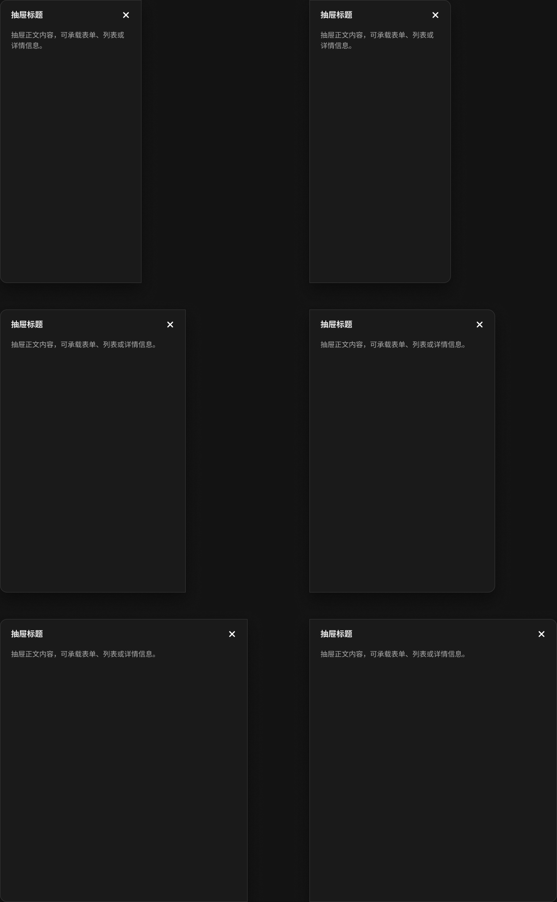

<!-- GEN:BEGIN 本段由 tools/gen-component-docs.py 依据 Figma 导出生成，勿手改；改 Figma 后重新生成 -->

## 概览

| 项 | 值 |
|---|---|
| Figma 组件集 | `Drawer`（node `56063:6563`） |
| 分类 | 反馈类 |
| 变体数 | 6 |
| 默认变体 | `Size=sm, Side=right` |
| 参考尺寸 | 320×640 px（默认变体） |
| 主题 | 主库（深色中性 + 品牌砂色） |
| 预览图 | [assets/previews/drawer.png](../../assets/previews/drawer.png) |
| 代码实现 | [`components/Drawer/Drawer.tsx`](../../components/Drawer/Drawer.tsx) |
| Figma 链接 | [在 Figma 打开](https://www.figma.com/design/ZO4WH3sbVCj7lZIFMpiwV9/VibeMe-App---Web-Design-%E5%A4%87%E4%BB%BD?node-id=56063-6563) |



## 变体与属性

| Figma 属性 | 类型 | 取值 | 默认 | 代码 prop |
|---|---|---|---|---|
| `Size` | VARIANT | `sm` / `md` / `lg` | `sm` | `size` |
| `Side` | VARIANT | `right` / `left` | `right` | `side` |

变体是属性轴的笛卡尔积：**6 = 3 × 2**（`Size` × `Side`）。

内嵌组件：`Property 1=cross_filled`×6

## 各变体的事实

> 填充栈按 Figma 图层顺序排列（**靠右的是上层**，hover/pressed 的叠加层在最后）。
> `⚠无cssVar` 表示该组件引用了历史遗留变量，代码里不要照抄，按 `foundations.md` 的规则换成语义 token。

| 变体 | 尺寸 | 填充栈 | 描边 | 圆角 | 内边距 上/右/下/左 | 不透明度 |
|---|---|---|---|---|---|---|
| `Size=sm, Side=right` | 320×640 | `Background/bg-panel` #1A1A1A `--vm-bg-panel` | `Background/border-default` #FFFFFF 12% `--vm-border-default` | 16/0/0/16 | 20/24/20/24 | — |
| `Size=sm, Side=left` | 320×640 | `Background/bg-panel` #1A1A1A `--vm-bg-panel` | `Background/border-default` #FFFFFF 12% `--vm-border-default` | 0/16/16/0 | 20/24/20/24 | — |
| `Size=md, Side=right` | 420×640 | `Background/bg-panel` #1A1A1A `--vm-bg-panel` | `Background/border-default` #FFFFFF 12% `--vm-border-default` | 16/0/0/16 | 20/24/20/24 | — |
| `Size=md, Side=left` | 420×640 | `Background/bg-panel` #1A1A1A `--vm-bg-panel` | `Background/border-default` #FFFFFF 12% `--vm-border-default` | 0/16/16/0 | 20/24/20/24 | — |
| `Size=lg, Side=right` | 560×640 | `Background/bg-panel` #1A1A1A `--vm-bg-panel` | `Background/border-default` #FFFFFF 12% `--vm-border-default` | 16/0/0/16 | 20/24/20/24 | — |
| `Size=lg, Side=left` | 560×640 | `Background/bg-panel` #1A1A1A `--vm-bg-panel` | `Background/border-default` #FFFFFF 12% `--vm-border-default` | 0/16/16/0 | 20/24/20/24 | — |

## 结构（默认变体）

### Size=sm, Side=right

```text
`COMPONENT` Size=sm, Side=right 320×640 VERTICAL gap 20 pad 20/24/20/24 填充 `Background/bg-panel` #1A1A1A `--vm-bg-panel` 描边 `Background/border-default` #FFFFFF 12% `--vm-border-default` 圆角 16/0/0/16
└─ `FRAME` Frame 270×26 HORIZONTAL gap 16 pad 0/0/0/0
  └─ `TEXT` 抽屉标题 234×26 填充 `Text/Text-Primary` #FFFFFF 92% `--vm-text-primary` 文字样式 `Heading/L`（18 Bold /26） 内容 '抽屉标题'
  └─ `INSTANCE` Filled icon 20×20 实例=Property 1=cross_filled
    └─ `VECTOR` icon 13.11×13.11 填充 #FFFFFF
└─ `TEXT` 抽屉正文内容，可承载表单、列表或详情信息。 270×48 填充 `Text/Text-Secondary` #FFFFFF 64% `--vm-text-secondary` 文字样式 `Heading/Body/M/Regular`（16 Regular /24） 内容 '抽屉正文内容，可承载表单、列表或详情信息。'
```


## 设计 token

| Figma 变量 | CSS 变量 | 值 |
|---|---|---|
| `Background/bg-panel` | `--vm-bg-panel` | `#1A1A1A` |
| `Background/border-default` | `--vm-border-default` | `rgba(255, 255, 255, 0.12)` |
| `Radious/radius-xl` | `--vm-radius-xl` | `16px` |
| `Semantic Space/padding-modal-x` | `--vm-padding-modal-x` | `24px` |
| `Semantic Space/padding-modal-y` | `--vm-padding-modal-y` | `20px` |
| `Text/Text-Primary` | `--vm-text-primary` | `rgba(255, 255, 255, 0.92)` |
| `Text/Text-Secondary` | `--vm-text-secondary` | `rgba(255, 255, 255, 0.64)` |
| `border/width/thin` | `--vm-border-width-thin` | `1px` |
| `space/space-4` | `--vm-space-4` | `16px` |
| `space/space-5` | `--vm-space-5` | `20px` |

<!-- GEN:END -->


## 交互与状态

Drawer 在 Figma 里**只有 `Size` × `Side` 两条轴，没有 `State` 轴**，所以「悬停变亮一点」这种事实根本不存在：
`drawer.variants.json` 里 6 个变体的 `fills` 都只有一条 `Background/bg-panel`（`--vm-bg-panel` #1A1A1A），
**没有** `White/White-7` / `White/White-6` 叠加层。不要按 Button / Card 一族的「填充叠加」给面板加 `:hover`，
面板、标题行、正文一个交互态都没有，唯一的交互体是右上角那个 × 图标。

| 交互 | 代码里由什么触发 | 行为上变了什么 |
|---|---|---|
| 显示 | prop `open` 落到**原生** `<dialog open>` 属性 | `.vm-drawer` 从 `display: none` 切到 `display: flex`；面板 `position: fixed; top: 0; bottom: 0`，高度随视口，**不写死** Figma 示例里的 640 |
| 收起 | 右上角 ×（`Filled icon` / `Property 1=cross_filled`） | 内部调 `dialog.close()` → 原生 `close` 事件 → 消费方的 `onClose` 里把 `open` 置回 `false`；组件自己不保存可见状态 |
| `Esc` / 点遮罩 | 无 | 这是**非模态** dialog：`drawer.variants.json` / `drawer.tree.json` 的 `variablesUsed` 里都没有 `Scrim/scrim-modal`，所以没有 `::backdrop`、也没有焦点陷阱 |
| hover / pressed | 无 | Figma 没有这两个状态，任何一层都不要加 `--vm-white-7` / `--vm-white-6` |
| disabled | 无 | 组件集没有 `disabled` 变体，不要写 `opacity: var(--vm-opacity-disabled)` |

`side` 只改三件事：贴哪一边（`right: 0` / `left: 0`）、圆角朝哪一边、以及边框与阴影的视觉方向。
圆角是「靠外的一侧保留 16px」——`side="right"` 是 `16/0/0/16`，`side="left"` 是 `0/16/16/0`，
16px 一律走 `--vm-radius-xl`（`Radious/radius-xl`），写成四角同值就不再是 Drawer 了。
`size` 只改宽度 320 / 420 / 560（Figma FIXED），高度、内边距（`--vm-padding-modal-y` / `--vm-padding-modal-x` 20/24）、
行间距（`--vm-space-5` 20、标题行 `--vm-space-4` 16）三档完全一致。

## 代码用法

```tsx
import { useState } from 'react';
import { Drawer } from '../components/Drawer';

export function ProjectDetailDrawer() {
  const [open, setOpen] = useState(false);

  return (
    <>
      <button type="button" onClick={() => setOpen(true)}>查看详情</button>

      {/* Size=md, Side=right（默认侧）：宽 420，左侧 16px 圆角 */}
      <Drawer
        open={open}
        onClose={() => setOpen(false)}
        size="md"
        side="right"
        title="抽屉标题"
      >
        <p>抽屉正文内容，可承载表单、列表或详情信息。</p>
      </Drawer>
    </>
  );
}

/** 左侧筛选抽屉：Size=lg, Side=left，宽 560，右侧 16px 圆角 */
export function FilterDrawer({ open, onClose }: { open: boolean; onClose: () => void }) {
  return (
    <Drawer open={open} onClose={onClose} size="lg" side="left" title="筛选条件" closeLabel="关闭筛选">
      <form>{/* 表单域用 Input / Select / Checkbox 组合 */}</form>
    </Drawer>
  );
}
```

CSS 引入方式：`import '../components/Drawer/Drawer.css'`（或整包 `import '../components/index'`，桶文件已经
`import './tokens.css'`，CSS 变量与 `.vm-type-*` 工具类会一起加载）。
`title` 对应 Figma 的「抽屉标题」文字层（`Heading/L` → `.vm-type-heading-l`，`--vm-text-primary`），
`children` 对应「抽屉正文内容…」文字层（`Heading/Body/M/Regular` → `.vm-type-heading-body-m-regular`，
`--vm-text-secondary`）。默认宽度三档是 FIXED，窄屏由组件自带的 `max-width` 兜底。

## 可访问性

- 根节点是真的 `<dialog>`，`open` 走**原生属性**（不是 `showModal()`），因此读屏会把它当 `role="dialog"` 播报，
  同时它**不是**模态：背景内容依然可聚焦、可按 Tab 走出去。需要焦点陷阱与遮罩的模态场景请用 Modal，不要给 Drawer 硬加。
- 标题渲染为 `<h2 class="vm-drawer__title">`，并用 `aria-labelledby` 关联到 dialog；调用方自己传的 `aria-labelledby` 优先，
  组件不覆盖。正文**不**挂 `aria-describedby`：抽屉里常常放表单/列表，整块被当成描述念一遍反而是灾难。
- 右上角 × 是真实的 `<button type="button">` ＋ `aria-label={closeLabel}`（默认「关闭」），内联 SVG 带 `aria-hidden="true"`，
  不会被读成图形字符；它也是抽屉里唯一由组件提供的可聚焦元素，Tab 到达后回车/空格都能收起。
- 组件不接管 `Esc`、不搬焦点：非模态 dialog 的浏览器默认行为里没有这两件事。打开抽屉后把焦点移到抽屉内第一个控件、
  关闭后还回触发按钮，都由消费方在 `open` 变化时处理；Modal 里那套「`Esc` 自动关闭 + 焦点陷阱」是原生模态 dialog 给的，不要照搬到这里。
- 对比度：标题 `--vm-text-primary`（92% 白）与正文 `--vm-text-secondary`（64% 白）落在 `--vm-bg-panel`（#1A1A1A）上分别约 13:1 与 8:1，
  面板描边 `--vm-border-default`（12% 白）只是分界线、不承担信息，不要把正文降到 `--vm-text-tertiary`（30% 白）去「弱化」。

## 不要这样做

1. **不要给 Drawer 加 `::backdrop` 或遮罩色。** Figma 的 Drawer 变量表里没有 `Scrim/scrim-modal`（有遮罩的是 Modal），
   写 `background-color: var(--vm-scrim-modal)` 会凭空多出一层 Figma 里不存在的视觉，也把非模态抽屉变成「看起来像模态」的假模态。
2. **不要用 `--vm-modal-sm|md|lg` 当抽屉宽度。** 那三个是 `Modal Size/*` 的语义变量（400/520/720），
   Drawer 的 320/420/560 是组件集自己的 FIXED 值，库里没有对应的 Drawer 宽度 token，只能在 CSS 里写死这三档并加注释说明。
3. **不要写死高度 640。** `drawer.variants.json` 里每个变体都是 640 高，那是画布样例；侧滑抽屉应当 `top: 0; bottom: 0` 撑满视口高度，
   照抄 640 会在尺寸不同的屏幕上露出后面的页面。
4. **不要给面板加 hover / pressed 叠加层。** 6 个变体的填充栈都只有 `--vm-bg-panel` 一条，没有 `--vm-white-7` / `--vm-white-6`；
   这两层只属于 Button / MenuItem / Card 一族。× 图标在 Figma 里也没有 hover 事实，只给 `:focus-visible` 焦点环即可。
5. **不要四角都用 `--vm-radius-xl`。** 抽屉是「靠外一侧圆角」，另一侧是直角 `0`；
   `side="right"` 与 `side="left"` 的圆角顺序必须互换，否则面板会飘在半空中。
6. **不要把面板底色换成 `--vm-bg-card`。** Figma 绑定的是 `Background/bg-panel`（`--vm-bg-panel` #1A1A1A），
   `--vm-bg-card`（#202020）是卡片/次级按钮的底色，两者深浅不同，混用会让抽屉在卡片墙上「浮」不出来。
7. **不要加 `state` / `disabled` / `loading` 这类 prop。** 组件集只有 `Size` × `Side`，没有第三根轴；
   需要禁用内部表单时，禁用状态属于 Input / Button 自己，不属于抽屉外壳。

## 相关组件

- **Modal**：同为反馈容器的两种形态，二选一。Modal 是模态（`showModal()` ＋ `--vm-scrim-modal` 遮罩 ＋ 焦点陷阱），
  Drawer 是非模态侧滑（无遮罩）；Modal 的宽度走 `--vm-modal-sm|md|lg`，Drawer 走自己的 320/420/560。
- **Sidebar**：常驻侧栏，宽度固定 240 / 64、没有开关；Drawer 是临时滑入的面板。不要把 Sidebar 塞进 Drawer 里当导航。
- **Input / Select / Textarea / Checkbox**：抽屉正文最常见的组合（详情、筛选、编辑表单），宽度跟着抽屉内容宽走，
  不要给它们再写死 320 宽，否则 560 档的抽屉里会留一大片空白。
- **ListItem / Divider**：抽屉里的信息列表用 ListItem 排列、用 `<Divider />` 分段，不要用 `border-top` 私造分隔线。
- **Button**：抽屉底部的提交/取消动作区；Figma 的 Drawer 里没放按钮，需要时由消费方放在正文末尾，
  样式直接复用 Button 组件而不是在这里另写一套。
- **Toast**：抽屉里保存成功后的反馈不要内联在面板顶部，交给 Toast 在页面右上角提示，避免面板内布局跳动。
