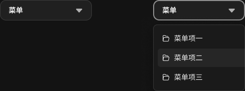

<!-- GEN:BEGIN 本段由 tools/gen-component-docs.py 依据 Figma 导出生成，勿手改；改 Figma 后重新生成 -->

## 概览

| 项 | 值 |
|---|---|
| Figma 组件集 | `Dropdown`（node `56064:6813`） |
| 分类 | 导航类 |
| 变体数 | 2 |
| 默认变体 | `State=closed` |
| 参考尺寸 | 180×40 px（默认变体） |
| 主题 | 主库（深色中性 + 品牌砂色） |
| 预览图 | [assets/previews/dropdown.png](../../assets/previews/dropdown.png) |
| 代码实现 | [`components/Dropdown/Dropdown.tsx`](../../components/Dropdown/Dropdown.tsx) |
| Figma 链接 | [在 Figma 打开](https://www.figma.com/design/ZO4WH3sbVCj7lZIFMpiwV9/VibeMe-App---Web-Design-%E5%A4%87%E4%BB%BD?node-id=56064-6813) |



## 变体与属性

| Figma 属性 | 类型 | 取值 | 默认 | 代码 prop |
|---|---|---|---|---|
| `State` | VARIANT | `closed` / `open` | `closed` | `state` |

变体是属性轴的笛卡尔积：**2 = 2**（`State`）。

内嵌组件：`Property 1=chevron-down_filled`×2、`State=default`×2、`State=hover`×1

## 各变体的事实

> 填充栈按 Figma 图层顺序排列（**靠右的是上层**，hover/pressed 的叠加层在最后）。
> `⚠无cssVar` 表示该组件引用了历史遗留变量，代码里不要照抄，按 `foundations.md` 的规则换成语义 token。

| 变体 | 尺寸 | 填充栈 | 描边 | 圆角 | 内边距 上/右/下/左 | 不透明度 |
|---|---|---|---|---|---|---|
| `State=closed` | 180×40 | — | — | — | 0/0/0/0 | — |
| `State=open` | 180×178 | — | — | — | 0/0/0/0 | — |

## 结构（默认变体）

### State=closed

```text
`COMPONENT` State=closed 180×40 VERTICAL gap 8 pad 0/0/0/0
└─ `FRAME` Frame 180×40 HORIZONTAL gap 8 pad 0/16/0/16 填充 `Background/bg-card` #202020 `--vm-bg-card` 描边 `Background/border-default` #FFFFFF 12% `--vm-border-default` 圆角 12
  └─ `TEXT` 菜单 122×20 填充 `Text/Text-Primary` #FFFFFF 92% `--vm-text-primary` 文字样式 `Heading/S`（14 SemiBold /20） 内容 '菜单'
  └─ `INSTANCE` Filled icon 16×16 实例=Property 1=chevron-down_filled
    └─ `VECTOR` icon 7.52×12.12 填充 `Text/Text-Secondary` #FFFFFF 64% `--vm-text-secondary`
```

### State=open

```text
`COMPONENT` State=open 180×178 VERTICAL gap 8 pad 0/0/0/0
└─ `FRAME` Frame 180×40 HORIZONTAL gap 8 pad 0/16/0/16 填充 `Background/bg-card` #202020 `--vm-bg-card` 描边 `Background/border-selected` #FFFFFF 50% `--vm-border-selected` 圆角 12
  └─ `TEXT` 菜单 120×20 填充 `Text/Text-Primary` #FFFFFF 92% `--vm-text-primary` 文字样式 `Heading/S`（14 SemiBold /20） 内容 '菜单'
  └─ `INSTANCE` Filled icon 16×16 实例=Property 1=chevron-down_filled
    └─ `VECTOR` icon 7.52×12.12 填充 `Text/Text-Secondary` #FFFFFF 64% `--vm-text-secondary`
└─ `FRAME` Frame 180×130 VERTICAL gap 2 pad 8/8/8/8 填充 `Background/bg-panel` #1A1A1A `--vm-bg-panel` 描边 `Background/border-default` #FFFFFF 12% `--vm-border-default` 圆角 8
  └─ `INSTANCE` MenuItem 208×36 HORIZONTAL gap 8 pad 8/8/8/8 圆角 6 实例=State=default
    └─ `INSTANCE` Line icon 16×16 实例=Property 1=icon, Property 2=folder-line
      └─ `VECTOR` icon 12.74×12.33 填充 `Text/Text-Primary` #FFFFFF 92% `--vm-text-primary`
    └─ `TEXT` 菜单项 168×20 填充 `Text/Text-Primary` #FFFFFF 92% `--vm-text-primary` 文字样式 `Heading/Body/S/Regular`（14 Regular /20） 内容 '菜单项一'
  └─ `INSTANCE` MenuItem 208×36 HORIZONTAL gap 8 pad 8/8/8/8 填充 `Background/Surface-hover` #262626 `--vm-surface-hover` 圆角 6 实例=State=hover
    └─ `INSTANCE` Line icon 16×16 实例=Property 1=icon, Property 2=folder-line
      └─ `VECTOR` icon 12.74×12.33 填充 `Text/Text-Primary` #FFFFFF 92% `--vm-text-primary`
    └─ `TEXT` 菜单项 168×20 填充 `Text/Text-Primary` #FFFFFF 92% `--vm-text-primary` 文字样式 `Heading/Body/S/Regular`（14 Regular /20） 内容 '菜单项二'
  └─ `INSTANCE` MenuItem 208×36 HORIZONTAL gap 8 pad 8/8/8/8 圆角 6 实例=State=default
    └─ `INSTANCE` Line icon 16×16 实例=Property 1=icon, Property 2=folder-line
      └─ `VECTOR` icon 12.74×12.33 填充 `Text/Text-Primary` #FFFFFF 92% `--vm-text-primary`
    └─ `TEXT` 菜单项 168×20 填充 `Text/Text-Primary` #FFFFFF 92% `--vm-text-primary` 文字样式 `Heading/Body/S/Regular`（14 Regular /20） 内容 '菜单项三'
```


## 设计 token

| Figma 变量 | CSS 变量 | 值 |
|---|---|---|
| `Background/Surface-hover` | `--vm-surface-hover` | `#262626` |
| `Background/bg-card` | `--vm-bg-card` | `#202020` |
| `Background/bg-panel` | `--vm-bg-panel` | `#1A1A1A` |
| `Background/border-default` | `--vm-border-default` | `rgba(255, 255, 255, 0.12)` |
| `Background/border-selected` | `--vm-border-selected` | `rgba(255, 255, 255, 0.5)` |
| `Radious/radius-md` | `--vm-radius-md` | `8px` |
| `Radious/radius-sm` | `--vm-radius-sm` | `6px` |
| `Semantic Radius/radius-button` | `--vm-radius-button` | `12px` |
| `Text/Text-Primary` | `--vm-text-primary` | `rgba(255, 255, 255, 0.92)` |
| `Text/Text-Secondary` | `--vm-text-secondary` | `rgba(255, 255, 255, 0.64)` |
| `border/width/thin` | `--vm-border-width-thin` | `1px` |
| `focus/ring-width` | `--vm-focus-ring-width` | `2px` |
| `space/space-0-5` | `--vm-space-0-5` | `2px` |
| `space/space-2` | `--vm-space-2` | `8px` |
| `space/space-4` | `--vm-space-4` | `16px` |

<!-- GEN:END -->

## 交互与状态

Figma 只画了 `closed` / `open` 两档，代码里各自对应什么：

| Figma State | 代码触发方式 | 视觉上变了什么 |
|---|---|---|
| `State=closed` | `open={false}`（默认）或非受控初值 `defaultOpen={false}` | 只剩触发器：`Background/bg-card`（`--vm-bg-card` #202020）＋ 1px `--vm-border-default`（12% 白）＋ 圆角 `--vm-radius-button`（`Semantic Radius/radius-button` 12px），面板 `role="menu"` **完全不渲染** |
| `State=open` | `open={true}` / 点触发器 / 键盘 `ArrowDown`·`ArrowUp` | 触发器描边换成 `--vm-border-selected`（`Background/border-selected` 50% 白）并把线宽从 `--vm-border-width-thin`（1px）加到 `--vm-border-width-thick`（2px，Figma 把这个 2px 绑在 `focus/ring-width` 上），下方 8px（`--vm-space-2`）出现面板：`--vm-bg-panel`（`Background/bg-panel` #1A1A1A）＋ 1px `--vm-border-default` ＋ 圆角 `--vm-radius-md`（`Radious/radius-md` 8px）＋ `--vm-elevation-3`（`Elevation/3` 0/8/24 黑 32%）＋ 8px 内边距，行间距 2px（`--vm-space-0-5`） |

状态收起的三种路径：**`Esc`**、**点面板外部**、**选中一个 `menuitem`**（都会把焦点还给触发器；点外部不抢焦点）。
`ArrowDown` / `ArrowUp` 在触发器上按下会直接打开并把焦点送到第一项 / 最后一项，在面板内则按项移动；
`Home` / `End` 跳首尾。hover / focus 是伪类（`:hover`、`:focus-visible`），**不是 prop**：
Figma 的 Dropdown 没有 hover 变体，代码里按同族「描边换色」控件（Input / Search / Select）补了一条
`:hover:not(:disabled)` → 描边 12% 白换 `--vm-white-4`（30% 白），**没有**白色叠加层。
`disabled` 走原生属性，只加 `opacity: var(--vm-opacity-disabled)`（`opacity/disabled` 0.38），同时挡住开合。

## 代码用法

```tsx
import { useState } from 'react';
import { Dropdown } from '../components/Dropdown';
import { MenuItem } from '../components/MenuItem';

export function Example() {
  const [open, setOpen] = useState(false);
  const [current, setCurrent] = useState('mine');

  return (
    <>
      {/* 受控：open + onOpenChange 成对使用 */}
      <Dropdown label="项目" open={open} onOpenChange={setOpen}>
        <MenuItem selected={current === 'all'} onClick={() => setCurrent('all')}>
          全部项目
        </MenuItem>
        <MenuItem selected={current === 'mine'} onClick={() => setCurrent('mine')}>
          我的项目
        </MenuItem>
      </Dropdown>

      {/* 非受控：组件自己管开合（点触发器 / Esc / 点外部 / 选中一项） */}
      <Dropdown label="排序方式" defaultOpen={false}>
        <MenuItem onClick={() => {}}>按更新时间</MenuItem>
        <MenuItem onClick={() => {}}>按名称</MenuItem>
      </Dropdown>

      {/* 禁用整条下拉 */}
      <Dropdown label="团队" disabled onOpenChange={() => {}}>
        <MenuItem>设计组</MenuItem>
      </Dropdown>
    </>
  );
}
```

CSS 引入方式：`import '../components/Dropdown/Dropdown.css'`（或整包 `import '../components/index'`，
桶文件已 `import './tokens.css'`，token 与 `.vm-type-*` 工具类会一起加载）。
`children` 放的是**面板内容**（`MenuItem` 列表），触发器文字走 `label`；`...rest` 与 `ref` 落在触发器的 `<button>` 上，
`className` 落在最外层 `<div class="vm-dropdown">` 上。宽度按 Figma 固定 180px 给，带 `max-width: 100%`，
要更宽由调用方覆盖。

`label` 可省略（`@default ''`）：标签位为空，但触发器本身（40px 高、`aria-haspopup` ＋
`aria-expanded` ＋ chevron）**照常渲染、不会消失**，开合与键盘行为完全不变。
`children` 是面板内容而不是标签，所以**不**拿它兜底；只放图标、不给文字时，
请自行传 `aria-label` 给触发器补可访问名。

## 可访问性

- 结构：外层 `<div class="vm-dropdown">`，触发器是真的 `<button type="button">` 并带
  `aria-haspopup="menu"` ＋ `aria-expanded`（关着也输出 `false`）＋ 展开时才有 `aria-controls`；
  面板是 `<ul role="menu" aria-labelledby={触发器 id}>`，`MenuItem` 自带 `<li role="none">` ＋
  `role="menuitem"`，HTML 与 ARIA 都成立。
- 键盘：`Enter` / `Space` 切换开合（原生 button 行为）；`ArrowDown` / `ArrowUp` 打开并聚焦首/末项，
  面板内继续上下移动、`Home` / `End` 跳首尾；`Esc` 关闭并把焦点还给触发器。焦点循环（roving focus）
  由面板负责，`MenuItem` 不注册 `onKeyDown`。
- 焦点管理：关闭时若焦点还在被卸载的面板里，会显式 `focus()` 回触发器，避免焦点丢到 `<body>`；
  点面板外部关闭时**不**抢焦点，用户当前操作的输入框不会被夺走。
- 焦点可见：触发器 `:focus-visible` 用 2px `--vm-border-selected` ＋ `--vm-focus-ring-width` 的 ring；
  面板内的行用 `MenuItem` 自己的 inset ring。
- 读屏：`aria-expanded` 会播报「已展开/已折叠」，`aria-labelledby` 让面板被念成「菜单，由『项目』触发」；
  选中项由 `MenuItem` 的 `aria-current="true"` 表达，颜色不是唯一线索。

## 不要这样做

1. **不要把 `State` 做成 `state="open"` 这种 prop**。`open` 是布尔应用态（还优先映射到
   `aria-expanded`），开了就是开了；`hover` / `focus` 用伪类，写成 prop 会和真实交互打架。
2. **不要把 `MenuItem` 之外的裸内容塞进面板**。面板是 `role="menu"`，直接子节点应当是
   `menuitem`（或 `role="none"` 的包装）；放一段说明文字请用 `role="none"` 包一层并加 `aria-hidden`，
   否则读屏会把它当菜单项念。
3. **不要给面板自己再加一层 `<ul role="menu">`**。`Dropdown` 已经渲染了 `role="menu"` 的 `<ul>`，
   再套一层会出现嵌套菜单角色，方向键逻辑也会错乱（会命中两层 `[role="menuitem"]` 集合）。
4. **不要复制 Figma 面板的裁切**。Figma 里面板固定 180 宽、里面却是固定 208 宽的 `MenuItem` 实例，
   右边 44px 被面板的 `clip:true` 裁掉了（`selected` 的对勾正好在裁切线外）。代码里靠
   `MenuItem` 的 `max-width: 100%` 收进 164px 内容宽，**不要**回去写死 208 或加 `overflow: hidden` 让它重新被裁。
5. **不要照抄 Button 的 hover 叠加**。Dropdown 的触发器是同族「描边换色」控件，hover 只改描边
   （`--vm-border-default` → `--vm-white-4`）；在 `--vm-bg-card` 上叠 `--vm-white-7` 与 Figma 不符。
6. **不要把触发器圆角写成 8px 或 12px 的输入框圆角以外的值**。它是 `--vm-radius-button`（12px），
   面板才是 `--vm-radius-md`（8px）—— 两者不同，别混用成一个。
7. **不要用 `title` / `position: absolute` 手写一个浮层来代替这个组件**，也不要拿 `VibeMe AI / *`
   那套紫粉 token 的浮层组件来拼主库的下拉；两边 token 不通用。

## 相关组件

- **MenuItem**：Dropdown 面板里唯一该放的内容（Figma 的 open 变体里就是 3 个 `MenuItem` 实例：
  `default` / `hover` / `default`）。选中、禁用、图标都在 MenuItem 里，Dropdown 不重造行样式。
- **Select**：同样是「触发器 ＋ 浮层」，但 Select 是**表单控件**语义（`combobox` / `listbox`，
  值是选中项），Dropdown 是**导航菜单**语义（`menu` / `menuitem`）。需要表单取值请用 Select。
- **Popover / Tooltip**：都能浮层，但都不承担菜单键盘逻辑；Popover 里放菜单时同样要自己补
  `role="menu"` 与方向键，或者直接用 Dropdown。
- **Divider**：面板里分组时可以插 `Divider`，但要包在 `role="group"` 里并给 `aria-label`，
  不要用裸 `<hr>` 打断菜单语义。
- **Sidebar / Tabs**：页面级导航用它们，Dropdown 只用于「一个触发器展开一小组操作/选项」的场景。
