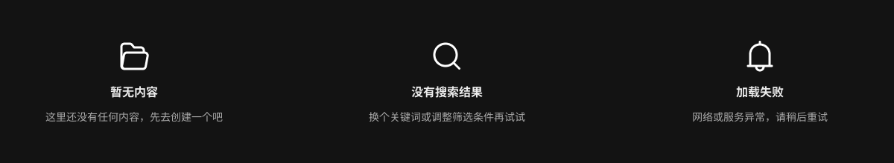

<!-- GEN:BEGIN 本段由 tools/gen-component-docs.py 依据 Figma 导出生成，勿手改；改 Figma 后重新生成 -->

## 概览

| 项 | 值 |
|---|---|
| Figma 组件集 | `Empty`（node `56061:6529`） |
| 分类 | 展示类 |
| 变体数 | 3 |
| 默认变体 | `Type=empty` |
| 参考尺寸 | 360×220 px（默认变体） |
| 主题 | 主库（深色中性 + 品牌砂色） |
| 预览图 | [assets/previews/empty.png](../../assets/previews/empty.png) |
| 代码实现 | [`components/Empty/Empty.tsx`](../../components/Empty/Empty.tsx) |
| Figma 链接 | [在 Figma 打开](https://www.figma.com/design/ZO4WH3sbVCj7lZIFMpiwV9/VibeMe-App---Web-Design-%E5%A4%87%E4%BB%BD?node-id=56061-6529) |



## 变体与属性

| Figma 属性 | 类型 | 取值 | 默认 | 代码 prop |
|---|---|---|---|---|
| `Type` | VARIANT | `empty` / `search` / `error` | `empty` | `type` |

变体是属性轴的笛卡尔积：**3 = 3**（`Type`）。

内嵌组件：`Property 1=icon, Property 2=alert-line`×1、`Property 1=icon, Property 2=folder-line`×1、`Property 1=icon, Property 2=search-line`×1

## 各变体的事实

> 填充栈按 Figma 图层顺序排列（**靠右的是上层**，hover/pressed 的叠加层在最后）。
> `⚠无cssVar` 表示该组件引用了历史遗留变量，代码里不要照抄，按 `foundations.md` 的规则换成语义 token。

| 变体 | 尺寸 | 填充栈 | 描边 | 圆角 | 内边距 上/右/下/左 | 不透明度 |
|---|---|---|---|---|---|---|
| `Type=empty` | 360×220 | — | — | — | 40/40/40/40 | — |
| `Type=search` | 360×220 | — | — | — | 40/40/40/40 | — |
| `Type=error` | 360×220 | — | — | — | 40/40/40/40 | — |

## 结构（默认变体）

### Type=empty

```text
`COMPONENT` Type=empty 360×220 VERTICAL gap 12 pad 40/40/40/40
└─ `INSTANCE` Line icon 48×48 实例=Property 1=icon, Property 2=folder-line
  └─ `VECTOR` icon 38.21×37 填充 #FFFFFF
└─ `TEXT` 暂无内容 64×24 填充 `Text/Text-Primary` #FFFFFF 92% `--vm-text-primary` 文字样式 `Heading/M`（16 SemiBold /24） 内容 '暂无内容'
└─ `TEXT` 这里还没有任何内容，先去创建一个吧 238×20 填充 `Text/Text-Secondary` #FFFFFF 64% `--vm-text-secondary` 文字样式 `Heading/Body/S/Regular`（14 Regular /20） 内容 '这里还没有任何内容，先去创建一个吧'
```

### Type=error

```text
`COMPONENT` Type=error 360×220 VERTICAL gap 12 pad 40/40/40/40
└─ `INSTANCE` Line icon 48×48 实例=Property 1=icon, Property 2=alert-line
  └─ `VECTOR` icon 35×41.5 填充 #FFFFFF
└─ `TEXT` 加载失败 64×24 填充 `Text/Text-Primary` #FFFFFF 92% `--vm-text-primary` 文字样式 `Heading/M`（16 SemiBold /24） 内容 '加载失败'
└─ `TEXT` 网络或服务异常，请稍后重试 182×20 填充 `Text/Text-Secondary` #FFFFFF 64% `--vm-text-secondary` 文字样式 `Heading/Body/S/Regular`（14 Regular /20） 内容 '网络或服务异常，请稍后重试'
```


## 设计 token

| Figma 变量 | CSS 变量 | 值 |
|---|---|---|
| `Text/Text-Primary` | `--vm-text-primary` | `rgba(255, 255, 255, 0.92)` |
| `Text/Text-Secondary` | `--vm-text-secondary` | `rgba(255, 255, 255, 0.64)` |
| `space/space-10` | `--vm-space-10` | `40px` |
| `space/space-3` | `--vm-space-3` | `12px` |

<!-- GEN:END -->


## 交互与状态

Empty **没有任何交互态**：Figma 只有一根 `Type` 轴（`empty` / `search` / `error`），既不是 `State`，也没有 hover / focus / disabled 档，
所以实现里没有任何 `:hover` / `:active` / `:focus-visible` / `:disabled` 规则，也没有过渡——它不可点击、不进 Tab 序列。

| 变化来源 | 代码触发方式 | 视觉上变了什么 |
|---|---|---|
| 图标 | prop `type` | 换 `Line icon` 实例：`empty` → `folder-line`（矢量 38.2084×37）、`search` → `search-line`（36.4998×36.4998）、`error` → `alert-line`（35×41.5）；三档都在 48×48 的槽位里居中 |
| 文案 | `type` 的默认文案，或 `title` / `description` 覆盖 | `empty`「暂无内容 / 这里还没有任何内容，先去创建一个吧」、`search`「没有搜索结果 / 换个关键词或调整筛选条件再试试」、`error`「加载失败 / 网络或服务异常，请稍后重试」 |
| 颜色 | **三档完全一致，不随 `type` 变化** | 图标 `--vm-white-0`、标题 `--vm-text-primary`（92% 白）、说明 `--vm-text-secondary`（64% 白）；`error` 档**不是**红色 |
| 布局 | 无 | 三档都是 `FIXED` 360×220、纵向排列、`gap: var(--vm-space-3)`（12px）、`padding: var(--vm-space-10)`（40px）、水平垂直居中 |

语义侧还有一处随 `type` 变化：`error` 输出 `role="alert"`，`empty` / `search` 输出 `role="status"`——因为三档颜色相同，
「这是错误」只能靠 ARIA 与文案传达，不能靠视觉。需要按钮时（例如「去创建」），由页面在 Empty 下方另放一个 `Button`，
Figma 的 Empty 里没有任何按钮层，组件也不接受 `action` 之类的 prop。

## 代码用法

```tsx
import { Button } from '../components/Button';
import { Empty } from '../components/Empty';

/** 搜索无结果：search 档的默认文案已经在教用户下一步做什么 */
export function SearchResult() {
  return (
    <Empty
      type="search"
      title="没找到「brand tokens」"
      // 说明留空就用 Figma 的默认文案
    />
  );
}

/** 加载失败：error 档会输出 role="alert"，读屏会主动播报 */
export function LoadFailed({ onRetry }: { onRetry: () => void }) {
  return (
    <div className="demo-panel">
      <Empty type="error" />
      {/* 按钮不进 Empty：Figma 里没有这一层，由页面自己摆 */}
      <Button type="secondary" onClick={onRetry}>
        重试
      </Button>
    </div>
  );
}

/** 容器比 360 窄时覆盖宽度（组件给的是 Figma 参考宽，不是硬约束） */
export function NarrowEmpty() {
  return <Empty type="empty" style={{ width: '100%', minHeight: 160 }} />;
}
```

CSS 引入方式：`import '../components/Empty/Empty.css'`（或整包 `import '../components/index'`，桶文件已 `import './tokens.css'`）。
三个图标是**从 Figma 导出的真实矢量**（内联 SVG、`fill="currentColor"`、`aria-hidden="true"`），不需要任何图标库。
`title` 覆盖的是可见标题，原生 `title`（tooltip）属性已被接口剔除。

## 可访问性

- 角色：根节点是 `<div>`，`type="error"` 时输出 `role="alert"`（读屏立即播报），`empty` / `search` 时输出 `role="status"`（礼貌播报）。
  这两个角色只在内容**出现**时才有意义——正好对应「请求回来发现为空/失败」的场景；调用方的 `role` 会覆盖默认值。
- 标题语义：标题与说明都是 `<p>`，不是 `<h1>`–`<h6>`——空状态不是页面的章节标题，用 heading 会污染大纲。
  如果它确实是一个区块的主标题，请由外层容器给 `aria-labelledby` 指向自己的标题元素。
- 图标：三个内联 SVG 全部 `aria-hidden="true"`、`focusable="false"`；含义由文案承担，读屏不会读出「图标」。
- 键盘：组件不接收焦点（没有 `tabIndex`、没有 `onClick`），`Tab` 会直接跳到页面里真正的操作按钮；
  需要「重试 / 去创建」时，请使用标准 `Button` 并紧跟其后，不要给 Empty 挂点击事件。
- 对比度：标题 `--vm-text-primary`（92% 白）与说明 `--vm-text-secondary`（64% 白）在 `--vm-bg-panel` / `--vm-bg-card` 上均 ≥ 4.5:1，
  图标 `--vm-white-0` 是纯白；三档颜色相同，因此**严禁**只靠图标区分 `error`——文案里必须写清「哪里错了、下一步做什么」。
- 宽度与换行：Figma 固定 360 宽、内边距 40，内容区 280；说明文字超长会自动换行并保持居中（Figma 里说明是一个居中的定宽文本块）。
  窄容器（移动端、侧栏）请覆盖 `width`，**不要**用 `transform: scale()` 缩小，那会让 14px 正文低于可读下限。
- 动效：没有任何过渡与动画；若要给「出现」加淡入，必须在 `@media (prefers-reduced-motion: reduce)` 下退化为无动画。

## 不要这样做

1. **不要把 `error` 档改成红色**。`empty.tree.error.json` 里 `alert-line` 的矢量填充、标题（`Text/Text-Primary`）、说明（`Text/Text-Secondary`）
   与 `empty` 档**一模一样**，没有 `--vm-status-error`。三档靠图标与文案区分；自己加红色就等于改了设计稿。
   如果产品确实需要红色错误态，先去 Figma 把组件改掉，再回来刷新这份文档。
2. **不要给 Empty 加 `action` / `button` / `onRetry` 这类 prop**。Figma 的 3 个变体里只有「图标 + 标题 + 说明」三个子节点，
   没有按钮层。按钮由页面在 Empty 下面摆（用 `Button`），这样按钮的变体与状态才能独立演进。
3. **不要把 360×220 当硬约束**。它是 Figma 的 `FIXED` 参考尺寸：窄容器请覆盖 `width`，宽容器请覆盖 `width` 与 `min-height`，
   不要为了「填满」而拉大内边距或放大字号。
4. **不要三档共用一句文案**。「暂无数据」对 `search` 档毫无帮助——Figma 给 `search` 档配的是
   「没有搜索结果 / 换个关键词或调整筛选条件再试试」，说明文字必须能告诉用户下一步做什么。
5. **不要用 emoji 或自画形状代替图标**。三档用的是 `Line icon` 的 `folder-line` / `search-line` / `alert-line`，
   矢量已从 Figma 导出并内联；`empty.tree.json` 里 `folder-line` 是 38.2084×37、`alert-line` 是 35×41.5，尺寸不能改。
6. **不要用 Empty 表达「加载中」**。加载中用 `Skeleton`；Empty 只在请求已经回来、且结果确实为空或失败时出现，两者互斥。
7. **不要手写字号与颜色**。标题挂 `.vm-type-heading-m`（`Heading/M` 16 SemiBold /24），说明挂 `.vm-type-heading-body-s-regular`
   （`Heading/Body/S/Regular` 14 Regular /20）；直接写 `font-size: 16px` 或 `#FFFFFF` 会绕过 token 校验。
8. **不要把 `title` 当 tooltip 用**。接口已经把原生 `title` 属性剔除，它是可见标题入口；tooltip 请用外层元素或 `aria-description`。

## 相关组件

- **Button**：空状态的「去创建 / 重试 / 清空筛选」动作。Empty 不内嵌 Button（Figma 里没有这一层），
  由页面在它下方放一个 `type="secondary"` 的 Button，间距用 `Stack` 的 `--vm-space-4` 之类统一控制。
- **Skeleton**：同一块区域的另一种状态——加载中放 `Skeleton`（`line` / `card` 档），加载完但没数据才换成 `Empty`。
  两者互斥，绝不同时出现。
- **ListItem / Table / TableRow**：列表、表格的宿主。为空时用 `Empty` 整块替换列表内容，而不是渲染一行「暂无数据」的 ListItem。
- **Search**：`type="search"` 档的上游——搜索框提交后无结果时展示它；此时 `Empty` 的说明要回显用户输入的关键词。
- **Container / Card**：Empty 通常放在内容容器或卡片内部并居中；外层的圆角、底色（`--vm-bg-card`）与内边距由容器负责，
  Empty 自己只有 `padding: var(--vm-space-10)`。
- **VibeMe AI / Response Card**：AI 回复失败 / 无结果时同样用 `Empty`（`type="error"` / `type="empty"`），
  但配色要跟随那套紫粉主题的变量，不要把主库的 `--vm-text-*` 混进去。
