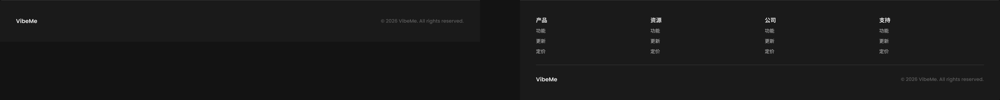

<!-- GEN:BEGIN 本段由 tools/gen-component-docs.py 依据 Figma 导出生成，勿手改；改 Figma 后重新生成 -->

## 概览

| 项 | 值 |
|---|---|
| Figma 组件集 | `Footer`（node `56066:6407`） |
| 分类 | 布局类 |
| 变体数 | 2 |
| 默认变体 | `Type=simple` |
| 参考尺寸 | 1200×105 px（默认变体） |
| 主题 | 主库（深色中性 + 品牌砂色） |
| 预览图 | [assets/previews/footer.png](../../assets/previews/footer.png) |
| 代码实现 | [`components/Footer/Footer.tsx`](../../components/Footer/Footer.tsx) |
| Figma 链接 | [在 Figma 打开](https://www.figma.com/design/ZO4WH3sbVCj7lZIFMpiwV9/VibeMe-App---Web-Design-%E5%A4%87%E4%BB%BD?node-id=56066-6407) |



## 变体与属性

| Figma 属性 | 类型 | 取值 | 默认 | 代码 prop |
|---|---|---|---|---|
| `Type` | VARIANT | `simple` / `columns` | `simple` | `type` |

变体是属性轴的笛卡尔积：**2 = 2**（`Type`）。

内嵌组件：`Orientation=horizontal, Style=solid`×1

## 各变体的事实

> 填充栈按 Figma 图层顺序排列（**靠右的是上层**，hover/pressed 的叠加层在最后）。
> `⚠无cssVar` 表示该组件引用了历史遗留变量，代码里不要照抄，按 `foundations.md` 的规则换成语义 token。

| 变体 | 尺寸 | 填充栈 | 描边 | 圆角 | 内边距 上/右/下/左 | 不透明度 |
|---|---|---|---|---|---|---|
| `Type=simple` | 1200×105 | `Background/bg-panel` #1A1A1A `--vm-bg-panel` | `Background/border-default` #FFFFFF 12% `--vm-border-default` | — | 40/40/40/40 | — |
| `Type=columns` | 1200×252 | `Background/bg-panel` #1A1A1A `--vm-bg-panel` | `Background/border-default` #FFFFFF 12% `--vm-border-default` | — | 40/40/40/40 | — |

## 结构（默认变体）

### Type=simple

```text
`COMPONENT` Type=simple 1200×105 VERTICAL gap 24 pad 40/40/40/40 填充 `Background/bg-panel` #1A1A1A `--vm-bg-panel` 描边 `Background/border-default` #FFFFFF 12% `--vm-border-default`
└─ `FRAME` Frame 1120×24 HORIZONTAL gap 16 pad 0/0/0/0
  └─ `TEXT` VibeMe 54×20 填充 `Text/Text-Primary` #FFFFFF 92% `--vm-text-primary` 文字样式 `Heading/S`（14 SemiBold /20） 内容 'VibeMe'
  └─ `FRAME` Frame 826×1
  └─ `TEXT` © 2026 VibeMe. All rights reserved. 208×18 填充 `Text/Text-Tertiary` #FFFFFF 30% `--vm-text-tertiary` 文字样式 `Caption/Caption`（12 Medium /18） 内容 '© 2026 VibeMe. All rights reserved.'
```

### Type=columns

```text
`COMPONENT` Type=columns 1200×252 VERTICAL gap 24 pad 40/40/40/40 填充 `Background/bg-panel` #1A1A1A `--vm-bg-panel` 描边 `Background/border-default` #FFFFFF 12% `--vm-border-default`
└─ `FRAME` Frame 1120×98 HORIZONTAL gap 24 pad 0/0/0/0
  └─ `FRAME` Frame 262×98 VERTICAL gap 8 pad 0/0/0/0
    └─ `TEXT` 产品 28×20 填充 `Text/Text-Primary` #FFFFFF 92% `--vm-text-primary` 文字样式 `Heading/S`（14 SemiBold /20） 内容 '产品'
    └─ `TEXT` 功能 24×18 填充 `Text/Text-Secondary` #FFFFFF 64% `--vm-text-secondary` 文字样式 `Caption/Caption`（12 Medium /18） 内容 '功能'
    └─ `TEXT` 更新 24×18 填充 `Text/Text-Secondary` #FFFFFF 64% `--vm-text-secondary` 文字样式 `Caption/Caption`（12 Medium /18） 内容 '更新'
    └─ `TEXT` 定价 24×18 填充 `Text/Text-Secondary` #FFFFFF 64% `--vm-text-secondary` 文字样式 `Caption/Caption`（12 Medium /18） 内容 '定价'
  └─ `FRAME` Frame 262×98 VERTICAL gap 8 pad 0/0/0/0
    └─ `TEXT` 资源 28×20 填充 `Text/Text-Primary` #FFFFFF 92% `--vm-text-primary` 文字样式 `Heading/S`（14 SemiBold /20） 内容 '资源'
    └─ `TEXT` 功能 24×18 填充 `Text/Text-Secondary` #FFFFFF 64% `--vm-text-secondary` 文字样式 `Caption/Caption`（12 Medium /18） 内容 '功能'
    └─ `TEXT` 更新 24×18 填充 `Text/Text-Secondary` #FFFFFF 64% `--vm-text-secondary` 文字样式 `Caption/Caption`（12 Medium /18） 内容 '更新'
    └─ `TEXT` 定价 24×18 填充 `Text/Text-Secondary` #FFFFFF 64% `--vm-text-secondary` 文字样式 `Caption/Caption`（12 Medium /18） 内容 '定价'
  └─ `FRAME` Frame 262×98 VERTICAL gap 8 pad 0/0/0/0
    └─ `TEXT` 公司 28×20 填充 `Text/Text-Primary` #FFFFFF 92% `--vm-text-primary` 文字样式 `Heading/S`（14 SemiBold /20） 内容 '公司'
    └─ `TEXT` 功能 24×18 填充 `Text/Text-Secondary` #FFFFFF 64% `--vm-text-secondary` 文字样式 `Caption/Caption`（12 Medium /18） 内容 '功能'
    └─ `TEXT` 更新 24×18 填充 `Text/Text-Secondary` #FFFFFF 64% `--vm-text-secondary` 文字样式 `Caption/Caption`（12 Medium /18） 内容 '更新'
    └─ `TEXT` 定价 24×18 填充 `Text/Text-Secondary` #FFFFFF 64% `--vm-text-secondary` 文字样式 `Caption/Caption`（12 Medium /18） 内容 '定价'
  └─ `FRAME` Frame 262×98 VERTICAL gap 8 pad 0/0/0/0
    └─ `TEXT` 支持 28×20 填充 `Text/Text-Primary` #FFFFFF 92% `--vm-text-primary` 文字样式 `Heading/S`（14 SemiBold /20） 内容 '支持'
    └─ `TEXT` 功能 24×18 填充 `Text/Text-Secondary` #FFFFFF 64% `--vm-text-secondary` 文字样式 `Caption/Caption`（12 Medium /18） 内容 '功能'
    └─ `TEXT` 更新 24×18 填充 `Text/Text-Secondary` #FFFFFF 64% `--vm-text-secondary` 文字样式 `Caption/Caption`（12 Medium /18） 内容 '更新'
    └─ `TEXT` 定价 24×18 填充 `Text/Text-Secondary` #FFFFFF 64% `--vm-text-secondary` 文字样式 `Caption/Caption`（12 Medium /18） 内容 '定价'
└─ `INSTANCE` Divider 1120×1 填充 `Background/border-default` #FFFFFF 12% `--vm-border-default` 实例=Orientation=horizontal, Style=solid
└─ `FRAME` Frame 1120×24 HORIZONTAL gap 16 pad 0/0/0/0
  └─ `TEXT` VibeMe 54×20 填充 `Text/Text-Primary` #FFFFFF 92% `--vm-text-primary` 文字样式 `Heading/S`（14 SemiBold /20） 内容 'VibeMe'
  └─ `FRAME` Frame 826×1
  └─ `TEXT` © 2026 VibeMe. All rights reserved. 208×18 填充 `Text/Text-Tertiary` #FFFFFF 30% `--vm-text-tertiary` 文字样式 `Caption/Caption`（12 Medium /18） 内容 '© 2026 VibeMe. All rights reserved.'
```


## 设计 token

| Figma 变量 | CSS 变量 | 值 |
|---|---|---|
| `Background/bg-panel` | `--vm-bg-panel` | `#1A1A1A` |
| `Background/border-default` | `--vm-border-default` | `rgba(255, 255, 255, 0.12)` |
| `Text/Text-Primary` | `--vm-text-primary` | `rgba(255, 255, 255, 0.92)` |
| `Text/Text-Secondary` | `--vm-text-secondary` | `rgba(255, 255, 255, 0.64)` |
| `Text/Text-Tertiary` | `--vm-text-tertiary` | `rgba(255, 255, 255, 0.3)` |
| `border/width/thin` | `--vm-border-width-thin` | `1px` |
| `space/space-10` | `--vm-space-10` | `40px` |
| `space/space-2` | `--vm-space-2` | `8px` |
| `space/space-4` | `--vm-space-4` | `16px` |
| `space/space-6` | `--vm-space-6` | `24px` |

<!-- GEN:END -->

## 交互与状态

**Footer 没有 `State` 轴**：组件集只有 `Type`(simple / columns) 一条属性，所以它既没有
hover/pressed 变体，也没有 `disabled` / `error` 之类的应用态，代码里**不要给它加任何状态 prop**。
两种版式的视觉差异全部来自结构：

- **`Type=simple`**（默认，1200×105）：根节点 `--vm-bg-panel` 实底 + **只此一条顶边**的
  1px `--vm-border-default`（Figma `strokeTopWeight=1`，右/下/左都是 0，`strokeAlign=INSIDE`），
  内边距四边都是 `--vm-space-10`（40）即 `space/space-10`，纵向 gap 是 `--vm-space-6`（24）。
  里面只有一个底部行：品牌 `VibeMe`（`Heading/S` + `--vm-text-primary`）与版权
  `© 2026 VibeMe. All rights reserved.`（`Caption/Caption` + `--vm-text-tertiary`）。
- **`Type=columns`**（1200×252）：多了第一层的四等分列（每个 262 宽，FILL），列内纵向
  gap `--vm-space-2`（8）＝ `space/space-2`；列标题 `Heading/S` + `--vm-text-primary`，
  列内链接 `Caption/Caption` + `--vm-text-secondary`。其后是一个 **`Divider` 实例**
  （`Orientation=horizontal, Style=solid`，1120×1，填充 `--vm-border-default`），最后仍是同一个底部行。
- 底部行的横向 gap 是 `--vm-space-4`（16），中间那 826px 的空档在 Figma 里是一个空 frame；
  代码用 `justify-content: space-between` 复刻「品牌居左、版权居右」，不再多渲染一个空元素。
- **唯一的交互样式**是列内链接：`:hover` 把文字从 `--vm-text-secondary` 提到
  `--vm-text-primary`，`:focus-visible` 再加 `--vm-border-width-thick`（2px）的
  `--vm-border-selected` 外框（`outline-offset: --vm-space-1`），过渡走 `--vm-duration-fast`，
  `prefers-reduced-motion: reduce` 时关闭。Figma 没有画这两个态，所以只用组件已经绑定的
  两个文字色，**没有引入任何新的色值**。

## 代码用法

```tsx
import { Footer } from '../../components/Footer'; // 只引单组件时要自己先加载 tokens：import '../../components/tokens.css';

const columns = [
  { title: '产品', links: [{ label: '功能', href: '/features' }, { label: '更新', href: '/changelog' }, { label: '定价', href: '/pricing' }] },
  { title: '资源', links: [{ label: '文档', href: '/docs' }, { label: '博客', href: '/blog' }, { label: '社区', href: '/community' }] },
  { title: '公司', links: [{ label: '关于', href: '/about' }, { label: '招聘', href: '/jobs' }, { label: '联系', href: '/contact' }] },
  { title: '支持', links: [{ label: '帮助中心', href: '/help' }, { label: '状态', href: '/status' }, { label: '隐私', href: '/privacy' }] },
];

export function PageFooter() {
  return (
    <>
      {/* Figma: Type=simple（默认变体），品牌与版权用 Figma 的默认文案 */}
      <Footer />

      {/* Figma: Type=columns —— 四列 + Divider + 底部行；文案换成业务内容 */}
      <Footer
        type="columns"
        columns={columns}
        brand="VibeMe"
        copyright="© 2026 VibeMe. All rights reserved."
        aria-label="站点页脚"
      />
    </>
  );
}
```

`Footer.tsx` 自己 `import './Footer.css'`，并在 `Type=columns` 时从 `../Divider` 取真实
`Divider` 组件（不要自己画一条线）。根节点是 `<footer>`，宽度默认撑满父容器（Figma 的
1200 只是 FIXED 参考宽），`className` 会与内部类合并而不是覆盖：`className="vm-footer--columns"` 之外
的业务类名请走 `className` 传。`type` 默认 `simple`，`brand` / `copyright` 有与 Figma 文本层一致的默认值；
`columns` 为空数组时 `columns` 版式只渲染 `Divider` 与底部行。

## 可访问性

- 根节点是**真实 `<footer>`**（落在页面层级时对应 `contentinfo` 地标），不是样式化的 `div`；
  一个页面只应有一个 `contentinfo`，若页面里已有另一个 `<footer>`，请给这个加
  `aria-label` 或改用 `role="contentinfo"` 之外的承载方式，避免地标重复。
- 四列各自包在 `<nav aria-labelledby={titleId}>` 里，`<h2 id={titleId}>` 是它的可访问名，
  读屏进入每个导航区时会播报「产品 / 资源 / 公司 / 支持」——这是 `Title` 文字在 Figma 里
  唯一能被机器读取的语义，不要把它降级成 `div` + 纯样式。
- 链接是真 `<a href>`，天然可 Tab、可回车、可右键新开；`<ul>/<li>` 让读屏知道「这一列有 3 条」。
  不要用 `onClick` + `<span>` 伪造链接。
- `Divider` 渲染的是 `<hr>`（`role="separator"`），是纯装饰性分组线；它不可聚焦、不带 tabindex。
- 键盘焦点环用 2px `--vm-border-selected`（50% 白）+ `outline-offset: --vm-space-1`：
  深色背景下 12% 描边太弱，**不要**把 `outline: none` 写掉；如果要换焦点样式，
  请保持与 Search / Input 的 `--vm-focus-ring-width` 一致。
- 版权行用 `--vm-text-tertiary`（30% 白，对比度约 3.4:1）：它只承载非必要信息，
  不要把有实际含义的正文放进这一行，否则会踩 WCAG AA 的 4.5:1 线。

## 不要这样做

1. **不要给 Footer 加 `State` / `hover` / `disabled` prop**。Figma 的 `Footer` 只有 `Type` 一条变体轴，
   加状态 prop 就等于在代码里发明一个设计上没有的组件；链接的 hover 交给 CSS `:hover`。
2. **不要把顶边画成四边描边**。Figma 的 `strokeTopWeight=1`、其余三边为 0（导出里 `strokeWeight` 是
   `mixed`，就是因为四个边不同）。写成 `border: 1px solid var(--vm-border-default)` 会在左右下
   多出三条 1px 的白线，和页面分割的关系就错了。
3. **不要用 `#1A1A1A` / `#FFFFFF1F` 这类字面量**。底色是 `--vm-bg-panel`（`Background/bg-panel`）、
   描边是 `--vm-border-default`（`Background/border-default`）；Copyright 行不是「主文字降透明度」，
   而是 `Text/Text-Tertiary`（`--vm-text-tertiary`，30% 白），别用 `opacity` 伪造。
4. **不要自己画分割线**。`Type=columns` 里的线在 Figma 里是一个 `Divider` 实例
   （`Orientation=horizontal, Style=solid`），代码里直接用 `Divider` 组件；自己写
   `border-top` 会绕开 `Divider` 的 dashed 变体与后续统一调整。
5. **不要给四列写死宽度**。Figma 里四列都是 FILL（各 262，随 1120 内容宽联动），
   写死 262px 会在窄容器里溢出；代码用 `flex: 1 1 0`，720px 以下折成两列（这是代码补充的响应式兜底，
   Figma 只有 1200 桌面稿）。
6. **不要用 `--vm-text-disable` 表示「次要」**。次要文字是 `Text/Text-Secondary`
   （`--vm-text-secondary`，64% 白）；`disable` 系列是为真正的禁用态准备的，Footer 里没有禁用态。

## 相关组件

- **Divider**：`Type=columns` 里内嵌一个 `Divider` 实例（`Orientation=horizontal, Style=solid`）。
  Footer 不复制它的样式，直接组合；要虚线分隔就换 `<Divider style="dashed" />`（视觉会偏离 Figma，需先改设计）。
- **Header / Sidebar**：同为页面级布局组件，都用 `--vm-bg-panel` 面板底 + `--vm-border-default`
  12% 描边；三者的描边方向按各自 Figma 事实，不要互相复制（Header 是底边、Footer 是顶边）。
- **ListItem / MenuItem**：如果某一列不是「链接列表」而是可操作项（带图标、选中态），
  请在列内改用 `ListItem`，不要往 Footer 里塞第二套 hover 逻辑。
- **Button / Tag**：页脚偶尔需要「订阅」按钮或备案标签时，直接用 `Button` / `Tag`；
  Footer 只负责 `Type` 决定的骨架：四列 → Divider → 底部行。
- **Container / Grid**：Footer 本身是满宽布局，不提供最大宽度限制；居中收窄请在组合层用 `Container` 包一层。
