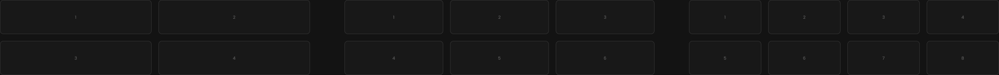

<!-- GEN:BEGIN 本段由 tools/gen-component-docs.py 依据 Figma 导出生成，勿手改；改 Figma 后重新生成 -->

## 概览

| 项 | 值 |
|---|---|
| Figma 组件集 | `Grid`（node `56066:6344`） |
| 分类 | 布局类 |
| 变体数 | 3 |
| 默认变体 | `Columns=2` |
| 参考尺寸 | 720×176 px（默认变体） |
| 主题 | 主库（深色中性 + 品牌砂色） |
| 预览图 | [assets/previews/grid.png](../../assets/previews/grid.png) |
| 代码实现 | [`components/Grid/Grid.tsx`](../../components/Grid/Grid.tsx) |
| Figma 链接 | [在 Figma 打开](https://www.figma.com/design/ZO4WH3sbVCj7lZIFMpiwV9/VibeMe-App---Web-Design-%E5%A4%87%E4%BB%BD?node-id=56066-6344) |



## 变体与属性

| Figma 属性 | 类型 | 取值 | 默认 | 代码 prop |
|---|---|---|---|---|
| `Columns` | VARIANT | `2` / `3` / `4` | `2` | `columns` |

变体是属性轴的笛卡尔积：**3 = 3**（`Columns`）。

## 各变体的事实

> 填充栈按 Figma 图层顺序排列（**靠右的是上层**，hover/pressed 的叠加层在最后）。
> `⚠无cssVar` 表示该组件引用了历史遗留变量，代码里不要照抄，按 `foundations.md` 的规则换成语义 token。

| 变体 | 尺寸 | 填充栈 | 描边 | 圆角 | 内边距 上/右/下/左 | 不透明度 |
|---|---|---|---|---|---|---|
| `Columns=2` | 720×176 | — | — | — | 0/0/0/0 | — |
| `Columns=3` | 720×176 | — | — | — | 0/0/0/0 | — |
| `Columns=4` | 720×176 | — | — | — | 0/0/0/0 | — |

## 结构（默认变体）

### Columns=2

```text
`COMPONENT` Columns=2 720×176 VERTICAL gap 16 pad 0/0/0/0
└─ `FRAME` Frame 720×80 HORIZONTAL gap 16 pad 0/0/0/0
  └─ `FRAME` Frame 352×80 HORIZONTAL gap 0 pad 0/0/0/0 填充 `White/White-9` #FFFFFF 2% `--vm-white-9` 描边 `Background/border-default` #FFFFFF 12% `--vm-border-default` 圆角 8
    └─ `TEXT` 1 4×14 填充 `Text/Text-Tertiary` #FFFFFF 30% `--vm-text-tertiary` 文字样式 `Caption/Label`（10 Medium /14） 内容 '1'
  └─ `FRAME` Frame 352×80 HORIZONTAL gap 0 pad 0/0/0/0 填充 `White/White-9` #FFFFFF 2% `--vm-white-9` 描边 `Background/border-default` #FFFFFF 12% `--vm-border-default` 圆角 8
    └─ `TEXT` 2 6×14 填充 `Text/Text-Tertiary` #FFFFFF 30% `--vm-text-tertiary` 文字样式 `Caption/Label`（10 Medium /14） 内容 '2'
└─ `FRAME` Frame 720×80 HORIZONTAL gap 16 pad 0/0/0/0
  └─ `FRAME` Frame 352×80 HORIZONTAL gap 0 pad 0/0/0/0 填充 `White/White-9` #FFFFFF 2% `--vm-white-9` 描边 `Background/border-default` #FFFFFF 12% `--vm-border-default` 圆角 8
    └─ `TEXT` 3 6×14 填充 `Text/Text-Tertiary` #FFFFFF 30% `--vm-text-tertiary` 文字样式 `Caption/Label`（10 Medium /14） 内容 '3'
  └─ `FRAME` Frame 352×80 HORIZONTAL gap 0 pad 0/0/0/0 填充 `White/White-9` #FFFFFF 2% `--vm-white-9` 描边 `Background/border-default` #FFFFFF 12% `--vm-border-default` 圆角 8
    └─ `TEXT` 4 7×14 填充 `Text/Text-Tertiary` #FFFFFF 30% `--vm-text-tertiary` 文字样式 `Caption/Label`（10 Medium /14） 内容 '4'
```

### Columns=4

```text
`COMPONENT` Columns=4 720×176 VERTICAL gap 16 pad 0/0/0/0
└─ `FRAME` Frame 720×80 HORIZONTAL gap 16 pad 0/0/0/0
  └─ `FRAME` Frame 168×80 HORIZONTAL gap 0 pad 0/0/0/0 填充 `White/White-9` #FFFFFF 2% `--vm-white-9` 描边 `Background/border-default` #FFFFFF 12% `--vm-border-default` 圆角 8
    └─ `TEXT` 1 4×14 填充 `Text/Text-Tertiary` #FFFFFF 30% `--vm-text-tertiary` 文字样式 `Caption/Label`（10 Medium /14） 内容 '1'
  └─ `FRAME` Frame 168×80 HORIZONTAL gap 0 pad 0/0/0/0 填充 `White/White-9` #FFFFFF 2% `--vm-white-9` 描边 `Background/border-default` #FFFFFF 12% `--vm-border-default` 圆角 8
    └─ `TEXT` 2 6×14 填充 `Text/Text-Tertiary` #FFFFFF 30% `--vm-text-tertiary` 文字样式 `Caption/Label`（10 Medium /14） 内容 '2'
  └─ `FRAME` Frame 168×80 HORIZONTAL gap 0 pad 0/0/0/0 填充 `White/White-9` #FFFFFF 2% `--vm-white-9` 描边 `Background/border-default` #FFFFFF 12% `--vm-border-default` 圆角 8
    └─ `TEXT` 3 6×14 填充 `Text/Text-Tertiary` #FFFFFF 30% `--vm-text-tertiary` 文字样式 `Caption/Label`（10 Medium /14） 内容 '3'
  └─ `FRAME` Frame 168×80 HORIZONTAL gap 0 pad 0/0/0/0 填充 `White/White-9` #FFFFFF 2% `--vm-white-9` 描边 `Background/border-default` #FFFFFF 12% `--vm-border-default` 圆角 8
    └─ `TEXT` 4 7×14 填充 `Text/Text-Tertiary` #FFFFFF 30% `--vm-text-tertiary` 文字样式 `Caption/Label`（10 Medium /14） 内容 '4'
└─ `FRAME` Frame 720×80 HORIZONTAL gap 16 pad 0/0/0/0
  └─ `FRAME` Frame 168×80 HORIZONTAL gap 0 pad 0/0/0/0 填充 `White/White-9` #FFFFFF 2% `--vm-white-9` 描边 `Background/border-default` #FFFFFF 12% `--vm-border-default` 圆角 8
    └─ `TEXT` 5 7×14 填充 `Text/Text-Tertiary` #FFFFFF 30% `--vm-text-tertiary` 文字样式 `Caption/Label`（10 Medium /14） 内容 '5'
  └─ `FRAME` Frame 168×80 HORIZONTAL gap 0 pad 0/0/0/0 填充 `White/White-9` #FFFFFF 2% `--vm-white-9` 描边 `Background/border-default` #FFFFFF 12% `--vm-border-default` 圆角 8
    └─ `TEXT` 6 7×14 填充 `Text/Text-Tertiary` #FFFFFF 30% `--vm-text-tertiary` 文字样式 `Caption/Label`（10 Medium /14） 内容 '6'
  └─ `FRAME` Frame 168×80 HORIZONTAL gap 0 pad 0/0/0/0 填充 `White/White-9` #FFFFFF 2% `--vm-white-9` 描边 `Background/border-default` #FFFFFF 12% `--vm-border-default` 圆角 8
    └─ `TEXT` 7 6×14 填充 `Text/Text-Tertiary` #FFFFFF 30% `--vm-text-tertiary` 文字样式 `Caption/Label`（10 Medium /14） 内容 '7'
  └─ `FRAME` Frame 168×80 HORIZONTAL gap 0 pad 0/0/0/0 填充 `White/White-9` #FFFFFF 2% `--vm-white-9` 描边 `Background/border-default` #FFFFFF 12% `--vm-border-default` 圆角 8
    └─ `TEXT` 8 7×14 填充 `Text/Text-Tertiary` #FFFFFF 30% `--vm-text-tertiary` 文字样式 `Caption/Label`（10 Medium /14） 内容 '8'
```


## 设计 token

| Figma 变量 | CSS 变量 | 值 |
|---|---|---|
| `Background/border-default` | `--vm-border-default` | `rgba(255, 255, 255, 0.12)` |
| `Radious/radius-md` | `--vm-radius-md` | `8px` |
| `Text/Text-Tertiary` | `--vm-text-tertiary` | `rgba(255, 255, 255, 0.3)` |
| `White/White-9` | `--vm-white-9` | `rgba(255, 255, 255, 0.02)` |
| `border/width/thin` | `--vm-border-width-thin` | `1px` |
| `space/space-4` | `--vm-space-4` | `16px` |

<!-- GEN:END -->


## 交互与状态

**Grid 没有交互态，也没有应用态。** Figma 的属性轴只有一个 `Columns`（2/3/4），没有 `State` 轴，
所以实现里不存在 `:hover` / `:active` / `:focus-visible` 规则，也没有 `disabled` / `error` / `open`
之类的 prop —— 唯一的 prop 就是 `columns`，多一个都算发明。

容器不加背景、不加描边、不加圆角（导出里根节点 `fills` / `strokes` / `radius` 全为空），
也不写 `cursor` / `pointer-events`，事件与焦点完全落在子元素上；格子里的按钮、链接该有的
hover 叠加（`--vm-white-7`）和 `:focus-visible` 聚焦环（`--vm-border-selected`）都不会被容器拦截。

唯一“随状态变化”的是列数：`columns` 一变，`grid-template-columns: repeat(n, minmax(0, 1fr))`
重算，所有格子等分新宽度，行距列距恒为 `--vm-space-4`（16px）。因为用的是等分 `fr` 而不是
内容宽度，列数切换过程中不会出现某列被长文案顶宽、其它列被挤扁的抖动。

## 代码用法

```tsx
import { Grid } from '../../components/Grid';
import { Card } from '../../components/Card';
// 样式随组件一起进来：components/Grid/index.ts → Grid.tsx 已 import './Grid.css'

// 默认变体 Columns=2
<Grid>
  <Card>本月生成</Card>
  <Card>剩余额度</Card>
</Grid>

// Columns=4（Figma 最大档），适合指标卡墙
<Grid columns={4} role="list">
  <Card role="listitem">总项目</Card>
  <Card role="listitem">活跃项目</Card>
  <Card role="listitem">本周新增</Card>
  <Card role="listitem">失败任务</Card>
</Grid>

// 列数是真数值：5 列、7 列都合法（Figma 只画到 4，但间距与等分规则不变）
<Grid columns={7} className="my-asset-grid">
  {assetList.map((a) => <Card key={a.id}>{a.name}</Card>)}
</Grid>
```

`columns` 的内部处理：非数字 / `NaN` / `Infinity` → 回落到 `2`；小数 `Math.floor`；
小于 1 钳到 `1`；传 `0` 或负数不会生成非法 CSS。

CSS 导入方式：`import { Grid } from '../../components/Grid'`。
不要手写 `grid-template-columns`，也不要给 `.vm-grid` 加宽度 —— Figma 里的 720 只是画板参考宽，
实际宽度由父级决定；需要固定宽就传 `style={{ width: 720 }}`。

## 可访问性

根元素是普通 `<div>`，**没有**隐式 role、**没有** tabIndex、**不进入** Tab 顺序。网格只是排版手段，
读屏软件不应该为此多念一句。

- 需要列表语义时由调用方补：容器 `role="list"`，每个直接子项 `role="listitem"`
  （这两个属性都经 `...rest` 透传到根节点与子元素，组件不做任何改写）。
- **不要**给 Grid 加 `role="grid"` / `role="table"`。ARIA 的 `grid` 是键盘可导航的二维控件
  （`role="gridcell"` + 方向键 + `aria-rowindex`），这里的 Grid 没有键盘交互，套上去只会误导读屏用户；
  真正的表格式数据请用 `Table`。
- DOM 顺序即视觉顺序：`display: grid` 按源码顺序填格，没有 `order` 参与，所以键盘 Tab 与读屏浏览
  的顺序天然等于你写在 children 里的顺序；需要改变阅读顺序时请改 DOM，不要用 `grid-area` 视觉重排。
- 子项内的可聚焦元素（按钮、链接）数量多时，Tab 会逐个穿过所有格子，这是预期行为；
  格子里放整卡可点击内容时，请让卡片只有一个可聚焦入口，避免一个格子产生多个 Tab 停靠点。

## 不要这样做

1. **不要把演示格子当成 Grid 的外观**。结构树里那些 720/352/168 宽、80 高的 `Frame` 是 Figma
   画出来示意分栏的演示内容，它们身上的 `White/White-9`（`--vm-white-9`，2% 白底）、
   `Background/border-default`（`--vm-border-default`，12% 白描边）、`Radious/radius-md`
   （`--vm-radius-md`，8px 圆角）**不属于 Grid 本体**。要卡片底用 `Card`（`--vm-bg-card`）。
2. **不要把 `columns` 做成三档枚举**。Figma 只画了 2/3/4，但这是数值语义：
   `columns={5}` 必须正常工作。反过来也别传浮点数指望它四舍五入成 3.5——实现按 `Math.floor` 取整。
3. **不要自己写 `gap`**。行列间距在 Figma 里两处都绑 `space/space-4`，实现固定为
   `gap: var(--vm-space-4)`（16px）；Grid 没有 `Gap` 属性轴，加一个 `gap` prop 属于发明 props。
   需要别的间距请在外层用 `Stack` 或原生 `style`，不要改 Grid 的 CSS。
4. **不要用 Grid 做单轴向堆叠**。只有一列或一行时用 `Stack`（`--vm-space-2/4/6` 三档间距），
   Grid 的等分列会把单个子项拉到满宽，语义也不对。
5. **不要给等分列写死宽度**。Figma 的 352 / 168 是 720 宽画板下算出来的结果
   （`(720 − (n−1) × 16) / n`），换成别的容器宽就会错；实现用 `minmax(0, 1fr)`，
   同时避免长文案把列撑宽（`minmax(0, …)` 的 `0` 不能省）。
6. **不要用 Grid 伪造表格**。需要表头、行选中、列排序时用 `Table` / `TableRow` / `TableCell`，
   它们已经带好了 `role="table"` 一族语义；用 Grid 拼出来的表对读屏软件就是一堆 div。

## 相关组件

- **Stack**（`56066:6298`）：单轴向堆叠（间距 sm/md/lg）。**一维用 Stack，二维用 Grid**；
  两者互相嵌套是最常见的用法 —— `Grid` 排卡片、每张卡片内部用 `Stack` 纵向排标题与按钮。
- **Card**：Grid 的典型子项。Figma 里 Grid 的演示格就是"一个方块里放一段 `Caption/Label`"，
  落地时换成真卡片即可（卡片自带 `--vm-bg-card` 与 `--vm-radius-card`，不要在 Grid 上补）。
- **Header / Sidebar / Container**：页面骨架里 Grid 负责内容区的多列分栏，
  Header 仍是横向的一条（内部用 `Stack direction="horizontal"`）。
- **Table / TableRow / TableCell**：表格语义场景请用它们，不要用 Grid 拼。
- **Skeleton / Empty**：Grid 的值加载中用 `Skeleton` 顶上、保持列宽稳定，空数据时用 `Empty`。
