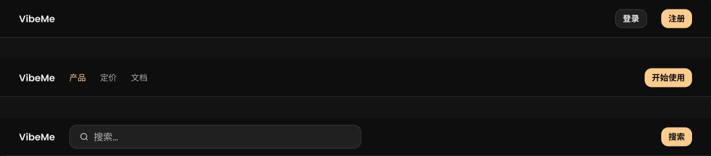

<!-- GEN:BEGIN 本段由 tools/gen-component-docs.py 依据 Figma 导出生成，勿手改；改 Figma 后重新生成 -->

## 概览

| 项 | 值 |
|---|---|
| Figma 组件集 | `Header`（node `56066:6374`） |
| 分类 | 布局类 |
| 变体数 | 3 |
| 默认变体 | `Type=simple` |
| 参考尺寸 | 1200×64 px（默认变体） |
| 主题 | 主库（深色中性 + 品牌砂色） |
| 预览图 | [assets/previews/header.png](../../assets/previews/header.png) |
| 代码实现 | [`components/Header/Header.tsx`](../../components/Header/Header.tsx) |
| Figma 链接 | [在 Figma 打开](https://www.figma.com/design/ZO4WH3sbVCj7lZIFMpiwV9/VibeMe-App---Web-Design-%E5%A4%87%E4%BB%BD?node-id=56066-6374) |



## 变体与属性

| Figma 属性 | 类型 | 取值 | 默认 | 代码 prop |
|---|---|---|---|---|
| `Type` | VARIANT | `simple` / `with-nav` / `with-search` | `simple` | `type` |

变体是属性轴的笛卡尔积：**3 = 3**（`Type`）。

内嵌组件：`Size=md, State=default`×1、`Type=primary, Size=sm, State=default`×3、`Type=secondary, Size=sm, State=default`×1

## 各变体的事实

> 填充栈按 Figma 图层顺序排列（**靠右的是上层**，hover/pressed 的叠加层在最后）。
> `⚠无cssVar` 表示该组件引用了历史遗留变量，代码里不要照抄，按 `foundations.md` 的规则换成语义 token。

| 变体 | 尺寸 | 填充栈 | 描边 | 圆角 | 内边距 上/右/下/左 | 不透明度 |
|---|---|---|---|---|---|---|
| `Type=simple` | 1200×64 | `Background/bg-app` #0E0E0E `--vm-bg-app` | `Background/border-default` #FFFFFF 12% `--vm-border-default` | — | 0/32/0/32 | — |
| `Type=with-nav` | 1200×64 | `Background/bg-app` #0E0E0E `--vm-bg-app` | `Background/border-default` #FFFFFF 12% `--vm-border-default` | — | 0/32/0/32 | — |
| `Type=with-search` | 1200×64 | `Background/bg-app` #0E0E0E `--vm-bg-app` | `Background/border-default` #FFFFFF 12% `--vm-border-default` | — | 0/32/0/32 | — |

## 结构（默认变体）

### Type=simple

```text
`COMPONENT` Type=simple 1200×64 HORIZONTAL gap 24 pad 0/32/0/32 填充 `Background/bg-app` #0E0E0E `--vm-bg-app` 描边 `Background/border-default` #FFFFFF 12% `--vm-border-default`
└─ `TEXT` VibeMe 61×24 填充 `Text/Text-Primary` #FFFFFF 92% `--vm-text-primary` 文字样式 `Heading/M`（16 SemiBold /24） 内容 'VibeMe'
└─ `FRAME` Frame 897×1
└─ `INSTANCE` Button 54×32 HORIZONTAL gap 0 pad 0/12/0/12 填充 `Background/bg-card` #202020 `--vm-bg-card` 描边 `Background/border-default` #FFFFFF 12% `--vm-border-default` 圆角 12 实例=Type=secondary, Size=sm, State=default
  └─ `TEXT` Button 28×20 填充 `Text/Text-Primary` #FFFFFF 92% `--vm-text-primary` 文字样式 `Heading/S`（14 SemiBold /20） 内容 '登录'
└─ `INSTANCE` Button 52×32 HORIZONTAL gap 0 pad 0/12/0/12 填充 `Brand/Brand` #FFCC90 `--vm-brand` 圆角 12 实例=Type=primary, Size=sm, State=default
  └─ `TEXT` Button 28×20 填充 `Neutral/Neutral-950` #0E0E0E `--vm-neutral-950` 文字样式 `Heading/S`（14 SemiBold /20） 内容 '注册'
```

### Type=with-search

```text
`COMPONENT` Type=with-search 1200×64 HORIZONTAL gap 24 pad 0/32/0/32 填充 `Background/bg-app` #0E0E0E `--vm-bg-app` 描边 `Background/border-default` #FFFFFF 12% `--vm-border-default`
└─ `TEXT` VibeMe 61×24 填充 `Text/Text-Primary` #FFFFFF 92% `--vm-text-primary` 文字样式 `Heading/M`（16 SemiBold /24） 内容 'VibeMe'
└─ `INSTANCE` Search 492.5×40 HORIZONTAL gap 8 pad 0/16/0/16 填充 `Background/bg-card` #202020 `--vm-bg-card` 描边 `Background/border-default` #FFFFFF 12% `--vm-border-default` 圆角 12 实例=Size=md, State=default
  └─ `INSTANCE` Line icon 16×16 实例=Property 1=icon, Property 2=search-line
    └─ `VECTOR` icon 12.17×12.17 填充 #FFFFFF
  └─ `TEXT` Search 434.5×24 填充 `Text/Text-Secondary` #FFFFFF 64% `--vm-text-secondary` 文字样式 `Heading/Body/M/Regular`（16 Regular /24） 内容 '搜索…'
└─ `FRAME` Frame 458.5×1
└─ `INSTANCE` Button 52×32 HORIZONTAL gap 0 pad 0/12/0/12 填充 `Brand/Brand` #FFCC90 `--vm-brand` 圆角 12 实例=Type=primary, Size=sm, State=default
  └─ `TEXT` Button 28×20 填充 `Neutral/Neutral-950` #0E0E0E `--vm-neutral-950` 文字样式 `Heading/S`（14 SemiBold /20） 内容 '搜索'
```


## 设计 token

| Figma 变量 | CSS 变量 | 值 |
|---|---|---|
| `Background/bg-app` | `--vm-bg-app` | `#0E0E0E` |
| `Background/bg-card` | `--vm-bg-card` | `#202020` |
| `Background/border-default` | `--vm-border-default` | `rgba(255, 255, 255, 0.12)` |
| `Brand/Brand` | `--vm-brand` | `#FFCC90` |
| `Neutral/Neutral-950` | `--vm-neutral-950` | `#0E0E0E` |
| `Semantic Radius/radius-button` | `--vm-radius-button` | `12px` |
| `Semantic Radius/radius-input` | `--vm-radius-input` | `12px` |
| `Semantic Space/padding-button-sm-x` | `--vm-padding-button-sm-x` | `12px` |
| `Semantic Space/padding-input-x` | `--vm-padding-input-x` | `16px` |
| `Text/Text-Primary` | `--vm-text-primary` | `rgba(255, 255, 255, 0.92)` |
| `Text/Text-Secondary` | `--vm-text-secondary` | `rgba(255, 255, 255, 0.64)` |
| `border/width/thin` | `--vm-border-width-thin` | `1px` |
| `space/space-2` | `--vm-space-2` | `8px` |
| `space/space-6` | `--vm-space-6` | `24px` |
| `space/space-8` | `--vm-space-8` | `32px` |

<!-- GEN:END -->


## 交互与状态

**Header 自己没有交互态，也没有应用态。** Figma 里唯一的属性轴是 `Type`(simple / with-nav / with-search)，
它是「放什么内容」的形态开关，不是 `State`；没有 `default` / `hover` / `pressed` / `focus`，也没有
`disabled` / `error` / `open`。所以实现里没有任何 `:hover` / `:active` / `:focus-visible` 规则，
props 也只有 `type` / `brand` / `actions` 三个（其余是原生透传）。

顶栏的两个视觉值在所有状态下都不变：底部 1px 分隔线恒为 `--vm-border-default`（`Background/border-default`，
12% 白），底色恒为 `--vm-bg-app`（`Background/bg-app`，`#0E0E0E`）。**不要**因为它挨着
`Search` / `Button` 就顺手把 hover 换成 `--vm-white-4` —— 那是 Input / Search 一族（描边换色）的手法，
Header 没有 `State` 变体支撑这个改动。

真正的交互全部落在子元素身上：`Button` 自己叠加 `--vm-white-7`（hover）/ `--vm-white-6`（pressed），
`Search` 自己把描边从 `--vm-border-default` 换成 `--vm-white-4`，导航链接自己写 `:hover` 文字色。
Header 不写 `cursor`、不写 `pointer-events`，也不加 `tabIndex`，所以这些状态与
`:focus-visible` 的 `--vm-border-selected` 聚焦环都不会被容器吞掉。

唯一与 `type` 有关的布局差异：`with-search` 时中间区变成 `flex: 1 1 0`，与弹性空档
（`.vm-header__spacer`）平分剩余宽度 —— 这正是 Figma 里 `Search` 宽 492.5、空档宽 458.5 的由来。

## 代码用法

```tsx
import { Header } from '../../components/Header';
import { Button } from '../../components/Button';
import { Search } from '../../components/Search';
// 样式随组件一起进来：components/Header/index.ts → Header.tsx 已 import './Header.css'

// 默认变体 Type=simple：品牌 + 右侧操作区
<Header
  actions={
    <>
      <Button type="secondary" size="sm">登录</Button>
      <Button type="primary" size="sm">注册</Button>
    </>
  }
/>

// Type=with-search：中间 Search 会撑满，右端一个 primary 按钮（与 Figma 一致）
<Header
  type="with-search"
  actions={<Button type="primary" size="sm">搜索</Button>}
>
  <Search size="md" placeholder="搜索…" />
</Header>

// Type=with-nav：中间放导航链接，宽度按内容（不会像 with-search 那样被拉满）
<Header
  type="with-nav"
  brand={<a className="vm-header__brand-link" href="/">VibeMe</a>}
  actions={<Button type="primary" size="sm">注册</Button>}
>
  <nav aria-label="主导航">
    <ul className="vm-header__nav">
      <li><a href="/home">首页</a></li>
      <li><a href="/projects">项目</a></li>
    </ul>
  </nav>
</Header>
```

`brand` 默认是 Figma 里的文本 `VibeMe`（`Heading/M`，16 SemiBold，色 `--vm-text-primary`）；
换成图标时传 `ReactNode` 即可。`actions` 没有默认值 —— Figma 里的「登录 / 注册 / 搜索」是演示文案，
按钮一律由调用方用 `Button` 组合。

CSS 导入方式：`import { Header } from '../../components/Header'`。
不要写死 `width: 1200px`，Figma 的 1200 只是画板参考宽，顶栏宽度由父级决定；
需要吸顶时用 `className` 或 `style` 自己加 `position: sticky; top: 0`（Figma 没有 sticky 事实）。

## 可访问性

根元素是原生 **`<header>`**（不是 `div`）：作为 `<body>` 的直接后代时会被映射成 **`banner` landmark**，
屏幕阅读器可以直接跳转过去；若被放进 `<article>` / `<section>` / `<main>` 内部，它降级为该区块的头部，
这时语义也是对的。**一页只应有一个顶层 `<header>`** —— 放两个会产生两个 `banner`，跳转列表就失去意义。

- 中间区放导航时请自己包 `<nav aria-label="主导航">`（`aria-label` 用于区分页内多个 `nav`），
  组件不替你加 `role="navigation"`，因为 `Type=simple` 时中间区根本没有导航。
- 搜索区建议用 `<form role="search">` 或 `Search` 组件自身的语义，并在容器上加 `aria-label="站内搜索"`。
- 品牌是链接时用真实 `<a href="/">`（可聚焦、可回车），不要用 `<div onClick>`；`brand` 插槽会原样渲染。
- 弹性空档 `.vm-header__spacer` 是空的装饰元素，带 `aria-hidden="true"`，不进入可达性树。
- Tab 顺序 = DOM 顺序：品牌 → 中间区 → 右侧操作区，与视觉顺序一致（没有任何 `order` 手段参与）。
  建议在整个 Header 之前放一个「跳到主内容」的 skip link。
- `<header>` 本身**不加** `tabIndex`、不做焦点陷阱；登录/注册这类操作请用真 `<button>`（`Button` 组件即是）。

## 不要这样做

1. **不要给 Header 加 hover / pressed / focus 的描边或底色变化。** Figma 的 Header 只有 `Type` 一个轴，
   没有 `State` 轴，容器在导出里三个变体的 `fills` / `strokes` 完全相同。
   `hover → --vm-white-4`、`focus → --vm-border-selected` 是 Input / Search / Select / Tabs 一族的描边换色手法，
   套到 Header 上没有事实依据。
2. **不要用 `--vm-bg-panel` / `--vm-bg-card` 做顶栏底。** 事实是 `Background/bg-app`
   （`--vm-bg-app`，`#0E0E0E`）；`#1A1A1A` / `#202020` 是面板与卡片的层级，顶栏用它们会与页面底色糊在一起。
3. **不要给容器写 `border: 1px solid`。** Figma 根节点的 `strokeWeight` 是 `mixed` —— 只有**底部**一条
   1px 的 `--vm-border-default`；四边全包会多出三条白边，与设计不符。
4. **不要写死 `width: 1200px`。** 1200 只是 Figma 画板的参考宽（`wSizing=FIXED`），
   真实产品里顶栏宽度必须跟随视口；需要最大宽度请用 `Container` 或外层样式。
5. **不要把 `Type` 做成三套外观。** 三个变体的容器事实（尺寸、gap 24、左右内边距 32、底色、描边）
   **完全一致**，差别只在中间放了什么；给 `with-nav` 单独换一套内边距或高度属于发明。
6. **不要用 Header 的 `actions` 承载主导航。** Figma 里右侧固定是 `Button` 实例组；
   导航链接属于中间区（`children`），塞进 `actions` 会让「操作」与「导航」的语义混在一起。
7. **不要照抄 `Search` / `Button` 子节点的 token。** 结构树里 `Search` 的 `--vm-bg-card` 填充、
   `--vm-radius-input` 圆角、`--vm-text-secondary` 提示文字，以及 `Button` 的 `--vm-brand` / `--vm-neutral-950`，
   都属于**那些组件自己的**事实；Header 只负责容器，重复实现一遍就会造成两处 token 漂移。

## 相关组件

- **Button**（内嵌）：Figma `Header` 里就有 4 个 `Button` 实例 —— `Type=simple` 是
  `Type=secondary, Size=sm` 的「登录」＋ `Type=primary, Size=sm` 的「注册」，`Type=with-search` 只有 primary「搜索」。
   代码里直接用 `<Button>` 组合，不要重写一套按钮样式；`sm` 尺寸（高 32）与 64 高的顶栏正好匹配。
- **Search**（内嵌）：`Type=with-search` 的中间区就是 `Search`(`Size=md, State=default`)，
   在 Figma 里是 `FILL`（实测宽 492.5），代码里放进 `children` 就会被 Header 拉满。
- **Container / Grid / Stack**：Header 只占一条 64 高的横条，下面的内容用 `Container` 限宽、
  用 `Grid` / `Stack` 排版，不要把页面留白塞进 Header 的左右内边距（那 32px 是 `space/space-8`）。
- **Sidebar**：左侧导航栏与 Header 属于同一层页面骨架，两者拼在一起时由外层布局决定谁固定、谁滚动。
- **MenuItem / Breadcrumb**：`Type=with-nav` 的中间区若需要下拉，直接用 `MenuItem` 列表，
  不要在 Header 里另写一套导航项样式。
- **Avatar / Notification**：顶栏右侧除按钮外常见头像入口与通知铃铛，放 `actions` 里即可。
