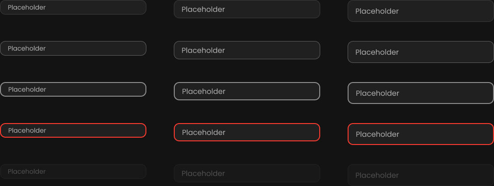

<!-- GEN:BEGIN 本段由 tools/gen-component-docs.py 依据 Figma 导出生成，勿手改；改 Figma 后重新生成 -->

## 概览

| 项 | 值 |
|---|---|
| Figma 组件集 | `Input`（node `56058:5648`） |
| 分类 | 表单控件 |
| 变体数 | 15 |
| 默认变体 | `Size=sm, State=default` |
| 参考尺寸 | 320×32 px（默认变体） |
| 主题 | 主库（深色中性 + 品牌砂色） |
| 预览图 | [assets/previews/input.png](../../assets/previews/input.png) |
| 代码实现 | [`components/Input/Input.tsx`](../../components/Input/Input.tsx) |
| Figma 链接 | [在 Figma 打开](https://www.figma.com/design/ZO4WH3sbVCj7lZIFMpiwV9/VibeMe-App---Web-Design-%E5%A4%87%E4%BB%BD?node-id=56058-5648) |



## 变体与属性

| Figma 属性 | 类型 | 取值 | 默认 | 代码 prop |
|---|---|---|---|---|
| `placeholder` | TEXT（内容插槽） | — | — | `children` |
| `Size` | VARIANT | `sm` / `md` / `lg` | `sm` | `size` |
| `State` | VARIANT | `default` / `hover` / `focus` / `error` / `disabled` | `default` | `state` |

变体是属性轴的笛卡尔积：**15 = 3 × 5**（`Size` × `State`）。

## 各变体的事实

> 填充栈按 Figma 图层顺序排列（**靠右的是上层**，hover/pressed 的叠加层在最后）。
> `⚠无cssVar` 表示该组件引用了历史遗留变量，代码里不要照抄，按 `foundations.md` 的规则换成语义 token。

| 变体 | 尺寸 | 填充栈 | 描边 | 圆角 | 内边距 上/右/下/左 | 不透明度 |
|---|---|---|---|---|---|---|
| `Size=sm, State=default` | 320×32 | `Background/bg-card` #202020 `--vm-bg-card` | `Background/border-default` #FFFFFF 12% `--vm-border-default` | 12 | 0/16/0/16 | — |
| `Size=sm, State=hover` | 320×32 | `Background/bg-card` #202020 `--vm-bg-card` | `White/White-4` #FFFFFF 30% `--vm-white-4` | 12 | 0/16/0/16 | — |
| `Size=sm, State=focus` | 320×32 | `Background/bg-card` #202020 `--vm-bg-card` | `Background/border-selected` #FFFFFF 50% `--vm-border-selected` | 12 | 0/16/0/16 | — |
| `Size=sm, State=error` | 320×32 | `Background/bg-card` #202020 `--vm-bg-card` | `状态色/Error` #FF3B30 `--vm-status-error` | 12 | 0/16/0/16 | — |
| `Size=sm, State=disabled` | 320×32 | `Background/bg-card` #202020 `--vm-bg-card` | `Background/border-default` #FFFFFF 12% `--vm-border-default` | 12 | 0/16/0/16 | 0.38 |
| `Size=md, State=default` | 320×40 | `Background/bg-card` #202020 `--vm-bg-card` | `Background/border-default` #FFFFFF 12% `--vm-border-default` | 12 | 0/16/0/16 | — |
| `Size=md, State=hover` | 320×40 | `Background/bg-card` #202020 `--vm-bg-card` | `White/White-4` #FFFFFF 30% `--vm-white-4` | 12 | 0/16/0/16 | — |
| `Size=md, State=focus` | 320×40 | `Background/bg-card` #202020 `--vm-bg-card` | `Background/border-selected` #FFFFFF 50% `--vm-border-selected` | 12 | 0/16/0/16 | — |
| `Size=md, State=error` | 320×40 | `Background/bg-card` #202020 `--vm-bg-card` | `状态色/Error` #FF3B30 `--vm-status-error` | 12 | 0/16/0/16 | — |
| `Size=md, State=disabled` | 320×40 | `Background/bg-card` #202020 `--vm-bg-card` | `Background/border-default` #FFFFFF 12% `--vm-border-default` | 12 | 0/16/0/16 | 0.38 |
| `Size=lg, State=default` | 320×48 | `Background/bg-card` #202020 `--vm-bg-card` | `Background/border-default` #FFFFFF 12% `--vm-border-default` | 12 | 0/16/0/16 | — |
| `Size=lg, State=hover` | 320×48 | `Background/bg-card` #202020 `--vm-bg-card` | `White/White-4` #FFFFFF 30% `--vm-white-4` | 12 | 0/16/0/16 | — |
| `Size=lg, State=focus` | 320×48 | `Background/bg-card` #202020 `--vm-bg-card` | `Background/border-selected` #FFFFFF 50% `--vm-border-selected` | 12 | 0/16/0/16 | — |
| `Size=lg, State=error` | 320×48 | `Background/bg-card` #202020 `--vm-bg-card` | `状态色/Error` #FF3B30 `--vm-status-error` | 12 | 0/16/0/16 | — |
| `Size=lg, State=disabled` | 320×48 | `Background/bg-card` #202020 `--vm-bg-card` | `Background/border-default` #FFFFFF 12% `--vm-border-default` | 12 | 0/16/0/16 | 0.38 |

## 结构（默认变体）

### Size=sm, State=default

```text
`COMPONENT` Size=sm, State=default 320×32 HORIZONTAL gap 0 pad 0/16/0/16 填充 `Background/bg-card` #202020 `--vm-bg-card` 描边 `Background/border-default` #FFFFFF 12% `--vm-border-default` 圆角 12
└─ `TEXT` Placeholder 286×20 填充 `Text/Text-Secondary` #FFFFFF 64% `--vm-text-secondary` 文字样式 `Heading/Body/S/Regular`（14 Regular /20） 内容 'Placeholder'
```

### Size=lg, State=error

```text
`COMPONENT` Size=lg, State=error 320×48 HORIZONTAL gap 0 pad 0/16/0/16 填充 `Background/bg-card` #202020 `--vm-bg-card` 描边 `状态色/Error` #FF3B30 `--vm-status-error` 圆角 12
└─ `TEXT` Placeholder 284×24 填充 `Text/Text-Secondary` #FFFFFF 64% `--vm-text-secondary` 文字样式 `Heading/Body/M/Regular`（16 Regular /24） 内容 'Placeholder'
```


## 设计 token

| Figma 变量 | CSS 变量 | 值 |
|---|---|---|
| `Background/bg-card` | `--vm-bg-card` | `#202020` |
| `Background/border-default` | `--vm-border-default` | `rgba(255, 255, 255, 0.12)` |
| `Background/border-selected` | `--vm-border-selected` | `rgba(255, 255, 255, 0.5)` |
| `Semantic Radius/radius-input` | `--vm-radius-input` | `12px` |
| `Semantic Space/padding-input-x` | `--vm-padding-input-x` | `16px` |
| `Text/Text-Secondary` | `--vm-text-secondary` | `rgba(255, 255, 255, 0.64)` |
| `White/White-4` | `--vm-white-4` | `rgba(255, 255, 255, 0.3)` |
| `border/width/thick` | `--vm-border-width-thick` | `2px` |
| `border/width/thin` | `--vm-border-width-thin` | `1px` |
| `focus/ring-width` | `--vm-focus-ring-width` | `2px` |
| `opacity/disabled` | `--vm-opacity-disabled` | `0.38` |
| `状态色/Error` | `--vm-status-error` | `#FF3B30` |

<!-- GEN:END -->


## 交互与状态

五档 `State` 在代码里拆成两类，**不要把 `State` 原样做成 prop**：

| Figma State | 代码触发方式 | 视觉上变了什么 |
|---|---|---|
| `default` | 无 | 底色 `--vm-bg-card`（`Background/bg-card` #202020）＋ 1px 描边 `--vm-border-default`（`Background/border-default` 12% 白） |
| `hover` | CSS `:hover:not(:disabled)` | **只换描边的实体值**：`--vm-border-default` → `--vm-white-4`（`White/White-4`，30% 白）。底色完全不叠加图层 |
| `focus` | CSS `:focus-visible` | 描边换成 `--vm-border-selected`（`Background/border-selected` 50% 白），线宽 1px → `--vm-border-width-thick`（`border/width/thick` 2px），并叠 `--vm-focus-ring-width` 的 ring |
| `error` | prop `error` | 描边换成 `--vm-status-error`（`状态色/Error` #FF3B30），线宽 2px；再传 `errorMessage` 时下方出现一行红色说明 |
| `disabled` | 原生 `disabled` | 只有 `opacity: var(--vm-opacity-disabled)`（`opacity/disabled` 0.38）＋ `cursor: not-allowed`，描边、底色、文字色**一个都不换** |

⚠️ 与 Button 的差异（同一设计体系里两种 hover 手法，别互相套）：Button 的 `hover` 是在底色上追加一层 `--vm-white-7`（8% 白叠加），
而 Input 的 `hover` 是**把描边换成更实的白**（`--vm-white-4`），没有叠加层——`input.variants.json` 里 hover 变体的 `fills` 只有一条 `Background/bg-card`。
键盘聚焦时浏览器同时命中 `:hover`（鼠标场景），CSS 顺序把 `:focus-visible` 写在 `:hover` 之后，聚焦的 2px 描边才不被 hover 覆盖。

## 代码用法

```tsx
import { useState } from 'react';
import { Input } from '../components/Input';

export function Example() {
  const [email, setEmail] = useState('');
  const invalid = email !== '' && !email.includes('@');

  return (
    <>
      {/* 受控 + 错误态（应用态才是 prop） */}
      <Input
        size="md"
        type="email"
        placeholder="you@example.com"
        value={email}
        onChange={(e) => setEmail(e.target.value)}
        error={invalid}
        errorMessage="请输入合法邮箱地址"
        aria-label="邮箱"
      />

      {/* 非受控：只给 defaultValue，其他交给原生属性 */}
      <Input size="sm" defaultValue="VibeMe" placeholder="项目名称" />

      {/* 禁用态走原生 disabled */}
      <Input size="lg" placeholder="不可编辑" disabled />

      {/* 多行：Figma 里另有独立的 Textarea 组件集，这里只是同一调用姿势 */}
      <Input multiline rows={4} placeholder="多行说明" />
    </>
  );
}
```

CSS 引入方式：`import '../components/Input/Input.css'`（或整包 `import '../components/index'`，桶文件已 `import './tokens.css'`，
token 与 `.vm-type-*` 工具类会一起加载）。组件本身**不锁宽**——它给了 Figma 参考宽 `width: 320px`，表单里用外层容器或内联 `style` 覆盖即可。
`children` **不是**提示文本入口，`Placeholder` 内容请用原生 `placeholder`。

## 可访问性

- 语义元素是真的 `<input>`（`type` 默认 `text`），`multiline` 时渲染真的 `<textarea>`；没有用 `div` 假输入框，也没有隐藏的原生控件。
- 键盘行为完全交给浏览器：`Tab` 进入/离开，`Enter` 在表单里提交（`input`）或在 `textarea` 里换行，文本选择、`Home`/`End`、`Shift+方向键` 都保持原生语义；
  控件自身不注册任何 `onKeyDown` 拦截。
- 错误态：`error` 会落到原生 `aria-invalid`（错误时才输出该属性，不写 `aria-invalid="false"`）；
  `errorMessage` 渲染的 `<p role="alert">` 会经 `aria-describedby` 自动挂到控件上（调用方自己传的 `aria-describedby` 会一起拼接，不覆盖）。
- 焦点可见：`:focus-visible` 给 2px `--vm-border-selected` 描边 ＋ `--vm-focus-ring-width` 的 ring，**没有** `outline: none` 了事。
- 对比度：提示文本（`Placeholder`）用 `--vm-text-secondary`（64% 白，在 `--vm-bg-card` 上约 8:1），已输入文字用 `--vm-text-primary`（92% 白）；
  错误说明文字用 `--vm-status-error`，状态不单靠颜色——文字本身就在说哪里错了。
- 触控目标：`sm` 档视觉高 32px，小于 40px；移动端请优先 `md`/`lg`，或由容器给出 ≥40px 的可点区域并保证四周有留白。

## 不要这样做

1. **不要把 `State` 做成 prop**。`hover` / `focus` 交给 `:hover` / `:focus-visible`；只保留 `error` 与原生 `disabled`。
   `<Input state="hover" />` 这种写法在真实浏览器里会同时和鼠标状态打架。
2. **hover 不要照抄 Button 的叠加层**。`--vm-white-7` 是 Button 的做法；Input 的 hover 是描边换成 `--vm-white-4`（30% 白）。
   在 Input 底色上叠 `--vm-white-7` 会让底色变亮，与 Figma 不符。
3. **不要把 `--vm-white-4` 当成背景色用**。它在 tokens 里同时是 `Text/Text-Tertiary` 的解析值（30% 白），
   但本组件只把它当**描边**用；拿它填底会得到一个几乎看不见的灰块。
4. **不要用旧版胶囊按钮的思路改输入框**。文件里另有一个圆角 999、蓝底、MiSans 的历史遗留胶囊按钮组件；
   Input 的圆角是 `--vm-radius-input`（12px），三档都不变，不要写成 `--vm-radius-avatar`。
5. **不要手写字号/行高**。三档文字样式来自 Figma：`sm` 是 `Heading/Body/S/Regular`（14/20，`.vm-type-heading-body-s-regular`），
   `md`/`lg` 是 `Heading/Body/M/Regular`（16/24）；直接写 `font-size: 14px` 会绕过 token 校验。
6. **不要拿 Input 重造 Search / Textarea / Upload / Select**。它们在 Figma 里各自是独立组件集，
   内部才组合 Input；页面层直接用那些组件，别在业务里再拼一遍。
7. **不要重复显示错误文案**。`errorMessage` 已经渲染了 `role="alert"` 的说明；表单层如果也有错误文本，二者只能出现一个。

## 相关组件

- **Textarea**：多行输入的真身，独立组件集。Input 的 `multiline` 只是为了调用姿势统一，表单里优先用 `Textarea`。
- **Select / Dropdown**：和 Input 同宽同高（320、sm/md/lg 对应 32/40/48），并排时用同一档 `size`，否则基线不齐。
- **Search**：内部是 Input ＋ `search-line` 图标 ＋ 清除按钮，不要用 `Input` 加装饰自己拼。
- **Upload**：拖拽区里嵌了一个只读 Input 显示文件名，属于「Upload 内嵌 Input」的关系。
- **Form / FormItem**：由它们提供持久 label、必填标记与错误汇总；此时 `errorMessage` 只保留 Input 自己的即时提示，避免与表单级文案重复。
- **VibeMe AI / Prompt Field**：另一套 token（紫粉）的输入区，**不要**与主库的 Input 混用变量值。
