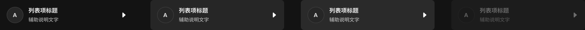

<!-- GEN:BEGIN 本段由 tools/gen-component-docs.py 依据 Figma 导出生成，勿手改；改 Figma 后重新生成 -->

## 概览

| 项 | 值 |
|---|---|
| Figma 组件集 | `List`（node `56061:6504`） |
| 分类 | 展示类 |
| 变体数 | 4 |
| 默认变体 | `State=default` |
| 参考尺寸 | 320×74 px（默认变体） |
| 主题 | 主库（深色中性 + 品牌砂色） |
| 预览图 | [assets/previews/list-item.png](../../assets/previews/list-item.png) |
| 代码实现 | [`components/ListItem/ListItem.tsx`](../../components/ListItem/ListItem.tsx) |
| Figma 链接 | [在 Figma 打开](https://www.figma.com/design/ZO4WH3sbVCj7lZIFMpiwV9/VibeMe-App---Web-Design-%E5%A4%87%E4%BB%BD?node-id=56061-6504) |



## 变体与属性

| Figma 属性 | 类型 | 取值 | 默认 | 代码 prop |
|---|---|---|---|---|
| `State` | VARIANT | `default` / `hover` / `selected` / `disabled` | `default` | `state` |

变体是属性轴的笛卡尔积：**4 = 4**（`State`）。

内嵌组件：`Property 1=chevron-right_filled`×4、`Size=md, Type=initial`×4

## 各变体的事实

> 填充栈按 Figma 图层顺序排列（**靠右的是上层**，hover/pressed 的叠加层在最后）。
> `⚠无cssVar` 表示该组件引用了历史遗留变量，代码里不要照抄，按 `foundations.md` 的规则换成语义 token。

| 变体 | 尺寸 | 填充栈 | 描边 | 圆角 | 内边距 上/右/下/左 | 不透明度 |
|---|---|---|---|---|---|---|
| `State=default` | 320×74 | — | — | 8 | 16/16/16/16 | — |
| `State=hover` | 320×74 | `Background/Surface-hover` #262626 `--vm-surface-hover` | — | 8 | 16/16/16/16 | — |
| `State=selected` | 320×74 | `Background/Surface-selected` #2A2A2A `--vm-surface-selected` | — | 8 | 16/16/16/16 | — |
| `State=disabled` | 320×74 | `Background/Surface-selected` #2A2A2A `--vm-surface-selected` | — | 8 | 16/16/16/16 | 0.38 |

## 结构（默认变体）

### State=default

```text
`COMPONENT` State=default 320×74 HORIZONTAL gap 12 pad 16/16/16/16 圆角 8
└─ `INSTANCE` Avatar 40×40 HORIZONTAL gap 0 pad 0/0/0/0 填充 `Neutral/Neutral-700` #262626 `--vm-neutral-700` 描边 `Background/border-default` #FFFFFF 12% `--vm-border-default` 圆角 999 实例=Size=md, Type=initial
  └─ `TEXT` A 11×20 填充 `Neutral/Neutral-100` #E0E0E0 `--vm-neutral-100` 文字样式 `Heading/S`（14 SemiBold /20） 内容 'A'
└─ `FRAME` Frame 208×42 VERTICAL gap 4 pad 0/0/0/0
  └─ `TEXT` 列表项标题 70×20 填充 `Text/Text-Primary` #FFFFFF 92% `--vm-text-primary` 文字样式 `Heading/S`（14 SemiBold /20） 内容 '列表项标题'
  └─ `TEXT` 辅助说明文字 72×18 填充 `Text/Text-Secondary` #FFFFFF 64% `--vm-text-secondary` 文字样式 `Caption/Caption`（12 Medium /18） 内容 '辅助说明文字'
└─ `INSTANCE` Filled icon 16×16 实例=Property 1=chevron-right_filled
  └─ `VECTOR` icon 7.52×12.12 填充 #FFFFFF
```


## 设计 token

| Figma 变量 | CSS 变量 | 值 |
|---|---|---|
| `Background/Surface-hover` | `--vm-surface-hover` | `#262626` |
| `Background/Surface-selected` | `--vm-surface-selected` | `#2A2A2A` |
| `Background/border-default` | `--vm-border-default` | `rgba(255, 255, 255, 0.12)` |
| `Neutral/Neutral-100` | `--vm-neutral-100` | `#E0E0E0` |
| `Neutral/Neutral-700` | `--vm-neutral-700` | `#262626` |
| `Radious/radius-md` | `--vm-radius-md` | `8px` |
| `Semantic Radius/radius-avatar` | `--vm-radius-avatar` | `999px` |
| `Semantic Space/padding-card-sm` | `--vm-padding-card-sm` | `16px` |
| `Text/Text-Primary` | `--vm-text-primary` | `rgba(255, 255, 255, 0.92)` |
| `Text/Text-Secondary` | `--vm-text-secondary` | `rgba(255, 255, 255, 0.64)` |
| `border/width/thin` | `--vm-border-width-thin` | `1px` |
| `opacity/disabled` | `--vm-opacity-disabled` | `0.38` |
| `space/space-1` | `--vm-space-1` | `4px` |
| `space/space-3` | `--vm-space-3` | `12px` |

<!-- GEN:END -->

## 交互与状态

四档 `State` 里只有一档是应用态，**不要把 `State` 原样做成 prop**：

| Figma State | 代码触发方式 | 视觉上变了什么 |
|---|---|---|
| `default` | 无 | 整行**没有填充也没有描边**（`background-color: transparent`），透出面板底色 `--vm-bg-panel` |
| `hover` | CSS `:hover:not(:disabled)` | 底色整块换成 `--vm-surface-hover`（`Background/Surface-hover` #262626）；文字、圆角、内边距都不动 |
| `selected` | prop `selected` | 底色整块换成 `--vm-surface-selected`（`Background/Surface-selected` #2A2A2A），并输出 `aria-current="true"`；该规则写在 `:hover` 之后，选中的行悬停时底色保持稳定 |
| `disabled` | 原生 `disabled` | 只有 `opacity: var(--vm-opacity-disabled)`（`opacity/disabled` 0.38）＋ `cursor: not-allowed`；底色与文字色**一个都不换**，`:hover:not(:disabled)` 让禁用行不再给出可点反馈 |

另外两处补充（Figma 里没有对应变体，按 `foundations.md` 的规范落地）：`:active:not(:disabled)` 按下时复用 `--vm-surface-selected`，不新造颜色；
`:focus-visible` 用 `box-shadow: inset 0 0 0 var(--vm-focus-ring-width) var(--vm-border-selected)` 画**内嵌**焦点环，外发光会被相邻行裁掉。
过渡只涉及颜色：`background-color var(--vm-duration-fast)`、`color var(--vm-duration-fast)`，`prefers-reduced-motion: reduce` 时整体关掉。

## 代码用法

```tsx
import { useState } from 'react';
import { Avatar } from '../components/Avatar';
import { ListItem } from '../components/ListItem';

export function ConversationList() {
  const [current, setCurrent] = useState('brand');

  return (
    <ul className="demo-list">
      {/* 选中态是 prop；hover / focus 交给伪类，不要手写 */}
      <ListItem
        avatar={<Avatar size="md" type="initial" initial="A" />}
        selected={current === 'brand'}
        description="昨天 · 关于品牌色的三个方案"
        onClick={() => setCurrent('brand')}
      >
        品牌设计讨论
      </ListItem>

      {/* 只有标题时，标题在行内垂直居中（Figma 的 HUG 高度） */}
      <ListItem avatar={<Avatar size="md" type="initial" initial="B" />}>未读消息</ListItem>

      {/* 禁用走原生 disabled；不传 avatar 时不渲染左侧槽位 */}
      <ListItem description="已被移出项目" disabled>
        归档会话
      </ListItem>
    </ul>
  );
}
```

CSS 引入方式：`import '../components/ListItem/ListItem.css'`（或整包 `import '../components/index'`，桶文件已 `import './tokens.css'`，
token 与 `.vm-type-*` 工具类会一起加载）。根节点是 `<li>`，**必须**包在 `<ul>` / `<ol>` 里；
`className` 落在 `<li>` 上（行间距、宽度等布局覆盖写在这里），`onClick` / `aria-*` / `ref` 落在内部的 `<button>` 上。
行宽由容器决定（Figma 参考宽 320、`wSizing: FIXED`），组件自己不锁宽。

## 可访问性

- 语义：根节点是真实的 `<li>`，可点实体是真实的 `<button type="button">`——没有把 `div` 样式化成按钮，也没有在 `li` 上挂 `onClick`。
  因为 `<button>` 只允许 phrasing content，标题与辅助说明都用 `display: block` 的 `<span>`，不是 `div`。
- 选中态：`selected` 会输出 `aria-current="true"`（不选中时属性**不输出**，不写 `aria-current="false"`），读屏会播报「当前项」；
  这里是导航型列表，所以不用 `aria-selected`——那个是给 `listbox` / `option` 组合用的。
- 键盘：`Tab` 进入/离开行，`Enter` 与 `Space` 触发按钮（浏览器原生行为），组件自身不注册 `onKeyDown`、不拦截方向键；
  多行列表需要方向键导航时，请把 `<ul>` 换成菜单 / `listbox` 组合，而不是给 ListItem 加按键处理。
- 焦点：`:focus-visible` 给 2px `--vm-border-selected` 的内嵌环（`--vm-focus-ring-width`），没有 `outline: none` 了事；
  `disabled` 时按钮不可聚焦，行会从 Tab 序列里消失，符合「禁用即不可操作」。
- 对比度：标题 `--vm-text-primary`（92% 白）、辅助说明 `--vm-text-secondary`（64% 白），在 `--vm-surface-hover` / `--vm-surface-selected` 上都 ≥ 4.5:1；
  选中状态**同时**有底色变化与 `aria-current`，不单靠颜色传达。
- 尺寸：行高 74px、头像 40×40，触控目标远超 40px；标题/说明超长时由 `text-overflow: ellipsis` 截断（对应 Figma 文字块的 `clip: true`），
  不要靠减小字号来塞下长文本。

## 不要这样做

1. **不要把 `State` 做成 prop**。`<ListItem state="hover" />` 会与真实鼠标状态打架；`hover` 归 `:hover`、`focus` 归 `:focus-visible`，
   只保留 `selected` 与原生 `disabled` 两个应用态。
2. **hover 既不要叠 `--vm-white-7`，也不要换成 `--vm-white-4` 描边**。这是第三种手法：`list-item.variants.json` 里 `State=hover` 的 `fills`
   是一条 `Background/Surface-hover`（#262626），等于把**整块底色**换成 `--vm-surface-hover`；叠白图层或改描边都会和 Figma 不符。
3. **不要复刻 `State=disabled` 的底色**。Figma 的 disabled 变体沿用了 selected 的 `Background/Surface-selected`（#2A2A2A），这是建组件时的历史遗留；
   代码里禁用只加 0.38 不透明度，否则一个「未选中但被禁用」的行会被误读成已选中。
4. **不要在 ListItem 里重画 Avatar**。左侧只给 40×40 的槽位（`.vm-list-item__avatar`）；
   圆形底 `--vm-neutral-700`、1px 描边 `--vm-border-default`、圆角 `--vm-radius-avatar`、首字母色 `--vm-neutral-100` 都属于 Avatar 组件，写在这里会双重上色。
5. **不要把 chevron 换成 emoji 或自画字符**。Figma 用的是 `Filled icon / chevron-right_filled`（16×16，矢量填充纯白，未绑变量）；
   内联 SVG 已经用 `currentColor` + `aria-hidden="true"`，换字体会因字号与基线不同而错位。
6. **不要手写字号/行高/颜色**。标题挂 `.vm-type-heading-s`（`Heading/S` 14 SemiBold /20），辅助说明挂 `.vm-type-caption-caption`
   （`Caption/Caption` 12 Medium /18）；直接写 `font-size: 14px` 或 `#FFFFFF` 会绕过 token 校验。
7. **不要把 `<li>` 当普通 `div` 用**。脱离 `<ul>` / `<ol>` 会造成无效 HTML；也不要为了省事把 `className` 和 `onClick` 都塞给根节点，
   `...rest` 是给内部 `<button>` 的。

## 相关组件

- **Avatar**：内嵌关系。Figma 的 `List` 默认变体里就是一个 `Size=md`（40×40）的 Avatar 实例，initial 文字是 `A`；
  列表里请显式传 `avatar={<Avatar size="md" … />}`，尺寸与 ListItem 的槽位（40×40）对齐。
- **MenuItem**：同样是 `State(default/hover/selected/disabled)` 的 4 变体行，但 MenuItem 的 hover 是 `--vm-white-7` 叠加，**不要互相套用**；
  下拉菜单、命令面板里用 MenuItem，内容列表、会话列表里用 ListItem。
- **Dropdown / Select**：展开后的选项面板由 ListItem / MenuItem 组成；此时面板容器负责 `--vm-bg-panel`、圆角与阴影，ListItem 只管行内状态。
- **Sidebar**：会话/导航列表的宿主，负责滚动、分组标题与行间距（不要在 ListItem 上写 `margin`）。
- **Skeleton**：列表首屏加载时，用 `Skeleton` 的行/卡片档位替位，行高与 ListItem 对齐（标题 20 + 说明 18 + 上下 16 内边距）。
- **Empty**：列表为空时用 `Empty` 占住内容区，并用 `type="search"` / `type="empty"` 区分「搜不到」与「还没有数据」。
- **Container / Stack**：负责多行的纵向排布与外边距；ListItem 自身不带外边距，也不带分隔线（Figma 里没有分隔线层）。
