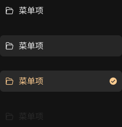

<!-- GEN:BEGIN 本段由 tools/gen-component-docs.py 依据 Figma 导出生成，勿手改；改 Figma 后重新生成 -->

## 概览

| 项 | 值 |
|---|---|
| Figma 组件集 | `MenuItem`（node `56064:6789`） |
| 分类 | 导航类 |
| 变体数 | 4 |
| 默认变体 | `State=default` |
| 参考尺寸 | 208×36 px（默认变体） |
| 主题 | 主库（深色中性 + 品牌砂色） |
| 预览图 | [assets/previews/menu-item.png](../../assets/previews/menu-item.png) |
| 代码实现 | [`components/MenuItem/MenuItem.tsx`](../../components/MenuItem/MenuItem.tsx) |
| Figma 链接 | [在 Figma 打开](https://www.figma.com/design/ZO4WH3sbVCj7lZIFMpiwV9/VibeMe-App---Web-Design-%E5%A4%87%E4%BB%BD?node-id=56064-6789) |



## 变体与属性

| Figma 属性 | 类型 | 取值 | 默认 | 代码 prop |
|---|---|---|---|---|
| `label` | TEXT（内容插槽） | — | — | `children` |
| `State` | VARIANT | `default` / `hover` / `selected` / `disabled` | `default` | `state` |

变体是属性轴的笛卡尔积：**4 = 4**（`State`）。

内嵌组件：`Property 1=circle-check-filled`×1、`Property 1=icon, Property 2=folder-line`×4

## 各变体的事实

> 填充栈按 Figma 图层顺序排列（**靠右的是上层**，hover/pressed 的叠加层在最后）。
> `⚠无cssVar` 表示该组件引用了历史遗留变量，代码里不要照抄，按 `foundations.md` 的规则换成语义 token。

| 变体 | 尺寸 | 填充栈 | 描边 | 圆角 | 内边距 上/右/下/左 | 不透明度 |
|---|---|---|---|---|---|---|
| `State=default` | 208×36 | — | — | 6 | 8/8/8/8 | — |
| `State=hover` | 208×36 | `Background/Surface-hover` #262626 `--vm-surface-hover` | — | 6 | 8/8/8/8 | — |
| `State=selected` | 208×36 | `Background/Surface-selected` #2A2A2A `--vm-surface-selected` | — | 6 | 8/8/8/8 | — |
| `State=disabled` | 208×36 | — | — | 6 | 8/8/8/8 | 0.38 |

## 结构（默认变体）

### State=default

```text
`COMPONENT` State=default 208×36 HORIZONTAL gap 8 pad 8/8/8/8 圆角 6
└─ `INSTANCE` Line icon 16×16 实例=Property 1=icon, Property 2=folder-line
  └─ `VECTOR` icon 12.74×12.33 填充 `Text/Text-Primary` #FFFFFF 92% `--vm-text-primary`
└─ `TEXT` 菜单项 168×20 填充 `Text/Text-Primary` #FFFFFF 92% `--vm-text-primary` 文字样式 `Heading/Body/S/Regular`（14 Regular /20） 内容 '菜单项'
```

### State=selected

```text
`COMPONENT` State=selected 208×36 HORIZONTAL gap 8 pad 8/8/8/8 填充 `Background/Surface-selected` #2A2A2A `--vm-surface-selected` 圆角 6
└─ `INSTANCE` Line icon 16×16 实例=Property 1=icon, Property 2=folder-line
  └─ `VECTOR` icon 12.74×12.33 填充 `Brand/Brand` #FFCC90 `--vm-brand`
└─ `TEXT` 菜单项 146×20 填充 `Brand/Brand` #FFCC90 `--vm-brand` 文字样式 `Heading/Body/S/Regular`（14 Regular /20） 内容 '菜单项'
└─ `INSTANCE` Filled icon 14×14 实例=Property 1=circle-check-filled
  └─ `VECTOR` icon 12.25×12.25 填充 `Brand/Brand` #FFCC90 `--vm-brand`
```


## 设计 token

| Figma 变量 | CSS 变量 | 值 |
|---|---|---|
| `Background/Surface-hover` | `--vm-surface-hover` | `#262626` |
| `Background/Surface-selected` | `--vm-surface-selected` | `#2A2A2A` |
| `Brand/Brand` | `--vm-brand` | `#FFCC90` |
| `Radious/radius-sm` | `--vm-radius-sm` | `6px` |
| `Text/Text-Primary` | `--vm-text-primary` | `rgba(255, 255, 255, 0.92)` |
| `opacity/disabled` | `--vm-opacity-disabled` | `0.38` |
| `space/space-2` | `--vm-space-2` | `8px` |

<!-- GEN:END -->


## 交互与状态

四档 `State` 在代码里拆成两类，**`State` 不原样做成 prop**：

| Figma State | 代码触发方式 | 视觉上变了什么 |
|---|---|---|
| `default` | 无 | 行底色透明（`menu-item.variants.json` 里该变体**没有** `fills`），文字 `--vm-text-primary`（`Text/Text-Primary`，92% 白），圆角 `--vm-radius-sm`（`Radious/radius-sm` 6px） |
| `hover` | CSS `:hover:not(:disabled)` | 底色换成 `--vm-surface-hover`（`Background/Surface-hover` #262626）。**只换底色 token，不叠白**——见下面第 2 条 |
| `selected` | prop `selected` | 底色换成 `--vm-surface-selected`（`Background/Surface-selected` #2A2A2A），文字与两个图标一起换成 `--vm-brand`（`Brand/Brand` #FFCC90），并在行尾多出一个 14×14 的 `circle-check-filled` 实例（`State=selected` 的树里是第 3 个子节点） |
| `disabled` | 原生 `disabled` | 只有 `opacity: var(--vm-opacity-disabled)`（`opacity/disabled` 0.38）＋ `cursor: not-allowed`，底色、圆角、文字色**一个都不换** |

Figma 只画了这四档，代码里另外补了两个无障碍/物理反馈，都不新造颜色：
`:active:not(:disabled)` 用现成的 `--vm-surface-pressed`（`Background/Surface-pressed` #303030），
`:focus-visible` 用 `--vm-focus-ring-width` 的 inset ring ＋ `--vm-border-selected`（`Background/border-selected` 50% 白）。
CSS 里 `:active` 与 `:hover` 都写在 `.vm-menu-item--selected` **之前**，所以已选中的行悬停/按下时不会被换成 hover 底色。
文本内容走 `children`（Figma 的 TEXT 属性叫 `label`，默认示例值「菜单项」）；选中对勾由组件自动渲染，调用方不要再传。

## 代码用法

```tsx
import { MenuItem } from '../components/MenuItem';

export function Example({ current, onPick }: { current: string; onPick: (id: string) => void }) {
  return (
    // 根节点是 <li role="none">，容器必须是 role="menu"（Dropdown 内部就是这么包的）
    <ul role="menu" aria-label="项目菜单" style={{ listStyle: 'none', margin: 0, padding: 0 }}>
      <MenuItem
        icon={<FolderIcon />}          // 行首 16×16 图标槽位
        onClick={() => onPick('all')}
      >
        全部项目
      </MenuItem>

      {/* 应用态才是 prop；hover / active / focus 交给伪类，disabled 交给原生属性 */}
      <MenuItem icon={<FolderIcon />} selected={current === 'mine'} onClick={() => onPick('mine')}>
        我的项目
      </MenuItem>

      <MenuItem icon={<FolderIcon />} disabled>
        已归档（无权限）
      </MenuItem>
    </ul>
  );
}
```

CSS 引入方式：`import '../components/MenuItem/MenuItem.css'`（或整包 `import '../components/index'`，
桶文件已 `import './tokens.css'`，token 与 `.vm-type-*` 工具类会一起加载）。
宽度默认按 Figma 的 `width: 208px` 给，并带 `max-width: 100%`；放进固定宽度的面板里会自动收缩，
要显式铺满时由调用方在自己的类里覆盖 `width` 即可。`...rest` 与 `ref` 落在内部的 `<button role="menuitem">` 上，
`className` 落在最外层 `<li>` 上。

## 可访问性

- 语义：根节点是 `<li role="none">`（列表语义对菜单无意义，故置为 presentational），可点实体是真的
  `<button type="button" role="menuitem">`，不是把 `div` 样式化成按钮。**必须**放进 `role="menu"` 的容器
  （Dropdown 的面板就是），否则 `menuitem` 会失去父角色。
- 选中态会落到 `aria-current="true"`（只在选中时输出，不写 `aria-current="false"`），读屏能播报「当前项」；
  视觉上的品牌色对勾是纯装饰，已用 `aria-hidden="true"` 包住，不会被念出来。
- 键盘：`Enter` / `Space` 触发 `onClick` 是原生 `<button>` 行为，组件不额外注册 `onKeyDown`；
  `Tab` 进出由浏览器负责。`role="menu"` 的**方向键上下移动、`Esc` 关闭、`Home`/`End`** 属于容器职责，
  由 Dropdown 实现，单个 MenuItem 不自己抢焦点。
- 焦点：`:focus-visible` 给 2px `--vm-border-selected` 的 inset ring（`--vm-focus-ring-width`），
  没有 `outline: none` 了事；`disabled` 时按钮退出可聚焦序列，只剩 `opacity: 0.38`，不要再叠一层灰色。
- 触控目标：行高 36px（`--vm-space-2` × 2 ＋ 20px 行高）略小于 40px，移动端请让外层菜单项之间留白，
  或由容器给 ≥40px 的可点区域。

## 不要这样做

1. **不要把 `State` 做成 prop**（`<MenuItem state="hover" />`）。hover / active / focus 用伪类，
   只有 `selected` 与原生 `disabled` 是应用态；做成 prop 会和真实鼠标状态打架。
2. **hover 不要照抄 Button 的叠加层**。Button 一族是「底色 + `--vm-white-7`（8% 白）」，
   而 MenuItem 的 hover 变体只有一条填充 `Background/Surface-hover`（#262626），**没有叠加层**；
   在透明底上叠 `--vm-white-7` 会得到一个几乎看不见的灰块，和 Figma 不符。
3. **圆角别用 12px**。MenuItem 是 6px（`--vm-radius-sm`，Figma 里的 `Radious/radius-sm`），
   不是按钮/输入框的 `--vm-radius-button` / `--vm-radius-input`（12px），也不是 `--vm-radius-full`。
   文件里那个圆角 999、蓝底、MiSans 的胶囊按钮是历史遗留组件，**不要参照**。
4. **不要手写字号与行高**。标签已挂 `.vm-type-heading-body-s-regular`（`Heading/Body/S/Regular`，Poppins Regular 14/20）；
   注意库里有三个「名不副实」的文字样式（`Heading/Body/L/Medium`、`Heading/Body/M/Medium`、`Heading/Body/S/SemiBold`
   实际都是 Poppins Regular），要真 Medium/SemiBold 请用 `Heading/S` 或 `.vm-type-heading-body-m-medium`，
   别指望样式名。
5. **不要自己再塞一个对勾**。`selected` 时组件已经按 Figma 渲染 14×14 的 `circle-check-filled`；
   额外传一个 `icon` 之外的对勾图标会出现两条勾，或者把行宽撑破 208px。
6. **不要在 MenuItem 外面再包一层 `<div>` 当菜单容器**。`role="menu"` 的直接子节点应是 `menuitem`（或 `role="none"` 的包装元素），
   裸的 `<li>` 放进 `<div>` 也是无效 HTML；需要分组请用 `role="group"` ＋ Divider，不要用 `<hr>` 打断菜单语义。
7. **不要拿 MenuItem 当通用列表行**。它没有副标题、没有头像、没有 chevron；这些是 `ListItem`（Figma 组件集 `List`）的职责，
   两者不要互相顶替。

## 相关组件

- **Dropdown**：MenuItem 的主要容器。Dropdown 的面板内就是 `role="menu"` ＋ 若干 MenuItem，
  方向键导航与开关由 Dropdown 管；MenuItem 只负责一行长什么样。
- **Divider**：菜单里分组用 `Divider`，组与组之间再加 `role="group"` / `aria-label`，
  不要用裸 `<hr>` 或空行。
- **Icon（Line icon / Filled icon）**：行首槽位对应 `folder-line`（16×16），选中对勾对应
  `circle-check-filled`（14×14）；换图标请从 Figma 对应图标组件集取矢量，别用 emoji。
- **ListItem**：同样是「左图标/头像 ＋ 文字 ＋ 右侧元素」的行式组件，但用在列表/会话场景；
  菜单里请不要用它来替代 MenuItem。
- **Select / Popover / Tooltip**：Select 展开后是下拉浮层而非 `role="menu"` 的菜单；Popover 里放菜单时要自己补
  `role="menu"` 与键盘处理，别指望 Popover 代劳。注意 `VibeMe AI / *` 那套紫粉 token 的组件与主库不通用。
