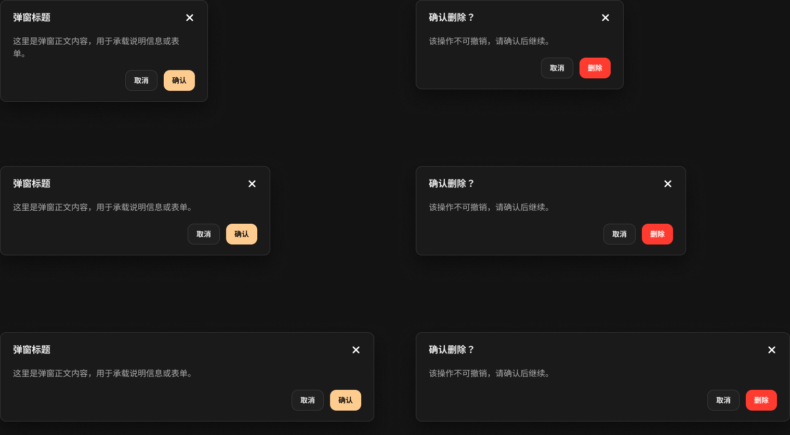

<!-- GEN:BEGIN 本段由 tools/gen-component-docs.py 依据 Figma 导出生成，勿手改；改 Figma 后重新生成 -->

## 概览

| 项 | 值 |
|---|---|
| Figma 组件集 | `Modal`（node `56063:6526`） |
| 分类 | 反馈类 |
| 变体数 | 6 |
| 默认变体 | `Size=sm, Type=basic` |
| 参考尺寸 | 400×196 px（默认变体） |
| 主题 | 主库（深色中性 + 品牌砂色） |
| 预览图 | [assets/previews/modal.png](../../assets/previews/modal.png) |
| 代码实现 | [`components/Modal/Modal.tsx`](../../components/Modal/Modal.tsx) |
| Figma 链接 | [在 Figma 打开](https://www.figma.com/design/ZO4WH3sbVCj7lZIFMpiwV9/VibeMe-App---Web-Design-%E5%A4%87%E4%BB%BD?node-id=56063-6526) |



## 变体与属性

| Figma 属性 | 类型 | 取值 | 默认 | 代码 prop |
|---|---|---|---|---|
| `Size` | VARIANT | `sm` / `md` / `lg` | `sm` | `size` |
| `Type` | VARIANT | `basic` / `confirm` | `basic` | `type` |

变体是属性轴的笛卡尔积：**6 = 3 × 2**（`Size` × `Type`）。

内嵌组件：`Property 1=cross_filled`×6、`Type=danger, Size=md, State=default`×3、`Type=primary, Size=md, State=default`×3、`Type=secondary, Size=md, State=default`×6

## 各变体的事实

> 填充栈按 Figma 图层顺序排列（**靠右的是上层**，hover/pressed 的叠加层在最后）。
> `⚠无cssVar` 表示该组件引用了历史遗留变量，代码里不要照抄，按 `foundations.md` 的规则换成语义 token。

| 变体 | 尺寸 | 填充栈 | 描边 | 圆角 | 内边距 上/右/下/左 | 不透明度 |
|---|---|---|---|---|---|---|
| `Size=sm, Type=basic` | 400×196 | `Background/bg-panel` #1A1A1A `--vm-bg-panel` | `Background/border-default` #FFFFFF 12% `--vm-border-default` | 12 | 20/24/20/24 | — |
| `Size=sm, Type=confirm` | 400×172 | `Background/bg-panel` #1A1A1A `--vm-bg-panel` | `Background/border-default` #FFFFFF 12% `--vm-border-default` | 12 | 20/24/20/24 | — |
| `Size=md, Type=basic` | 520×172 | `Background/bg-panel` #1A1A1A `--vm-bg-panel` | `Background/border-default` #FFFFFF 12% `--vm-border-default` | 12 | 20/24/20/24 | — |
| `Size=md, Type=confirm` | 520×172 | `Background/bg-panel` #1A1A1A `--vm-bg-panel` | `Background/border-default` #FFFFFF 12% `--vm-border-default` | 12 | 20/24/20/24 | — |
| `Size=lg, Type=basic` | 720×172 | `Background/bg-panel` #1A1A1A `--vm-bg-panel` | `Background/border-default` #FFFFFF 12% `--vm-border-default` | 12 | 20/24/20/24 | — |
| `Size=lg, Type=confirm` | 720×172 | `Background/bg-panel` #1A1A1A `--vm-bg-panel` | `Background/border-default` #FFFFFF 12% `--vm-border-default` | 12 | 20/24/20/24 | — |

## 结构（默认变体）

### Size=sm, Type=basic

```text
`COMPONENT` Size=sm, Type=basic 400×196 VERTICAL gap 20 pad 20/24/20/24 填充 `Background/bg-panel` #1A1A1A `--vm-bg-panel` 描边 `Background/border-default` #FFFFFF 12% `--vm-border-default` 圆角 12
└─ `FRAME` Frame 350×26 HORIZONTAL gap 16 pad 0/0/0/0
  └─ `TEXT` 弹窗标题 314×26 填充 `Text/Text-Primary` #FFFFFF 92% `--vm-text-primary` 文字样式 `Heading/L`（18 Bold /26） 内容 '弹窗标题'
  └─ `INSTANCE` Filled icon 20×20 实例=Property 1=cross_filled
    └─ `VECTOR` icon 13.11×13.11 填充 #FFFFFF
└─ `TEXT` 这里是弹窗正文内容，用于承载说明信息或表单。 350×48 填充 `Text/Text-Secondary` #FFFFFF 64% `--vm-text-secondary` 文字样式 `Heading/Body/M/Regular`（16 Regular /24） 内容 '这里是弹窗正文内容，用于承载说明信息或表单。'
└─ `FRAME` Frame 350×40 HORIZONTAL gap 12 pad 0/0/0/0
  └─ `INSTANCE` Button 62×40 HORIZONTAL gap 0 pad 0/16/0/16 填充 `Background/bg-card` #202020 `--vm-bg-card` 描边 `Background/border-default` #FFFFFF 12% `--vm-border-default` 圆角 12 实例=Type=secondary, Size=md, State=default
    └─ `TEXT` Button 28×20 填充 `Text/Text-Primary` #FFFFFF 92% `--vm-text-primary` 文字样式 `Heading/S`（14 SemiBold /20） 内容 '取消'
  └─ `INSTANCE` Button 60×40 HORIZONTAL gap 0 pad 0/16/0/16 填充 `Brand/Brand` #FFCC90 `--vm-brand` 圆角 12 实例=Type=primary, Size=md, State=default
    └─ `TEXT` Button 28×20 填充 `Neutral/Neutral-950` #0E0E0E `--vm-neutral-950` 文字样式 `Heading/S`（14 SemiBold /20） 内容 '确认'
```

### Size=lg, Type=confirm

```text
`COMPONENT` Size=lg, Type=confirm 720×172 VERTICAL gap 20 pad 20/24/20/24 填充 `Background/bg-panel` #1A1A1A `--vm-bg-panel` 描边 `Background/border-default` #FFFFFF 12% `--vm-border-default` 圆角 12
└─ `FRAME` Frame 670×26 HORIZONTAL gap 16 pad 0/0/0/0
  └─ `TEXT` 确认删除？ 634×26 填充 `Text/Text-Primary` #FFFFFF 92% `--vm-text-primary` 文字样式 `Heading/L`（18 Bold /26） 内容 '确认删除？'
  └─ `INSTANCE` Filled icon 20×20 实例=Property 1=cross_filled
    └─ `VECTOR` icon 13.11×13.11 填充 #FFFFFF
└─ `TEXT` 该操作不可撤销，请确认后继续。 670×24 填充 `Text/Text-Secondary` #FFFFFF 64% `--vm-text-secondary` 文字样式 `Heading/Body/M/Regular`（16 Regular /24） 内容 '该操作不可撤销，请确认后继续。'
└─ `FRAME` Frame 670×40 HORIZONTAL gap 12 pad 0/0/0/0
  └─ `INSTANCE` Button 62×40 HORIZONTAL gap 0 pad 0/16/0/16 填充 `Background/bg-card` #202020 `--vm-bg-card` 描边 `Background/border-default` #FFFFFF 12% `--vm-border-default` 圆角 12 实例=Type=secondary, Size=md, State=default
    └─ `TEXT` Button 28×20 填充 `Text/Text-Primary` #FFFFFF 92% `--vm-text-primary` 文字样式 `Heading/S`（14 SemiBold /20） 内容 '取消'
  └─ `INSTANCE` Button 60×40 HORIZONTAL gap 0 pad 0/16/0/16 填充 `状态色/Error` #FF3B30 `--vm-status-error` 圆角 12 实例=Type=danger, Size=md, State=default
    └─ `TEXT` Button 28×20 填充 `White/White-0` #FFFFFF `--vm-white-0` 文字样式 `Heading/S`（14 SemiBold /20） 内容 '删除'
```


## 设计 token

| Figma 变量 | CSS 变量 | 值 |
|---|---|---|
| `Background/bg-card` | `--vm-bg-card` | `#202020` |
| `Background/bg-panel` | `--vm-bg-panel` | `#1A1A1A` |
| `Background/border-default` | `--vm-border-default` | `rgba(255, 255, 255, 0.12)` |
| `Brand/Brand` | `--vm-brand` | `#FFCC90` |
| `Modal Size/modal-lg` | `--vm-modal-lg` | `720px` |
| `Modal Size/modal-md` | `--vm-modal-md` | `520px` |
| `Modal Size/modal-sm` | `--vm-modal-sm` | `400px` |
| `Neutral/Neutral-950` | `--vm-neutral-950` | `#0E0E0E` |
| `Semantic Radius/radius-button` | `--vm-radius-button` | `12px` |
| `Semantic Radius/radius-card` | `--vm-radius-card` | `12px` |
| `Semantic Space/padding-button-md-x` | `--vm-padding-button-md-x` | `16px` |
| `Semantic Space/padding-modal-x` | `--vm-padding-modal-x` | `24px` |
| `Semantic Space/padding-modal-y` | `--vm-padding-modal-y` | `20px` |
| `Text/Text-Primary` | `--vm-text-primary` | `rgba(255, 255, 255, 0.92)` |
| `Text/Text-Secondary` | `--vm-text-secondary` | `rgba(255, 255, 255, 0.64)` |
| `White/White-0` | `--vm-white-0` | `#FFFFFF` |
| `border/width/thin` | `--vm-border-width-thin` | `1px` |
| `space/space-3` | `--vm-space-3` | `12px` |
| `space/space-4` | `--vm-space-4` | `16px` |
| `space/space-5` | `--vm-space-5` | `20px` |
| `状态色/Error` | `--vm-status-error` | `#FF3B30` |

<!-- GEN:END -->


## 交互与状态

Modal 在 Figma 里**只有 `Size` × `Type` 两条轴，没有 `State` 轴**——所以这里既没有 `state` prop，也没有 hover/focus 变体可以照抄。

| 交互 | 代码里由什么触发 | 视觉/行为上变了什么 |
|---|---|---|
| 打开 | prop `open`（受控，落到原生 `<dialog>`） | 组件调 `showModal()`：进入 top layer，拿到 `::backdrop`（`Scrim/scrim-modal` → `--vm-scrim-modal` rgba(0,0,0,.56)），背景内容 inert |
| 关闭 | 原生 `Esc`、右上角 ×、底部次按钮 | 统一走 `dialog.close()` → 原生 `close` 事件 → 消费方 `onClose`；`close` 后 `open` 属性消失，CSS 的 `display` 回到 `none` |
| 主按钮点击 | 底部主按钮（`basic` → primary、`confirm` → danger） | 先 `onConfirm()`，随后同样 `dialog.close()`；组件不自己保存可见状态 |
| hover | 只发生在**底部 Button 实例**上（`:hover:not(:disabled)`） | 底色不变，叠一层 `--vm-white-7`（`White/White-7` 8% 白）——Button 一族的「填充叠加」手法 |
| pressed | `:active:not(:disabled)` | 叠层换成 `--vm-white-6`（`White/White-6` 12% 白） |
| focus | `:focus-visible` | 底部按钮与 × 图标各加一圈 `--vm-focus-ring-width`（2px）的 `--vm-border-selected` ring |

⚠️ 弹窗**本体**（面板、标题行、正文）没有任何悬停/按下事实，不要给它加叠加层。hover 的叠加只属于底部那两个 Button 实例。
`Type` 也不等于按钮语义：`Type=confirm` 的「主」按钮在 Figma 里是 `Type=danger, Size=md, State=default` 实例，底色是 `--vm-status-error` 而不是 `--vm-brand`。

## 代码用法

```tsx
import { useState } from 'react';
import { Modal } from '../components/Modal';

export function DeleteProjectButton() {
  const [open, setOpen] = useState(false);

  return (
    <>
      <button type="button" onClick={() => setOpen(true)}>
        删除项目
      </button>

      {/* 危险确认：Type=confirm → 主按钮换成 --vm-status-error 底色的 danger 按钮 */}
      <Modal
        open={open}
        onClose={() => setOpen(false)}
        size="md"
        type="confirm"
        title="确认删除？"
        confirmLabel="删除"
        cancelLabel="取消"
        onConfirm={() => {
          // 这里做真正的删除；弹窗随后自动关闭
        }}
      >
        该操作不可撤销，请确认后继续。
      </Modal>

      {/* 常规说明弹窗：Type=basic → 主按钮是 --vm-brand 品牌色 */}
      <Modal
        open={open}
        onClose={() => setOpen(false)}
        size="sm"
        title="弹窗标题"
      >
        这里是弹窗正文内容，用于承载说明信息或表单。
      </Modal>
    </>
  );
}
```

CSS 引入方式：`import '../components/Modal/Modal.css'`（或整包 `import '../components/index'`，桶文件已 `import './tokens.css'`，
token 与 `.vm-type-*` 工具类会一起加载）。宽度三档来自 Figma 的 FIXED 值 `--vm-modal-sm|md|lg`（400/520/720），
窄屏由组件自带的 `max-width` 兜底；没有标题就**不要**留空标题行——`title` 不传时整行只剩右上角的 ×。

## 可访问性

- 语义元素是真的 `<dialog>`，并且用 `showModal()` 打开：焦点陷阱（`Tab` 只在弹窗内循环）、`Esc` 关闭、top layer、
  背景内容 inert 全部由浏览器提供；不要用 `div` + `z-index` 假弹窗，那样这四件事都得自己实现且极易出错。
- 标题渲染为 `<h2>` 并由 `aria-labelledby` 关联到 `<dialog>`；正文容器由 `aria-describedby` 关联。
  调用方自己传的 `aria-labelledby` / `aria-describedby` **优先**，组件不覆盖。
- 右上角 × 是 `<button type="button">` ＋ `aria-label={closeLabel}`（默认「关闭」），内联 SVG 带 `aria-hidden="true"`，
  不会把图标读成文字；底部两个动作同样是真的 `<button>`，不是被样式化的 `div`。
- 焦点可见：`:focus-visible` 给 `--vm-focus-ring-width` 的 `--vm-border-selected` ring；`Esc` 关闭后焦点回到触发元素
  （由浏览器交还给打开前的活动元素，页面层不要抢焦点）。
- 对比度：正文 `--vm-text-secondary`（64% 白）在 `--vm-bg-panel`（#1A1A1A）上约 8:1，标题 `--vm-text-primary`（92% 白）更高；
  危险按钮文字 `--vm-white-0` 落在 `--vm-status-error`（#FF3B30）上约 4.0:1，属于大号/半粗文字边缘，**不要**再降低不透明度。
- 遮罩层只做视觉，不承担点击关闭（Figma 没有这个事实）；如果产品确实要「点遮罩关闭」，由消费方在 `onClose` 上自行决定。

## 不要这样做

1. **不要把 `open` 当普通属性透传到 `<dialog>` 上**。只写 `open` 属性得到的是「非模态」dialog：没有 top layer、没有 `::backdrop`、
   没有焦点陷阱。必须 `showModal()` / `close()`，`Modal.tsx` 里的 `useEffect` 就是干这个的。
2. **不要给弹窗面板加 hover / 叠加层**。`modal.variants.json` 里 6 个变体的 `fills` 都只有一条 `Background/bg-panel`，
   没有 `White/White-7` 叠加；叠加只出现在底部 Button 实例（`button.variants.json` 的 `State=hover`）。
3. **不要手写遮罩色**（`rgba(0, 0, 0, 0.56)` 之类）。遮罩有真源变量 `Scrim/scrim-modal` → `--vm-scrim-modal`，
   手写值在换主题时不会跟着走，也会被 `tools/validate.py` 判为字面量颜色。
4. **不要用 `--vm-bg-card` 当弹窗底色**。面板是 `Background/bg-panel` `#1A1A1A` → `--vm-bg-panel`；
   `--vm-bg-card`（`#202020`）是底部 secondary 按钮和卡片的底色，两者别对调。
5. **不要把 `Type=confirm` 理解成「确认框」的按钮层级**。它的主按钮是 danger（`--vm-status-error`），
   而且按钮文案在 Figma 里是 Button 实例的 TEXT 属性（确认/取消/删除），本组件用 `confirmLabel` / `cancelLabel` 承接。
6. **不要用原始圆角 / 原始间距**（`--vm-radius-lg`、`--vm-space-6`…）。面板圆角语义是 `--vm-radius-card`，
   内边距是 `--vm-padding-modal-y` / `--vm-padding-modal-x`（20 / 24）；它们现在恰好等于 12px、24px，但语义层才会跟着真源变。
7. **不要让底部按钮另起一套视觉**。它们目前用 `.vm-modal__action--secondary|primary|danger` + `--vm-radius-button` 兜着，
   等 Button 组件落地后应替换成 `<Button type="secondary|primary|danger" size="md">`，不要再复制第三套按钮样式。
8. **不要为了「好看」把 Modal 做成 Drawer/Toast**。宽度、圆角、海拔、遮罩都是各自组件集的事实（Drawer 是 `Elevation/4` ＋ 单侧圆角，Toast 是 `Elevation/3` 无遮罩），不要互相套参数。

## 相关组件

- **Button**：Modal 的底部动作栏在 Figma 里就是三个 Button 实例（`Size=md`）：取消 = `Type=secondary`、确认 = `Type=primary`、
  删除 = `Type=danger`。代码里先按同样的 token 手写，Button 落地后换成组件引用。
- **Drawer**：同属反馈容器的另一种形态（侧滑、单侧圆角、有遮罩）。同一个流程里二选一，不要同时出现。
- **Toast**：无遮罩、不拦截焦点的轻提示（`Elevation/3`）。Modal 里的「操作成功」可以在关闭后再弹 Toast，
  但不要把 Toast 塞进 Modal 的正文里当状态条。
- **Input / Textarea / Select**：表单型弹窗的正文由它们组成，宽度要跟着 `size` 走（`sm` 面板宽 400，减掉两边 24 内边距只有 352 可用）。
- **Menu / Dropdown**：`Menu` 家族会嵌 `MenuItem`；如果「更多操作」要弹确认框，用 Modal 而不是在菜单里内联一段确认文案。
