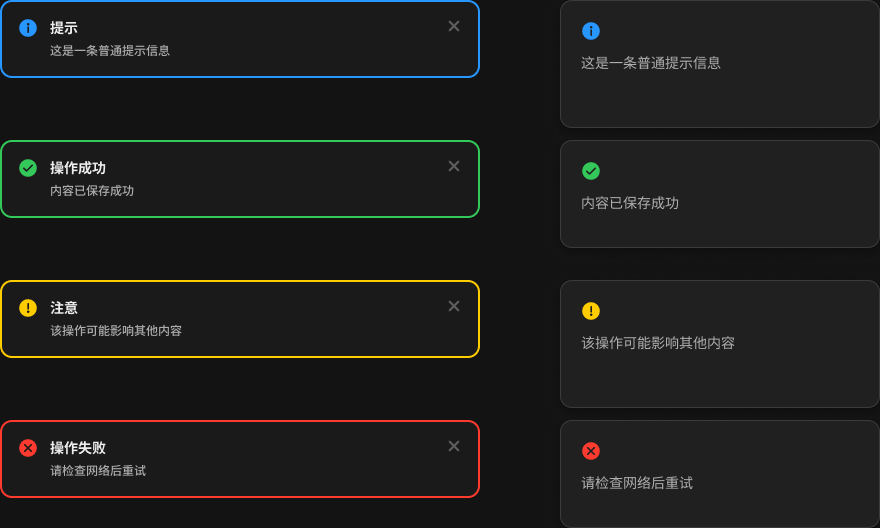

<!-- GEN:BEGIN 本段由 tools/gen-component-docs.py 依据 Figma 导出生成，勿手改；改 Figma 后重新生成 -->

## 概览

| 项 | 值 |
|---|---|
| Figma 组件集 | `Notification`（node `56063:6645`） |
| 分类 | 反馈类 |
| 变体数 | 8 |
| 默认变体 | `Type=info, Layout=banner` |
| 参考尺寸 | 480×78 px（默认变体） |
| 主题 | 主库（深色中性 + 品牌砂色） |
| 预览图 | [assets/previews/notification.png](../../assets/previews/notification.png) |
| 代码实现 | [`components/Notification/Notification.tsx`](../../components/Notification/Notification.tsx) |
| Figma 链接 | [在 Figma 打开](https://www.figma.com/design/ZO4WH3sbVCj7lZIFMpiwV9/VibeMe-App---Web-Design-%E5%A4%87%E4%BB%BD?node-id=56063-6645) |



## 变体与属性

| Figma 属性 | 类型 | 取值 | 默认 | 代码 prop |
|---|---|---|---|---|
| `Type` | VARIANT | `info` / `success` / `warning` / `error` | `info` | `type` |
| `Layout` | VARIANT | `banner` / `card` | `banner` | `layout` |

变体是属性轴的笛卡尔积：**8 = 4 × 2**（`Type` × `Layout`）。

内嵌组件：`Property 1=circle-alert-filled`×2、`Property 1=circle-check-filled`×2、`Property 1=circle-cross-filled`×2、`Property 1=circle-info-filled`×2、`Property 1=cross_filled`×4

## 各变体的事实

> 填充栈按 Figma 图层顺序排列（**靠右的是上层**，hover/pressed 的叠加层在最后）。
> `⚠无cssVar` 表示该组件引用了历史遗留变量，代码里不要照抄，按 `foundations.md` 的规则换成语义 token。

| 变体 | 尺寸 | 填充栈 | 描边 | 圆角 | 内边距 上/右/下/左 | 不透明度 |
|---|---|---|---|---|---|---|
| `Type=info, Layout=banner` | 480×78 | `Background/bg-panel` #1A1A1A `--vm-bg-panel` | `状态色/Info` #2797FF `--vm-status-info` | 12 | 16/16/16/16 | — |
| `Type=info, Layout=card` | 320×128 | `Background/bg-card` #202020 `--vm-bg-card` | `Background/border-default` #FFFFFF 12% `--vm-border-default` | 12 | 20/20/20/20 | — |
| `Type=success, Layout=banner` | 480×78 | `Background/bg-panel` #1A1A1A `--vm-bg-panel` | `状态色/Success` #34C759 `--vm-status-success` | 12 | 16/16/16/16 | — |
| `Type=success, Layout=card` | 320×108 | `Background/bg-card` #202020 `--vm-bg-card` | `Background/border-default` #FFFFFF 12% `--vm-border-default` | 12 | 20/20/20/20 | — |
| `Type=warning, Layout=banner` | 480×78 | `Background/bg-panel` #1A1A1A `--vm-bg-panel` | `状态色/Warning` #FFCC00 `--vm-status-warning` | 12 | 16/16/16/16 | — |
| `Type=warning, Layout=card` | 320×128 | `Background/bg-card` #202020 `--vm-bg-card` | `Background/border-default` #FFFFFF 12% `--vm-border-default` | 12 | 20/20/20/20 | — |
| `Type=error, Layout=banner` | 480×78 | `Background/bg-panel` #1A1A1A `--vm-bg-panel` | `状态色/Error` #FF3B30 `--vm-status-error` | 12 | 16/16/16/16 | — |
| `Type=error, Layout=card` | 320×108 | `Background/bg-card` #202020 `--vm-bg-card` | `Background/border-default` #FFFFFF 12% `--vm-border-default` | 12 | 20/20/20/20 | — |

## 结构（默认变体）

### Type=info, Layout=banner

```text
`COMPONENT` Type=info, Layout=banner 480×78 HORIZONTAL gap 12 pad 16/16/16/16 填充 `Background/bg-panel` #1A1A1A `--vm-bg-panel` 描边 `状态色/Info` #2797FF `--vm-status-info` 圆角 12
└─ `INSTANCE` Filled icon 20×20 实例=Property 1=circle-info-filled
  └─ `VECTOR` icon 17.5×17.5 填充 `状态色/Info` #2797FF `--vm-status-info`
└─ `FRAME` Frame 384×42 VERTICAL gap 4 pad 0/0/0/0
  └─ `TEXT` 提示 28×20 填充 `Text/Text-Primary` #FFFFFF 92% `--vm-text-primary` 文字样式 `Heading/S`（14 SemiBold /20） 内容 '提示'
  └─ `TEXT` 这是一条普通提示信息 120×18 填充 `Text/Text-Secondary` #FFFFFF 64% `--vm-text-secondary` 文字样式 `Caption/Caption`（12 Medium /18） 内容 '这是一条普通提示信息'
└─ `INSTANCE` Filled icon 16×16 实例=Property 1=cross_filled
  └─ `VECTOR` icon 10.49×10.49 填充 `Text/Text-Tertiary` #FFFFFF 30% `--vm-text-tertiary`
```

### Type=error, Layout=card

```text
`COMPONENT` Type=error, Layout=card 320×108 VERTICAL gap 12 pad 20/20/20/20 填充 `Background/bg-card` #202020 `--vm-bg-card` 描边 `Background/border-default` #FFFFFF 12% `--vm-border-default` 圆角 12
└─ `INSTANCE` Filled icon 20×20 实例=Property 1=circle-cross-filled
  └─ `VECTOR` icon 17.5×17.5 填充 `状态色/Error` #FF3B30 `--vm-status-error`
└─ `TEXT` 请检查网络后重试 278×20 填充 `Text/Text-Secondary` #FFFFFF 64% `--vm-text-secondary` 文字样式 `Heading/Body/S/Regular`（14 Regular /20） 内容 '请检查网络后重试'
```

### Type=info, Layout=card

```text
`COMPONENT` Type=info, Layout=card 320×128 VERTICAL gap 12 pad 20/20/20/20 填充 `Background/bg-card` #202020 `--vm-bg-card` 描边 `Background/border-default` #FFFFFF 12% `--vm-border-default` 圆角 12
└─ `INSTANCE` Filled icon 20×20 实例=Property 1=circle-info-filled
  └─ `VECTOR` icon 17.5×17.5 填充 `状态色/Info` #2797FF `--vm-status-info`
└─ `TEXT` 这是一条普通提示信息 278×20 填充 `Text/Text-Secondary` #FFFFFF 64% `--vm-text-secondary` 文字样式 `Heading/Body/S/Regular`（14 Regular /20） 内容 '这是一条普通提示信息'
```


## 设计 token

| Figma 变量 | CSS 变量 | 值 |
|---|---|---|
| `Background/bg-card` | `--vm-bg-card` | `#202020` |
| `Background/bg-panel` | `--vm-bg-panel` | `#1A1A1A` |
| `Background/border-default` | `--vm-border-default` | `rgba(255, 255, 255, 0.12)` |
| `Semantic Radius/radius-card` | `--vm-radius-card` | `12px` |
| `Semantic Space/padding-card-md` | `--vm-padding-card-md` | `20px` |
| `Text/Text-Primary` | `--vm-text-primary` | `rgba(255, 255, 255, 0.92)` |
| `Text/Text-Secondary` | `--vm-text-secondary` | `rgba(255, 255, 255, 0.64)` |
| `Text/Text-Tertiary` | `--vm-text-tertiary` | `rgba(255, 255, 255, 0.3)` |
| `border/width/thick` | `--vm-border-width-thick` | `2px` |
| `border/width/thin` | `--vm-border-width-thin` | `1px` |
| `space/space-1` | `--vm-space-1` | `4px` |
| `space/space-3` | `--vm-space-3` | `12px` |
| `space/space-4` | `--vm-space-4` | `16px` |
| `状态色/Error` | `--vm-status-error` | `#FF3B30` |
| `状态色/Info` | `--vm-status-info` | `#2797FF` |
| `状态色/Success` | `--vm-status-success` | `#34C759` |
| `状态色/Warning` | `--vm-status-warning` | `#FFCC00` |

<!-- GEN:END -->


## 交互与状态

**Figma 的 `Notification` 没有 `State` 轴**（8 个变体只有 `Type` × `Layout`），所以代码里也**没有** hover / pressed / disabled / loading 之类的 prop，`notification.variants.json` 里每个变体的 `fills`/`strokes` 只有一条 paint、`opacity` 为 1，没有任何状态叠加层。

| 视觉状态 | 代码里由什么触发 | 变了什么 |
|---|---|---|
| 默认（banner） | `layout="banner"` | 底色 `--vm-bg-panel`（`Background/bg-panel` #1A1A1A）＋ 2px 状态色描边 `--vm-status-info` / `--vm-status-success` / `--vm-status-warning` / `--vm-status-error`（线宽走 `--vm-border-width-thick`），圆角 `--vm-radius-card`（12px），内边距 `--vm-space-4`（16px），图标与描边同色 |
| 默认（card） | `layout="card"` | 底色 `--vm-bg-card`（`Background/bg-card` #202020）＋ 1px `--vm-border-default`（`Background/border-default` 12% 白）＋ `--vm-elevation-2`（`Elevation/2` 0/4/12 黑 28%），内边距 `--vm-padding-card-md`（20px）；**状态色只出现在图标上**，描边保持中性 |
| 描述文字 | 传 `children` | banner 走 `.vm-type-caption-caption`（`Caption/Caption` 12 Medium/18）＋ `--vm-text-secondary`；card 走 `.vm-type-heading-body-s-regular`（`Heading/Body/S/Regular` 14 Regular/20）＋ `--vm-text-secondary` |
| 关闭按钮 hover | CSS `:hover`（`layout="banner"` 且传了 `onClose`） | **代码补充，Figma 没有这个变体**：图标颜色由 `--vm-text-tertiary`（`Text/Text-Tertiary` 30% 白）提到 `--vm-text-secondary`（64% 白）。这是「前景换 token」一族的做法，**没有**叠 `--vm-white-7` |
| 关闭按钮聚焦 | CSS `:focus-visible` | 没有写 `outline: none` 了事，而是 `box-shadow: 0 0 0 var(--vm-focus-ring-width) var(--vm-border-selected)` 的 ring |

`card` 变体在 Figma 里**没有关闭图标**（`notification.tree.error-card.json` / `notification.tree.info-card.json` 的子节点只有「Filled icon + 一个 TEXT」），因此即使传了 `onClose`，`layout="card"` 也不渲染关闭按钮。

## 代码用法

```tsx
import { useState } from 'react';
import { Notification } from '../components/Notification';

export function Example() {
  const [visible, setVisible] = useState(true);

  return (
    <>
      {/* banner：横向条，带标题 + 描述 + 关闭按钮 */}
      <Notification type="info" layout="banner" title="提示" onClose={() => setVisible(false)}>
        这是一条普通提示信息
      </Notification>

      {/* 四种 Type 只换状态色：描边与图标一起变 */}
      <Notification type="success" title="保存成功">项目已同步到云端</Notification>
      <Notification type="warning" title="空间不足">剩余容量不足 10%</Notification>
      <Notification type="error" title="保存失败" onClose={() => setVisible(false)}>
        请检查网络后重试
      </Notification>

      {/* card：纵向卡片，只有图标 + 一行文字，没有关闭按钮 */}
      <Notification type="error" layout="card">请检查网络后重试</Notification>

      {/* 关闭按钮的无障碍名称可本地化（默认「关闭」） */}
      <Notification type="info" title="提示" onClose={() => {}} closeLabel="Dismiss">
        Press Esc to dismiss
      </Notification>

      {visible ? null : <p>通知已关闭</p>}
    </>
  );
}
```

CSS 引入方式：`import '../components/Notification/Notification.css'`（或整包 `import '../components/index'`，桶文件已 `import './tokens.css'`，token 与 `.vm-type-*` 工具类会一起加载）。

宽度按 Figma 给了参考值：banner `width: 480px`、card `width: 320px`，两者都带 `max-width: 100%`，放进窄容器或栅格里会自行收缩（Figma 里它们是 FIXED，代码里不做锁死）。**高度不锁**——Figma 的 card 高度 108/128 只是样板文案一行/两行的结果，实现由内容撑开。内容入口是 `title`（banner 标题）与 `children`（banner 描述 / card 正文），不要用 `dangerouslySetInnerHTML` 注入。

## 可访问性

- 根节点是普通 `<div>`＋`role`：`type="error"` 默认 `role="alert"`（打断读屏、立即播报），`info` / `success` / `warning` 默认 `role="status"`（礼貌播报）。`role` 可以经 `...rest` 覆盖（例如放进已有的 `aria-live` 区域时传 `role="none"` 避免双重播报）。
- 状态**不只靠颜色**：四个 `Type` 各有形状不同的图标（`circle-info-filled` / `circle-check-filled` / `circle-alert-filled` / `circle-cross-filled`，均取自 Figma 原始矢量），加上标题文字本身就在说明发生了什么；色盲用户看形状与文案即可分辨。
- 图标一律 `aria-hidden="true"` ＋ `focusable="false"`：它们不承载额外信息，读屏只念标题与正文，不会念出「图片」。
- 关闭按钮是真的 `<button type="button">`，带 `aria-label`（默认「关闭」，可用 `closeLabel` 覆盖）——纯图标按钮没有可读文本，**必须**给名字。Figma 里它只有 16×16，代码用 `padding: var(--vm-space-1)` 把可点区域撑到 24×24 再用 `margin: calc(var(--vm-space-1) * -1)` 抵消，视觉位置与 Figma 一致但更好点。
- 键盘：`Tab` 能聚焦到关闭按钮，`Enter` / `Space` 触发 `onClose`；`:focus-visible` 给 `--vm-focus-ring-width` 的 `--vm-border-selected` ring，焦点可见。组件自身不劫持 `Esc`——`Esc` 关闭是浮层（Toast/Drawer/Modal）的行为，通知条不该抢。
- 对比度：标题 `--vm-text-primary`（92% 白）在 `--vm-bg-panel` 上约 15:1，描述 `--vm-text-secondary`（64% 白）约 8:1，都过 AA；`--vm-status-warning` #FFCC00 只用于描边和图标（非文字），不承担正文对比度。
- 触控目标：banner 高 78px、card 由内容撑开，都远超 40px；关闭按钮 24×24 仍偏小，移动端请在容器上留出足够留白。

## 不要这样做

1. **不要把 `Type` 做成样式之外的语义**。`Type` 只决定「描边/图标的 `--vm-status-*` 颜色 + 图标形状」，不要拿 `type="error"` 去改字号、加粗或换圆角；Figma 八个变体的 `radius` 全是 `--vm-radius-card`（12）、`auto.gap` 全是 `--vm-space-3`（12）。
2. **不要给 banner 和 card 套同一套底色/描边**。banner 是 `--vm-bg-panel` ＋ **2px 状态色**描边（`--vm-border-width-thick`）；card 是 `--vm-bg-card` ＋ **1px `--vm-border-default`** ＋ `--vm-elevation-2`。把状态色描边搬到 card 上、或给 banner 加阴影，都与 `notification.variants.json` 不符。
3. **不要在 card 里塞标题和关闭按钮**。Figma 的 card 结构是「`Filled icon` + 一个 TEXT」，`notification.tree.info-card.json` 与 `notification.tree.error-card.json` 都证实了这一点；card 的两行文案差异（128 vs 108 高）只是样板文案行数不同，不代表它有独立标题层。
4. **不要用 hover 叠加层的写法给通知条做 hover**。`--vm-white-7`（8% 白叠加）是 Button/Card/MenuItem 一族的手法；notification 在 Figma 里根本没有 hover 变体，唯一的前景变化是关闭图标在 hover 时从 `--vm-text-tertiary` 换成 `--vm-text-secondary`，请不要顺手给整条通知加一层白色蒙版。
5. **不要用 `opacity` 或灰色模拟「不可用」**。Figma 没有 disabled 变体，也没有任何变体绑 `opacity/disabled`——通知要么显示要么移除（`onClose` 里卸载），不要造一个 `disabled` 通知条。
6. **不要手写字号行高**。标题 `Heading/S`（14 SemiBold/20）＝ `.vm-type-heading-s`，banner 描述 `Caption/Caption`（12 Medium/18）＝ `.vm-type-caption-caption`，card 正文 `Heading/Body/S/Regular`（14 Regular/20）＝ `.vm-type-heading-body-s-regular`；写死 `font-size: 14px` 会绕过 token 校验。
7. **不要把 `role="alert"` 用在 info/success 上**。满屏 `alert` 会让读屏不停打断用户；只有 `type="error"` 才默认 `alert`。
8. **不要自造橙色**。四个状态色是 `--vm-status-info` #2797FF、`--vm-status-success` #34C759、`--vm-status-warning` #FFCC00、`--vm-status-error` #FF3B30，品牌色 `--vm-text-action` #FFCC90 不参与通知状态。

## 相关组件

- **Toast**：同样是临时反馈，但 Toast 是浮在页面之上的、带 `--vm-padding-toast-x/y` 与 `--vm-radius-toast` 的短时提示；Notification 是**嵌在页面流里**的通知条/通知卡（`banner` 480 宽、`card` 320 宽）。要「3 秒后自动消失」用 Toast，要「留在页面上直到用户处理」用 Notification。
- **Modal / Drawer**：需要用户必须先决策的场景（二次确认、危险操作）用 Modal（内嵌 Button）；Notification 不阻塞操作，不要用通知条代替确认弹窗。
- **Empty / Table**：列表或表格加载失败时，表内用 Empty 的 `error` 变体、表外用 `layout="card"` 的 Notification，二者不要同时出现同一句文案。
- **Button**：通知条里如果要放操作入口，用 `Type=secondary` 的 Button（`size="sm"`）放在描述下方，不要用通知条自己拼一个「链接样式」的可点文字——可点文字要用 `--vm-text-action`。
- **Badge / Tag**：Notification 的 `Type` 是状态语义；如果只是给标题加一个「新」「Beta」的标记，用 Tag（`--vm-radius-badge`），不要拿通知条当标签。
- **VibeMe AI / \***：那是另一套 token（紫 #8547FF / 粉 #FF57AD、底色 #080A11），**不要**把 `VibeMe AI / Semantic` 的变量混进通知条。
