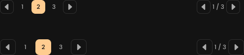

<!-- GEN:BEGIN 本段由 tools/gen-component-docs.py 依据 Figma 导出生成，勿手改；改 Figma 后重新生成 -->

## 概览

| 项 | 值 |
|---|---|
| Figma 组件集 | `Pagination`（node `56064:6707`） |
| 分类 | 导航类 |
| 变体数 | 4 |
| 默认变体 | `Size=sm, Type=full` |
| 参考尺寸 | 156×28 px（默认变体） |
| 主题 | 主库（深色中性 + 品牌砂色） |
| 预览图 | [assets/previews/pagination.png](../../assets/previews/pagination.png) |
| 代码实现 | [`components/Pagination/Pagination.tsx`](../../components/Pagination/Pagination.tsx) |
| Figma 链接 | [在 Figma 打开](https://www.figma.com/design/ZO4WH3sbVCj7lZIFMpiwV9/VibeMe-App---Web-Design-%E5%A4%87%E4%BB%BD?node-id=56064-6707) |



## 变体与属性

| Figma 属性 | 类型 | 取值 | 默认 | 代码 prop |
|---|---|---|---|---|
| `Size` | VARIANT | `sm` / `md` | `sm` | `size` |
| `Type` | VARIANT | `full` / `simple` | `full` | `type` |

变体是属性轴的笛卡尔积：**4 = 2 × 2**（`Size` × `Type`）。

内嵌组件：`Property 1=chevron-left_filled`×4、`Property 1=chevron-right_filled`×4

## 各变体的事实

> 填充栈按 Figma 图层顺序排列（**靠右的是上层**，hover/pressed 的叠加层在最后）。
> `⚠无cssVar` 表示该组件引用了历史遗留变量，代码里不要照抄，按 `foundations.md` 的规则换成语义 token。

| 变体 | 尺寸 | 填充栈 | 描边 | 圆角 | 内边距 上/右/下/左 | 不透明度 |
|---|---|---|---|---|---|---|
| `Size=sm, Type=full` | 156×28 | — | — | — | 0/0/0/0 | — |
| `Size=sm, Type=simple` | 88×28 | — | — | — | 0/0/0/0 | — |
| `Size=md, Type=full` | 176×32 | — | — | — | 0/0/0/0 | — |
| `Size=md, Type=simple` | 96×32 | — | — | — | 0/0/0/0 | — |

## 结构（默认变体）

### Size=sm, Type=full

```text
`COMPONENT` Size=sm, Type=full 156×28 HORIZONTAL gap 4 pad 0/0/0/0
└─ `FRAME` Frame 28×28 HORIZONTAL gap 0 pad 0/0/0/0 描边 `Background/border-default` #FFFFFF 12% `--vm-border-default` 圆角 8
  └─ `INSTANCE` Filled icon 16×16 实例=Property 1=chevron-left_filled
    └─ `VECTOR` icon 7.52×12.12 填充 `Text/Text-Secondary` #FFFFFF 64% `--vm-text-secondary`
└─ `FRAME` Frame 28×28 HORIZONTAL gap 0 pad 0/0/0/0 圆角 8
  └─ `TEXT` 1 5×18 填充 `Text/Text-Secondary` #FFFFFF 64% `--vm-text-secondary` 文字样式 `Caption/Caption`（12 Medium /18） 内容 '1'
└─ `FRAME` Frame 28×28 HORIZONTAL gap 0 pad 0/0/0/0 填充 `Brand/Brand` #FFCC90 `--vm-brand` 圆角 8
  └─ `TEXT` 2 7×18 填充 `Neutral/Neutral-950` #0E0E0E `--vm-neutral-950` 文字样式 `Caption/Caption`（12 Medium /18） 内容 '2'
└─ `FRAME` Frame 28×28 HORIZONTAL gap 0 pad 0/0/0/0 圆角 8
  └─ `TEXT` 3 8×18 填充 `Text/Text-Secondary` #FFFFFF 64% `--vm-text-secondary` 文字样式 `Caption/Caption`（12 Medium /18） 内容 '3'
└─ `FRAME` Frame 28×28 HORIZONTAL gap 0 pad 0/0/0/0 描边 `Background/border-default` #FFFFFF 12% `--vm-border-default` 圆角 8
  └─ `INSTANCE` Filled icon 16×16 实例=Property 1=chevron-right_filled
    └─ `VECTOR` icon 7.52×12.12 填充 `Text/Text-Secondary` #FFFFFF 64% `--vm-text-secondary`
```

### Size=md, Type=full

```text
`COMPONENT` Size=md, Type=full 176×32 HORIZONTAL gap 4 pad 0/0/0/0
└─ `FRAME` Frame 32×32 HORIZONTAL gap 0 pad 0/0/0/0 描边 `Background/border-default` #FFFFFF 12% `--vm-border-default` 圆角 8
  └─ `INSTANCE` Filled icon 16×16 实例=Property 1=chevron-left_filled
    └─ `VECTOR` icon 7.52×12.12 填充 `Text/Text-Secondary` #FFFFFF 64% `--vm-text-secondary`
└─ `FRAME` Frame 32×32 HORIZONTAL gap 0 pad 0/0/0/0 圆角 8
  └─ `TEXT` 1 5×18 填充 `Text/Text-Secondary` #FFFFFF 64% `--vm-text-secondary` 文字样式 `Caption/Caption`（12 Medium /18） 内容 '1'
└─ `FRAME` Frame 32×32 HORIZONTAL gap 0 pad 0/0/0/0 填充 `Brand/Brand` #FFCC90 `--vm-brand` 圆角 8
  └─ `TEXT` 2 7×18 填充 `Neutral/Neutral-950` #0E0E0E `--vm-neutral-950` 文字样式 `Caption/Caption`（12 Medium /18） 内容 '2'
└─ `FRAME` Frame 32×32 HORIZONTAL gap 0 pad 0/0/0/0 圆角 8
  └─ `TEXT` 3 8×18 填充 `Text/Text-Secondary` #FFFFFF 64% `--vm-text-secondary` 文字样式 `Caption/Caption`（12 Medium /18） 内容 '3'
└─ `FRAME` Frame 32×32 HORIZONTAL gap 0 pad 0/0/0/0 描边 `Background/border-default` #FFFFFF 12% `--vm-border-default` 圆角 8
  └─ `INSTANCE` Filled icon 16×16 实例=Property 1=chevron-right_filled
    └─ `VECTOR` icon 7.52×12.12 填充 `Text/Text-Secondary` #FFFFFF 64% `--vm-text-secondary`
```

### Size=sm, Type=simple

```text
`COMPONENT` Size=sm, Type=simple 88×28 HORIZONTAL gap 4 pad 0/0/0/0
└─ `FRAME` Frame 28×28 HORIZONTAL gap 0 pad 0/0/0/0 描边 `Background/border-default` #FFFFFF 12% `--vm-border-default` 圆角 8
  └─ `INSTANCE` Filled icon 16×16 实例=Property 1=chevron-left_filled
    └─ `VECTOR` icon 7.52×12.12 填充 `Text/Text-Secondary` #FFFFFF 64% `--vm-text-secondary`
└─ `TEXT` 1 / 3 24×18 填充 `Text/Text-Secondary` #FFFFFF 64% `--vm-text-secondary` 文字样式 `Caption/Caption`（12 Medium /18） 内容 '1 / 3'
└─ `FRAME` Frame 28×28 HORIZONTAL gap 0 pad 0/0/0/0 描边 `Background/border-default` #FFFFFF 12% `--vm-border-default` 圆角 8
  └─ `INSTANCE` Filled icon 16×16 实例=Property 1=chevron-right_filled
    └─ `VECTOR` icon 7.52×12.12 填充 `Text/Text-Secondary` #FFFFFF 64% `--vm-text-secondary`
```


## 设计 token

| Figma 变量 | CSS 变量 | 值 |
|---|---|---|
| `Background/border-default` | `--vm-border-default` | `rgba(255, 255, 255, 0.12)` |
| `Brand/Brand` | `--vm-brand` | `#FFCC90` |
| `Neutral/Neutral-950` | `--vm-neutral-950` | `#0E0E0E` |
| `Radious/radius-md` | `--vm-radius-md` | `8px` |
| `Text/Text-Secondary` | `--vm-text-secondary` | `rgba(255, 255, 255, 0.64)` |
| `border/width/thin` | `--vm-border-width-thin` | `1px` |
| `space/space-1` | `--vm-space-1` | `4px` |

<!-- GEN:END -->


## 交互与状态

Figma 的 `Pagination` **没有 `State` 轴**（只有 `Size` × `Type` 两个轴），所以没有 `state` prop；
但它的每个单元格在 `variants.json` / `tree` 里的视觉结构分成两类，**hover 必须按各自那一类的手法**：

- **箭头单元格**（28×28 / 32×32，有 `--vm-border-default` 1px 描边、圆角 `--vm-radius-md` 8px）——
  这一类是「描边换色」手法（与 Input / Search 同族）：`:hover` 时描边从 `--vm-border-default`
  （12% 白）换成 `--vm-white-4`（30% 白），**底色保持透明、图标色不动**。
  `:focus-visible` 时描边换 `--vm-border-selected`（50% 白）并补 `box-shadow: 0 0 0 var(--vm-focus-ring-width)`。
- **页码单元格**（28×28 / 32×32，**既无底色也无描边**）——这一类是「底色叠加」手法（与 Tabs `Type=pill` 同族）：
  `:hover` 加 `background-color: var(--vm-surface-hover)`（`Background/Surface-hover` #262626）并把文字换成
  `--vm-text-primary`；`:focus-visible` 加 ring。默认文字是 `--vm-text-secondary`。
- **当前页**（Figma 里页码 `2` 那一格）：底色 `--vm-brand`（`Brand/Brand` #FFCC90）＋ 文字
  `--vm-neutral-950`（`Neutral/Neutral-950` #0E0E0E）＋ `aria-current="page"`。当前页**没有 hover 变化**，
  选中态优先级高于 hover（写在 hover 规则之后）。
- **`type="simple"`** 时中间不是页码格而是一段纯文字 `1 / 3`
  （Figma 里是单独的 TEXT 节点，Caption/Caption 12 Medium / 18，色 `--vm-text-secondary`）——
  它不可点、不参与 hover，用 `<span>` 而不是 `<button>`。
- **到达边界**：首页时上一页箭头、末页时下一页箭头渲染成原生 `disabled`；
  `disabled` 只加 `opacity: var(--vm-opacity-disabled)`（38%）＋ `cursor: not-allowed`，
  **不换灰色、不换描边色**（与全库 disabled 规则一致）。
- 整组还支持 `disabled` prop（原生属性透传语义）：根节点 `opacity: var(--vm-opacity-disabled)`，
  所有按钮同时 `disabled`。过渡统一 `background-color / border-color / color var(--vm-duration-fast)`，
  `prefers-reduced-motion: reduce` 下全部关掉。

## 代码用法

```tsx
import { Pagination } from './components/Pagination';
import './components/tokens.css'; // 必须先引入，Pagination.css 依赖其中的 --vm-* 变量

// 1) 受控分页：current 是「真实数值」页码（1 起算），不是 Figma 示例里的 2
<Pagination current={page} total={3} onChange={setPage} />

// Size=md（单元格 32×32）+ Type=simple（中间显示「2 / 3」）
<Pagination current={page} total={3} size="md" type="simple" onChange={setPage} />

// 整体禁用（例如表格正在加载）：只降不透明度，不换配色
<Pagination current={1} total={10} disabled />

<Pagination aria-label="搜索结果分页" current={page} total={12} onChange={setPage} className="my-pager" />
```

`current` 与 `total` 都可省略（`@default 1` / `@default 1`）：不传即「只有一页」——
页码 `1` 高亮、左右箭头都因首/末页而禁用，不补空白格。`total` 默认取 1 而不是 0，
是因为实现里 `total` 已被 `Math.max(1, …)` 钳制到 ≥1（写 0 也会变成 1）。

`type="full"`（默认）按 `total` 逐个渲染页码；`Type` 在 Figma 里只画了 3 个页码，
那只是**视觉样本**，实现必须接受任意 `total ≥ 1`（页码数量不设上限，`total` 很小时不要补空白格）。

## 可访问性

- 根元素是 `<nav aria-label="分页">`（`aria-label` 可被 `...rest` 覆盖），内部 `<ul>` + `<li>`，
  每个可点单元格是**原生 `<button type="button">`**，不是 `div` + `onClick`。
- 当前页码按钮带 `aria-current="page"`；不要用 `aria-selected`（那是 tablist 的语义）或自定义 class 充当状态。
- 箭头按钮没有可见文字，必须给可访问名：实现里固定为 `aria-label="上一页"` / `"下一页"`，
  内联 SVG 加 `aria-hidden="true"` + `focusable="false"`，避免读屏读出图形。
- 边界禁用用原生 `disabled`，读屏会播报「不可用」；不要只做 `pointer-events: none`（那样按钮仍可聚焦且能 Enter 触发）。
- `total` / `current` 被钳制到 `[1, max(total,1)]`，非法值不抛错；`simple` 型的 `1 / 3` 用
  `<span aria-hidden="true">`：当前页信息已经由带 `aria-current` 的按钮或 `<nav>` 语义给出，
  纯视觉的「x / y」不必重复播报。
- 键盘：Tab 依次进入每个按钮，Enter / Space 触发；`:focus-visible` 的 ring 是唯一的焦点指示，
  不要 `outline: none` 后不给替代。

## 不要这样做

1. **不要把两种 hover 手法混用**。箭头单元格在 Figma 里有 `--vm-border-default` 描边，属于
   「描边换色」一族（hover 换 `--vm-white-4`）；页码单元格**填充栈与描边都是空的**，属于
   「底色叠加」一族（hover 加 `--vm-surface-hover`）。给页码格加描边、或给箭头格加
   `--vm-white-7` / `--vm-surface-hover` 底色，都会偏离 Figma 记录的事实。
2. **不要给当前页做 hover 变化**。当前页是 `--vm-brand` 实底 + `--vm-neutral-950` 文字，
   再叠一层 hover 会让品牌色变脏；CSS 里 hover 规则必须写在当前页规则**之前**，并排除当前页。
3. **不要把 `Current` 当成变体**。`Pagination` 的属性轴只有 `Size` 与 `Type`；
   当前页是**数值**（`current: number`，1 起算），要在文档里写清合法范围与钳制规则，
   不要照抄 Figma 示例里被高亮的那个 `2`。
4. **不要手写 `font-size`**。单元格文字在三个变体里都是 `Caption/Caption`（12 Medium / 18 行高），
   代码里挂 `.vm-type-caption-caption` 或 `--vm-type-caption-caption-size`；18px 行高 + 单元格内边距
   才是 28 / 32 两种高度的来源。
5. **不要用 `--vm-text-disable` 或灰色表达禁用**。禁用只有 `opacity: var(--vm-opacity-disabled)`（38%）；
   另外 `disabled` 时**不要**把描边换成别的颜色。
6. **不要引用历史遗留变量**。本组件只用到 `Brand/Brand`、`Neutral/Neutral-950`、`Text/Text-Secondary`、
   `Background/border-default`、`border/width/thin`、`Radious/radius-md`、`space/space-1`；
   `Color` / `分割线` / `主色/Main Orange` 之类的不要碰。
7. **不要用 `#` 开头的字面量色值**写品牌底与文字：必须走 `var(--vm-brand)` 与 `var(--vm-neutral-950)`。

## 相关组件

- **`Table` / `List`**：分页最常出现在表格与列表下方，且 `Table` 内已有 Tag / Empty / Skeleton。
  间距用 `space/space-4`（16px）把分页与表格主体分开，不要靠给分页加 margin 写死（组件内已有
  `space/space-1` = 4px 的单元格间距，来自 Figma 的 auto layout gap）。
- **`Button`**：如果产品需要「跳转 / 每页条数」这类附加控件，用现成的 `Button`（`--vm-radius-button` 12px）
  与 `Select`，**不要**把分页单元格改成按钮样式；分页单元格的圆角是 `--vm-radius-md`（8px）。
- **`Select`**：翻页频率高的场景把 `type="simple"` 与「每页 N 条」的 Select 并排放在右侧。
- **`Steps`**：两者都是「按顺序的位置指示」，但语义不同——`Steps` 表达流程进度（不可随便跳），
  `Pagination` 表达数据切片（可以任意跳）；不要用 Steps 冒充分页，也不要用 Pagination 表示流程。
- **`Breadcrumb`**：同为导航类，同样属于「无填充」的文字型/描边型导航；三者在页面上都靠
  `--vm-text-secondary` 做默认前景，保证同一屏里导航类元素的视觉权重一致。
