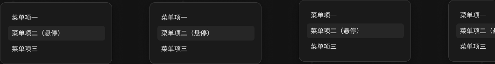

<!-- GEN:BEGIN 本段由 tools/gen-component-docs.py 依据 Figma 导出生成，勿手改；改 Figma 后重新生成 -->

## 概览

| 项 | 值 |
|---|---|
| Figma 组件集 | `Popover`（node `56063:6819`） |
| 分类 | 反馈类 |
| 变体数 | 4 |
| 默认变体 | `Placement=bottom-start` |
| 参考尺寸 | 100×139 px（默认变体） |
| 主题 | 主库（深色中性 + 品牌砂色） |
| 预览图 | [assets/previews/popover.png](../../assets/previews/popover.png) |
| 代码实现 | [`components/Popover/Popover.tsx`](../../components/Popover/Popover.tsx) |
| Figma 链接 | [在 Figma 打开](https://www.figma.com/design/ZO4WH3sbVCj7lZIFMpiwV9/VibeMe-App---Web-Design-%E5%A4%87%E4%BB%BD?node-id=56063-6819) |



## 变体与属性

| Figma 属性 | 类型 | 取值 | 默认 | 代码 prop |
|---|---|---|---|---|
| `Placement` | VARIANT | `bottom-start` / `bottom-end` / `top-start` / `top-end` | `bottom-start` | `placement` |

变体是属性轴的笛卡尔积：**4 = 4**（`Placement`）。

## 各变体的事实

> 填充栈按 Figma 图层顺序排列（**靠右的是上层**，hover/pressed 的叠加层在最后）。
> `⚠无cssVar` 表示该组件引用了历史遗留变量，代码里不要照抄，按 `foundations.md` 的规则换成语义 token。

| 变体 | 尺寸 | 填充栈 | 描边 | 圆角 | 内边距 上/右/下/左 | 不透明度 |
|---|---|---|---|---|---|---|
| `Placement=bottom-start` | 100×139 | — | — | — | 0/0/0/0 | — |
| `Placement=bottom-end` | 100×139 | — | — | — | 0/0/0/0 | — |
| `Placement=top-start` | 100×139 | — | — | — | 0/0/0/0 | — |
| `Placement=top-end` | 100×139 | — | — | — | 0/0/0/0 | — |

## 结构（默认变体）

### Placement=bottom-start

```text
`COMPONENT` Placement=bottom-start 100×139 VERTICAL gap 0 pad 0/0/0/0
└─ `FRAME` Frame 100×5 HORIZONTAL gap 0 pad 0/24/0/24
  └─ `VECTOR` Vector 8×5 填充 `Background/bg-panel` #1A1A1A `--vm-bg-panel`
└─ `FRAME` Frame 240×134 VERTICAL gap 2 pad 16/16/16/16 填充 `Background/bg-panel` #1A1A1A `--vm-bg-panel` 描边 `Background/border-default` #FFFFFF 12% `--vm-border-default` 圆角 12
  └─ `FRAME` Frame 208×32 HORIZONTAL gap 0 pad 6/8/6/8 圆角 6
    └─ `TEXT` 菜单项一 56×20 填充 `Text/Text-Primary` #FFFFFF 92% `--vm-text-primary` 文字样式 `Heading/Body/S/Regular`（14 Regular /20） 内容 '菜单项一'
  └─ `FRAME` Frame 208×32 HORIZONTAL gap 0 pad 6/8/6/8 填充 `Background/Surface-hover` #262626 `--vm-surface-hover` 圆角 6
    └─ `TEXT` 菜单项二（悬停） 112×20 填充 `Text/Text-Primary` #FFFFFF 92% `--vm-text-primary` 文字样式 `Heading/Body/S/Regular`（14 Regular /20） 内容 '菜单项二（悬停）'
  └─ `FRAME` Frame 208×32 HORIZONTAL gap 0 pad 6/8/6/8 圆角 6
    └─ `TEXT` 菜单项三 56×20 填充 `Text/Text-Primary` #FFFFFF 92% `--vm-text-primary` 文字样式 `Heading/Body/S/Regular`（14 Regular /20） 内容 '菜单项三'
```

### Placement=top-end

```text
`COMPONENT` Placement=top-end 100×139 VERTICAL gap 0 pad 0/0/0/0
└─ `FRAME` Frame 240×134 VERTICAL gap 2 pad 16/16/16/16 填充 `Background/bg-panel` #1A1A1A `--vm-bg-panel` 描边 `Background/border-default` #FFFFFF 12% `--vm-border-default` 圆角 12
  └─ `FRAME` Frame 208×32 HORIZONTAL gap 0 pad 6/8/6/8 圆角 6
    └─ `TEXT` 菜单项一 56×20 填充 `Text/Text-Primary` #FFFFFF 92% `--vm-text-primary` 文字样式 `Heading/Body/S/Regular`（14 Regular /20） 内容 '菜单项一'
  └─ `FRAME` Frame 208×32 HORIZONTAL gap 0 pad 6/8/6/8 填充 `Background/Surface-hover` #262626 `--vm-surface-hover` 圆角 6
    └─ `TEXT` 菜单项二（悬停） 112×20 填充 `Text/Text-Primary` #FFFFFF 92% `--vm-text-primary` 文字样式 `Heading/Body/S/Regular`（14 Regular /20） 内容 '菜单项二（悬停）'
  └─ `FRAME` Frame 208×32 HORIZONTAL gap 0 pad 6/8/6/8 圆角 6
    └─ `TEXT` 菜单项三 56×20 填充 `Text/Text-Primary` #FFFFFF 92% `--vm-text-primary` 文字样式 `Heading/Body/S/Regular`（14 Regular /20） 内容 '菜单项三'
└─ `FRAME` Frame 100×5 HORIZONTAL gap 0 pad 0/24/0/24
  └─ `VECTOR` Vector 8×5 填充 `Background/bg-panel` #1A1A1A `--vm-bg-panel`
```


## 设计 token

| Figma 变量 | CSS 变量 | 值 |
|---|---|---|
| `Background/Surface-hover` | `--vm-surface-hover` | `#262626` |
| `Background/bg-panel` | `--vm-bg-panel` | `#1A1A1A` |
| `Background/border-default` | `--vm-border-default` | `rgba(255, 255, 255, 0.12)` |
| `Radious/radius-sm` | `--vm-radius-sm` | `6px` |
| `Semantic Radius/radius-card` | `--vm-radius-card` | `12px` |
| `Semantic Space/padding-popover` | `--vm-padding-popover` | `16px` |
| `Text/Text-Primary` | `--vm-text-primary` | `rgba(255, 255, 255, 0.92)` |
| `border/width/thin` | `--vm-border-width-thin` | `1px` |
| `space/space-0-5` | `--vm-space-0-5` | `2px` |
| `space/space-1-5` | `--vm-space-1-5` | `6px` |
| `space/space-2` | `--vm-space-2` | `8px` |
| `space/space-6` | `--vm-space-6` | `24px` |

<!-- GEN:END -->


## 交互与状态

**Popover 没有 `State` 轴。** Figma 里 4 个变体全部只由 `Placement` 组成，导出的四个变体顶层既没有
`fills` / `strokes` 也没有 `opacity` —— 面板与箭头都是子节点，所以**面板自己没有 hover / pressed /
focus / disabled / open 任何一档**：`.vm-popover__panel` 上不写 `:hover`，也不接受 `open` prop。
显隐由调用方控制（条件渲染），和 Tooltip 一样。

`placement` 是唯一会改变渲染的 prop，它同时控制三件事（都是逐变体导出的事实，不是推导）：

| `placement` | root 排列 | 子节点顺序 | 箭头朝向 | 箭头行水平对齐 |
|---|---|---|---|---|
| `bottom-start`（默认） | VERTICAL | 箭头行 → 面板 | 朝上 | `hAlign=MIN`（距面板左缘 `--vm-space-6` 24px） |
| `bottom-end` | VERTICAL | 箭头行 → 面板 | 朝上 | `hAlign=MAX`（距面板右缘 24px） |
| `top-start` | VERTICAL | 面板 → 箭头行 | 朝下 | `hAlign=MIN`（距面板左缘 24px） |
| `top-end` | VERTICAL | 面板 → 箭头行 | 朝下 | `hAlign=MAX`（距面板右缘 24px） |

面板本身在四个变体里**完全一致**（`bottom-start` 与 `top-end` 两棵树的绑定逐项相同）：
底 `Background/bg-panel` → `--vm-bg-panel` #1A1A1A；描边 `Background/border-default`（12% 白）
× `border/width/thin` → `--vm-border-default` / `--vm-border-width-thin` 1px；
圆角 `Semantic Radius/radius-card` → `--vm-radius-card` 12px；
内边距 `Semantic Space/padding-popover` → `--vm-padding-popover` 16px；
行间距 `space/space-0-5` → `--vm-space-0-5` 2px；阴影 `Elevation/3` → `--vm-elevation-3`。

面板里那个「菜单项二（悬停）」是 Figma 为了让设计师看到悬停效果而**画出来的样本行**，
底色 `Background/Surface-hover` → `--vm-surface-hover` #262626。它属于**行组件**的状态，
不是面板的状态：`:hover` 要写在行上（参照 `MenuItem`），不要挪到 `.vm-popover__panel`。
注意这里用的是「底色换 token」的手法（透明 → `--vm-surface-hover`），**不是** Button/Card 那种叠加
`--vm-white-7` 的手法，两者不要互串。

## 代码用法

```tsx
import { Popover } from './components/Popover';
import { MenuItem } from './components/MenuItem';

// 1) 默认 Placement=bottom-start，面板内容自己给
<Popover>
  <ul role="menu" style={{ margin: 0, padding: 0 }}>
    <MenuItem>重命名</MenuItem>
    <MenuItem>复制链接</MenuItem>
    <MenuItem>删除</MenuItem>
  </ul>
</Popover>

// 2) 放到触发元素上方、箭头对齐右缘
<Popover placement="top-end">…</Popover>

// 3) 真实用法：显隐由调用方控制，角色交给内容
<button type="button" aria-haspopup="menu" aria-expanded={open} onClick={toggle}>
  更多
</button>
{open ? (
  <Popover placement="bottom-end">
    <ul role="menu">…</ul>
  </Popover>
) : null}
```

只有 `placement` 与 `children` 两个 prop（外加原生 `div` 属性透传），没有 `open` / `trigger` /
定位计算 —— 面板宽固定 240px（`wSizing: FIXED`），所以给 `children` 里放宽度超过 208px 的内容时
要么让它换行、要么自己覆盖 `.vm-popover__panel` 的 `width`，不要把面板撑破。
箭头是内联 SVG（`vm-popover__arrow`，8×5，`fill="currentColor"`，颜色取 `--vm-bg-panel`），
颜色和面板同源，所以**换面板底色时必须同时换箭头颜色**，否则箭头会变成一块异色补丁。

## 可访问性

- 根节点是普通 `<div>`，**不预设 `role`**：面板里放什么决定了角色。放菜单就由内容带上
  `<ul role="menu">` + `role="menuitem"`；放表单或富内容就用 `role="dialog"` + `aria-modal="false"`
  并给 `aria-label`。把角色塞进组件内部会在两种用法之间二选一，所以留给调用方（`...rest` 支持
  在根节点写 `role` / `aria-*`）。
- 触发元素必须自报状态：`aria-haspopup="menu"`（或 `"dialog"`）标明点开的是弹层，`aria-expanded`
  随开合在 `true` / `false` 之间切换，让读屏知道面板此刻是否展开。
- 键盘：`Escape` 关闭并把焦点还回触发元素；`Tab` 在非模态 Popover 里**不应该**被锁住（锁焦点是
  `Modal` 的职责）；上下方向键在 `role="menu"` 里移动焦点属于菜单内容的实现，不由本组件接管。
- 焦点管理：非模态 Popover 打开时不要抢焦点（不要 `autoFocus`），除非内容是表单；关闭后焦点必须
  回到触发元素，否则键盘用户会掉到文档开头。
- 面板是纯视觉容器，`--vm-bg-panel` 压在 `--vm-text-primary` 上对比度足够；`Elevation/3` 只是阴影，
  不能替代描边（`--vm-border-default` 仍然要在，浅底背景下阴影会消失）。

## 不要这样做

1. **不要给面板加 `:hover` 或 `:active`**。Popover 的 4 个变体里没有任何 `State`，面板在被悬停时不会
   变样；`.vm-popover__panel:hover { background-color: var(--vm-surface-hover) }` 是凭空发明。
   悬停反馈属于里面的行（`MenuItem` 的 `:hover` 换 `--vm-surface-hover`）。
2. **不要用 `--vm-white-7` / `--vm-white-6` 叠加做悬停**。那是 Button / Card / MenuItem 一族的填充叠加手法；
   Popover 的面板底色是 `--vm-bg-panel`（`Background/bg-panel`），叠加层会在它上面糊出一层不属于设计稿的灰。
3. **不要给 `placement` 只做 `transform: rotate` 的箭头翻转**。`-start` 与 `-end` 的区别是箭头行的
   水平对齐（导出里 `hAlign` 从 `MIN` 变成 `MAX`），四个变体的子节点顺序也不同
   （`bottom-*` 箭头行在前、`top-*` 面板在前）；只转箭头会让箭头压到面板里。
4. **不要照抄 Figma 的 100×139 当尺寸**。那是组件集变体的包围盒（箭头行 100 宽 + 面板 240 宽并集出来的
   假尺寸）。真实面板是 **240px 宽、高度 HUG**（默认示例 3 行时 134px 高），写死 139 会让内容被裁切
   （面板 `clip: true`）。
5. **不要在面板上写死 208px 或 134px**。208 = 240 − 16×2 是内边距算出来的行宽，134 是三行示例撑出来的
   高度；面板要保持 `width: 240px` + `padding: var(--vm-padding-popover)`，其余交给内容自然生长。
6. **不要把 `Radious/radius-sm`（6px，行圆角）当成面板圆角**。Figma 里这个拼错的变量名是原始命名，
   行用它（`--vm-radius-sm`），面板用 `Semantic Radius/radius-card`（`--vm-radius-card` 12px），
   两者混用会让面板看起来像一张大卡片里的按钮。
7. **不要用 Popover 承载一句话提示**。没有箭头以外的交互内容、也不需要焦点管理时用 `Tooltip`；
   Popover 有 `Elevation/3` + 240px 面板，重得多。

## 相关组件

- **`Tooltip`**：同族弹出层，但更轻 —— 只有一行文字、无面板、无阴影，方位词是 `top` / `bottom` / `left` / `right`
  （居中），而 Popover 是 `bottom-start` / `bottom-end` / `top-start` / `top-end`（带对齐）。两者都**没有**
  `State` 轴，实现风格可直接对照。
- **`MenuItem`**：Popover 面板内容最常用的组合。Figma 里 Popover 的面板画了 3 行菜单样本
  （208×32、内边距 6/8、圆角 `--vm-radius-sm`），代码里就用 `MenuItem`（208×36、内边距 `--vm-space-2`）填进去，
  不要重造行。注意 `DropDown` 是「触发 + 面板」的整体，Popover 只是那个面板。
- **`Dropdown`**：如果 Popover 里放的就是一列可选项、还要选中态，直接用 `Dropdown`（它内部已经组合了
  `MenuItem` 与选中逻辑），不要用 Popover 手拼。
- **`Modal` / `Drawer`**：需要遮罩、焦点陷阱、`Escape` 关闭且不允许点外部穿透时用它们；Popover 是非模态的。
- **`Button` / 图标按钮**：触发元素。用 `aria-haspopup` + `aria-expanded` 与 Popover 建立关系。
- **`List` / `Table` / `Avatar`**：Popover 面板里放「用户卡片」「行详情」这类富内容时与它们组合。
