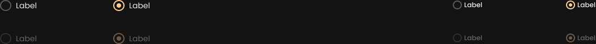

<!-- GEN:BEGIN 本段由 tools/gen-component-docs.py 依据 Figma 导出生成，勿手改；改 Figma 后重新生成 -->

## 概览

| 项 | 值 |
|---|---|
| Figma 组件集 | `Radio`（node `56059:6471`） |
| 分类 | 表单控件 |
| 变体数 | 8 |
| 默认变体 | `Size=md, Selected=false, State=default` |
| 参考尺寸 | 66×20 px（默认变体） |
| 主题 | 主库（深色中性 + 品牌砂色） |
| 预览图 | [assets/previews/radio.png](../../assets/previews/radio.png) |
| 代码实现 | [`components/Radio/Radio.tsx`](../../components/Radio/Radio.tsx) |
| Figma 链接 | [在 Figma 打开](https://www.figma.com/design/ZO4WH3sbVCj7lZIFMpiwV9/VibeMe-App---Web-Design-%E5%A4%87%E4%BB%BD?node-id=56059-6471) |



## 变体与属性

| Figma 属性 | 类型 | 取值 | 默认 | 代码 prop |
|---|---|---|---|---|
| `label` | TEXT（内容插槽） | — | — | `children` |
| `Size` | VARIANT | `sm` / `md` | `sm` | `size` |
| `Selected` | VARIANT | `false` / `true` | `false` | `selected` |
| `State` | VARIANT | `default` / `disabled` | `default` | `state` |

变体是属性轴的笛卡尔积：**8 = 2 × 2 × 2**（`Size` × `Selected` × `State`）。

## 各变体的事实

> 填充栈按 Figma 图层顺序排列（**靠右的是上层**，hover/pressed 的叠加层在最后）。
> `⚠无cssVar` 表示该组件引用了历史遗留变量，代码里不要照抄，按 `foundations.md` 的规则换成语义 token。

| 变体 | 尺寸 | 填充栈 | 描边 | 圆角 | 内边距 上/右/下/左 | 不透明度 |
|---|---|---|---|---|---|---|
| `Size=sm, Selected=false, State=default` | 53×18 | — | — | — | 0/0/0/0 | — |
| `Size=sm, Selected=false, State=disabled` | 53×18 | — | — | — | 0/0/0/0 | 0.38 |
| `Size=sm, Selected=true, State=default` | 53×18 | — | — | — | 0/0/0/0 | — |
| `Size=sm, Selected=true, State=disabled` | 53×18 | — | — | — | 0/0/0/0 | 0.38 |
| `Size=md, Selected=false, State=default` | 66×20 | — | — | — | 0/0/0/0 | — |
| `Size=md, Selected=false, State=disabled` | 66×20 | — | — | — | 0/0/0/0 | 0.38 |
| `Size=md, Selected=true, State=default` | 66×20 | — | — | — | 0/0/0/0 | — |
| `Size=md, Selected=true, State=disabled` | 66×20 | — | — | — | 0/0/0/0 | 0.38 |

## 结构（默认变体）

### Size=md, Selected=false, State=default

```text
`COMPONENT` Size=md, Selected=false, State=default 66×20 HORIZONTAL gap 8 pad 0/0/0/0
└─ `FRAME` Frame 20×20 HORIZONTAL gap 0 pad 0/0/0/0 描边 `White/White-4` #FFFFFF 30% `--vm-white-4` 圆角 999
└─ `TEXT` Label 38×20 填充 `Text/Text-Primary` #FFFFFF 92% `--vm-text-primary` 文字样式 `Heading/Body/S/Regular`（14 Regular /20） 内容 'Label'
```

### Size=sm, Selected=true, State=default

```text
`COMPONENT` Size=sm, Selected=true, State=default 53×18 HORIZONTAL gap 4 pad 0/0/0/0
└─ `FRAME` Frame 16×16 HORIZONTAL gap 0 pad 0/0/0/0 描边 `Brand/Brand` #FFCC90 `--vm-brand` 圆角 999
  └─ `FRAME` Frame 6×6 填充 `Brand/Brand` #FFCC90 `--vm-brand` 圆角 999
└─ `TEXT` Label 33×18 填充 `Text/Text-Primary` #FFFFFF 92% `--vm-text-primary` 文字样式 `Caption/Caption`（12 Medium /18） 内容 'Label'
```

### Size=md, Selected=true, State=default

```text
`COMPONENT` Size=md, Selected=true, State=default 66×20 HORIZONTAL gap 8 pad 0/0/0/0
└─ `FRAME` Frame 20×20 HORIZONTAL gap 0 pad 0/0/0/0 描边 `Brand/Brand` #FFCC90 `--vm-brand` 圆角 999
  └─ `FRAME` Frame 8×8 填充 `Brand/Brand` #FFCC90 `--vm-brand` 圆角 999
└─ `TEXT` Label 38×20 填充 `Text/Text-Primary` #FFFFFF 92% `--vm-text-primary` 文字样式 `Heading/Body/S/Regular`（14 Regular /20） 内容 'Label'
```


## 设计 token

| Figma 变量 | CSS 变量 | 值 |
|---|---|---|
| `Brand/Brand` | `--vm-brand` | `#FFCC90` |
| `Radious/radius-full` | `--vm-radius-full` | `999px` |
| `Text/Text-Primary` | `--vm-text-primary` | `rgba(255, 255, 255, 0.92)` |
| `White/White-4` | `--vm-white-4` | `rgba(255, 255, 255, 0.3)` |
| `border/width/thick` | `--vm-border-width-thick` | `2px` |
| `opacity/disabled` | `--vm-opacity-disabled` | `0.38` |
| `space/space-1` | `--vm-space-1` | `4px` |
| `space/space-2` | `--vm-space-2` | `8px` |

<!-- GEN:END -->


## 交互与状态

Radio 只有 `Selected` 与 `State=disabled` 两个状态轴，Figma **没有** hover / pressed / focus
变体，所以代码里也不造这三种视觉。

- **未选中（`Selected=false`）**：外圈是一条 2px 描边 `--vm-border-width-thick`，颜色取
  `White/White-4` = `--vm-white-4`（30% 白），没有填充、没有内点。
- **选中（`Selected=true`，由原生 `:checked` 触发）**：外圈描边换成 `Brand/Brand` = `--vm-brand`
  （#FFCC90），同时 `::after` 从 `scale(0)` 变成 `scale(1)` 画出内点——内点直径是外圈的 40%
  （md 8/20，sm 6/16，与 Figma 两棵树完全一致），颜色同为 `--vm-brand`。
- **hover**：Figma 里不存在该变体，所以 `.vm-radio` **没有任何 `:hover` 规则**，
  底色与描边都不动。不要照抄 Input / Search / Select 那套「hover 把描边换成 `--vm-white-4`」，
  因为 Radio 的默认描边本身就是 `--vm-white-4`。
- **键盘焦点（`:focus-visible`）**：描边颜色不换（否则会跟选中态的 `--vm-brand` 打架），
  只在外圈外沿加 `0 0 0 var(--vm-focus-ring-width) var(--vm-border-selected)` 的 ring。
- **禁用（`State=disabled`，由原生 `disabled` 触发）**：整行只加
  `opacity: var(--vm-opacity-disabled)`（Figma 的 `opacity/disabled` = 38%），底色、描边、文字色
  一律不换，且 `cursor: not-allowed`。禁用时内点保留（`Selected=true, State=disabled` 在 Figma 里
  确实是选中且 38% 的）。
- **尺寸（`Size`）**：sm 外圈 16、内点 6、标签 `Caption/Caption`（12/18）、间距 `--vm-space-1`（4）；
  md 外圈 20、内点 8、标签 `Heading/Body/S/Regular`（14/20）、间距 `--vm-space-2`（8）。

## 代码用法

```tsx
import { useState } from 'react';
import { Radio } from './components/Radio/Radio'; // 桶文件里是 import { Radio } from './components';

// 1) 非受控：同组用同一个 name，浏览器负责互斥
function PlanPickUncontrolled() {
  return (
    <fieldset>
      <legend className="vm-type-heading-body-s-medium">套餐</legend>
      <Radio name="plan" value="basic" defaultChecked>
        基础版
      </Radio>
      <Radio name="plan" value="pro" size="sm">
        专业版
      </Radio>
    </fieldset>
  );
}

// 2) 受控：checked 与 onChange 成对出现，value 用于标识这一项
function PlanPickControlled() {
  const [plan, setPlan] = useState('pro');
  return (
    <div role="radiogroup" aria-label="套餐">
      <Radio
        name="plan"
        value="basic"
        checked={plan === 'basic'}
        onChange={(e) => setPlan(e.target.value)}
      >
        基础版
      </Radio>
      <Radio
        name="plan"
        value="pro"
        checked={plan === 'pro'}
        onChange={(e) => setPlan(e.target.value)}
      >
        专业版
      </Radio>
      <Radio name="plan" value="legacy" disabled>
        历史套餐（不可选）
      </Radio>
    </div>
  );
}
```

`Radio.tsx` 的实际 props 是：`size?: 'sm' | 'md'`（默认 `'md'`，对应 Figma 默认变体）、
`children?: ReactNode`（对应 Figma 的 TEXT 属性 `label`），其余全部是原生
`input[type=radio]` 属性透传（`checked` / `defaultChecked` / `disabled` / `name` / `value` /
`onChange` / `id` / `aria-*`）。样式随组件一起加载，调用方只需 `import './components/tokens.css'`
一次（桶文件 `components/index.ts` 已经做了这件事）。

## 可访问性

- **语义**：真实 `<input type="radio">`，屏幕阅读器读作 radio；`<label>` 包住 input 与文字，
  文字天然成为该控件的可访问名称，点文字也能切换。
- **分组**：同组的若干 Radio 必须共享同一个原生 `name`。需要组标题时由调用方在外部包
  `<fieldset><legend>`（Figma 没有 Group 组件集，所以这里没有 `RadioGroup`）。用
  `role="radiogroup"` + `aria-label` 时请确保 radios 就是它的直接子元素。
- **键盘**：Tab 进入组内**一个**单选（浏览器对同名组的 roving tabindex 行为，选中的那个或第一个），
  `↓` / `→` 选下一项，`↑` / `←` 选上一项，`Space` 选中当前项；选中即触发 `change`。
- **焦点可见**：`.vm-radio__input:focus-visible + .vm-radio__mark` 加
  `--vm-focus-ring-width` 的 ring，颜色 `--vm-border-selected`，**没有** `outline: none`。
  原生 input 用 1×1 透明定位而不是 `display: none`，否则会退出焦点序列。
- **触控目标**：视觉高度只有 18–20px，靠根节点 `min-height: var(--vm-space-8)`（32px）加上
  label 的整行可点把命中区撑大；再密排时请自行加 `--vm-space-*` 的垂直间隙。
- **禁用**：用原生 `disabled`（不是 `aria-disabled`），读屏会播报「不可用」，且退出表单提交。
- **不要用颜色单独表意**：选中状态同时有内点形状，禁用的信息由原生属性播报，不依赖 38% 的淡化。

## 不要这样做

1. **不要给 Radio 加 `error` prop 或红色描边。** Figma 的 Radio 组件集只有
   `Size` / `Selected` / `State` 三个轴，`State` 只有 `default` / `disabled`；错误态是
   Checkbox、Input 那一族的能力（Input 的 `State=error` 才是 `--vm-status-error`）。
2. **不要把 `State` 当成 prop。** 有人会写 `<Radio state="default">` —— Figma 的 `State=default`
   是交互基线，代码里没有这个 prop；`State=disabled` 也已经映射成原生 `disabled`。
3. **不要用 `<Radio checked={...}>` 却不给 `onChange`。** 原生受控 input 会退化成只读，
   点了没反应；受控就配 `onChange`，或者干脆用 `defaultChecked`。
4. **不要照抄 Input / Search / Select 的 hover 手法。** 那一族是「hover 把 `--vm-border-default`
   换成 `--vm-white-4`」；Radio 的默认描边**已经**是 `--vm-white-4`，再套一遍等于没有 hover。
   Button 一族的「底色叠 `--vm-white-7`」更不能抄——Radio 没有底色。
5. **不要硬编码色值。** 品牌色写 `#FFCC90`、或给未选中描边写 `rgba(255,255,255,0.3)` 都算漂移；
   正确的引用是 `var(--vm-brand)` 与 `var(--vm-white-4)`（对应的正是 Figma 变量
   `Brand/Brand` 与 `White/White-4`）。
6. **不要用 `div` 假单选或自己维护「组里只能选一个」的全局状态。** 原生 `name` 分组 + 一个
   受控 state 就够了；自己维护全局状态会同时丢掉键盘方向键与表单提交。
7. **不要为了对齐而写死 `height`。** 两档尺寸只差外圈 16/20、内点 `40%` 与文字样式；
   文字换行或去掉标签时组件应当自适应，固定高度会裁切中文标签。

## 相关组件

- **Checkbox**：同为表单多选/单选控件，共享 `label` 文字与 `Selected`/`Checked` 的思路，但
  Checkbox 有第三态 `indeterminate` 且尺寸轴是 sm/md 的 20/24 方框，**不能互换**。
  多选场景用 Checkbox，组内互斥才用 Radio。
- **Switch**：语义是「立即生效的开关」，无 `<form>` 提交值、无 `name` 分组；设置项用 Switch，
  表单里候选项互斥用 Radio。
- **ListItem / MenuItem**：如果整行可点且行内带单选指示，用它们承载行，把 Radio 放在行首即可；
  反过来不要把 Radio 用它自己的 label 当整行点击区。
- **Input / Select**：同一个表单里并列使用，高度基准一致（Radio 根节点 32px ≈ Input sm 的 32px），
  排列时用 `--vm-space-2` / `--vm-space-3` 做行距，与 `--vm-padding-input-x` 的横向节奏对齐。
- **Stack / Grid**：多组单选建议放进 `Stack`（纵向）或 `Grid`（横排多列），不要手工写 margin。
