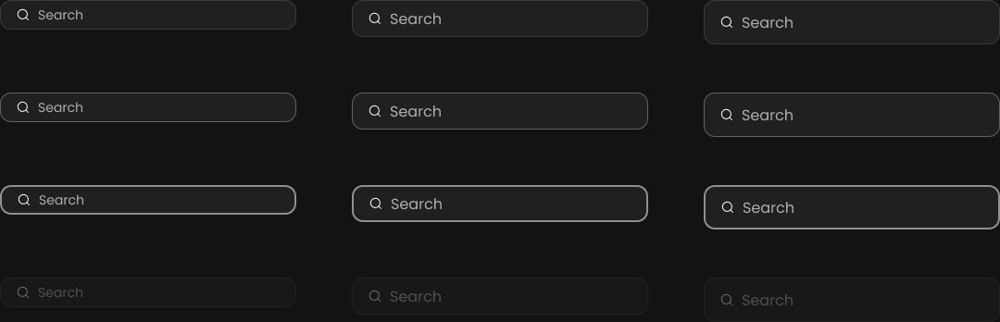

<!-- GEN:BEGIN 本段由 tools/gen-component-docs.py 依据 Figma 导出生成，勿手改；改 Figma 后重新生成 -->

## 概览

| 项 | 值 |
|---|---|
| Figma 组件集 | `Search`（node `56059:6373`） |
| 分类 | 表单控件 |
| 变体数 | 12 |
| 默认变体 | `Size=sm, State=default` |
| 参考尺寸 | 320×32 px（默认变体） |
| 主题 | 主库（深色中性 + 品牌砂色） |
| 预览图 | [assets/previews/search.png](../../assets/previews/search.png) |
| 代码实现 | [`components/Search/Search.tsx`](../../components/Search/Search.tsx) |
| Figma 链接 | [在 Figma 打开](https://www.figma.com/design/ZO4WH3sbVCj7lZIFMpiwV9/VibeMe-App---Web-Design-%E5%A4%87%E4%BB%BD?node-id=56059-6373) |



## 变体与属性

| Figma 属性 | 类型 | 取值 | 默认 | 代码 prop |
|---|---|---|---|---|
| `placeholder` | TEXT（内容插槽） | — | — | `children` |
| `Size` | VARIANT | `sm` / `md` / `lg` | `sm` | `size` |
| `State` | VARIANT | `default` / `hover` / `focus` / `disabled` | `default` | `state` |

变体是属性轴的笛卡尔积：**12 = 3 × 4**（`Size` × `State`）。

内嵌组件：`Property 1=icon, Property 2=search-line`×12

## 各变体的事实

> 填充栈按 Figma 图层顺序排列（**靠右的是上层**，hover/pressed 的叠加层在最后）。
> `⚠无cssVar` 表示该组件引用了历史遗留变量，代码里不要照抄，按 `foundations.md` 的规则换成语义 token。

| 变体 | 尺寸 | 填充栈 | 描边 | 圆角 | 内边距 上/右/下/左 | 不透明度 |
|---|---|---|---|---|---|---|
| `Size=sm, State=default` | 320×32 | `Background/bg-card` #202020 `--vm-bg-card` | `Background/border-default` #FFFFFF 12% `--vm-border-default` | 12 | 0/16/0/16 | — |
| `Size=sm, State=hover` | 320×32 | `Background/bg-card` #202020 `--vm-bg-card` | `White/White-4` #FFFFFF 30% `--vm-white-4` | 12 | 0/16/0/16 | — |
| `Size=sm, State=focus` | 320×32 | `Background/bg-card` #202020 `--vm-bg-card` | `Background/border-selected` #FFFFFF 50% `--vm-border-selected` | 12 | 0/16/0/16 | — |
| `Size=sm, State=disabled` | 320×32 | `Background/bg-card` #202020 `--vm-bg-card` | `Background/border-default` #FFFFFF 12% `--vm-border-default` | 12 | 0/16/0/16 | 0.38 |
| `Size=md, State=default` | 320×40 | `Background/bg-card` #202020 `--vm-bg-card` | `Background/border-default` #FFFFFF 12% `--vm-border-default` | 12 | 0/16/0/16 | — |
| `Size=md, State=hover` | 320×40 | `Background/bg-card` #202020 `--vm-bg-card` | `White/White-4` #FFFFFF 30% `--vm-white-4` | 12 | 0/16/0/16 | — |
| `Size=md, State=focus` | 320×40 | `Background/bg-card` #202020 `--vm-bg-card` | `Background/border-selected` #FFFFFF 50% `--vm-border-selected` | 12 | 0/16/0/16 | — |
| `Size=md, State=disabled` | 320×40 | `Background/bg-card` #202020 `--vm-bg-card` | `Background/border-default` #FFFFFF 12% `--vm-border-default` | 12 | 0/16/0/16 | 0.38 |
| `Size=lg, State=default` | 320×48 | `Background/bg-card` #202020 `--vm-bg-card` | `Background/border-default` #FFFFFF 12% `--vm-border-default` | 12 | 0/16/0/16 | — |
| `Size=lg, State=hover` | 320×48 | `Background/bg-card` #202020 `--vm-bg-card` | `White/White-4` #FFFFFF 30% `--vm-white-4` | 12 | 0/16/0/16 | — |
| `Size=lg, State=focus` | 320×48 | `Background/bg-card` #202020 `--vm-bg-card` | `Background/border-selected` #FFFFFF 50% `--vm-border-selected` | 12 | 0/16/0/16 | — |
| `Size=lg, State=disabled` | 320×48 | `Background/bg-card` #202020 `--vm-bg-card` | `Background/border-default` #FFFFFF 12% `--vm-border-default` | 12 | 0/16/0/16 | 0.38 |

## 结构（默认变体）

### Size=sm, State=default

```text
`COMPONENT` Size=sm, State=default 320×32 HORIZONTAL gap 8 pad 0/16/0/16 填充 `Background/bg-card` #202020 `--vm-bg-card` 描边 `Background/border-default` #FFFFFF 12% `--vm-border-default` 圆角 12
└─ `INSTANCE` Line icon 16×16 实例=Property 1=icon, Property 2=search-line
  └─ `VECTOR` icon 12.17×12.17 填充 #FFFFFF
└─ `TEXT` Search 262×20 填充 `Text/Text-Secondary` #FFFFFF 64% `--vm-text-secondary` 文字样式 `Heading/Body/S/Regular`（14 Regular /20） 内容 'Search'
```

### Size=lg, State=focus

```text
`COMPONENT` Size=lg, State=focus 320×48 HORIZONTAL gap 8 pad 0/16/0/16 填充 `Background/bg-card` #202020 `--vm-bg-card` 描边 `Background/border-selected` #FFFFFF 50% `--vm-border-selected` 圆角 12
└─ `INSTANCE` Line icon 16×16 实例=Property 1=icon, Property 2=search-line
  └─ `VECTOR` icon 12.17×12.17 填充 #FFFFFF
└─ `TEXT` Search 260×24 填充 `Text/Text-Secondary` #FFFFFF 64% `--vm-text-secondary` 文字样式 `Heading/Body/M/Regular`（16 Regular /24） 内容 'Search'
```

### Size=md, State=default

```text
`COMPONENT` Size=md, State=default 320×40 HORIZONTAL gap 8 pad 0/16/0/16 填充 `Background/bg-card` #202020 `--vm-bg-card` 描边 `Background/border-default` #FFFFFF 12% `--vm-border-default` 圆角 12
└─ `INSTANCE` Line icon 16×16 实例=Property 1=icon, Property 2=search-line
  └─ `VECTOR` icon 12.17×12.17 填充 #FFFFFF
└─ `TEXT` Search 262×24 填充 `Text/Text-Secondary` #FFFFFF 64% `--vm-text-secondary` 文字样式 `Heading/Body/M/Regular`（16 Regular /24） 内容 'Search'
```


## 设计 token

| Figma 变量 | CSS 变量 | 值 |
|---|---|---|
| `Background/bg-card` | `--vm-bg-card` | `#202020` |
| `Background/border-default` | `--vm-border-default` | `rgba(255, 255, 255, 0.12)` |
| `Background/border-selected` | `--vm-border-selected` | `rgba(255, 255, 255, 0.5)` |
| `Semantic Radius/radius-input` | `--vm-radius-input` | `12px` |
| `Semantic Space/padding-input-x` | `--vm-padding-input-x` | `16px` |
| `Text/Text-Secondary` | `--vm-text-secondary` | `rgba(255, 255, 255, 0.64)` |
| `White/White-4` | `--vm-white-4` | `rgba(255, 255, 255, 0.3)` |
| `border/width/thin` | `--vm-border-width-thin` | `1px` |
| `focus/ring-width` | `--vm-focus-ring-width` | `2px` |
| `opacity/disabled` | `--vm-opacity-disabled` | `0.38` |
| `space/space-2` | `--vm-space-2` | `8px` |

<!-- GEN:END -->


## 交互与状态

`State` 的四个值分两类：`default` / `hover` / `focus` 是交互态（CSS 伪类，不做 prop），
`disabled` 是应用态（做成 prop 并落到原生 `disabled`）。

- **default**：`--vm-bg-card` 实底 + 1px `--vm-border-default` 描边；左侧 16×16 的 `search-line`
  图标（`--vm-white-0`），图标与文字之间 gap 8px 即 `--vm-space-2`；提示文字 `--vm-text-secondary`。
- **hover**（CSS `:hover`，`disabled` 时不生效）：**只换描边** —— 12% 白的 `--vm-border-default`
  换成 `White/White-4`（`--vm-white-4`，30% 白），线宽仍是 `--vm-border-width-thin` 1px，
  底色与文字都不动。这是「描边换色」手法，**不要**照 Button 那样叠加 `--vm-white-7`。
- **focus**（CSS `:focus-visible`）：2px + `--vm-border-selected`（`Background/border-selected`，50% 白），
  线宽来自 Figma 绑定的 `focus/ring-width`（即 `--vm-focus-ring-width`）。实现另外补了一圈同宽的
  `box-shadow` 外环（可访问性补充，Figma 只画了描边，没有 ring 图层），保证键盘焦点在任何背景下都看得见。
  在固定 320 宽下 1px → 2px 会让文字区从 262 收到 260，这与 Figma 的 `Size=lg, State=focus` 实测一致。
- **disabled**（原生 `disabled`）：`opacity: var(--vm-opacity-disabled)`（38%）+ `cursor: not-allowed`；
  描边停在 `--vm-border-default`、文字色不变——不要换成灰色或 `--vm-text-disable`。
- 颜色过渡统一 `--vm-duration-fast`（100ms），`prefers-reduced-motion: reduce` 时整体关闭。

## 代码用法

```tsx
import { Search } from '../../components'; // 桶文件已 import './tokens.css'
// 只引单个组件时要自己先加载：import '../../components/tokens.css'; import { Search } from '../../components/Search';

export function SearchBar() {
  const [keyword, setKeyword] = React.useState('');

  return (
    <>
      {/* Figma: Size=sm, State=default；TEXT 属性 placeholder 默认就是 "Search" */}
      <Search value={keyword} onChange={(e) => setKeyword(e.target.value)} onKeyDown={(e) => {
        if (e.key === 'Enter') console.log('search', keyword);
      }} />

      {/* Figma: Size=md —— 提示文案换成业务语言 */}
      <Search size="md" placeholder="搜索作品或创作者" aria-label="搜索作品或创作者" />

      {/* Figma: Size=lg, State=disabled —— 走原生 disabled */}
      <Search size="lg" disabled defaultValue="筛选条件未选" />
    </>
  );
}
```

`Search.tsx` 自己 `import './Search.css'`。宽度默认 320px（Figma 的 FIXED 参考宽），
撑满容器时用 `className="w-full"` 覆盖；`className` 会与内部类合并而不是覆盖。
表单集成时直接把 `name` / `form` / `required` 等原生属性透传进来即可。

## 可访问性

- 控件本体是**真实 `<input type="search">`**（语义角色 `searchbox`），不是样式化的 `div`；
  键盘输入、`Esc` 清空（浏览器行为）、移动端回车键全部原生可用，不要自己拦 `keydown` 造轮子。
- 图标是 `aria-hidden="true"` 的装饰元素且 `pointer-events: none`；不要给它加 `role="img"`、
  也不要单独给它 `aria-label`，否则读屏会把它当成可聚焦/可读的元素重复播报。
- 只有 `placeholder` 的输入框对读屏是不够的（提示会在输入后消失）：请同时给
  `aria-label`（或外部 `<label htmlFor>`）说明这个搜索框搜什么；`name` 只影响表单提交，不是可访问名。
- 图标必须能「穿透」点击：图标区域 `pointer-events: none`，点击左边距任意位置都应聚焦到输入框，
  不要把图标放进 `<input>` 的 `padding` 之外的可点击层里。
- 搜索是异步的，请在业务层用 `aria-live="polite"` 的区域播报「找到 N 条结果」；
  组件本身不渲染结果列表，也不该自动 `role="status"`，避免每次输入都打断读屏。
- 禁用态用原生 `disabled` 而非 `aria-disabled`：前者能同时移出 tab 序列并播报「不可用」。

## 不要这样做

1. **不要把 hover 写成填充叠加**。Button 的 hover 是在底色上追加 `--vm-white-7`，
   而 Search 的 `State=hover` 变体填充栈完全没变，只把描边换成 `--vm-white-4`（30% 白）。
   这两套手法在同一份 Figma 文件里并存，不要互相套用。
2. **不要把 `State=focus` 做成 `focus` prop**。它是交互态，由 `:focus-visible` 触发；
   做成 prop 会导致「用鼠标点击也叫 focus」或「键盘 Tab 进来没有焦点环」这类问题。
3. **不要给输入值用 `--vm-text-secondary`**。Figma 把 `Text/Text-Secondary` 绑给了
   **placeholder**（组件里唯一的 TEXT 属性就叫 `placeholder`），真实输入值在 Figma 里没有画；
   代码里输入值用 `--vm-text-primary`、`::placeholder` 才用 `--vm-text-secondary`，
   并且不要用 `opacity` 让主文字变淡——那会连真实值的对比度一起降低。
4. **不要保留 WebKit 自带的搜索清除按钮**。`<input type="search">` 默认会在右侧画一个 ✕，
   Figma 的 Search 里没有这个部件；组件已用 `appearance: none` 去掉它。要提供清除能力的话，
   请等 Figma 补上对应部件，不要在代码里私自加一个图标按钮。
5. **不要给图标写 `` 或图标库**：`search-line` 已按 Figma 真实矢量内联在组件里
   （16×16 容器、12.1666 的路径、`fill="currentColor"`），换成图标库会带来第二套视觉与额外依赖。
6. **不要加 `error` / `loading` 等 Figma 没有的状态**。这个组件集只有
   `default / hover / focus / disabled` 四个 State；需要错误提示请用 `Input` 的 `error`。

## 相关组件

- **Input / Textarea / Select**：同一表单家族，focus 视觉必须一致（2px `--vm-border-selected`
  + `--vm-focus-ring-width` 外环）；Search 是 Input 的「带前置图标」特化，不要在两者之间复制样式。
- **Button**：搜索框右侧的「搜索」按钮用 `Button`（`type="primary"` 或 `ghost`），
  不要为搜索框再造一个内嵌按钮样式。
- **Empty / List / Table**：搜索无结果时的空状态交给 `Empty`，结果列表交给 `List` / `Table`；
  Search 只负责输入与提示文案。
- **Dropdown / MenuItem**：需要「搜索范围」这种前置筛选时，用 `Dropdown` 放在 Search 左侧组合，
  而不是往 Search 内部塞第二个控件。
- 结构上没有子组件：Search 只渲染 `<input>` + 一个装饰性 SVG。
