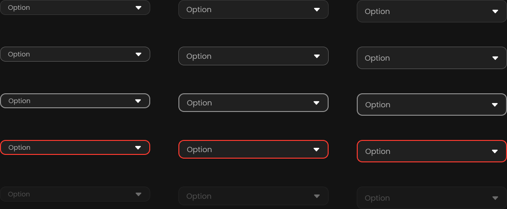

<!-- GEN:BEGIN 本段由 tools/gen-component-docs.py 依据 Figma 导出生成，勿手改；改 Figma 后重新生成 -->

## 概览

| 项 | 值 |
|---|---|
| Figma 组件集 | `Select`（node `56059:6318`） |
| 分类 | 表单控件 |
| 变体数 | 15 |
| 默认变体 | `Size=sm, State=default` |
| 参考尺寸 | 320×32 px（默认变体） |
| 主题 | 主库（深色中性 + 品牌砂色） |
| 预览图 | [assets/previews/select.png](../../assets/previews/select.png) |
| 代码实现 | [`components/Select/Select.tsx`](../../components/Select/Select.tsx) |
| Figma 链接 | [在 Figma 打开](https://www.figma.com/design/ZO4WH3sbVCj7lZIFMpiwV9/VibeMe-App---Web-Design-%E5%A4%87%E4%BB%BD?node-id=56059-6318) |



## 变体与属性

| Figma 属性 | 类型 | 取值 | 默认 | 代码 prop |
|---|---|---|---|---|
| `value` | TEXT（内容插槽） | — | — | `children` |
| `Size` | VARIANT | `sm` / `md` / `lg` | `sm` | `size` |
| `State` | VARIANT | `default` / `hover` / `open` / `error` / `disabled` | `default` | `state` |

变体是属性轴的笛卡尔积：**15 = 3 × 5**（`Size` × `State`）。

内嵌组件：`Property 1=chevron-down_filled`×15

## 各变体的事实

> 填充栈按 Figma 图层顺序排列（**靠右的是上层**，hover/pressed 的叠加层在最后）。
> `⚠无cssVar` 表示该组件引用了历史遗留变量，代码里不要照抄，按 `foundations.md` 的规则换成语义 token。

| 变体 | 尺寸 | 填充栈 | 描边 | 圆角 | 内边距 上/右/下/左 | 不透明度 |
|---|---|---|---|---|---|---|
| `Size=sm, State=default` | 320×32 | `Background/bg-card` #202020 `--vm-bg-card` | `Background/border-default` #FFFFFF 12% `--vm-border-default` | 12 | 0/16/0/16 | — |
| `Size=sm, State=hover` | 320×32 | `Background/bg-card` #202020 `--vm-bg-card` | `White/White-4` #FFFFFF 30% `--vm-white-4` | 12 | 0/16/0/16 | — |
| `Size=sm, State=open` | 320×32 | `Background/bg-card` #202020 `--vm-bg-card` | `Background/border-selected` #FFFFFF 50% `--vm-border-selected` | 12 | 0/16/0/16 | — |
| `Size=sm, State=error` | 320×32 | `Background/bg-card` #202020 `--vm-bg-card` | `状态色/Error` #FF3B30 `--vm-status-error` | 12 | 0/16/0/16 | — |
| `Size=sm, State=disabled` | 320×32 | `Background/bg-card` #202020 `--vm-bg-card` | `Background/border-default` #FFFFFF 12% `--vm-border-default` | 12 | 0/16/0/16 | 0.38 |
| `Size=md, State=default` | 320×40 | `Background/bg-card` #202020 `--vm-bg-card` | `Background/border-default` #FFFFFF 12% `--vm-border-default` | 12 | 0/16/0/16 | — |
| `Size=md, State=hover` | 320×40 | `Background/bg-card` #202020 `--vm-bg-card` | `White/White-4` #FFFFFF 30% `--vm-white-4` | 12 | 0/16/0/16 | — |
| `Size=md, State=open` | 320×40 | `Background/bg-card` #202020 `--vm-bg-card` | `Background/border-selected` #FFFFFF 50% `--vm-border-selected` | 12 | 0/16/0/16 | — |
| `Size=md, State=error` | 320×40 | `Background/bg-card` #202020 `--vm-bg-card` | `状态色/Error` #FF3B30 `--vm-status-error` | 12 | 0/16/0/16 | — |
| `Size=md, State=disabled` | 320×40 | `Background/bg-card` #202020 `--vm-bg-card` | `Background/border-default` #FFFFFF 12% `--vm-border-default` | 12 | 0/16/0/16 | 0.38 |
| `Size=lg, State=default` | 320×48 | `Background/bg-card` #202020 `--vm-bg-card` | `Background/border-default` #FFFFFF 12% `--vm-border-default` | 12 | 0/16/0/16 | — |
| `Size=lg, State=hover` | 320×48 | `Background/bg-card` #202020 `--vm-bg-card` | `White/White-4` #FFFFFF 30% `--vm-white-4` | 12 | 0/16/0/16 | — |
| `Size=lg, State=open` | 320×48 | `Background/bg-card` #202020 `--vm-bg-card` | `Background/border-selected` #FFFFFF 50% `--vm-border-selected` | 12 | 0/16/0/16 | — |
| `Size=lg, State=error` | 320×48 | `Background/bg-card` #202020 `--vm-bg-card` | `状态色/Error` #FF3B30 `--vm-status-error` | 12 | 0/16/0/16 | — |
| `Size=lg, State=disabled` | 320×48 | `Background/bg-card` #202020 `--vm-bg-card` | `Background/border-default` #FFFFFF 12% `--vm-border-default` | 12 | 0/16/0/16 | 0.38 |

## 结构（默认变体）

### Size=sm, State=default

```text
`COMPONENT` Size=sm, State=default 320×32 HORIZONTAL gap 8 pad 0/16/0/16 填充 `Background/bg-card` #202020 `--vm-bg-card` 描边 `Background/border-default` #FFFFFF 12% `--vm-border-default` 圆角 12
└─ `TEXT` Option 262×20 填充 `Text/Text-Secondary` #FFFFFF 64% `--vm-text-secondary` 文字样式 `Heading/Body/S/Regular`（14 Regular /20） 内容 'Option'
└─ `INSTANCE` Filled icon 16×16 实例=Property 1=chevron-down_filled
  └─ `VECTOR` icon 7.52×12.12 填充 #FFFFFF
```

### Size=lg, State=open

```text
`COMPONENT` Size=lg, State=open 320×48 HORIZONTAL gap 8 pad 0/16/0/16 填充 `Background/bg-card` #202020 `--vm-bg-card` 描边 `Background/border-selected` #FFFFFF 50% `--vm-border-selected` 圆角 12
└─ `TEXT` Option 260×24 填充 `Text/Text-Secondary` #FFFFFF 64% `--vm-text-secondary` 文字样式 `Heading/Body/M/Regular`（16 Regular /24） 内容 'Option'
└─ `INSTANCE` Filled icon 16×16 实例=Property 1=chevron-down_filled
  └─ `VECTOR` icon 7.52×12.12 填充 #FFFFFF
```

### Size=md, State=default

```text
`COMPONENT` Size=md, State=default 320×40 HORIZONTAL gap 8 pad 0/16/0/16 填充 `Background/bg-card` #202020 `--vm-bg-card` 描边 `Background/border-default` #FFFFFF 12% `--vm-border-default` 圆角 12
└─ `TEXT` Option 262×24 填充 `Text/Text-Secondary` #FFFFFF 64% `--vm-text-secondary` 文字样式 `Heading/Body/M/Regular`（16 Regular /24） 内容 'Option'
└─ `INSTANCE` Filled icon 16×16 实例=Property 1=chevron-down_filled
  └─ `VECTOR` icon 7.52×12.12 填充 #FFFFFF
```


## 设计 token

| Figma 变量 | CSS 变量 | 值 |
|---|---|---|
| `Background/bg-card` | `--vm-bg-card` | `#202020` |
| `Background/border-default` | `--vm-border-default` | `rgba(255, 255, 255, 0.12)` |
| `Background/border-selected` | `--vm-border-selected` | `rgba(255, 255, 255, 0.5)` |
| `Semantic Radius/radius-input` | `--vm-radius-input` | `12px` |
| `Semantic Space/padding-input-x` | `--vm-padding-input-x` | `16px` |
| `Text/Text-Secondary` | `--vm-text-secondary` | `rgba(255, 255, 255, 0.64)` |
| `White/White-4` | `--vm-white-4` | `rgba(255, 255, 255, 0.3)` |
| `border/width/thick` | `--vm-border-width-thick` | `2px` |
| `border/width/thin` | `--vm-border-width-thin` | `1px` |
| `focus/ring-width` | `--vm-focus-ring-width` | `2px` |
| `opacity/disabled` | `--vm-opacity-disabled` | `0.38` |
| `space/space-2` | `--vm-space-2` | `8px` |
| `状态色/Error` | `--vm-status-error` | `#FF3B30` |

<!-- GEN:END -->


## 交互与状态

`State` 的五个值分两类：`default` / `hover` 是交互态（CSS 伪类，不做 prop），
`open` / `error` / `disabled` 是应用态（做成 prop，并尽量落到原生属性）。

- **default**：`--vm-bg-card` 实底 + 1px `--vm-border-default` 描边，文字 `--vm-text-secondary`，
  右侧 16×16 的 `chevron-down_filled` 图标。
- **hover**（CSS `:hover`，`disabled` 时不生效）：**只换描边** —— `--vm-border-default`（12% 白）换成
  `--vm-white-4`（`White/White-4`，30% 白），线宽仍是 `--vm-border-width-thin` 1px，底色与文字都不动。
  这是「描边换色」手法，**不要**照 Button 那样叠 `--vm-white-7`。
- **open**（`open` prop）：2px + `--vm-border-selected`（`Background/border-selected`，50% 白），
  线宽来自 `focus/ring-width`（即 `--vm-focus-ring-width`）。耗时上是 1px → 2px，在固定 320 宽下
  文字区会从 262 收到 260，与 Figma 的 `Size=lg, State=open` 实测一致。
  原生 `<select>` 的弹层由浏览器绘制、页面无法感知开关，所以 `open` 是**调用方受控**的视觉状态。
- **error**（`error` prop）：2px + `--vm-status-error`（`状态色/Error`），线宽来自 `border/width/thick`
  即 `--vm-border-width-thick`；同时落到 `aria-invalid="true"`，并可用 `errorMessage` 渲染
  `role="alert"` 的文字说明（Figma 没有这段文案，是补的可访问性要求）。error 优先于 hover。
- **disabled**（原生 `disabled`）：`opacity: var(--vm-opacity-disabled)`（38%）+ `cursor: not-allowed`，
  描边与文字色都不换。焦点环（`:focus-visible`，2px `--vm-border-selected` + 同宽外环）是 Figma 之外的
  可访问性补充——Select 只有 `open` 变体，没有独立 focus 变体。

## 代码用法

```tsx
import { Select } from '../../components'; // 桶文件已 import './tokens.css'
// 单引时要自己先加载：import '../../components/tokens.css'; import { Select } from '../../components/Select';

export function SortPicker() {
  const [value, setValue] = React.useState('');

  return (
    <>
      {/* Figma: Size=md, State=default；TEXT 属性 value 对应选中的 <option> */}
      <Select size="md" value={value} onChange={(e) => setValue(e.target.value)}>
        <option value="">请选择排序方式</option>
        <option value="hot">最热</option>
        <option value="new">最新</option>
      </Select>

      {/* 自绘下拉（与 Dropdown 组合）时用 open 表达「面板已展开」 */}
      <Select size="sm" open>
        <option value="hot">最热</option>
      </Select>

      {/* Figma: State=error；errorMessage 会通过 aria-describedby 关联到 select */}
      <Select size="sm" error errorMessage="必须选择一个字段">
        <option value="">请选择字段</option>
      </Select>

      {/* Figma: State=disabled 走原生 disabled，不需要 state prop */}
      <Select size="lg" disabled defaultValue="hot">
        <option value="hot">最热</option>
      </Select>
    </>
  );
}
```

`Select.tsx` 自己 `import './Select.css'`。宽度默认 320px（Figma 的 FIXED 参考宽），
需要撑满容器时用 `className="w-full"` 之类的排版类覆盖；`className` 会与内部类合并。

## 可访问性

- 控件本体是**真实 `<select>`**，不是样式化的 `div` + 假面板：键盘 `↑` / `↓` / `Enter` / `Esc`、
  首字母跳转、移动端原生滚轮全部由浏览器提供，代码里不要自己实现。
- 错误态同时给 `aria-invalid="true"` 与一段文字（`errorMessage` → `role="alert"` +
  `aria-describedby`），**不要只靠红框**表达错误，色觉障碍用户看不到描边颜色。
- `<option>` 必须有稳定的 `value`；空选项用 `value=""` 表达（label 写「请选择」），不要用一句提示语当真实值，
  否则表单提交会把这个提示语当成数据。
- 右侧 chevron 是 `aria-hidden="true"` 的装饰图标，且 `pointer-events: none`——不要给它加
  `tabindex` 或在它上面绑点击事件，展开动作由 `<select>` 自己承担。
- `open` 只是视觉状态，不会替调用方做键盘焦点管理；如果改用自绘下拉，请把 `role="listbox"` /
  `aria-expanded` 与焦点收束交给 `Dropdown` / `MenuItem`，不要在 Select 上重造。
- `<select>` 是单行控件，不要在里面放 `<option>` 之外的内容（图标、按钮都会被浏览器丢弃）。

## 不要这样做

1. **不要把 hover 写成填充叠加**。Button 的 hover 是在底色上追加 `--vm-white-7`，而 Select 的
   `State=hover` 变体填充栈**完全没变**，只有描边从 `--vm-border-default` 换成了 `--vm-white-4`。
   两套手法不要互相套用。
2. **不要给 Select 加 `placeholder` prop**。Figma 这个组件集的 TEXT 属性叫 `value`（示例 `Option`），
   「还没选」这种状态靠一个 `value=""` 的 `<option>` 表达；`placeholder` 是 Search 的属性，两者别混。
3. **不要把文字色换成 `--vm-text-primary`**。从 `default` 到 `open` 再到 `error`，Figma 给文字绑的一直是
   `Text/Text-Secondary`（`--vm-text-secondary`，64% 白）。想区分「已选值 / 未选」请用文案和描边，
   不要私自换色——那会脱离 token 的既有绑定。
4. **不要用 `appearance: none` 之外的办法去掉原生箭头又忘记补图标**，也不要给图标加 `pointer-events`
   或 `tabindex`：图标必须能「穿透」点击到 `<select>`，否则点右侧区域无法展开。
5. **不要给 `open` 加过渡动画/旋转箭头**。Figma 的 `State=open` 只改了描边（2px、50% 白），
   箭头本身没有旋转变体；自己加旋转属于发明设计里没有的状态。
6. **不要照抄 `hover` 到 `disabled` 上**：禁用态描边必须停留在 `--vm-border-default`，
   只降 `--vm-opacity-disabled`（38%），不要换成灰色描边或 `--vm-text-disable`。

## 相关组件

- **Dropdown / MenuItem**：Select 是「收起态」的触发器。需要多列、分组、搜索或图标选项时，
  用 `Dropdown` 内嵌 `MenuItem` 自绘面板，并把展开状态喂给本组件的 `open`。
- **Input / Textarea / Search**：同一个表单里并列的表单控件，三者的 focus 视觉必须一致
  （2px `--vm-border-selected` + `--vm-focus-ring-width` 外环），不要各自发明。
- **Button**：表单的提交/重置按钮；`Select` 本身不渲染按钮。
- **Tag / Badge**：多选场景下已选项常以 Tag 展示在 Select 附近，而不是塞进 `<option>`。
- 图标沿用 Figma `Filled icon / chevron-down_filled` 的真实矢量（已内联在组件里），不要换成图标库或字符箭头。
