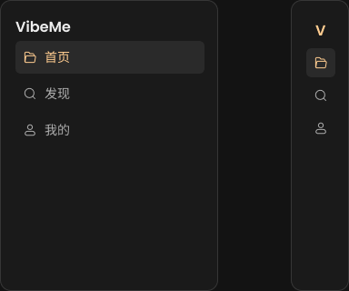

<!-- GEN:BEGIN 本段由 tools/gen-component-docs.py 依据 Figma 导出生成，勿手改；改 Figma 后重新生成 -->

## 概览

| 项 | 值 |
|---|---|
| Figma 组件集 | `Sidebar`（node `56064:6840`） |
| 分类 | 导航类 |
| 变体数 | 2 |
| 默认变体 | `State=expanded` |
| 参考尺寸 | 240×320 px（默认变体） |
| 主题 | 主库（深色中性 + 品牌砂色） |
| 预览图 | [assets/previews/sidebar.png](../../assets/previews/sidebar.png) |
| 代码实现 | [`components/Sidebar/Sidebar.tsx`](../../components/Sidebar/Sidebar.tsx) |
| Figma 链接 | [在 Figma 打开](https://www.figma.com/design/ZO4WH3sbVCj7lZIFMpiwV9/VibeMe-App---Web-Design-%E5%A4%87%E4%BB%BD?node-id=56064-6840) |



## 变体与属性

| Figma 属性 | 类型 | 取值 | 默认 | 代码 prop |
|---|---|---|---|---|
| `State` | VARIANT | `expanded` / `collapsed` | `expanded` | `state` |

变体是属性轴的笛卡尔积：**2 = 2**（`State`）。

内嵌组件：`Property 1=icon, Property 2=folder-line`×2、`Property 1=icon, Property 2=search-line`×2、`Property 1=icon, Property 2=user-line`×2

## 各变体的事实

> 填充栈按 Figma 图层顺序排列（**靠右的是上层**，hover/pressed 的叠加层在最后）。
> `⚠无cssVar` 表示该组件引用了历史遗留变量，代码里不要照抄，按 `foundations.md` 的规则换成语义 token。

| 变体 | 尺寸 | 填充栈 | 描边 | 圆角 | 内边距 上/右/下/左 | 不透明度 |
|---|---|---|---|---|---|---|
| `State=expanded` | 240×320 | `Background/bg-panel` #1A1A1A `--vm-bg-panel` | `Background/border-default` #FFFFFF 12% `--vm-border-default` | 12 | 16/16/16/16 | — |
| `State=collapsed` | 64×320 | `Background/bg-panel` #1A1A1A `--vm-bg-panel` | `Background/border-default` #FFFFFF 12% `--vm-border-default` | 12 | 16/16/16/16 | — |

## 结构（默认变体）

### State=expanded

```text
`COMPONENT` State=expanded 240×320 VERTICAL gap 4 pad 16/16/16/16 填充 `Background/bg-panel` #1A1A1A `--vm-bg-panel` 描边 `Background/border-default` #FFFFFF 12% `--vm-border-default` 圆角 12
└─ `TEXT` VibeMe 61×24 填充 `Text/Text-Primary` #FFFFFF 92% `--vm-text-primary` 文字样式 `Heading/M`（16 SemiBold /24） 内容 'VibeMe'
└─ `FRAME` Frame 208×36 HORIZONTAL gap 8 pad 8/8/8/8 填充 `Background/Surface-selected` #2A2A2A `--vm-surface-selected` 圆角 6
  └─ `INSTANCE` Line icon 16×16 实例=Property 1=icon, Property 2=folder-line
    └─ `VECTOR` icon 12.74×12.33 填充 `Brand/Brand` #FFCC90 `--vm-brand`
  └─ `TEXT` 首页 28×20 填充 `Brand/Brand` #FFCC90 `--vm-brand` 文字样式 `Heading/Body/S/Regular`（14 Regular /20） 内容 '首页'
└─ `FRAME` Frame 208×36 HORIZONTAL gap 8 pad 8/8/8/8 圆角 6
  └─ `INSTANCE` Line icon 16×16 实例=Property 1=icon, Property 2=search-line
    └─ `VECTOR` icon 12.17×12.17 填充 `Text/Text-Secondary` #FFFFFF 64% `--vm-text-secondary`
  └─ `TEXT` 发现 28×20 填充 `Text/Text-Secondary` #FFFFFF 64% `--vm-text-secondary` 文字样式 `Heading/Body/S/Regular`（14 Regular /20） 内容 '发现'
└─ `FRAME` Frame 208×36 HORIZONTAL gap 8 pad 8/8/8/8 圆角 6
  └─ `INSTANCE` Line icon 16×16 实例=Property 1=icon, Property 2=user-line
    └─ `VECTOR` icon 11.63×12.47 填充 `Text/Text-Secondary` #FFFFFF 64% `--vm-text-secondary`
  └─ `TEXT` 我的 28×20 填充 `Text/Text-Secondary` #FFFFFF 64% `--vm-text-secondary` 文字样式 `Heading/Body/S/Regular`（14 Regular /20） 内容 '我的'
```

### State=collapsed

```text
`COMPONENT` State=collapsed 64×320 VERTICAL gap 4 pad 16/16/16/16 填充 `Background/bg-panel` #1A1A1A `--vm-bg-panel` 描边 `Background/border-default` #FFFFFF 12% `--vm-border-default` 圆角 12
└─ `FRAME` Frame 32×32 HORIZONTAL gap 0 pad 0/0/0/0 圆角 6
  └─ `TEXT` V 12×24 填充 `Brand/Brand` #FFCC90 `--vm-brand` 文字样式 `Heading/M`（16 SemiBold /24） 内容 'V'
└─ `FRAME` Frame 32×32 HORIZONTAL gap 8 pad 8/8/8/8 填充 `Background/Surface-selected` #2A2A2A `--vm-surface-selected` 圆角 6
  └─ `INSTANCE` Line icon 16×16 实例=Property 1=icon, Property 2=folder-line
    └─ `VECTOR` icon 12.74×12.33 填充 `Brand/Brand` #FFCC90 `--vm-brand`
└─ `FRAME` Frame 32×32 HORIZONTAL gap 8 pad 8/8/8/8 圆角 6
  └─ `INSTANCE` Line icon 16×16 实例=Property 1=icon, Property 2=search-line
    └─ `VECTOR` icon 12.17×12.17 填充 `Text/Text-Secondary` #FFFFFF 64% `--vm-text-secondary`
└─ `FRAME` Frame 32×32 HORIZONTAL gap 8 pad 8/8/8/8 圆角 6
  └─ `INSTANCE` Line icon 16×16 实例=Property 1=icon, Property 2=user-line
    └─ `VECTOR` icon 11.63×12.47 填充 `Text/Text-Secondary` #FFFFFF 64% `--vm-text-secondary`
```


## 设计 token

| Figma 变量 | CSS 变量 | 值 |
|---|---|---|
| `Background/Surface-selected` | `--vm-surface-selected` | `#2A2A2A` |
| `Background/bg-panel` | `--vm-bg-panel` | `#1A1A1A` |
| `Background/border-default` | `--vm-border-default` | `rgba(255, 255, 255, 0.12)` |
| `Brand/Brand` | `--vm-brand` | `#FFCC90` |
| `Radious/radius-sm` | `--vm-radius-sm` | `6px` |
| `Semantic Radius/radius-card` | `--vm-radius-card` | `12px` |
| `Text/Text-Primary` | `--vm-text-primary` | `rgba(255, 255, 255, 0.92)` |
| `Text/Text-Secondary` | `--vm-text-secondary` | `rgba(255, 255, 255, 0.64)` |
| `border/width/thin` | `--vm-border-width-thin` | `1px` |
| `space/space-1` | `--vm-space-1` | `4px` |
| `space/space-2` | `--vm-space-2` | `8px` |
| `space/space-4` | `--vm-space-4` | `16px` |

<!-- GEN:END -->


## 交互与状态

Figma 只有展开/折叠两档布局，代码里把「折叠」做成布尔 prop：

| Figma State | 代码触发方式 | 视觉上变了什么 |
|---|---|---|
| `State=expanded` | `collapsed={false}`（默认） | 容器宽 240px、内边距 `--vm-space-4`（16px）、圆角 `--vm-radius-card`（`Semantic Radius/radius-card` 12px）、底 `--vm-bg-panel` ＋ 1px `--vm-border-default`；标题是 `Text/Text-Primary`（92% 白）的「VibeMe」（`Heading/M`，16 SemiBold/24）；每个导航行 208×36：`--vm-space-2`（8px）内边距与间距、圆角 `--vm-radius-sm`（`Radious/radius-sm` 6px）、图标 16×16 ＋ 文字 `Heading/Body/S/Regular`（14/20） |
| `State=collapsed` | `collapsed={true}` | 容器宽收到 64px，标题换成一个 32×32 的品牌色首字母方块（`--vm-brand`，`Brand/Brand` #FFCC90，圆角 `--vm-radius-sm`）；每个导航行变成 32×32、内容居中、**文字层整个移除**（只剩图标）。行与容器都保持 `--vm-bg-panel` 与 `--vm-border-default` 不变 |

导航行的两种底色（**两个变体共用同一套行样式**，Figma 的两棵树里都一致）：

- **未选中行**：无填充，图标与文字都是 `--vm-text-secondary`（`Text/Text-Secondary` 64% 白）；
- **选中行**（`selected` prop）：填充 `--vm-surface-selected`（`Background/Surface-selected` #2A2A2A），图标与文字换成 `--vm-brand`，并输出 `aria-current="true"`。

Figma 的 Sidebar 没有行级 hover / pressed / focus 变体，代码里按同族行组件（MenuItem / ListItem）补齐，**不新造颜色**：
`:hover:not(:disabled)` → 底色 `--vm-surface-hover`（`Background/Surface-hover` #262626，属于「填充换 token」手法，不叠 `--vm-white-7`）、
`:active:not(:disabled)` → `--vm-surface-pressed`（`Background/Surface-pressed` #303030）、
`:focus-visible` → `--vm-focus-ring-width` 的 inset ring ＋ `--vm-border-selected`、`:disabled` → 只加 `opacity: var(--vm-opacity-disabled)`（0.38）。
`:active` 写在 `.vm-sidebar__item-wrap--selected` 之前，所以选中的行按下时不会被换成别的底色。

## 代码用法

```tsx
import { useState } from 'react';
import { Sidebar, SidebarItem } from '../components/Sidebar';

export function Example() {
  const [collapsed, setCollapsed] = useState(false);
  const [current, setCurrent] = useState('home');

  return (
    <Sidebar title="VibeMe" collapsed={collapsed} aria-label="主导航">
      <SidebarItem
        icon={<FolderIcon />}
        selected={current === 'home'}
        onClick={() => setCurrent('home')}
      >
        首页
      </SidebarItem>
      <SidebarItem icon={<SearchIcon />} selected={current === 'explore'} onClick={() => setCurrent('explore')}>
        发现
      </SidebarItem>
      <SidebarItem icon={<UserIcon />} selected={current === 'me'} onClick={() => setCurrent('me')}>
        我的
      </SidebarItem>
      <SidebarItem icon={<UserIcon />} disabled onClick={() => {}}>
        团队（无权限）
      </SidebarItem>
    </Sidebar>
  );
}
```

CSS 引入方式：`import '../components/Sidebar/Sidebar.css'`（或整包 `import '../components/index'`，
桶文件已 `import './tokens.css'`，token 与 `.vm-type-*` 工具类会一起加载）。
`title` 是展开态标题，折叠态自动取它的首字符（`title` 不是字符串时请显式传 `monogram`）。
`...rest`（`aria-label` / `onClick` / `id` …）与 `ref` 落在根 `<nav>` 上，`SidebarItem` 的 `...rest` / `ref` 落在它的 `<button>` 上；
宽度按 Figma 的 240 / 64 给，高度只有 `min-height: 320px`，撑满视口由外层容器决定。

## 可访问性

- 语义：根节点是真的 `<nav>`（请给 `aria-label`，例如「主导航」，页面里出现第二个导航区时更要给），
  内部是 `<ul>` ＋ 每行 `<li>` ＋ 真的 `<button type="button">`；没有用 `div` 拼导航。
- 选中态落到 `aria-current="true"`（只在选中时输出），读屏能播报「当前项」；品牌色只是视觉强化，不是唯一线索。
- 折叠态是把文字层**从视觉上移除**（`display: none`），文字因此不参与朗读 —— 所以图标按钮**必须**有可访问名，
  推荐用 `aria-label`（如 `<SidebarItem icon={...} aria-label="首页" />`），或者把文字放进 `aria-label`；
  折叠时不要只留一个纯装饰的 SVG 而不给名字。
- 键盘：`Tab` 逐行进入、`Enter` / `Space` 触发是原生 `<button>` 行为；组件不注册 `onKeyDown`，也不抢焦点。
- 焦点可见：行用 `--vm-focus-ring-width`（2px）的 **inset** ring ＋ `--vm-border-selected`，不会被相邻行裁切。
- 触控目标：展开态行高 36px、折叠态 32×32，都低于 40px 的建议值；移动端请让外层给行之间留白，
  或整体改用更大的点击区域。

## 不要这样做

1. **不要把 `State` 做成 `state="expanded"` 这种字符串 prop**。它只有两档、且是纯布局状态，
   所以是布尔 `collapsed`（默认 `false` = Figma 的 `State=expanded`）；其他组件里 `hover` / `selected`
   这类轴也各自有专用 prop 或伪类，别指望统一用 `state`。
2. **不要给行加描边或换圆角**。行的圆角是 `--vm-radius-sm`（6px，`Radious/radius-sm`），
   容器才是 `--vm-radius-card`（12px，`Semantic Radius/radius-card`）；行本身**没有** stroke，
   选中只换填充 `--vm-surface-selected`。
3. **不要照抄 Button 的 hover 叠加层**。Sidebar 行属于「填充换 token」：hover 底色是
   `--vm-surface-hover`（#262626）；在透明底上叠 `--vm-white-7` 与 Figma 不符。
4. **不要把未选中行的文字改成 `--vm-text-primary`**。Figma 里未选中行（「发现」「我的」）的图标与文字都是
   `Text/Text-Secondary`（64% 白），只有选中行才升到 `--vm-brand`；照 MenuItem 写会整体偏亮。
5. **折叠态不要用 `opacity: 0` 或 `width: 0` 藏文字**。Figma 的 `State=collapsed` 里那些 TEXT 层是**不存在**的，
   用 `display: none` 才能既不留空隙也不被读屏读到；同时必须给图标行补 `aria-label`，否则折叠后整条导航没有可访问名。
6. **不要手写字号**。标题是 `Heading/M`（`.vm-type-heading-m`，16 SemiBold/24），行文字是
   `Heading/Body/S/Regular`（`.vm-type-heading-body-s-regular`，14/20）；库里有三个「名不副实」的样式
   （`Heading/Body/L/Medium`、`Heading/Body/M/Medium`、`Heading/Body/S/SemiBold` 实际是 Regular），不要拿它们当 Medium/SemiBold 用。
7. **不要写死高度**。Figma 是 320 高的静态帧，真实侧栏应撑满视口高度；组件只给 `min-height: 320px`，
   高度请交给外层布局（Grid / Stack），也不要写 `height: 100vh` 之外的自创值去顶掉页头。

## 相关组件

- **SidebarItem**：`Sidebar` 的同文件子导出，对应 Figma 内部那三个普通 Frame（不是独立组件集）。
  导航行的图标、选中、禁用都在它身上，`Sidebar` 只负责容器、标题与折叠布局。
- **MenuItem**：同样是「图标 ＋ 一行文字」的行，但未选中文字是 `Text/Text-Primary`（92% 白）、宽度固定 208，
  用在菜单/浮层里；侧栏里请用 `SidebarItem`，不要把 MenuItem 塞进 `Sidebar`（颜色与宽度都对不上）。
- **Grid / Stack**：页面级布局用它们承载 Sidebar（侧栏 ＋ 主内容），Sidebar 自己不写栅格也不吸顶。
- **Header / Breadcrumb**：顶部栏与面包屑常与侧栏同时在页面上出现；此时 `Sidebar` 的 `aria-label`
  要写得更具体（如「主导航」），避免与顶部导航的可访问名重复。
- **Avatar**：用户信息区常放在侧栏底部，用 `Avatar` 组件，不要自己画一个圆形底板充数；它不在这两个变体里，
  需要时放在 `children` 之外的自定义区块，别硬塞进 `SidebarItem`。
- **Divider**：侧栏内部分组时可用 `Divider` 分隔，但分组语义请用 `role="group"` ＋ `aria-label` 表达。
