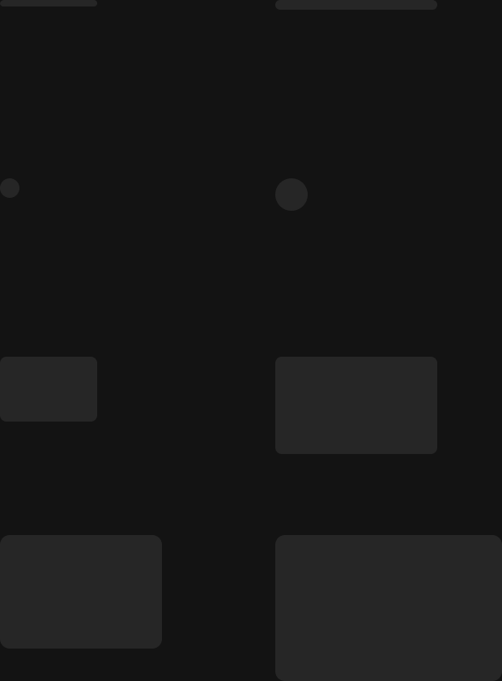

<!-- GEN:BEGIN 本段由 tools/gen-component-docs.py 依据 Figma 导出生成，勿手改；改 Figma 后重新生成 -->

## 概览

| 项 | 值 |
|---|---|
| Figma 组件集 | `Skeleton`（node `56061:6513`） |
| 分类 | 展示类 |
| 变体数 | 8 |
| 默认变体 | `Type=line, Size=sm` |
| 参考尺寸 | 120×8 px（默认变体） |
| 主题 | 主库（深色中性 + 品牌砂色） |
| 预览图 | [assets/previews/skeleton.png](../../assets/previews/skeleton.png) |
| 代码实现 | [`components/Skeleton/Skeleton.tsx`](../../components/Skeleton/Skeleton.tsx) |
| Figma 链接 | [在 Figma 打开](https://www.figma.com/design/ZO4WH3sbVCj7lZIFMpiwV9/VibeMe-App---Web-Design-%E5%A4%87%E4%BB%BD?node-id=56061-6513) |



## 变体与属性

| Figma 属性 | 类型 | 取值 | 默认 | 代码 prop |
|---|---|---|---|---|
| `Type` | VARIANT | `line` / `circle` / `rect` / `card` | `line` | `type` |
| `Size` | VARIANT | `sm` / `md` | `sm` | `size` |

变体是属性轴的笛卡尔积：**8 = 4 × 2**（`Type` × `Size`）。

## 各变体的事实

> 填充栈按 Figma 图层顺序排列（**靠右的是上层**，hover/pressed 的叠加层在最后）。
> `⚠无cssVar` 表示该组件引用了历史遗留变量，代码里不要照抄，按 `foundations.md` 的规则换成语义 token。

| 变体 | 尺寸 | 填充栈 | 描边 | 圆角 | 内边距 上/右/下/左 | 不透明度 |
|---|---|---|---|---|---|---|
| `Type=line, Size=sm` | 120×8 | `White/White-7` #FFFFFF 8% `--vm-white-7` | — | 999 | — | — |
| `Type=line, Size=md` | 200×12 | `White/White-7` #FFFFFF 8% `--vm-white-7` | — | 999 | — | — |
| `Type=circle, Size=sm` | 24×24 | `White/White-7` #FFFFFF 8% `--vm-white-7` | — | 999 | — | — |
| `Type=circle, Size=md` | 40×40 | `White/White-7` #FFFFFF 8% `--vm-white-7` | — | 999 | — | — |
| `Type=rect, Size=sm` | 120×80 | `White/White-7` #FFFFFF 8% `--vm-white-7` | — | 8 | — | — |
| `Type=rect, Size=md` | 200×120 | `White/White-7` #FFFFFF 8% `--vm-white-7` | — | 8 | — | — |
| `Type=card, Size=sm` | 200×140 | `White/White-7` #FFFFFF 8% `--vm-white-7` | — | 12 | — | — |
| `Type=card, Size=md` | 280×180 | `White/White-7` #FFFFFF 8% `--vm-white-7` | — | 12 | — | — |

## 结构（默认变体）

### Type=line, Size=sm

```text
`COMPONENT` Type=line, Size=sm 120×8 填充 `White/White-7` #FFFFFF 8% `--vm-white-7` 圆角 999
```

### Type=card, Size=md

```text
`COMPONENT` Type=card, Size=md 280×180 填充 `White/White-7` #FFFFFF 8% `--vm-white-7` 圆角 12
```


## 设计 token

| Figma 变量 | CSS 变量 | 值 |
|---|---|---|
| `Radious/radius-full` | `--vm-radius-full` | `999px` |
| `Radious/radius-md` | `--vm-radius-md` | `8px` |
| `Semantic Radius/radius-card` | `--vm-radius-card` | `12px` |
| `White/White-7` | `--vm-white-7` | `rgba(255, 255, 255, 0.08)` |

<!-- GEN:END -->

## 交互与状态

Skeleton **没有任何交互态**，也不该有。Figma 的属性轴只有 `Type` × `Size`（8 = 4 × 2），没有 hover / focus / disabled / loading 变体，
所以 `Skeleton.css` 里**一条 `:hover` / `:active` / `:focus-visible` / `:disabled` 规则都没有**——它不可点击、不进 Tab 序列。

| 变化来源 | 代码触发方式 | 视觉上变了什么 |
|---|---|---|
| 形状 | prop `type`（`line` / `circle` / `rect` / `card`） | 只改宽高与圆角：`line` / `circle` 是 `--vm-radius-full`（999px），`rect` 是 `--vm-radius-md`（8px），`card` 是 `--vm-radius-card`（12px） |
| 尺寸 | prop `size`（`sm` / `md`） | 8 档固定宽高按 `Skeleton.css` 顶部对照表取值，例如 `line` 是 120×8 → 200×12、`circle` 是 24×24 → 40×40 |
| 填充 | 无 | 8 档**全部**是 `--vm-white-7`（`White/White-7`，8% 白），与形状、尺寸都无关 |

动效方面：Figma 里没有 shimmer / pulse 变体，所以实现里不用任何 `--vm-duration-*` 动效 token，也不写 `@keyframes`；
需要扫光动画时请在业务层加，并用 `@media (prefers-reduced-motion: reduce)` 关掉。要非固定宽度（例如撑满一行的文本行）时，
用原生 `style={{ width: '100%' }}` 或自己的 `className` 覆盖，**不要**为此新增 prop。

## 代码用法

```tsx
import { Skeleton } from '../components/Skeleton';

export function ProfileLoading() {
  return (
    // 「正在加载」由容器播报，骨架块自己 aria-hidden
    <div aria-busy="true" aria-live="polite" className="demo-card">
      <Skeleton type="circle" size="md" />
      <div className="demo-lines">
        {/* 固定 200×12；要铺满整行就覆盖 width */}
        <Skeleton type="line" size="md" style={{ width: '100%' }} />
        <Skeleton type="line" size="sm" style={{ width: '60%' }} />
      </div>
      <Skeleton type="rect" size="md" />
      <span className="visually-hidden">内容加载中</span>
    </div>
  );
}

/** 列表首屏：一行 = circle(md) + 两条 line，尺寸与 ListItem 的行高对齐 */
export function ListLoading() {
  return (
    <ul aria-busy="true">
      {[0, 1, 2].map((i) => (
        <li key={i} className="demo-row">
          <Skeleton type="circle" size="md" />
          <Skeleton type="line" size="md" />
        </li>
      ))}
    </ul>
  );
}
```

CSS 引入方式：`import '../components/Skeleton/Skeleton.css'`（或整包 `import '../components/index'`，桶文件已 `import './tokens.css'`）。
默认档位是 Figma 的 `defaultVariant`：`type="line"`、`size="sm"`。`width` / `height` / `style` / `data-*` 都走原生属性透传，
组件不锁宽也不吃外边距——间距交给外层的 `Container` / `Stack` 或业务自己的 flex 布局。

## 可访问性

- 语义：根节点是纯装饰的 `<div>`，默认 `aria-hidden="true"`，读屏会整块跳过；**不要**给它加 `role`、`aria-label` 或 `tabIndex`。
  想让它被读屏读到，就显式传 `aria-hidden={false}` 并配 `aria-label`，但这属于例外，默认姿势是隐藏。
- 「正在加载」必须由外层容器承载：容器加 `aria-busy="true"`，再放一段视觉隐藏的提示文本（如 `内容加载中`），
  而不是把文案塞进骨架块。加载结束把 `aria-busy` 去掉即可，骨架块直接卸载。
- 键盘：骨架块不参与焦点（没有 `tabIndex`、没有 `role`），`Tab` 会直接跳到后面的真实控件；
  因此**不要**把骨架块当成按钮或链接的可点区域，也不要在它上面挂 `onClick`。
- 对比度：`--vm-white-7`（`White/White-7`，8% 白）在 `--vm-bg-panel` / `--vm-bg-card` 上只有极低对比度，这是**刻意**的——
  它是加载过渡期的装饰，不承载文本信息，不受正文 4.5:1 约束。不要为了「看得更清」把它换成 `--vm-white-4`（30% 白），
  那会让骨架块比真实内容还抢眼，加载完成时产生明显跳变。
- 布局稳定：8 档都是固定宽高（Figma `FIXED`），接入前请让骨架块的容器尺寸与真实内容一致（例如列表行按 ListItem 的 74px 行高排），
  避免内容替换时的布局位移；超长文本行用覆盖 `width` 的方式铺满，而不是拉伸字号或加 padding。
- 动效：如需扫光，必须提供 `@media (prefers-reduced-motion: reduce)` 下的静态降级。

## 不要这样做

1. **不要把 `card` / `rect` 当成「已经拼好的骨架卡片」**。`skeleton.tree.card-md.json` 里 `Type=card, Size=md` 只有**一个**
   280×180 的填充块，没有任何子节点，`instances` 也是空的——它只是更大的圆角矩形。行内的「头像 + 两行文字」这种结构，
   要在业务层用 `circle` + `line` 自己拼，Figma 里没有对应的组合变体。
2. **不要把 `--vm-white-7` 换成别的底色**。8 档填充在 Figma 里全部绑定 `White/White-7`（8% 白）；
   换成 `--vm-bg-card`、`--vm-surface-hover` 或 `--vm-white-4` 都会让骨架块与真实卡片的层次关系反过来。
3. **不要新增 Figma 里没有的 prop**。`animated` / `loading` / `count` / `rows` / `radius` 这些都不存在；
   变体属性只有 `Type` 与 `Size`，其余需求用原生属性透传（`style`、`className`、`aria-*`）。
4. **不要给 `line` / `circle` 写 `--vm-radius-md`**。这两档是 `--vm-radius-full`（999px）：`line` 是胶囊，
   `circle` 是正圆；写 8px 会让 8px 高的文本行出现可见直角。
5. **不要用 Skeleton 表达「没有数据」**。数据为空 / 搜索无结果要用 `Empty`；Skeleton 只表示「马上就有」。
   反过来，`Empty` 也不能拿来当加载态，两者的可访问性语义完全不同。
6. **不要手写颜色字面量**。填充只有 `var(--vm-white-7)` 一个来源；写 `rgba(255, 255, 255, 0.08)` 或 `#FFFFFF` 会绕过 token 校验。
7. **不要给骨架块加外边距或阴影**。Figma 里没有内边距、没有描边、没有 `--vm-shadow-*` 效果；
   行间距、卡片间距属于布局（`Container` / `Stack` / `Grid`）的职责。
8. **不要忘记 `prefers-reduced-motion`**。自定义扫光动画时，若不加静态降级，前庭敏感用户会持续看到闪动。

## 相关组件

- **ListItem**：最典型的组合——列表首屏用 `circle`（`md` 40×40，等同 ListItem 的头像槽）＋ 两条 `line`（`md` 200×12 当标题、`sm` 120×8 当辅助说明）
  拼成一行骨架，行高与 ListItem 的 74px 对齐（标题 20 + 说明 18 + 间隙 4 + 上下各 16 内边距）。Skeleton 不内嵌 ListItem，是业务层把它们摆在一起。
- **Card / VibeMe AI / Response Card**：整卡加载用 `type="card"`（`sm` 200×140 / `md` 280×180）；真实卡片一句话摘要的加载，
  用 `line` 多行拼更贴近内容形态，不要用 `card` 一把盖住。
- **Empty**：加载结束但结果为空 → `Empty`（`type="search"` 表示搜不到、`type="empty"` 表示还没有数据）；
  加载中 → Skeleton。两者互斥，绝不同时出现。
- **Loading / Progress**：Skeleton 表达「结构已知、内容未到」；Loading 表达「不知道要多久」的转圈，Progress 表达有百分比的进度。
  首屏结构明确的列表用 Skeleton，操作提交（保存 / 上传）用 Loading 或 Progress。
- **TableRow / TableCell**：表格的骨架用 `line` 在单元格里铺（每格一条，宽度按该列文本长度），不要整表用 `card` 盖住。
- **Container / Stack / Grid**：负责骨架块的排布与间距；Skeleton 自身 `flex: none`、无外边距，放进 `Stack` 的纵向排布即可。
