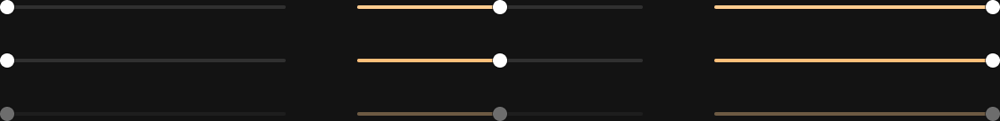

<!-- GEN:BEGIN 本段由 tools/gen-component-docs.py 依据 Figma 导出生成，勿手改；改 Figma 后重新生成 -->

## 概览

| 项 | 值 |
|---|---|
| Figma 组件集 | `Slider`（node `56059:6522`） |
| 分类 | 表单控件 |
| 变体数 | 9 |
| 默认变体 | `State=default, Value=0` |
| 参考尺寸 | 320×16 px（默认变体） |
| 主题 | 主库（深色中性 + 品牌砂色） |
| 预览图 | [assets/previews/slider.png](../../assets/previews/slider.png) |
| 代码实现 | [`components/Slider/Slider.tsx`](../../components/Slider/Slider.tsx) |
| Figma 链接 | [在 Figma 打开](https://www.figma.com/design/ZO4WH3sbVCj7lZIFMpiwV9/VibeMe-App---Web-Design-%E5%A4%87%E4%BB%BD?node-id=56059-6522) |



## 变体与属性

| Figma 属性 | 类型 | 取值 | 默认 | 代码 prop |
|---|---|---|---|---|
| `State` | VARIANT | `default` / `hover` / `disabled` | `default` | `state` |
| `Value` | VARIANT | `0` / `50` / `100` | `0` | `value` |

变体是属性轴的笛卡尔积：**9 = 3 × 3**（`State` × `Value`）。

## 各变体的事实

> 填充栈按 Figma 图层顺序排列（**靠右的是上层**，hover/pressed 的叠加层在最后）。
> `⚠无cssVar` 表示该组件引用了历史遗留变量，代码里不要照抄，按 `foundations.md` 的规则换成语义 token。

| 变体 | 尺寸 | 填充栈 | 描边 | 圆角 | 内边距 上/右/下/左 | 不透明度 |
|---|---|---|---|---|---|---|
| `State=default, Value=0` | 320×16 | — | — | — | — | — |
| `State=default, Value=50` | 320×16 | — | — | — | — | — |
| `State=default, Value=100` | 320×16 | — | — | — | — | — |
| `State=hover, Value=0` | 320×16 | — | — | — | — | — |
| `State=hover, Value=50` | 320×16 | — | — | — | — | — |
| `State=hover, Value=100` | 320×16 | — | — | — | — | — |
| `State=disabled, Value=0` | 320×16 | — | — | — | — | 0.38 |
| `State=disabled, Value=50` | 320×16 | — | — | — | — | 0.38 |
| `State=disabled, Value=100` | 320×16 | — | — | — | — | 0.38 |

## 结构（默认变体）

### State=default, Value=0

```text
`COMPONENT` State=default, Value=0 320×16
└─ `FRAME` Frame 320×4 填充 `White/White-6` #FFFFFF 12% `--vm-white-6` 圆角 999
└─ `FRAME` Frame 16×16 填充 `White/White-0` #FFFFFF `--vm-white-0` 描边 `Scrim/scrim-modal` #000000 56% `--vm-scrim-modal` 圆角 999
```

### State=disabled, Value=50

```text
`COMPONENT` State=disabled, Value=50 320×16 不透明度 0.38
└─ `FRAME` Frame 320×4 填充 `White/White-6` #FFFFFF 12% `--vm-white-6` 圆角 999
└─ `FRAME` Frame 160×4 填充 `Brand/Brand` #FFCC90 `--vm-brand` 圆角 999
└─ `FRAME` Frame 16×16 填充 `White/White-0` #FFFFFF `--vm-white-0` 描边 `Scrim/scrim-modal` #000000 56% `--vm-scrim-modal` 圆角 999
```

### State=hover, Value=50

```text
`COMPONENT` State=hover, Value=50 320×16
└─ `FRAME` Frame 320×4 填充 `White/White-6` #FFFFFF 12% `--vm-white-6` 圆角 999
└─ `FRAME` Frame 160×4 填充 `Brand/Brand-Hover` #FFC07A `--vm-brand-hover` 圆角 999
└─ `FRAME` Frame 16×16 填充 `White/White-0` #FFFFFF `--vm-white-0` 描边 `Scrim/scrim-modal` #000000 56% `--vm-scrim-modal` 圆角 999
```

### State=default, Value=50

```text
`COMPONENT` State=default, Value=50 320×16
└─ `FRAME` Frame 320×4 填充 `White/White-6` #FFFFFF 12% `--vm-white-6` 圆角 999
└─ `FRAME` Frame 160×4 填充 `Brand/Brand` #FFCC90 `--vm-brand` 圆角 999
└─ `FRAME` Frame 16×16 填充 `White/White-0` #FFFFFF `--vm-white-0` 描边 `Scrim/scrim-modal` #000000 56% `--vm-scrim-modal` 圆角 999
```


## 设计 token

| Figma 变量 | CSS 变量 | 值 |
|---|---|---|
| `Brand/Brand` | `--vm-brand` | `#FFCC90` |
| `Brand/Brand-Hover` | `--vm-brand-hover` | `#FFC07A` |
| `Radious/radius-full` | `--vm-radius-full` | `999px` |
| `Scrim/scrim-modal` | `--vm-scrim-modal` | `rgba(0, 0, 0, 0.56)` |
| `White/White-0` | `--vm-white-0` | `#FFFFFF` |
| `White/White-6` | `--vm-white-6` | `rgba(255, 255, 255, 0.12)` |
| `border/width/thin` | `--vm-border-width-thin` | `1px` |
| `opacity/disabled` | `--vm-opacity-disabled` | `0.38` |

<!-- GEN:END -->


## 交互与状态

Slider 是这批表单控件里唯一**有 `hover` 变体**的组件，所以它的 hover 是硬事实而不是补充设计：
`State=hover` 变体与 `State=default` 的差别只有一处——进度条填充从 `Brand/Brand`（`--vm-brand` #FFCC90）
换成 `Brand/Brand-Hover`（`--vm-brand-hover` #FFC07A），轨道（`--vm-white-6` 12% 白）与拇指
（`--vm-white-0` 纯白 + `--vm-scrim-modal` 56% 黑描边）完全不变。这属于 **换前景 token** 的手法，
和 Button 一族「底色 + `--vm-white-7` 叠加」不是一回事，不要互相套用。

| 状态 | 代码里由什么触发 | 视觉上变了什么 |
|---|---|---|
| 默认 | 无 | 轨道 `--vm-white-6`、进度条 `--vm-brand`、拇指白底 + 1px 56% 黑描边；进度条宽度 = `(value − min) / (max − min)` |
| 悬停 | 鼠标进入根节点（`State=hover`） | 只把进度条换成 `--vm-brand-hover`；`disabled` 时用 `:has(...:not(:disabled))` 挡掉，不出现 hover |
| 键盘聚焦 | 原生 `:focus-visible` | 拇指外圈加 `0 0 0 var(--vm-focus-ring-width) var(--vm-border-selected)`（2px、50% 白）。Figma 没有 focus 变体，这是本实现补的可访问性表达 |
| 拖动 / 键盘改值 | 原生 range 的指针拖动、←/→、Home/End、PageUp/PageDown | 拇指位置与进度条宽度同步变化；进度条宽度只由组件写的 `--slider-progress` 决定，窄到 `Value=0` 时宽度为 0（对应 Figma 里 `Value=0` 变体干脆没有进度层） |
| 禁用 | 原生 `disabled` | 根节点 `opacity: var(--vm-opacity-disabled)`（0.38），轨道/进度/拇指**都不换色**，也不响应拖动与悬停 |

几何事实：根部 320×16（Figma 参考宽），轨道 4px 高、满圆角（`--vm-radius-full` 999px）且垂直居中，
拇指 16×16、满圆角、描边 1px（`--vm-border-width-thin`）。这些尺寸在图里**没有绑定变量**，
所以实现里按 Figma 的像素值写死并注明出处；颜色、圆角、时长则一律走 `var(--vm-*)`。

## 代码用法

```tsx
import { useState } from 'react';
import { Slider } from '../vibeme-design-system/components/Slider';
import '../vibeme-design-system/components/Slider/Slider.css';

export function VolumeControl() {
  const [volume, setVolume] = useState(60);

  return (
    <>
      {/* 受控：onChange 沿用原生签名，取 e.target.value 转数值 */}
      <Slider
        value={volume}
        min={0}
        max={100}
        step={1}
        onChange={(e) => setVolume(Number(e.target.value))}
        aria-label="音量"
      />

      {/* 非受控 + 浮点步进：Figma 的 Value=0/50/100 只是样本，真实范围由 min/max/step 决定 */}
      <Slider defaultValue={0.3} min={0} max={1} step={0.05} aria-label="不透明度" />

      {/* 禁用态：原生 disabled，视觉只降不透明度 */}
      <Slider min={0} max={100} defaultValue={50} disabled aria-label="已禁用的滑块" />
    </>
  );
}
```

props 一览：`value?: number`（受控，映射 Figma 的 `Value`）、`defaultValue?: number`（非受控初始值，
默认 `min`）、`min`（默认 `0`）、`max`（默认 `100`）、`step`（默认 `1`），其余如 `disabled`、`name`、
`id`、`onChange`（原生 `ChangeEvent<HTMLInputElement>`）、`aria-label` / `aria-labelledby`
全部透传；`className` 与 `style` 落在根节点上（`style` 会和内部的进度百分比变量合并）。
取值规则：进度的百分比按 `(value − min) / (max − min)` 计算并钳在 `[min, max]`；`max <= min` 时进度按 0 处理；
`step` 的吸附交给原生 range（用户拖动时由浏览器吸附），需要程序化吸附时请自己按
`Math.round((v - min) / step) * step + min` 取整后再传 `value`。

## 可访问性

- 语义元素是原生 `<input type="range">`：浏览器直接给出 `role="slider"` 与 `aria-valuenow` /
  `aria-valuemin` / `aria-valuemax`，**不要**手写这些 ARIA 属性去覆盖原生值。
- 键盘：`←` / `→`（和 `↑` / `↓`）按 `step` 增减、`Home` 到 `min`、`End` 到 `max`、
  `PageUp` / `PageDown` 按更大步长跳；这些都来自原生控件，组件不需要自己监听 `keydown`。
- **可访问名字**：Figma 的 Slider 没有文字层，必须给 `aria-label` / `aria-labelledby`，
  或在外部写 `<label htmlFor>` 配 `id`；漏掉的话读屏只会念「滑块」而不知道在调什么。
  需要让用户知道当前数值时，配一段可见的数值文本并加 `aria-describedby`，不要塞进 `aria-label`。
- 焦点：只有键盘触发 `:focus-visible` 才给拇指画 `--vm-focus-ring-width`（2px）`--vm-border-selected`
  光环；根节点与原生 input 都设了 `outline: none`，但一定有成对的光环兜底，不要只删不加。
- 禁用：原生 `disabled` 会让滑块退出 Tab 序列且不随表单提交；`opacity: var(--vm-opacity-disabled)`
  只是视觉，不要用「变灰但还能拖」来假装禁用。
- 触控：可视高度只有 16px，拇指 16×16 偏小于 44px 的建议触控尺寸；移动端把它放在整行可点的设置项里，
  或由调用方在根节点加 `padding`（`style` 可覆盖）来扩大热区。
- 动效：hover 的颜色变化是 100ms（`--vm-duration-fast`）；`prefers-reduced-motion: reduce` 下关闭。

## 不要这样做

1. **不要用 `div` + `pointerdown/mousemove` 自造滑块。** 手写实现会同时丢掉键盘操作、`role="slider"`、
   `aria-valuenow`、表单提交与 `disabled` 语义；原生 `<input type="range">` 全都有。
2. **不要把 hover 做成填充叠加。** Figma 的 `State=hover` 只把进度条换成 `--vm-brand-hover`；
   叠加 `--vm-white-7`、改 `--vm-brand` 本身、或者连轨道/拇指一起变亮，都是发明设计。
3. **不要把 `Value` 只当成 `0 / 50 / 100` 三个枚举。** 那三档只是 Figma 的视觉样本，
   组件必须支持任意数值范围，并用 `min` / `max` / `step` 表达；把 `value` 收成枚举会让音量、亮度这类连续值用不了。
4. **不要用错轨道的颜色。** 轨道是 `White/White-6`（`--vm-white-6`，12% 白），
   不是 `--vm-white-4`（30%）也不是 `--vm-border-default`；用错会让轨道明显偏亮，抢掉进度条的对比。
5. **不要给拇指去掉描边或换成亮色描边。** Figma 的拇指是 `White/White-0` 填充 + `Scrim/scrim-modal`
   （`--vm-scrim-modal`，56% 黑）1px 描边；去掉描边后白色拇指压在浅色轨道上会糊成一团。
6. **不要把 `State=disabled` 实现成换灰色或 `--vm-brand-disable`。** Figma 的禁用只在根节点写
   `opacity/disabled`（`--vm-opacity-disabled` 0.38），颜色 token 一个都不换。
7. **不要加 `orientation="vertical"` 之类的 prop。** Figma 的 Slider 只有水平一条轴（320×16），
   竖向滑块属于新设计，需要先在 Figma 里建变体。

## 相关组件

- `Progress`：同样是「一条轨道 + 一段有色填充」，但 Progress 只展示、不可交互，也不吃键盘焦点；
  能拖动的场景一律用 Slider，不要让 Progress 长出交互。
- [Switch](switch.md)：当取值是「开 / 关」两态时用 Switch（立即生效），只有连续或多档取值才用 Slider。
- [Input](input.md)：需要精确输入数值时，用 Slider + 一个 `type="number"` 的 Input 组合（滑块粗调、输入框精调），
  两者用同一个受控 state，圆角分别是 `--vm-radius-full` 与 `--vm-radius-input`，不要互换。
- [Checkbox](checkbox.md) / [Radio](radio.md)：二态、多选一用 Checkbox / Radio，与 Slider 同属表单控件族，
  禁用规则一致（`--vm-opacity-disabled` 0.38），并排放在表单里时对齐各自的高度即可。
- `FormItem` / `Label`：Slider 自己没有标签，表单里请用外部 label（`htmlFor` + `id`）
  或 `aria-label` 提供可访问名字。
