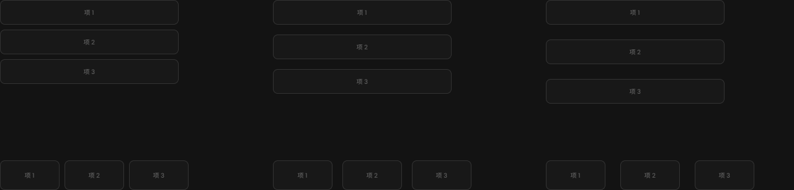

<!-- GEN:BEGIN 本段由 tools/gen-component-docs.py 依据 Figma 导出生成，勿手改；改 Figma 后重新生成 -->

## 概览

| 项 | 值 |
|---|---|
| Figma 组件集 | `Stack`（node `56066:6298`） |
| 分类 | 布局类 |
| 变体数 | 6 |
| 默认变体 | `Direction=vertical, Gap=sm` |
| 参考尺寸 | 288×136 px（默认变体） |
| 主题 | 主库（深色中性 + 品牌砂色） |
| 预览图 | [assets/previews/stack.png](../../assets/previews/stack.png) |
| 代码实现 | [`components/Stack/Stack.tsx`](../../components/Stack/Stack.tsx) |
| Figma 链接 | [在 Figma 打开](https://www.figma.com/design/ZO4WH3sbVCj7lZIFMpiwV9/VibeMe-App---Web-Design-%E5%A4%87%E4%BB%BD?node-id=56066-6298) |



## 变体与属性

| Figma 属性 | 类型 | 取值 | 默认 | 代码 prop |
|---|---|---|---|---|
| `Direction` | VARIANT | `vertical` / `horizontal` | `vertical` | `direction` |
| `Gap` | VARIANT | `sm` / `md` / `lg` | `sm` | `gap` |

变体是属性轴的笛卡尔积：**6 = 2 × 3**（`Direction` × `Gap`）。

## 各变体的事实

> 填充栈按 Figma 图层顺序排列（**靠右的是上层**，hover/pressed 的叠加层在最后）。
> `⚠无cssVar` 表示该组件引用了历史遗留变量，代码里不要照抄，按 `foundations.md` 的规则换成语义 token。

| 变体 | 尺寸 | 填充栈 | 描边 | 圆角 | 内边距 上/右/下/左 | 不透明度 |
|---|---|---|---|---|---|---|
| `Direction=vertical, Gap=sm` | 288×136 | — | — | — | 0/0/0/0 | — |
| `Direction=vertical, Gap=md` | 288×152 | — | — | — | 0/0/0/0 | — |
| `Direction=vertical, Gap=lg` | 288×168 | — | — | — | 0/0/0/0 | — |
| `Direction=horizontal, Gap=sm` | 400×48 | — | — | — | 0/0/0/0 | — |
| `Direction=horizontal, Gap=md` | 400×48 | — | — | — | 0/0/0/0 | — |
| `Direction=horizontal, Gap=lg` | 400×48 | — | — | — | 0/0/0/0 | — |

## 结构（默认变体）

### Direction=vertical, Gap=sm

```text
`COMPONENT` Direction=vertical, Gap=sm 288×136 VERTICAL gap 8 pad 0/0/0/0
└─ `FRAME` Frame 288×40 HORIZONTAL gap 0 pad 0/0/0/0 填充 `White/White-9` #FFFFFF 2% `--vm-white-9` 描边 `Background/border-default` #FFFFFF 12% `--vm-border-default` 圆角 8
  └─ `TEXT` 项 1 17×14 填充 `Text/Text-Tertiary` #FFFFFF 30% `--vm-text-tertiary` 文字样式 `Caption/Label`（10 Medium /14） 内容 '项 1'
└─ `FRAME` Frame 288×40 HORIZONTAL gap 0 pad 0/0/0/0 填充 `White/White-9` #FFFFFF 2% `--vm-white-9` 描边 `Background/border-default` #FFFFFF 12% `--vm-border-default` 圆角 8
  └─ `TEXT` 项 2 19×14 填充 `Text/Text-Tertiary` #FFFFFF 30% `--vm-text-tertiary` 文字样式 `Caption/Label`（10 Medium /14） 内容 '项 2'
└─ `FRAME` Frame 288×40 HORIZONTAL gap 0 pad 0/0/0/0 填充 `White/White-9` #FFFFFF 2% `--vm-white-9` 描边 `Background/border-default` #FFFFFF 12% `--vm-border-default` 圆角 8
  └─ `TEXT` 项 3 19×14 填充 `Text/Text-Tertiary` #FFFFFF 30% `--vm-text-tertiary` 文字样式 `Caption/Label`（10 Medium /14） 内容 '项 3'
```

### Direction=horizontal, Gap=lg

```text
`COMPONENT` Direction=horizontal, Gap=lg 400×48 HORIZONTAL gap 24 pad 0/0/0/0
└─ `FRAME` Frame 96×48 HORIZONTAL gap 0 pad 0/0/0/0 填充 `White/White-9` #FFFFFF 2% `--vm-white-9` 描边 `Background/border-default` #FFFFFF 12% `--vm-border-default` 圆角 8
  └─ `TEXT` 项 1 17×14 填充 `Text/Text-Tertiary` #FFFFFF 30% `--vm-text-tertiary` 文字样式 `Caption/Label`（10 Medium /14） 内容 '项 1'
└─ `FRAME` Frame 96×48 HORIZONTAL gap 0 pad 0/0/0/0 填充 `White/White-9` #FFFFFF 2% `--vm-white-9` 描边 `Background/border-default` #FFFFFF 12% `--vm-border-default` 圆角 8
  └─ `TEXT` 项 2 19×14 填充 `Text/Text-Tertiary` #FFFFFF 30% `--vm-text-tertiary` 文字样式 `Caption/Label`（10 Medium /14） 内容 '项 2'
└─ `FRAME` Frame 96×48 HORIZONTAL gap 0 pad 0/0/0/0 填充 `White/White-9` #FFFFFF 2% `--vm-white-9` 描边 `Background/border-default` #FFFFFF 12% `--vm-border-default` 圆角 8
  └─ `TEXT` 项 3 19×14 填充 `Text/Text-Tertiary` #FFFFFF 30% `--vm-text-tertiary` 文字样式 `Caption/Label`（10 Medium /14） 内容 '项 3'
```


## 设计 token

| Figma 变量 | CSS 变量 | 值 |
|---|---|---|
| `Background/border-default` | `--vm-border-default` | `rgba(255, 255, 255, 0.12)` |
| `Radious/radius-md` | `--vm-radius-md` | `8px` |
| `Text/Text-Tertiary` | `--vm-text-tertiary` | `rgba(255, 255, 255, 0.3)` |
| `White/White-9` | `--vm-white-9` | `rgba(255, 255, 255, 0.02)` |
| `border/width/thin` | `--vm-border-width-thin` | `1px` |
| `space/space-2` | `--vm-space-2` | `8px` |
| `space/space-4` | `--vm-space-4` | `16px` |
| `space/space-6` | `--vm-space-6` | `24px` |

<!-- GEN:END -->


## 交互与状态

**Stack 没有交互态，也没有应用态。** Figma 的 6 个变体 = `Direction`(2) × `Gap`(3)，压根没有 `State` 轴，
所以 `Stack.tsx` / `Stack.css` 里既没有 `:hover` / `:active` / `:focus-visible` 规则，也没有 `disabled` /
`error` / `open` 之类需要映射原生属性的 prop —— 只有 `direction` 与 `gap` 两个轴，缺一个都不该出现在 props 上。

容器本身不加背景、不加描边、不加圆角（导出里 `fills` / `strokes` / `radius` 全为空），也不写 `cursor`
或 `pointer-events`，因此子元素自己的 hover 叠加层（`--vm-white-7` / `--vm-white-6`）与 `:focus-visible`
的 `--vm-border-selected` ring 都照常生效，不会被容器吞掉。

唯一“随状态变化”的是重排：`vertical` 时交叉轴对齐是 `flex-start`（Figma `counterAxisAlignItems=MIN`），
`horizontal` 时是 `center`（Figma `counterAxisAlignItems=CENTER`）。这意味着横向排列时子项各自在交叉轴居中，
某个子项变高**不会**把兄弟节点的顶端拉齐；需要顶端对齐时不要改 Stack，改用 `Grid` 或自行包一层。

## 代码用法

```tsx
import { Stack } from '../../components/Stack';
import { Button } from '../../components/Button';
import { Card } from '../../components/Card';
// 样式随组件一起进来：components/Stack/index.ts → Stack.tsx 已 import './Stack.css'

// 默认变体 Direction=vertical, Gap=sm（8px）
<Stack>
  <span className="vm-type-heading-body-s-regular">基础信息</span>
  <span className="vm-type-heading-body-s-regular">账号安全</span>
</Stack>

// 横向、间距 md（--vm-space-4 = 16px），常用于工具栏 / 表单底部操作区
<Stack direction="horizontal" gap="md" role="group" aria-label="表单操作">
  <Button type="secondary">取消</Button>
  <Button type="primary">保存</Button>
</Stack>

// 纵向大间距（--vm-space-6 = 24px）堆卡片
<Stack gap="lg" role="list">
  <Card role="listitem">最近项目</Card>
  <Card role="listitem">团队空间</Card>
</Stack>
```

CSS 导入方式：`import { Stack } from '../../components/Stack'` 即可（组件内部 `import './Stack.css'`）。
需要覆盖宽度时传 `className` 或 `style`，例如 `<Stack className="my-panel" />`；
宽度不会被写死 —— Figma 里 288 / 400 只是画板参考宽，代码里容器宽度永远由父级决定。

## 可访问性

根元素是普通的 `<div>`，**没有**隐式 role、**没有** tabIndex、**不参与** Tab 顺序，键盘行为为零 ——
这是刻意的：一个纯排版容器抢焦点或加 `role="group"` 只会给屏幕阅读器制造无意义的停顿。

- 需要列表语义时由调用方补：容器 `role="list"`，每个直接子项 `role="listitem"`（这两个属性经 `...rest`
  透传到根 `div`，子项属性则落在 children 自己的元素上）。
- 表单操作区建议 `<Stack direction="horizontal" role="group" aria-label="…">`，让读屏软件念出分组名。
- 所有 `aria-*` / `id` / 事件都原样透传，组件不覆盖、不吞掉任何一个（`...rest` 展开在 `className` 与 `ref` 之前）。
- 视觉顺序与 DOM 顺序始终一致：`direction` 只改 `flex-direction`，**不会**用 `order` 打乱顺序，
  所以读屏与键盘的浏览顺序永远等于源码顺序。
- 不要用 Stack 做「视觉重排」（比如把取消按钮放到 DOM 最后再用 `order` 提到前面），那会造成焦点顺序错乱。

## 不要这样做

1. **不要把结构树里的方块当成 Stack 的外观**。那三个 288×40 的 `Frame` 只是 Figma 画出来示意排列效果的演示内容，
   它们身上的 `White/White-9`（`--vm-white-9`，2% 白底）、`Background/border-default`
   （`--vm-border-default`，12% 白描边）、`Radious/radius-md`（`--vm-radius-md`，8px 圆角）**不属于容器**。
   要卡片底请用 `Card`（`--vm-bg-card`），别给 `.vm-stack` 加填充/描边/圆角。
2. **不要把 `gap` 当任意间距用**。Figma 只给了 sm/md/lg 三档，映射 `--vm-space-2` / `--vm-space-4` /
   `--vm-space-6`；传 `4` / `12` / `32` 这类值没有对应 token。真需要特殊值就退到原生
   `style={{ gap: 'var(--vm-space-5)' }}`，不要在组件里加第四档。
3. **不要用 `Stack direction="horizontal"` 冒充网格**。横向 Stack 的子项宽度由内容决定，
   不会等分；两列 / 三列 / 四列请用 `Grid`（`--vm-space-4` 列间距），需要等宽时再在子项上写 `flex: 1`，
   而不是给 Stack 加 `justify-content: space-between` 硬撑。
4. **不要用 `margin` 模拟间距**。`gap` 已经在子项之间生效，再给子项加 `margin-top` 会让间距翻倍，
   也会让最后一行的间距与第一行不一致；上下留白交给父级的 `--vm-padding-*`。
5. **不要把 `Direction=horizontal` 的对齐当成通用规则**。Figma 里横向是 `counterAxisAlignItems=CENTER`、
   纵向是 `MIN`，所以三层结构高度不同时横向会各自居中；要顶端对齐请显式加类覆盖 `align-items`，
   不要改 Stack 的默认值 —— 那会与 Figma 漂移。
6. 不要在 Stack 上写 `overflow: hidden`。导出里的 `clip` 是子 `Frame` 自己的属性，
   容器裁剪会把子元素的 `:focus-visible` ring 与 Tooltip / Dropdown 浮层一起切掉。

## 相关组件

- **Grid**（`56066:6344`）：二维网格，2/3/4 列。单轴向堆叠用 `Stack`，需要行列同时约束时用 `Grid`；
  两者可以嵌套（`Grid` 的每个单元格里放一个 `Stack` 来排卡片内的文字与按钮）。
- **Header**（`56066:6374`）：顶栏内部就是横向排列，`Type=with-search` 时把 `Search` 插在导航与操作区之间，
  正适合用 `Stack direction="horizontal"` 承载 logo / 导航 / 操作三组内容。
- **Card**：`Stack gap="lg"` 常作为卡片列表的外层容器；卡片内部的标题、正文、按钮也用 `Stack` 纵向排列。
- **Divider**：需要视觉分隔线时，把 `Divider` 作为 Stack 的一个子项，而不是给 Stack 加 `border` 或 `divide-*`。
- **Button / Search / Select** 等交互组件：作为子项放进 Stack，交互态（`--vm-white-7` 叠加、`--vm-border-selected` 聚焦环）
  由它们自己负责，Stack 不参与。
