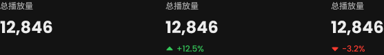

<!-- GEN:BEGIN 本段由 tools/gen-component-docs.py 依据 Figma 导出生成，勿手改；改 Figma 后重新生成 -->

## 概览

| 项 | 值 |
|---|---|
| Figma 组件集 | `Statistic`（node `56065:7053`） |
| 分类 | 数据展示类 |
| 变体数 | 3 |
| 默认变体 | `Type=default` |
| 参考尺寸 | 77×58 px（默认变体） |
| 主题 | 主库（深色中性 + 品牌砂色） |
| 预览图 | [assets/previews/statistic.png](../../assets/previews/statistic.png) |
| 代码实现 | [`components/Statistic/Statistic.tsx`](../../components/Statistic/Statistic.tsx) |
| Figma 链接 | [在 Figma 打开](https://www.figma.com/design/ZO4WH3sbVCj7lZIFMpiwV9/VibeMe-App---Web-Design-%E5%A4%87%E4%BB%BD?node-id=56065-7053) |



## 变体与属性

| Figma 属性 | 类型 | 取值 | 默认 | 代码 prop |
|---|---|---|---|---|
| `Type` | VARIANT | `default` / `up` / `down` | `default` | `type` |

变体是属性轴的笛卡尔积：**3 = 3**（`Type`）。

内嵌组件：`Property 1=chevron-down_filled`×1、`Property 1=chevron-up_filled`×1

## 各变体的事实

> 填充栈按 Figma 图层顺序排列（**靠右的是上层**，hover/pressed 的叠加层在最后）。
> `⚠无cssVar` 表示该组件引用了历史遗留变量，代码里不要照抄，按 `foundations.md` 的规则换成语义 token。

| 变体 | 尺寸 | 填充栈 | 描边 | 圆角 | 内边距 上/右/下/左 | 不透明度 |
|---|---|---|---|---|---|---|
| `Type=default` | 77×58 | — | — | — | 0/0/0/0 | — |
| `Type=up` | 77×80 | — | — | — | 0/0/0/0 | — |
| `Type=down` | 77×80 | — | — | — | 0/0/0/0 | — |

## 结构（默认变体）

### Type=default

```text
`COMPONENT` Type=default 77×58 VERTICAL gap 4 pad 0/0/0/0
└─ `TEXT` 总播放量 48×18 填充 `Text/Text-Secondary` #FFFFFF 64% `--vm-text-secondary` 文字样式 `Caption/Caption`（12 Medium /18） 内容 '总播放量'
└─ `TEXT` 12,846 77×36 填充 `Text/Text-Primary` #FFFFFF 92% `--vm-text-primary` 文字样式 `Heading/XXL`（24 Bold /36） 内容 '12,846'
```

### Type=down

```text
`COMPONENT` Type=down 77×80 VERTICAL gap 4 pad 0/0/0/0
└─ `TEXT` 总播放量 48×18 填充 `Text/Text-Secondary` #FFFFFF 64% `--vm-text-secondary` 文字样式 `Caption/Caption`（12 Medium /18） 内容 '总播放量'
└─ `TEXT` 12,846 77×36 填充 `Text/Text-Primary` #FFFFFF 92% `--vm-text-primary` 文字样式 `Heading/XXL`（24 Bold /36） 内容 '12,846'
└─ `FRAME` Frame 50×18 HORIZONTAL gap 4 pad 0/0/0/0
  └─ `INSTANCE` Filled icon 12×12 实例=Property 1=chevron-down_filled
    └─ `VECTOR` icon 5.64×9.09 填充 `状态色/Error` #FF3B30 `--vm-status-error`
  └─ `TEXT` -3.2% 34×18 填充 `状态色/Error` #FF3B30 `--vm-status-error` 文字样式 `Caption/Caption`（12 Medium /18） 内容 '-3.2%'
```

### Type=up

```text
`COMPONENT` Type=up 77×80 VERTICAL gap 4 pad 0/0/0/0
└─ `TEXT` 总播放量 48×18 填充 `Text/Text-Secondary` #FFFFFF 64% `--vm-text-secondary` 文字样式 `Caption/Caption`（12 Medium /18） 内容 '总播放量'
└─ `TEXT` 12,846 77×36 填充 `Text/Text-Primary` #FFFFFF 92% `--vm-text-primary` 文字样式 `Heading/XXL`（24 Bold /36） 内容 '12,846'
└─ `FRAME` Frame 56×18 HORIZONTAL gap 4 pad 0/0/0/0
  └─ `INSTANCE` Filled icon 12×12 实例=Property 1=chevron-up_filled
    └─ `VECTOR` icon 9.09×5.64 填充 `状态色/Success` #34C759 `--vm-status-success`
  └─ `TEXT` +12.5% 40×18 填充 `状态色/Success` #34C759 `--vm-status-success` 文字样式 `Caption/Caption`（12 Medium /18） 内容 '+12.5%'
```


## 设计 token

| Figma 变量 | CSS 变量 | 值 |
|---|---|---|
| `Text/Text-Primary` | `--vm-text-primary` | `rgba(255, 255, 255, 0.92)` |
| `Text/Text-Secondary` | `--vm-text-secondary` | `rgba(255, 255, 255, 0.64)` |
| `space/space-1` | `--vm-space-1` | `4px` |
| `状态色/Error` | `--vm-status-error` | `#FF3B30` |
| `状态色/Success` | `--vm-status-success` | `#34C759` |

<!-- GEN:END -->


## 交互与状态

`Statistic` 的 3 个变体只有 `Type`（default / up / down）一条轴，**没有 `State` 轴**：
没有 hover / pressed / focus / disabled / error 变体，所以实现里没有任何 `:hover` / `:active` / `:focus-visible` 规则，
也没有第二个 prop 去改状态。它在页面里是只读数字块，不是按钮也不是表格行。

`Type` 三个值对应的视觉差异，全部能从 `statistic.tree.up.json` / `statistic.tree.down.json` 里逐字段核对：

| Type | 结构差异 | 颜色 |
|---|---|---|
| `default` | 只有两行：标签 ＋ 数值（77×58） | 标签 `--vm-text-secondary`（`Text/Text-Secondary` 64% 白）；数值 `--vm-text-primary`（`Text/Text-Primary` 92% 白） |
| `up` | 第三行出现：12×12 图标（Figma 实例 `Property 1=chevron-up_filled`）＋ 变化文案 `+12.5%`（77×80） | 图标与变化文案都是 `--vm-status-success`（`状态色/Success` #34C759） |
| `down` | 第三行出现：12×12 图标（Figma 实例 `Property 1=chevron-down_filled`）＋ 变化文案 `-3.2%`（77×80） | 图标与变化文案都是 `--vm-status-error`（`状态色/Error` #FF3B30） |

三行之间的间距在三个变体里都是同一个 `--vm-space-1`（`space/space-1` 4px，根部 Auto Layout gap），
第三行内部「图标 ↔ 文案」也是 4px——所以图标和文字永远贴在一起，不要用 `--vm-space-2` 之类去改。
另外 `default` 档**不渲染**第三行；传入 `change` 也只有 `type="up"` / `type="down"` 时才显示。

## 代码用法

```tsx
import { Statistic } from '../components/Statistic';

export function Dashboard() {
  return (
    <div style={{ display: 'flex', gap: 'var(--vm-space-6)' }}>
      {/* Type=default：只有标签与数值 */}
      <Statistic label="总播放量" value="12,846" />

      {/* Type=up：第三行是 Success 色的图标 + 带 + 号的变化文案 */}
      <Statistic type="up" label="总播放量" value="12,846" change="+12.5%" />

      {/* Type=down：Error 色；变化文案自己带 - 号，不要只靠颜色表达方向 */}
      <Statistic type="down" label="总播放量" value="12,846" change="-3.2%" />

      {/* 数值可以是 ReactNode（例如千分位格式化后的字符串或带单位的组合） */}
      <Statistic label="总时长" value={<>128<span>h</span></>} />
    </div>
  );
}
```

CSS 引入方式：`import '../components/Statistic/Statistic.css'`（或整包 `import '../components/index'`，桶文件已 `import './tokens.css'`）。
结构是 `<dl>` ＋ `<dt>`（标签）＋ `<dd>`（数值，内部再放一行变化）——数值列不锁宽，宽度随内容 HUG，与 Figma 一致（示例内容下 77px）。
`change` 里的 `+` / `-` 号是文案的一部分（Figma 就是 `+12.5%` / `-3.2%`），组件不会根据 `type` 自动补符号。

## 可访问性

- 语义：根节点是 `<dl>`，标签是 `<dt>`、数值是 `<dd>`——读屏会读成「总播放量：12,846」，这是统计数据最省事也最稳的语义。
  **不要**给大数字套 `<h1>`~`<h6>`，它只是数值不是标题；也不要为了跟其他卡片排齐而拆成两个无关的 `<span>`。
- 涨跌不靠颜色单独表意：`default` 档没有第三行；`up` / `down` 的第三行文案本身带 `+` / `-` 号（Figma 的 `+12.5%` / `-3.2%`），
  色觉障碍用户靠符号也能分辨方向。组件里的箭头 SVG 是 `aria-hidden="true"`，不额外朗读「向上箭头」。
- 颜色对比度：`--vm-status-success` #34C759 与 `--vm-status-error` #FF3B30 在 `--vm-bg-card` #202020 上分别是约 7:1 与约 5.5:1，
  达到正文级对比度；变化文案是 12px 小字，请不要额外降低不透明度。
- 数字格式化交给调用方：`12,846` 这种千分位、单位、百分比都是文案的一部分，组件不做 `Intl.NumberFormat`，
  避免服务端与客户端格式化结果不一致导致 hydration 报错。
- 组件内没有可聚焦元素，`Tab` 不会停在它上面；如果整块数字需要点击跳转，请在外层包 `<a>` / `<button>` 并自己给焦点环
  （`:focus-visible` + `--vm-border-selected`），不要把点击行为塞进 `value`。

## 不要这样做

1. **不要给 `default` 档硬塞第三行**。`Type=default` 在 Figma 里只有标签 ＋ 数值两行（77×58），高度差 22px 就是第三行带来的；
   把 `change` 传进 `type="default"` 会被实现忽略——需要涨跌就显式写 `type="up"` / `type="down"`。
2. **不要用颜色反推 `type`**（比如靠 `change` 是否以 `+` 开头自动判断）。Figma 的 `Type` 是显式变体属性，方向由它决定；
   自动推断会在「持平」「绝对值」这类文案上出错。
3. **不要把箭头做成 emoji 或字符**（`↑` / `⬆️`）。Figma 用的是 `Line icon` / `Filled icon` 族里的 `chevron-up_filled` / `chevron-down_filled` 实例，
   实现里是内联 SVG（`stroke="currentColor"` 跟随 `--vm-status-*`）；emoji 在不同平台字体会串味且颜色不可控。
4. **不要手写大数字字号**。数值是 `Heading/XXL`（24 Bold / 行高 36 ⇒ `.vm-type-heading-xxl`），标签是 `Caption/Caption`（12 Medium / 18）；
   自己写 `font-size: 24px` 会绕过 token 校验，也会丢掉行高。
5. **不要给整块加 `opacity` 或灰色来表达「无变化」**。没有涨跌就用 `default`，它本来就只有两行；
   `opacity: var(--vm-opacity-disabled)` 是 disabled 的语义，本组件没有 disabled 变体。
6. **不要把 `Statistic` 当 `Descriptions` 用**。多组键值对（≥3 对、需要 2/3 列）请用 `Descriptions`；
   `Statistic` 只有「标签-数值(-变化)」三层，塞进更多文案会破坏 24/36 的数值层级。
7. **不要挪动图标与文案的顺序**。Figma 里第三行是 `HORIZONTAL`：图标在左、文案在右（gap 4px）；
   写成文案在前、图标在后会和 `Descriptions`、`Notification` 里的同类语义图形不一致。

## 相关组件

- **Descriptions**：统计明细的搭档。页面里常见「上面一行 `Statistic` 摘要、下面 `Descriptions` 列明细」；两者共用 `--vm-text-secondary` 做标签色。
- **Card**：`Statistic` 常被放进 `Card`（同 `--vm-bg-card` 底、`--vm-border-default` 描边）；一个卡片里多个指标时用 `--vm-space-6` 横向排开。
- **Container**：一排统计块的宽度由 `Container` 决定，`Statistic` 自身 HUG 宽度（Figma 示例 77px），不要给它写死宽度。
- **Tag / Badge**：若「涨跌」需要更强的状态标记（如「超预期」），在变化文案旁边用 `Tag`，颜色与 `--vm-status-success` / `--vm-status-error` 保持一致。
- **Progress**：完成率类指标常与 `Statistic` 并排：数字用 `Statistic`，进度条用 `Progress`，不要用 `Statistic` 自己画条。
- **Skeleton**：数据未到位时用 `Skeleton` 顶住数值行的高度（`Heading/XXL` 24/36），不要显示 `--` 或 `0` 假装有数据。
