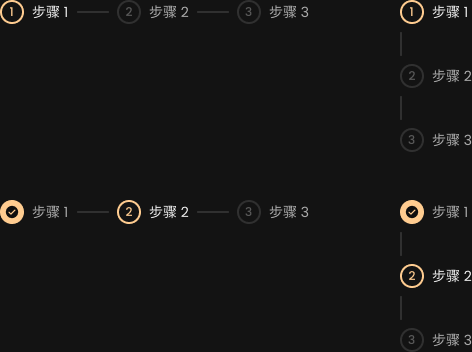

<!-- GEN:BEGIN 本段由 tools/gen-component-docs.py 依据 Figma 导出生成，勿手改；改 Figma 后重新生成 -->

## 概览

| 项 | 值 |
|---|---|
| Figma 组件集 | `Steps`（node `56064:6770`） |
| 分类 | 导航类 |
| 变体数 | 4 |
| 默认变体 | `Type=horizontal, Current=1` |
| 参考尺寸 | 309×24 px（默认变体） |
| 主题 | 主库（深色中性 + 品牌砂色） |
| 预览图 | [assets/previews/steps.png](../../assets/previews/steps.png) |
| 代码实现 | [`components/Steps/Steps.tsx`](../../components/Steps/Steps.tsx) |
| Figma 链接 | [在 Figma 打开](https://www.figma.com/design/ZO4WH3sbVCj7lZIFMpiwV9/VibeMe-App---Web-Design-%E5%A4%87%E4%BB%BD?node-id=56064-6770) |



## 变体与属性

| Figma 属性 | 类型 | 取值 | 默认 | 代码 prop |
|---|---|---|---|---|
| `Type` | VARIANT | `horizontal` / `vertical` | `horizontal` | `type` |
| `Current` | VARIANT | `1` / `2` | `1` | `current` |

变体是属性轴的笛卡尔积：**4 = 2 × 2**（`Type` × `Current`）。

内嵌组件：`Property 1=circle-check-filled`×2

## 各变体的事实

> 填充栈按 Figma 图层顺序排列（**靠右的是上层**，hover/pressed 的叠加层在最后）。
> `⚠无cssVar` 表示该组件引用了历史遗留变量，代码里不要照抄，按 `foundations.md` 的规则换成语义 token。

| 变体 | 尺寸 | 填充栈 | 描边 | 圆角 | 内边距 上/右/下/左 | 不透明度 |
|---|---|---|---|---|---|---|
| `Type=horizontal, Current=1` | 309×24 | — | — | — | 0/0/0/0 | — |
| `Type=horizontal, Current=2` | 309×24 | — | — | — | 0/0/0/0 | — |
| `Type=vertical, Current=1` | 72×152 | — | — | — | 0/0/0/0 | — |
| `Type=vertical, Current=2` | 72×152 | — | — | — | 0/0/0/0 | — |

## 结构（默认变体）

### Type=horizontal, Current=1

```text
`COMPONENT` Type=horizontal, Current=1 309×24 HORIZONTAL gap 8 pad 0/0/0/0
└─ `FRAME` Frame 69×24 HORIZONTAL gap 8 pad 0/0/0/0
  └─ `FRAME` Frame 24×24 HORIZONTAL gap 0 pad 0/0/0/0 描边 `Brand/Brand` #FFCC90 `--vm-brand` 圆角 999
    └─ `TEXT` 1 5×18 填充 `Brand/Brand` #FFCC90 `--vm-brand` 文字样式 `Caption/Caption`（12 Medium /18） 内容 '1'
  └─ `TEXT` 步骤 1 37×20 填充 `Text/Text-Primary` #FFFFFF 92% `--vm-text-primary` 文字样式 `Heading/Body/S/Regular`（14 Regular /20） 内容 '步骤 1'
└─ `FRAME` Frame 32×2 填充 `Background/border-default` #FFFFFF 12% `--vm-border-default` 圆角 999
└─ `FRAME` Frame 72×24 HORIZONTAL gap 8 pad 0/0/0/0
  └─ `FRAME` Frame 24×24 HORIZONTAL gap 0 pad 0/0/0/0 描边 `Background/border-default` #FFFFFF 12% `--vm-border-default` 圆角 999
    └─ `TEXT` 2 7×18 填充 `Text/Text-Tertiary` #FFFFFF 30% `--vm-text-tertiary` 文字样式 `Caption/Caption`（12 Medium /18） 内容 '2'
  └─ `TEXT` 步骤 2 40×20 填充 `Text/Text-Secondary` #FFFFFF 64% `--vm-text-secondary` 文字样式 `Heading/Body/S/Regular`（14 Regular /20） 内容 '步骤 2'
└─ `FRAME` Frame 32×2 填充 `Background/border-default` #FFFFFF 12% `--vm-border-default` 圆角 999
└─ `FRAME` Frame 72×24 HORIZONTAL gap 8 pad 0/0/0/0
  └─ `FRAME` Frame 24×24 HORIZONTAL gap 0 pad 0/0/0/0 描边 `Background/border-default` #FFFFFF 12% `--vm-border-default` 圆角 999
    └─ `TEXT` 3 8×18 填充 `Text/Text-Tertiary` #FFFFFF 30% `--vm-text-tertiary` 文字样式 `Caption/Caption`（12 Medium /18） 内容 '3'
  └─ `TEXT` 步骤 3 40×20 填充 `Text/Text-Secondary` #FFFFFF 64% `--vm-text-secondary` 文字样式 `Heading/Body/S/Regular`（14 Regular /20） 内容 '步骤 3'
```

### Type=horizontal, Current=2

```text
`COMPONENT` Type=horizontal, Current=2 309×24 HORIZONTAL gap 8 pad 0/0/0/0
└─ `FRAME` Frame 69×24 HORIZONTAL gap 8 pad 0/0/0/0
  └─ `FRAME` Frame 24×24 HORIZONTAL gap 0 pad 0/0/0/0 填充 `Brand/Brand` #FFCC90 `--vm-brand` 圆角 999
    └─ `INSTANCE` Filled icon 14×14 实例=Property 1=circle-check-filled
      └─ `VECTOR` icon 12.25×12.25 填充 `Neutral/Neutral-950` #0E0E0E `--vm-neutral-950`
  └─ `TEXT` 步骤 1 37×20 填充 `Text/Text-Secondary` #FFFFFF 64% `--vm-text-secondary` 文字样式 `Heading/Body/S/Regular`（14 Regular /20） 内容 '步骤 1'
└─ `FRAME` Frame 32×2 填充 `Background/border-default` #FFFFFF 12% `--vm-border-default` 圆角 999
└─ `FRAME` Frame 72×24 HORIZONTAL gap 8 pad 0/0/0/0
  └─ `FRAME` Frame 24×24 HORIZONTAL gap 0 pad 0/0/0/0 描边 `Brand/Brand` #FFCC90 `--vm-brand` 圆角 999
    └─ `TEXT` 2 7×18 填充 `Brand/Brand` #FFCC90 `--vm-brand` 文字样式 `Caption/Caption`（12 Medium /18） 内容 '2'
  └─ `TEXT` 步骤 2 40×20 填充 `Text/Text-Primary` #FFFFFF 92% `--vm-text-primary` 文字样式 `Heading/Body/S/Regular`（14 Regular /20） 内容 '步骤 2'
└─ `FRAME` Frame 32×2 填充 `Background/border-default` #FFFFFF 12% `--vm-border-default` 圆角 999
└─ `FRAME` Frame 72×24 HORIZONTAL gap 8 pad 0/0/0/0
  └─ `FRAME` Frame 24×24 HORIZONTAL gap 0 pad 0/0/0/0 描边 `Background/border-default` #FFFFFF 12% `--vm-border-default` 圆角 999
    └─ `TEXT` 3 8×18 填充 `Text/Text-Tertiary` #FFFFFF 30% `--vm-text-tertiary` 文字样式 `Caption/Caption`（12 Medium /18） 内容 '3'
  └─ `TEXT` 步骤 3 40×20 填充 `Text/Text-Secondary` #FFFFFF 64% `--vm-text-secondary` 文字样式 `Heading/Body/S/Regular`（14 Regular /20） 内容 '步骤 3'
```

### Type=vertical, Current=1

```text
`COMPONENT` Type=vertical, Current=1 72×152 VERTICAL gap 8 pad 0/0/0/0
└─ `FRAME` Frame 69×24 HORIZONTAL gap 8 pad 0/0/0/0
  └─ `FRAME` Frame 24×24 HORIZONTAL gap 0 pad 0/0/0/0 描边 `Brand/Brand` #FFCC90 `--vm-brand` 圆角 999
    └─ `TEXT` 1 5×18 填充 `Brand/Brand` #FFCC90 `--vm-brand` 文字样式 `Caption/Caption`（12 Medium /18） 内容 '1'
  └─ `TEXT` 步骤 1 37×20 填充 `Text/Text-Primary` #FFFFFF 92% `--vm-text-primary` 文字样式 `Heading/Body/S/Regular`（14 Regular /20） 内容 '步骤 1'
└─ `FRAME` Frame 2×24 填充 `Background/border-default` #FFFFFF 12% `--vm-border-default` 圆角 999
└─ `FRAME` Frame 72×24 HORIZONTAL gap 8 pad 0/0/0/0
  └─ `FRAME` Frame 24×24 HORIZONTAL gap 0 pad 0/0/0/0 描边 `Background/border-default` #FFFFFF 12% `--vm-border-default` 圆角 999
    └─ `TEXT` 2 7×18 填充 `Text/Text-Tertiary` #FFFFFF 30% `--vm-text-tertiary` 文字样式 `Caption/Caption`（12 Medium /18） 内容 '2'
  └─ `TEXT` 步骤 2 40×20 填充 `Text/Text-Secondary` #FFFFFF 64% `--vm-text-secondary` 文字样式 `Heading/Body/S/Regular`（14 Regular /20） 内容 '步骤 2'
└─ `FRAME` Frame 2×24 填充 `Background/border-default` #FFFFFF 12% `--vm-border-default` 圆角 999
└─ `FRAME` Frame 72×24 HORIZONTAL gap 8 pad 0/0/0/0
  └─ `FRAME` Frame 24×24 HORIZONTAL gap 0 pad 0/0/0/0 描边 `Background/border-default` #FFFFFF 12% `--vm-border-default` 圆角 999
    └─ `TEXT` 3 8×18 填充 `Text/Text-Tertiary` #FFFFFF 30% `--vm-text-tertiary` 文字样式 `Caption/Caption`（12 Medium /18） 内容 '3'
  └─ `TEXT` 步骤 3 40×20 填充 `Text/Text-Secondary` #FFFFFF 64% `--vm-text-secondary` 文字样式 `Heading/Body/S/Regular`（14 Regular /20） 内容 '步骤 3'
```


## 设计 token

| Figma 变量 | CSS 变量 | 值 |
|---|---|---|
| `Background/border-default` | `--vm-border-default` | `rgba(255, 255, 255, 0.12)` |
| `Brand/Brand` | `--vm-brand` | `#FFCC90` |
| `Neutral/Neutral-950` | `--vm-neutral-950` | `#0E0E0E` |
| `Radious/radius-full` | `--vm-radius-full` | `999px` |
| `Text/Text-Primary` | `--vm-text-primary` | `rgba(255, 255, 255, 0.92)` |
| `Text/Text-Secondary` | `--vm-text-secondary` | `rgba(255, 255, 255, 0.64)` |
| `Text/Text-Tertiary` | `--vm-text-tertiary` | `rgba(255, 255, 255, 0.3)` |
| `border/width/thick` | `--vm-border-width-thick` | `2px` |
| `space/space-2` | `--vm-space-2` | `8px` |

<!-- GEN:END -->


## 交互与状态

Steps 在 Figma 里**没有 `State` 轴**：4 个变体只有 `Type`（horizontal / vertical）× `Current`（1 / 2），
所以它是纯展示组件 —— CSS 里没有任何 `:hover` / `:active` / `:focus-visible` / `:disabled` 规则，
也没有 `disabled` prop。唯一会变的是每一步相对 `current` 的位置，由代码在渲染时算出来，
落在 `class` 与 `data-state` 上：

- **`complete`（`index + 1 < current`）**：圆点 `background-color: var(--vm-brand)`（`Brand/Brand`），
  内部换成 14×14 的对勾图标；图标是「实心圆 + 挖空对勾」的矢量，填 `--vm-neutral-950`（`Neutral/Neutral-950`），
  挖空处透出的正是圆点的品牌色底。文案用 `color: var(--vm-text-secondary)`（64% 白）。
- **`current`（`index + 1 === current`）**：圆点只换描边 —— `border: var(--vm-border-width-thick) solid var(--vm-brand)`
  （`border/width/thick` = 2px ＋ `Brand/Brand`），序号文字 `color: var(--vm-brand)`；
  文案升到 `color: var(--vm-text-primary)`（92% 白），同时 `<li>` 带 `aria-current="step"`。
- **`upcoming`（`index + 1 > current`）**：描边退回 `var(--vm-border-default)`（`Background/border-default`，12% 白），
  序号文字 `var(--vm-text-tertiary)`（`Text/Text-Tertiary`，30% 白），文案 `var(--vm-text-secondary)`。

连接线在三种状态下**完全不变**：`background-color: var(--vm-border-default)` ＋ `border-radius: var(--vm-radius-full)`。
Figma 的 `Current=2` 变体里第 1 步已经完成，但它后面那段线仍然是 12% 白 —— 这条线不是进度条。
`current` 是 1 起序号，会被钳制进 `1..items.length`：传 `current={2}` 且 3 步时，第 1 步完成、第 2 步当前、第 3 步未开始，
与 Figma 的 `Type=horizontal, Current=2` 逐像素一致。

## 代码用法

```tsx
import { Steps, type StepsItem } from './components/Steps';

const items: StepsItem[] = [
  { label: '步骤 1' },
  { label: '步骤 2' },
  { label: '步骤 3' },
];

// 默认：横向 + 当前第 1 步（= Figma 的 Type=horizontal, Current=1，309×24）
<Steps items={items} />

// 前两步完成、第 3 步当前（= Figma 的 Current=2 再往后一步的语义）
<Steps items={items} current={3} />

// 纵向（= Figma 的 Type=vertical，72×152）
<Steps type="vertical" items={items} current={2} />

// 文案可以是任意节点，其余原生属性透传到 <ol>
<Steps items={items} current={2} aria-label="发布流程" className="checkout-steps" />
```

`items` 可省略（`@default []`）：只保留 `<ol>` 根（承载 `ref` / `className` / `...rest` 与列表语义），
不渲染任何 `<li>`、序号、对勾与连接线，也不会凭空补一步；`current` 此时按 0 处理。

`Steps` 内部已 `import './Steps.css'`；只想用样式时才需要单独引 `components/Steps/Steps.css`，
token 变量来自 `components/tokens.css`。宽度是 HUG：横向参考宽 309 = 3 个步骤的固定文案宽度之和，
需要撑满容器时由调用方给 `.vm-steps` 设 `width`；纵向的每一步高度 = 24（圆点）＋ 32（`space-2` 8 ＋ 连接线 `space-6` 24）。

## 可访问性

渲染成 `<ol>` / `<li>`（有序列表，读屏播报「第 n 项，共 m 项」），不是一堆 `div`；
当前步的 `<li>` 带 `aria-current="step"`（ARIA 为步骤/流程规定的取值），
配合调用方传入的 `aria-label`（如「发布流程」）能表达整条流程的用途。
圆点（序号或对勾）是纯装饰，标了 `aria-hidden="true"`，所以读屏只念文案，不会把「1」「2」「3」当成内容重复一遍；
对勾图标是 `<svg aria-hidden="true" focusable="false">`，不进入 tab 顺序，也没有 `role="img"`。
Figma 没有为「已完成」提供文案，因此这里**不发明** sr-only 文案；需要读屏播报完成态时，
请在 `items[].label` 里自带文字（例如「步骤 1（已完成）」）。组件本身零键盘交互
（Figma 没有 clickable 变体），`current` 变化只影响 class 与 `aria-current`，不需要焦点管理；
要让某一步可点，把 `Button` 放进 `items[].label`，不要把 `onClick` 塞给 `<li>`。

## 不要这样做

1. **不要把连接线当进度条上色。** Figma 的 `Current=2` 变体里第 1 步已完成，但它后面那段线仍是
   `var(--vm-border-default)`（`Background/border-default`，12% 白），没有品牌色。把「已完成之后那段线」改成
   `var(--vm-brand)` 是在发明设计 —— 要改先改 Figma。
2. **不要给 Steps 加 `:hover` / `:active`。** 它没有 `State` 轴。Button / MenuItem / Card 那族的 hover 是叠一层
   `var(--vm-white-7)`，Input / Search / Select 那族的 hover 是描边换 `var(--vm-white-4)`，这两种手法在 Steps 上都不成立。
3. **不要把 `current` 当成 0 起下标或百分比。** Figma 的变体值写的是 `1` / `2`（第几步），代码里 `current` 是 1 起序号，
   `0` 会被钳到第 1 步、超过步数会钳到最后一步；也不要传入 `25 / 50 / 75 / 100` 这类进度值（那是 `Progress` 的 `Value` 轴）。
4. **不要手写 `font-size` 代替文字样式。** 序号是 `Caption/Caption`（`.vm-type-caption-caption`，12 Medium/18），
   文案是 `Heading/Body/S/Regular`（`.vm-type-heading-body-s-regular`，14 Regular/20）；写死 `font-size: 12px`
   会同时丢掉 Poppins 与行高。
5. **不要把纵向连接线改成圆心对齐。** Figma 纵向变体的连接线是 2×24、左边缘与圆点左边缘对齐（x = 0，根节点 hAlign MIN），
   代码用 `left: 0` 复刻；改成 `left: 11px` 去「对齐圆心」会和设计稿差 11px。
6. **不要用 emoji 或字符 `✓` 冒充对勾。** 用 Figma 的 `Filled icon / Property 1=circle-check-filled` 真实矢量
   （内联 SVG，`fill="currentColor"`，已完成态颜色走 `var(--vm-neutral-950)`）。
7. **不要给圆点写死不同的宽高。** 三种形态都是 24×24，描边恒为 `var(--vm-border-width-thick)`（2px）且
   `box-sizing: border-box`；换成 `border: none` 或改用 `box-shadow` 会让圆点在状态切换时跳 2px。

## 相关组件

- **Button**：Steps 自己不可点。需要「上一步 / 下一步」时用 `Button`（`type="primary"` / `type="secondary"`）
  放在步骤条下方；要让某一步可点，把 `Button` 塞进 `items[].label`，而不是给 `<li>` 加点击。
- **Progress**：只表达「完成了百分之多少」、不需要每步文案时用 `Progress`（它有 `Value` 轴）。
  Steps 表达的是「第几步 + 每步叫什么」，两者不要互换。
- **Tag**：给某一步附加「可选 / 已跳过」之类的标注用 `Tag`，不要靠改圆点颜色表达。
- **Card / Modal / Container**：Steps 通常放在这些容器的顶部做流程指示；Steps 的 `--vm-border-default`
  在 `--vm-bg-card` 上本来就只有 12% 白，和 Figma 一致，不要为了「看得更清」私自提亮描边。
- **Breadcrumb**：分层导航路径用 `Breadcrumb`；Steps 表达的是线性流程的先后，Breadcrumb 不表达进度，两者不要混用。
- **Loading / Skeleton**：异步加载中先用 `Loading` / `Skeleton` 顶上，不要用 `current={0}` 之类的假值糊过去
  （`0` 会被钳成第 1 步，视觉上是在撒谎）。
