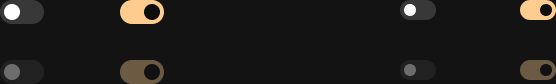

<!-- GEN:BEGIN 本段由 tools/gen-component-docs.py 依据 Figma 导出生成，勿手改；改 Figma 后重新生成 -->

## 概览

| 项 | 值 |
|---|---|
| Figma 组件集 | `Switch`（node `56059:6488`） |
| 分类 | 表单控件 |
| 变体数 | 8 |
| 默认变体 | `Size=md, Checked=false, State=default` |
| 参考尺寸 | 44×24 px（默认变体） |
| 主题 | 主库（深色中性 + 品牌砂色） |
| 预览图 | [assets/previews/switch.png](../../assets/previews/switch.png) |
| 代码实现 | [`components/Switch/Switch.tsx`](../../components/Switch/Switch.tsx) |
| Figma 链接 | [在 Figma 打开](https://www.figma.com/design/ZO4WH3sbVCj7lZIFMpiwV9/VibeMe-App---Web-Design-%E5%A4%87%E4%BB%BD?node-id=56059-6488) |



## 变体与属性

| Figma 属性 | 类型 | 取值 | 默认 | 代码 prop |
|---|---|---|---|---|
| `Size` | VARIANT | `sm` / `md` | `sm` | `size` |
| `Checked` | VARIANT | `false` / `true` | `false` | `checked` |
| `State` | VARIANT | `default` / `disabled` | `default` | `state` |

变体是属性轴的笛卡尔积：**8 = 2 × 2 × 2**（`Size` × `Checked` × `State`）。

## 各变体的事实

> 填充栈按 Figma 图层顺序排列（**靠右的是上层**，hover/pressed 的叠加层在最后）。
> `⚠无cssVar` 表示该组件引用了历史遗留变量，代码里不要照抄，按 `foundations.md` 的规则换成语义 token。

| 变体 | 尺寸 | 填充栈 | 描边 | 圆角 | 内边距 上/右/下/左 | 不透明度 |
|---|---|---|---|---|---|---|
| `Size=sm, Checked=false, State=default` | 36×20 | `Neutral/Neutral-550` #383838 `--vm-neutral-550` | — | 999 | 4/4/4/4 | — |
| `Size=sm, Checked=false, State=disabled` | 36×20 | `Neutral/Neutral-550` #383838 `--vm-neutral-550` | — | 999 | 4/4/4/4 | 0.38 |
| `Size=sm, Checked=true, State=default` | 36×20 | `Brand/Brand` #FFCC90 `--vm-brand` | — | 999 | 4/4/4/4 | — |
| `Size=sm, Checked=true, State=disabled` | 36×20 | `Brand/Brand` #FFCC90 `--vm-brand` | — | 999 | 4/4/4/4 | 0.38 |
| `Size=md, Checked=false, State=default` | 44×24 | `Neutral/Neutral-550` #383838 `--vm-neutral-550` | — | 999 | 4/4/4/4 | — |
| `Size=md, Checked=false, State=disabled` | 44×24 | `Neutral/Neutral-550` #383838 `--vm-neutral-550` | — | 999 | 4/4/4/4 | 0.38 |
| `Size=md, Checked=true, State=default` | 44×24 | `Brand/Brand` #FFCC90 `--vm-brand` | — | 999 | 4/4/4/4 | — |
| `Size=md, Checked=true, State=disabled` | 44×24 | `Brand/Brand` #FFCC90 `--vm-brand` | — | 999 | 4/4/4/4 | 0.38 |

## 结构（默认变体）

### Size=md, Checked=false, State=default

```text
`COMPONENT` Size=md, Checked=false, State=default 44×24 HORIZONTAL gap 0 pad 4/4/4/4 填充 `Neutral/Neutral-550` #383838 `--vm-neutral-550` 圆角 999
└─ `FRAME` Frame 16×16 HORIZONTAL gap 0 pad 0/0/0/0 填充 `White/White-0` #FFFFFF `--vm-white-0` 圆角 999
```

### Size=md, Checked=true, State=default

```text
`COMPONENT` Size=md, Checked=true, State=default 44×24 HORIZONTAL gap 0 pad 4/4/4/4 填充 `Brand/Brand` #FFCC90 `--vm-brand` 圆角 999
└─ `FRAME` Frame 16×16 HORIZONTAL gap 0 pad 0/0/0/0 填充 `Neutral/Neutral-950` #0E0E0E `--vm-neutral-950` 圆角 999
```


## 设计 token

| Figma 变量 | CSS 变量 | 值 |
|---|---|---|
| `Brand/Brand` | `--vm-brand` | `#FFCC90` |
| `Neutral/Neutral-550` | `--vm-neutral-550` | `#383838` |
| `Neutral/Neutral-950` | `--vm-neutral-950` | `#0E0E0E` |
| `Radious/radius-full` | `--vm-radius-full` | `999px` |
| `White/White-0` | `--vm-white-0` | `#FFFFFF` |
| `opacity/disabled` | `--vm-opacity-disabled` | `0.38` |
| `space/space-1` | `--vm-space-1` | `4px` |

<!-- GEN:END -->


## 交互与状态

Figma 的 `State` 轴只有 `default` / `disabled`，**没有** `hover` / `focus` / `pressed` 变体，所以本实现
不给悬停、按下追加视觉：鼠标移到轨道上时仍是 `--vm-neutral-550`（未选中）或 `--vm-brand`（选中），
不做 `--vm-white-7` 叠加、也不换 `--vm-brand-hover`。这和 Button（有 `State=hover`，用叠加层）以及
Slider（有 `State=hover`，把进度条换成 `--vm-brand-hover`）都不一样，不要跨组件套用。

| 状态 | 代码里由什么触发 | 视觉上变了什么 |
|---|---|---|
| 未选中 | `checked` 不给或为 `false` | 轨道 `--vm-neutral-550`，拇指 `--vm-white-0`（纯白）贴左内边距，`translateX(0)` |
| 选中 | `checked` / `defaultChecked` 为 `true`（原生 `:checked`） | 轨道换 `--vm-brand`，拇指换 `--vm-neutral-950` 并滑到右内边距（`translateX(calc(100% + var(--vm-space-1)))`） |
| 键盘聚焦 | 原生 `:focus-visible` | 轨道外圈加 `0 0 0 var(--vm-focus-ring-width) var(--vm-border-selected)`（2px、50% 白） |
| 禁用 | 原生 `disabled` | 根节点 `opacity: var(--vm-opacity-disabled)`（0.38）+ `cursor: not-allowed`；轨道与拇指**都不换色**，也不再响应点击、不在 Tab 序列里 |

几何事实：轨道 md 44×24、sm 36×20，四边内边距都是 `space/space-1` → `--vm-space-1`（4px），
圆角 `Radious/radius-full` → `--vm-radius-full`（999px，胶囊）。拇指是 1:1 的 FIXED Frame，
高度撑满轨道的 content box，于是 md 16、sm 12（= 轨道高 − 2×4px，与 Figma md 的 16×16 一致）；
滑动距离 = 拇指宽 + 一个内边距，两档尺寸下恰好等于「轨道 content 宽 − 拇指宽」，
等价于 Figma 里 `hAlign` 从 `MIN` 切到 `MAX`。过渡统一 100ms（`--vm-duration-fast`），
并在 `prefers-reduced-motion: reduce` 下关闭。

## 代码用法

```tsx
import { useState } from 'react';
import { Switch } from '../vibeme-design-system/components/Switch';
import '../vibeme-design-system/components/Switch/Switch.css';

export function NotificationSettings() {
  const [notify, setNotify] = useState(true);

  return (
    <>
      {/* Figma 的 Switch 没有文字，读屏名字靠 aria-label 或外部 label + id */}
      <Switch
        size="md"
        checked={notify}
        onChange={(e) => setNotify(e.target.checked)}
        aria-label="开启站内通知"
      />

      {/* 需要可见标签时，标签写在外面，用 htmlFor / id 关联 */}
      <label htmlFor="auto-save">自动保存</label>
      <Switch id="auto-save" size="sm" defaultChecked />

      {/* 禁用态用原生 disabled，视觉由 CSS 降不透明度 */}
      <Switch size="md" disabled aria-label="灰度中的开关" />
    </>
  );
}
```

props 一览：`size?: 'sm' | 'md'`（默认 `md`，Figma 默认变体），其余 `input[type=checkbox]` 的原生属性
（`checked` / `defaultChecked` / `disabled` / `name` / `value` / `onChange` / `id`、以及
`aria-label` / `aria-labelledby` / `aria-describedby`）全部透传，`className` 与内部类名合并。
组件**没有** `children` 标签插槽，这是刻意的：Figma 的 Switch 里没有文字层。
样式可单独引 `Switch.css`，也可统一引 `components/index.ts`（内含 `tokens.css`）。

## 可访问性

- 语义：真实 `<input type="checkbox" role="switch">`。`role="switch"` 让读屏念「开关 / 开 / 关」，
  而键盘行为、表单提交、`:checked` 状态仍来自原生 checkbox——比用 `div role="switch"` 手写键盘逻辑可靠得多。
- 键盘：`Tab` 聚焦、`Space` 切换（原生行为，不需要自己监听 keydown）；`Enter` 在原生 checkbox 上不切换，
  这是平台惯例，不要为了「顺手」额外加。
- **可访问名字**：Figma 组件里只有轨道与拇指，没有文字，所以一定要给 `aria-label` / `aria-labelledby`，
  或配一个外层 `<label htmlFor>`；漏掉的话读屏只会念「开关」，用户不知道在开什么。
- 焦点：只有键盘触发 `:focus-visible` 才画 `--vm-focus-ring-width` 光环，鼠标点击不出环；
  不要用 `outline: none` 干掉焦点。
- 禁用：原生 `disabled` 会让控件退出 Tab 序列且不随表单提交；`opacity: var(--vm-opacity-disabled)`
  只是视觉表达，不要用「灰化 + 仍可点击」来假装禁用。
- 动效：拇指位移走 100ms 过渡，`prefers-reduced-motion: reduce` 下直接到位，避免前庭不适。
- 触控目标：md 轨道只有 44×24，横向达标、纵向偏小；在移动端把它放进整行可点的设置项里（点击行即切换），
  不要缩到更小。

## 不要这样做

1. **不要给 Switch 加 hover / pressed 效果。** Figma 的 `State` 只有 `default` / `disabled`；
   叠加 `--vm-white-7` 或换成 `--vm-brand-hover` 都是发明状态。要表达可点性，用 `cursor: pointer`
   与键盘 focus 光环就够了。
2. **不要把 `State=disabled` 做成 `state` prop 或换灰色。** 用原生 `disabled`，视觉只加
   `opacity: var(--vm-opacity-disabled)`（0.38），轨道与拇指的颜色 token 一个都不换。
3. **不要给组件塞 `children` 当标签。** Figma 的 Switch 没有 TEXT 属性，加进去就和设计稿不一致了；
   需要标签请在外部写 `<label htmlFor>` 或传 `aria-label`。
4. **不要用 `div` / `button` + `onClick` 自己画开关**，也不要只写 `role="switch"` 而忘了同步
   `aria-checked`：前者丢掉 Space 键与表单提交，后者会让读屏状态永远停在「关」。
5. **不要把拇指颜色写反。** 未选中拇指是 `White/White-0`（`--vm-white-0` 纯白），选中拇指是
   `Neutral/Neutral-950`（`--vm-neutral-950` 近黑）压在 `--vm-brand` 上；把选中拇指改成白色会丢掉对比。
6. 不要把轨道宽度从 FIXED 改成随内容 HUG：Figma 两档都是固定 36×20 / 44×24，拇指位移依赖这个固定宽度。

## 相关组件

- [Checkbox](checkbox.md)：同为「勾选」语义，但 Checkbox 是**提交时生效**的多选项，Switch 是
  **立即生效**的单一开关（设置项、灰度开关）。同一组多选里不要用 Switch 代替 Checkbox。
- [Slider](slider.md)：当「开关」其实是一个连续/多档取值（音量、亮度）时用 Slider，不要用 Switch 硬凑。
- [Radio](radio.md)：多选一时用 Radio（原生 `name` 分组互斥），不是一排 Switch。
- [Input](input.md)：设置表单里 Switch 常与 Input 上下排布；两者尺寸档位不同（Input sm/md/lg 是 32/40/48），
  同一行对齐时以 Switch 的 24 高度为中心线，不要拉伸 Switch 去凑高度。
- `ListItem` / `Card`：Figma 的设置类列表项把 Switch 放在行尾，整行可点；实现时让行自己处理点击，
  Switch 只负责状态，避免一次点击触发两次切换。
