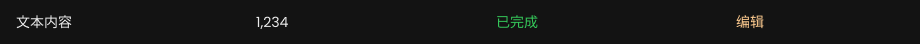

<!-- GEN:BEGIN 本段由 tools/gen-component-docs.py 依据 Figma 导出生成，勿手改；改 Figma 后重新生成 -->

## 概览

| 项 | 值 |
|---|---|
| Figma 组件集 | `TableCell`（node `56065:6816`） |
| 分类 | 数据展示类 |
| 变体数 | 4 |
| 默认变体 | `Type=text` |
| 参考尺寸 | 200×44 px（默认变体） |
| 主题 | 主库（深色中性 + 品牌砂色） |
| 预览图 | [assets/previews/table-cell.png](../../assets/previews/table-cell.png) |
| 代码实现 | [`components/TableCell/TableCell.tsx`](../../components/TableCell/TableCell.tsx) |
| Figma 链接 | [在 Figma 打开](https://www.figma.com/design/ZO4WH3sbVCj7lZIFMpiwV9/VibeMe-App---Web-Design-%E5%A4%87%E4%BB%BD?node-id=56065-6816) |



## 变体与属性

| Figma 属性 | 类型 | 取值 | 默认 | 代码 prop |
|---|---|---|---|---|
| `Type` | VARIANT | `text` / `number` / `status` / `action` | `text` | `type` |

变体是属性轴的笛卡尔积：**4 = 4**（`Type`）。

## 各变体的事实

> 填充栈按 Figma 图层顺序排列（**靠右的是上层**，hover/pressed 的叠加层在最后）。
> `⚠无cssVar` 表示该组件引用了历史遗留变量，代码里不要照抄，按 `foundations.md` 的规则换成语义 token。

| 变体 | 尺寸 | 填充栈 | 描边 | 圆角 | 内边距 上/右/下/左 | 不透明度 |
|---|---|---|---|---|---|---|
| `Type=text` | 200×44 | — | — | — | 12/16/12/16 | — |
| `Type=number` | 200×44 | — | — | — | 12/16/12/16 | — |
| `Type=status` | 200×44 | — | — | — | 12/16/12/16 | — |
| `Type=action` | 200×44 | — | — | — | 12/16/12/16 | — |

## 结构（默认变体）

### Type=text

```text
`COMPONENT` Type=text 200×44 HORIZONTAL gap 0 pad 12/16/12/16
└─ `TEXT` 文本内容 56×20 填充 `Text/Text-Primary` #FFFFFF 92% `--vm-text-primary` 文字样式 `Heading/Body/S/Regular`（14 Regular /20） 内容 '文本内容'
```

### Type=status

```text
`COMPONENT` Type=status 200×44 HORIZONTAL gap 0 pad 12/16/12/16
└─ `TEXT` 已完成 42×20 填充 `状态色/Success` #34C759 `--vm-status-success` 文字样式 `Heading/Body/S/Regular`（14 Regular /20） 内容 '已完成'
```


## 设计 token

| Figma 变量 | CSS 变量 | 值 |
|---|---|---|
| `Text/Text-Primary` | `--vm-text-primary` | `rgba(255, 255, 255, 0.92)` |
| `space/space-3` | `--vm-space-3` | `12px` |
| `space/space-4` | `--vm-space-4` | `16px` |
| `状态色/Success` | `--vm-status-success` | `#34C759` |

<!-- GEN:END -->


## 交互与状态

`TableCell` 在 Figma 里**只有 `Type` 一根轴，没有任何 `State` 变体**（没有 hover / pressed / focus / disabled）。
所以单元格本身不是交互元素：CSS 里没有 `:hover` / `:active`，底色保持透明——四个变体的 `fills` 都是空的，
行的 hover / selected 叠加层（`TableRow` 的 `--vm-white-7` / `--vm-white-4`）能直接透出来，这正是设计意图。
状态差异全部落在**文字颜色**上，`type` prop 一一对应：

- `text` / `number` → `--vm-text-primary`（Figma 变量 `Text/Text-Primary`，`rgba(255,255,255,0.92)`）；
- `status` → `--vm-status-success`（Figma 变量 `状态色/Success`，`#34C759`）；
- `action` → `--vm-text-action`（Figma 变量 `Text/Text-Action`，`#FFCC90`）。

单元格被禁用这件事 Figma 里不存在，因此**不要**在 `TableCell` 上造 `disabled`；要表达禁用请给单元格里的
`Button` 传原生 `disabled`（它才会走 `opacity: var(--vm-opacity-disabled)`）。键盘焦点同理：`td` 不进 tab 序列，
焦点由单元格内的 `button` / `a` 自己管理。

## 代码用法

```tsx
import { TableCell } from '../components/TableCell'; // 组件自带 import './TableCell.css'

export function Row() {
  return (
    <tr className="vm-table-row">
      <TableCell type="text">设计系统 / 组件库</TableCell>
      <TableCell type="number">1,234</TableCell>
      <TableCell type="status">已完成</TableCell>
      <TableCell type="action">
        <button type="button">编辑</button>
      </TableCell>
    </tr>
  );
}
```

- 必须放在 `<tr>` 里（组件渲染的是真实 `<td>`），不要单独使用；
- 内容走 `children`（对应 Figma 里唯一的 TEXT 层），`type` 只影响颜色与数字排印；
- 透传所有 `<td>` 原生属性：`colSpan` / `rowSpan` / `headers` / `title` 等，`className` 会与内部类合并；
- 需要「其它状态色」时不要在调用处写十六进制，用 `style={{ color: 'var(--vm-status-error)' }}` 或改用 `Badge`。

## 可访问性

- 根元素是真实 `<td>`，可访问名就是它的文本内容；**不要**用 `div` + `role="cell"` 模拟，
  表格的行列关联、`Ctrl/⌘ + F` 页面内查找、朗读器的「第 3 行第 2 列」都依赖原生表格语义。
- 本组件不渲染 `<th>`：Figma 的 `TableCell` 只出现在 body 行（表头文字在 `TableRow` 的 `Type=header` 里）。
  列名请由 `TableRow` 的表头单元格承担，并给它 `scope="col"`，这样数字列（`type="number"`）会被读成
  「列名 + 数值」，不需要给每个单元格补 `aria-label`。
- `action` 单元格里的控件必须是真实 `<button type="button">` 或 `<a href>`；纯图标按钮要写 `aria-label`
  （Figma 示例文案是 `编辑`，别只留图标让朗读器读出「button」）。
- 状态**不能只靠颜色**：`status` 变体只把文字染成 `--vm-status-success`，文字本身必须写清状态词
  （Figma 示例 `已完成`），色盲用户与高对比模式下才读得出来；同理不要给单元格加背景色块充当状态。
- 行被选中（`TableRow` 的 `selected`）时，除了底色，请在行上给 `aria-selected`/`aria-current`，视觉之外要有语义。

## 不要这样做

1. **不要给单元格加 hover / pressed 样式或 prop。** Figma 没有 `State` 轴，`<TableCell hover>` 这种 prop 不存在；
   悬停反馈属于 `TableRow`（它是 `Update`/`State=hover` 的载体），在 `TableCell` 上再叠一层会双重变亮。
2. **不要写死宽度。** 单格画板 200px 只是 Figma 的展示尺寸；真实列宽由 `TableRow` 的列定义
   （60/240/160/140/120）与表格布局决定，写 `width: 200px` 会把 5 列挤爆。
3. **不要把 `status` 理解成「绿色 = 全部状态」。** Figma 只绑定了 `状态色/Success` 一个样本色；
   失败 / 警告 / 进行中请用 `--vm-status-error` / `--vm-status-warning` / `--vm-status-info`
   （由调用方覆盖 `color`）或直接用 `Badge`，不要在组件 CSS 里另造颜色。
4. **不要给单元格加描边或圆角。** 导出的四个变体 `strokes` 为空数组（`strokeWeight: 1` 是残留设置，
   没有可见描边）、`cornerRadius` 未设置、`fills` 为空；网格线属于 `TableRow` / `Table`，加在这里会画双线。
5. **不要用灰色或额外 opacity 表达禁用。** 那会同时改掉文字与描边；本组件也压根没有 disabled 变体，
   真要禁用请用内层 `Button` 的原生 `disabled`（`opacity: var(--vm-opacity-disabled)`）。
6. **不要手写 `font-size: 14px`。** 四档变体统一是 `Heading/Body/S/Regular`（14 / 行高 20），
   必须挂 `.vm-type-heading-body-s-regular`，否则字号会脱离 token（字体也只有 Poppins，走 `--vm-font-family`）。

## 相关组件

- **`TableRow`**：内嵌 3~5 个 `TableCell`。列宽、行高（43px）、行分隔线与 hover / selected 底色都在行上，
  `TableCell` 只负责 `--vm-space-3` / `--vm-space-4` 内边距与文字色——改行样式别改到单元格里。
- **`Table`**：外层容器，组合多行 `TableRow`，并提供 `state="empty" | "loading"`（内嵌 `Empty` / `Skeleton`）。
  空态 / 加载态时不要用 `TableCell` 拼假行，用 `Table` 的状态。
- **`Badge`**：需要带底色、圆角、图标的状态标签时用它放进 `TableCell`，不要给单元格文字上色来假装标签。
- **`Button`**：`type="action"` 单元格的内容，通常是文字按钮；把删除等危险操作放在这里时要给出可访问名。
- **`Skeleton`**：单行骨架（`Table` 的 loading 已内嵌），需要自定义加载行时与 `TableRow` 组合使用。
