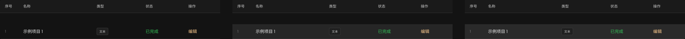

<!-- GEN:BEGIN 本段由 tools/gen-component-docs.py 依据 Figma 导出生成，勿手改；改 Figma 后重新生成 -->

## 概览

| 项 | 值 |
|---|---|
| Figma 组件集 | `TableRow`（node `56065:6886`） |
| 分类 | 数据展示类 |
| 变体数 | 6 |
| 默认变体 | `Type=header, State=default` |
| 参考尺寸 | 720×43 px（默认变体） |
| 主题 | 主库（深色中性 + 品牌砂色） |
| 预览图 | [assets/previews/table-row.png](../../assets/previews/table-row.png) |
| 代码实现 | [`components/TableRow/TableRow.tsx`](../../components/TableRow/TableRow.tsx) |
| Figma 链接 | [在 Figma 打开](https://www.figma.com/design/ZO4WH3sbVCj7lZIFMpiwV9/VibeMe-App---Web-Design-%E5%A4%87%E4%BB%BD?node-id=56065-6886) |



## 变体与属性

| Figma 属性 | 类型 | 取值 | 默认 | 代码 prop |
|---|---|---|---|---|
| `Type` | VARIANT | `header` / `body` | `header` | `type` |
| `State` | VARIANT | `default` / `hover` / `selected` | `default` | `state` |

变体是属性轴的笛卡尔积：**6 = 2 × 3**（`Type` × `State`）。

内嵌组件：`Tone=neutral, Size=sm, Style=soft`×3

## 各变体的事实

> 填充栈按 Figma 图层顺序排列（**靠右的是上层**，hover/pressed 的叠加层在最后）。
> `⚠无cssVar` 表示该组件引用了历史遗留变量，代码里不要照抄，按 `foundations.md` 的规则换成语义 token。

| 变体 | 尺寸 | 填充栈 | 描边 | 圆角 | 内边距 上/右/下/左 | 不透明度 |
|---|---|---|---|---|---|---|
| `Type=header, State=default` | 720×43 | `Background/bg-panel` #1A1A1A `--vm-bg-panel` | `Background/border-default` #FFFFFF 12% `--vm-border-default` | — | 0/0/0/0 | — |
| `Type=header, State=hover` | 720×43 | `Background/bg-panel` #1A1A1A `--vm-bg-panel` | `Background/border-default` #FFFFFF 12% `--vm-border-default` | — | 0/0/0/0 | — |
| `Type=header, State=selected` | 720×43 | `Background/bg-panel` #1A1A1A `--vm-bg-panel` | `Background/border-default` #FFFFFF 12% `--vm-border-default` | — | 0/0/0/0 | — |
| `Type=body, State=default` | 720×49 | — | `Background/border-default` #FFFFFF 12% `--vm-border-default` | — | 0/0/0/0 | — |
| `Type=body, State=hover` | 720×49 | `Background/Surface-hover` #262626 `--vm-surface-hover` | `Background/border-default` #FFFFFF 12% `--vm-border-default` | — | 0/0/0/0 | — |
| `Type=body, State=selected` | 720×49 | `Background/Surface-selected` #2A2A2A `--vm-surface-selected` | `Background/border-default` #FFFFFF 12% `--vm-border-default` | — | 0/0/0/0 | — |

## 结构（默认变体）

### Type=header, State=default

```text
`COMPONENT` Type=header, State=default 720×43 HORIZONTAL gap 0 pad 0/0/0/0 填充 `Background/bg-panel` #1A1A1A `--vm-bg-panel` 描边 `Background/border-default` #FFFFFF 12% `--vm-border-default`
└─ `FRAME` Frame 60×42 HORIZONTAL gap 0 pad 12/16/12/16
  └─ `TEXT` 序号 24×18 填充 `Text/Text-Secondary` #FFFFFF 64% `--vm-text-secondary` 文字样式 `Caption/Caption`（12 Medium /18） 内容 '序号'
└─ `FRAME` Frame 240×42 HORIZONTAL gap 0 pad 12/16/12/16
  └─ `TEXT` 名称 24×18 填充 `Text/Text-Secondary` #FFFFFF 64% `--vm-text-secondary` 文字样式 `Caption/Caption`（12 Medium /18） 内容 '名称'
└─ `FRAME` Frame 160×42 HORIZONTAL gap 0 pad 12/16/12/16
  └─ `TEXT` 类型 24×18 填充 `Text/Text-Secondary` #FFFFFF 64% `--vm-text-secondary` 文字样式 `Caption/Caption`（12 Medium /18） 内容 '类型'
└─ `FRAME` Frame 140×42 HORIZONTAL gap 0 pad 12/16/12/16
  └─ `TEXT` 状态 24×18 填充 `Text/Text-Secondary` #FFFFFF 64% `--vm-text-secondary` 文字样式 `Caption/Caption`（12 Medium /18） 内容 '状态'
└─ `FRAME` Frame 120×42 HORIZONTAL gap 0 pad 12/16/12/16
  └─ `TEXT` 操作 24×18 填充 `Text/Text-Secondary` #FFFFFF 64% `--vm-text-secondary` 文字样式 `Caption/Caption`（12 Medium /18） 内容 '操作'
```

### Type=body, State=selected

```text
`COMPONENT` Type=body, State=selected 720×49 HORIZONTAL gap 0 pad 0/0/0/0 填充 `Background/Surface-selected` #2A2A2A `--vm-surface-selected` 描边 `Background/border-default` #FFFFFF 12% `--vm-border-default`
└─ `FRAME` Frame 60×48 HORIZONTAL gap 0 pad 12/16/12/16
  └─ `TEXT` 1 5×18 填充 `Text/Text-Tertiary` #FFFFFF 30% `--vm-text-tertiary` 文字样式 `Caption/Caption`（12 Medium /18） 内容 '1'
└─ `FRAME` Frame 240×48 HORIZONTAL gap 0 pad 12/16/12/16
  └─ `TEXT` 示例项目 1 65×20 填充 `Text/Text-Primary` #FFFFFF 92% `--vm-text-primary` 文字样式 `Heading/Body/S/Regular`（14 Regular /20） 内容 '示例项目 1'
└─ `FRAME` Frame 160×48 HORIZONTAL gap 0 pad 12/16/12/16
  └─ `INSTANCE` Tag 38×24 HORIZONTAL gap 4 pad 4/8/4/8 填充 `Background/bg-card` #202020 `--vm-bg-card` 描边 `Background/border-default` #FFFFFF 12% `--vm-border-default` 圆角 4 实例=Tone=neutral, Size=sm, Style=soft
    └─ `TEXT` Tag 20×14 填充 `Text/Text-Secondary` #FFFFFF 64% `--vm-text-secondary` 文字样式 `Caption/Label`（10 Medium /14） 内容 '文本'
└─ `FRAME` Frame 140×48 HORIZONTAL gap 0 pad 12/16/12/16
  └─ `TEXT` 已完成 42×20 填充 `状态色/Success` #34C759 `--vm-status-success` 文字样式 `Heading/Body/S/Regular`（14 Regular /20） 内容 '已完成'
└─ `FRAME` Frame 120×48 HORIZONTAL gap 0 pad 12/16/12/16
  └─ `TEXT` 编辑 28×20 填充 `Text/Text-Action` #FFCC90 `--vm-text-action` 文字样式 `Heading/Body/S/Regular`（14 Regular /20） 内容 '编辑'
```


## 设计 token

| Figma 变量 | CSS 变量 | 值 |
|---|---|---|
| `Background/Surface-hover` | `--vm-surface-hover` | `#262626` |
| `Background/Surface-selected` | `--vm-surface-selected` | `#2A2A2A` |
| `Background/bg-card` | `--vm-bg-card` | `#202020` |
| `Background/bg-panel` | `--vm-bg-panel` | `#1A1A1A` |
| `Background/border-default` | `--vm-border-default` | `rgba(255, 255, 255, 0.12)` |
| `Semantic Radius/radius-badge` | `--vm-radius-badge` | `4px` |
| `Text/Text-Action` | `--vm-text-action` | `#FFCC90` |
| `Text/Text-Primary` | `--vm-text-primary` | `rgba(255, 255, 255, 0.92)` |
| `Text/Text-Secondary` | `--vm-text-secondary` | `rgba(255, 255, 255, 0.64)` |
| `Text/Text-Tertiary` | `--vm-text-tertiary` | `rgba(255, 255, 255, 0.3)` |
| `border/width/thin` | `--vm-border-width-thin` | `1px` |
| `space/space-1` | `--vm-space-1` | `4px` |
| `space/space-2` | `--vm-space-2` | `8px` |
| `space/space-3` | `--vm-space-3` | `12px` |
| `space/space-4` | `--vm-space-4` | `16px` |
| `状态色/Success` | `--vm-status-success` | `#34C759` |

<!-- GEN:END -->


## 交互与状态

`type` 决定行的身份：`header`（Figma 默认变体）底色是 `--vm-bg-panel`（Figma 变量 `Background/bg-panel`，`#1A1A1A`）；
`body` 的 `State=default` 没有任何填充，透明底让面板/卡片的 `--vm-bg-card` 透出来。

`State` 的三档在代码里只剩两种处理方式：**`State=selected` 是 prop**（`selected` → `--vm-surface-selected`，
Figma 变量 `Background/Surface-selected` `#2A2A2A`，同时输出 `aria-selected="true"`）；
**`State=hover` 是伪类**（`:hover` → `--vm-surface-hover`，Figma 变量 `Background/Surface-hover` `#262626`）。
注意这是 Figma 直接绑定的**实色 token 交换**，与 Button 一族的 `--vm-white-7` 叠加手法**不是一回事**，
hover 变体的填充栈里只有一层 paint。选中行悬停时底色保持 `--vm-surface-selected`：
hover 规则带了 `:not(.vm-table-row--selected)`，选中规则的选择器又比默认规则多一个 class。

表头的另外两个变体（`Type=header, State=hover` / `State=selected`）在 Figma 里与 default **填充栈完全相同**
（都是 `Background/bg-panel`），所以表头不参与 hover/选中，代码里也没有对应样式。
分隔线来自行自身的 `border-bottom: var(--vm-border-width-thin) solid var(--vm-border-default)`——探针显示
行描边只有下边一项（`strokeBottomWeight=1`，其余三边 0、`strokeAlign=INSIDE`）。
本组件没有 pressed / focus / disabled 变体：不要给行造这些状态，焦点环交给行内的控件。

## 代码用法

```tsx
import { Table } from '../components/Table';
import { TableRow } from '../components/TableRow';
import { TableCell } from '../components/TableCell';
import { Tag } from '../components/Tag';

export function Demo() {
  return (
    <Table>
      <thead>
        <TableRow type="header">
          <th scope="col">序号</th>
          <th scope="col">名称</th>
          <th scope="col">类型</th>
          <th scope="col">状态</th>
          <th scope="col">操作</th>
        </TableRow>
      </thead>
      <tbody>
        <TableRow type="body" selected>
          <TableCell type="number" className="vm-table-row__meta">1</TableCell>
          <TableCell>示例项目 1</TableCell>
          <TableCell><Tag>文本</Tag></TableCell>
          <TableCell type="status">已完成</TableCell>
          <TableCell type="action"><button type="button">编辑</button></TableCell>
        </TableRow>
      </tbody>
    </Table>
  );
}
```

- 行必须放在 `<thead>` / `<tbody>` 里（组件渲染真实 `<tr>`）；表头行推荐直接用 `<th scope="col">`，
  也可以放 `TableCell`——`type="header"` 会把行内文字统一覆盖成 Caption/Caption + `--vm-text-secondary`；
- 列宽 60/240/160/140/120 是 Figma 的示例列宽，由调用方用 `<colgroup>` 或单元格 `className` 控制，组件不写死；
- 次要列（Figma 的「序号」列，Caption/Caption + `--vm-text-tertiary`）在 `TableCell` 上挂
  `className="vm-table-row__meta"` 即可；
- 透传所有 `<tr>` 原生属性，`className` 与内部类合并。

## 可访问性

- 根元素是真实 `<tr>`，语义父级必须是 `<thead>` / `<tbody>` / `<tfoot>`；不要用 `div` 模拟行。
- 表头行请写 `<th scope="col">`（行标题用 `scope="row"`）。`TableRow` 只负责视觉，标签语义由调用方决定，
  但**列关联完全依赖 `scope`**：没有它，屏幕阅读器读数字列时不会带上列名。
- `selected` 会渲染 `aria-selected="true"`。在原生 `<table>` 里该属性的 AT 支持有限：
  要做可键盘浏览的表格，请给 `<table role="grid">` 并自己实现 roving tabindex；
  否则选中态不要只靠 `--vm-surface-selected` 的底色，配一个勾选图标或 `aria-current`。
- 行本身不可聚焦。整行可点击时，动作必须落在行内真实 `<button>` / `<a>` 上，不要只给 `<tr>` 挂 `onClick`。
- 操作列的控件要有可读文案（Figma 示例是 `编辑`）；纯图标按钮补 `aria-label`。
- 表头文字用 `--vm-text-secondary`（64% 白）已经满足对比度要求，不要再调低到 `--vm-text-tertiary`。

## 不要这样做

1. **不要把 hover 做成 prop。** Figma 的 `State=hover` 是交互态，代码里必须用 CSS `:hover`；
   只有 `State=selected` 才是 prop，并且要同步 `aria-selected`。写成 `state="hover"` 会让行永久高亮。
2. **不要用 `--vm-white-7` / `--vm-white-6` 叠加做行 hover。** 本行 hover / selected 是 Figma 直接绑定的
   `--vm-surface-hover` / `--vm-surface-selected` 实色（导出里 body hover 的 `fills` 只有一层，`v` 指向 Surface-hover）；
   叠加白色是 Button 一族的手法，套过来会和行内 Tag 的 `--vm-bg-card` 叠出脏色。
3. **不要把列宽写进 `TableRow`。** 60/240/160/140/120 只是 Figma 那个示意行的列宽；写死后列数一变就错位。
   用 `<colgroup>` 或单元格宽度。
4. **不要忘记 `border-collapse: collapse`。** 行的分隔线是 `tr` 的 `border-bottom`，
   表格若是 `border-collapse: separate` 这条线根本不渲染（`Table` 组件已经设好，单独用 `TableRow` 时要自己设）。
5. **不要给表头行加 hover / 选中样式。** Figma 里 header 的三个 State 变体填充栈完全一致（都是 `--vm-bg-panel`），
   表头是可点的排序区也好、不可点也好，都不该跟着 hover 变亮。
6. **不要手写 `font-size: 12px` 做表头。** 表头规格走 `--vm-type-caption-caption-*`（Caption/Caption 12/500/18），
   正文单元格走 `TableCell` 的 `.vm-type-heading-body-s-regular`；表头的覆盖选择器是
   `.vm-table-row.vm-table-row--header .vm-table-cell__content`，三 class 是为了不被 import 顺序影响。
7. **不要给行加 `opacity: var(--vm-opacity-disabled)` 表达禁用。** `TableRow` 没有 disabled 变体，
   真禁用请禁用行内控件（`Button` 的原生 `disabled`），或者由 `Table` 的 `state` 表达整体不可用。

## 相关组件

- **`TableCell`**：行的单元格。分工是「行管底色、分隔线、表头文字规格；单元格管内边距与文字色」：
  内边距 12/16 来自 `TableCell`（`--vm-space-3` / `--vm-space-4`），行只做覆盖。
- **`Tag`**：Figma 的「类型」列内嵌 3 处 `Tone=neutral, Size=sm, Style=soft` 实例（38×24、圆角
  `--vm-radius-badge`、底 `--vm-bg-card`、描边 `--vm-border-default`，内部是 Caption/Label 10/14）。
- **`Table`**：外层容器。它负责 `<table>` 的 `border-collapse: collapse`、列宽 `colgroup`、
  `state="empty" | "loading"`（内嵌 `Empty` / `Skeleton`），并组合表头行与数据行。
- **`Button`**：操作列的动作控件；行内按钮的 hover 走 Button 自己的填充叠加手法，不要在这一层重复处理。
- **`Checkbox`**：需要多选时放在首个 `TableCell` 里，选中行与勾选框状态要保持一致（视觉 + `aria-selected`）。
