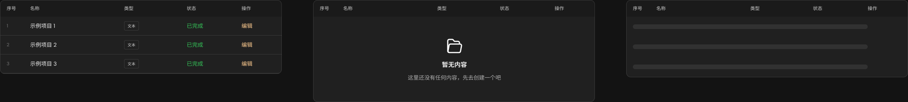

<!-- GEN:BEGIN 本段由 tools/gen-component-docs.py 依据 Figma 导出生成，勿手改；改 Figma 后重新生成 -->

## 概览

| 项 | 值 |
|---|---|
| Figma 组件集 | `Table`（node `56065:6970`） |
| 分类 | 数据展示类 |
| 变体数 | 3 |
| 默认变体 | `State=default` |
| 参考尺寸 | 720×191 px（默认变体） |
| 主题 | 主库（深色中性 + 品牌砂色） |
| 预览图 | [assets/previews/table.png](../../assets/previews/table.png) |
| 代码实现 | [`components/Table/Table.tsx`](../../components/Table/Table.tsx) |
| Figma 链接 | [在 Figma 打开](https://www.figma.com/design/ZO4WH3sbVCj7lZIFMpiwV9/VibeMe-App---Web-Design-%E5%A4%87%E4%BB%BD?node-id=56065-6970) |



## 变体与属性

| Figma 属性 | 类型 | 取值 | 默认 | 代码 prop |
|---|---|---|---|---|
| `State` | VARIANT | `default` / `empty` / `loading` | `default` | `state` |

变体是属性轴的笛卡尔积：**3 = 3**（`State`）。

内嵌组件：`Tone=neutral, Size=sm, Style=soft`×3、`Type=empty`×1、`Type=line, Size=md`×3

## 各变体的事实

> 填充栈按 Figma 图层顺序排列（**靠右的是上层**，hover/pressed 的叠加层在最后）。
> `⚠无cssVar` 表示该组件引用了历史遗留变量，代码里不要照抄，按 `foundations.md` 的规则换成语义 token。

| 变体 | 尺寸 | 填充栈 | 描边 | 圆角 | 内边距 上/右/下/左 | 不透明度 |
|---|---|---|---|---|---|---|
| `State=default` | 720×191 | `Background/bg-card` #202020 `--vm-bg-card` | `Background/border-default` #FFFFFF 12% `--vm-border-default` | 12 | 0/0/0/0 | — |
| `State=empty` | 720×264 | `Background/bg-card` #202020 `--vm-bg-card` | `Background/border-default` #FFFFFF 12% `--vm-border-default` | 12 | 0/0/0/0 | — |
| `State=loading` | 720×200 | `Background/bg-card` #202020 `--vm-bg-card` | `Background/border-default` #FFFFFF 12% `--vm-border-default` | 12 | 0/0/0/0 | — |

## 结构（默认变体）

### State=default

```text
`COMPONENT` State=default 720×191 VERTICAL gap 0 pad 0/0/0/0 填充 `Background/bg-card` #202020 `--vm-bg-card` 描边 `Background/border-default` #FFFFFF 12% `--vm-border-default` 圆角 12
└─ `FRAME` Frame 720×42 HORIZONTAL gap 0 pad 0/0/0/0 填充 `Background/bg-panel` #1A1A1A `--vm-bg-panel`
  └─ `FRAME` Frame 60×42 HORIZONTAL gap 0 pad 12/16/12/16
    └─ `TEXT` 序号 24×18 填充 `Text/Text-Secondary` #FFFFFF 64% `--vm-text-secondary` 文字样式 `Caption/Caption`（12 Medium /18） 内容 '序号'
  └─ `FRAME` Frame 240×42 HORIZONTAL gap 0 pad 12/16/12/16
    └─ `TEXT` 名称 24×18 填充 `Text/Text-Secondary` #FFFFFF 64% `--vm-text-secondary` 文字样式 `Caption/Caption`（12 Medium /18） 内容 '名称'
  └─ `FRAME` Frame 160×42 HORIZONTAL gap 0 pad 12/16/12/16
    └─ `TEXT` 类型 24×18 填充 `Text/Text-Secondary` #FFFFFF 64% `--vm-text-secondary` 文字样式 `Caption/Caption`（12 Medium /18） 内容 '类型'
  └─ `FRAME` Frame 140×42 HORIZONTAL gap 0 pad 12/16/12/16
    └─ `TEXT` 状态 24×18 填充 `Text/Text-Secondary` #FFFFFF 64% `--vm-text-secondary` 文字样式 `Caption/Caption`（12 Medium /18） 内容 '状态'
  └─ `FRAME` Frame 120×42 HORIZONTAL gap 0 pad 12/16/12/16
    └─ `TEXT` 操作 24×18 填充 `Text/Text-Secondary` #FFFFFF 64% `--vm-text-secondary` 文字样式 `Caption/Caption`（12 Medium /18） 内容 '操作'
└─ `FRAME` Frame 720×49 HORIZONTAL gap 0 pad 0/0/0/0 描边 `Background/border-default` #FFFFFF 12% `--vm-border-default`
  └─ `FRAME` Frame 60×48 HORIZONTAL gap 0 pad 12/16/12/16
    └─ `TEXT` 1 5×18 填充 `Text/Text-Tertiary` #FFFFFF 30% `--vm-text-tertiary` 文字样式 `Caption/Caption`（12 Medium /18） 内容 '1'
  └─ `FRAME` Frame 240×48 HORIZONTAL gap 0 pad 12/16/12/16
    └─ `TEXT` 示例项目 1 65×20 填充 `Text/Text-Primary` #FFFFFF 92% `--vm-text-primary` 文字样式 `Heading/Body/S/Regular`（14 Regular /20） 内容 '示例项目 1'
  └─ `FRAME` Frame 160×48 HORIZONTAL gap 0 pad 12/16/12/16
    └─ `INSTANCE` Tag 38×24 HORIZONTAL gap 4 pad 4/8/4/8 填充 `Background/bg-card` #202020 `--vm-bg-card` 描边 `Background/border-default` #FFFFFF 12% `--vm-border-default` 圆角 4 实例=Tone=neutral, Size=sm, Style=soft
      └─ `TEXT` Tag 20×14 填充 `Text/Text-Secondary` #FFFFFF 64% `--vm-text-secondary` 文字样式 `Caption/Label`（10 Medium /14） 内容 '文本'
  └─ `FRAME` Frame 140×48 HORIZONTAL gap 0 pad 12/16/12/16
    └─ `TEXT` 已完成 42×20 填充 `状态色/Success` #34C759 `--vm-status-success` 文字样式 `Heading/Body/S/Regular`（14 Regular /20） 内容 '已完成'
  └─ `FRAME` Frame 120×48 HORIZONTAL gap 0 pad 12/16/12/16
    └─ `TEXT` 编辑 28×20 填充 `Text/Text-Action` #FFCC90 `--vm-text-action` 文字样式 `Heading/Body/S/Regular`（14 Regular /20） 内容 '编辑'
└─ `FRAME` Frame 720×49 HORIZONTAL gap 0 pad 0/0/0/0 描边 `Background/border-default` #FFFFFF 12% `--vm-border-default`
  └─ `FRAME` Frame 60×48 HORIZONTAL gap 0 pad 12/16/12/16
    └─ `TEXT` 2 7×18 填充 `Text/Text-Tertiary` #FFFFFF 30% `--vm-text-tertiary` 文字样式 `Caption/Caption`（12 Medium /18） 内容 '2'
  └─ `FRAME` Frame 240×48 HORIZONTAL gap 0 pad 12/16/12/16
    └─ `TEXT` 示例项目 2 68×20 填充 `Text/Text-Primary` #FFFFFF 92% `--vm-text-primary` 文字样式 `Heading/Body/S/Regular`（14 Regular /20） 内容 '示例项目 2'
  └─ `FRAME` Frame 160×48 HORIZONTAL gap 0 pad 12/16/12/16
    └─ `INSTANCE` Tag 38×24 HORIZONTAL gap 4 pad 4/8/4/8 填充 `Background/bg-card` #202020 `--vm-bg-card` 描边 `Background/border-default` #FFFFFF 12% `--vm-border-default` 圆角 4 实例=Tone=neutral, Size=sm, Style=soft
      └─ `TEXT` Tag 20×14 填充 `Text/Text-Secondary` #FFFFFF 64% `--vm-text-secondary` 文字样式 `Caption/Label`（10 Medium /14） 内容 '文本'
  └─ `FRAME` Frame 140×48 HORIZONTAL gap 0 pad 12/16/12/16
    └─ `TEXT` 已完成 42×20 填充 `状态色/Success` #34C759 `--vm-status-success` 文字样式 `Heading/Body/S/Regular`（14 Regular /20） 内容 '已完成'
  └─ `FRAME` Frame 120×48 HORIZONTAL gap 0 pad 12/16/12/16
    └─ `TEXT` 编辑 28×20 填充 `Text/Text-Action` #FFCC90 `--vm-text-action` 文字样式 `Heading/Body/S/Regular`（14 Regular /20） 内容 '编辑'
└─ `FRAME` Frame 720×49 HORIZONTAL gap 0 pad 0/0/0/0 描边 `Background/border-default` #FFFFFF 12% `--vm-border-default`
  └─ `FRAME` Frame 60×48 HORIZONTAL gap 0 pad 12/16/12/16
    └─ `TEXT` 3 8×18 填充 `Text/Text-Tertiary` #FFFFFF 30% `--vm-text-tertiary` 文字样式 `Caption/Caption`（12 Medium /18） 内容 '3'
  └─ `FRAME` Frame 240×48 HORIZONTAL gap 0 pad 12/16/12/16
    └─ `TEXT` 示例项目 3 68×20 填充 `Text/Text-Primary` #FFFFFF 92% `--vm-text-primary` 文字样式 `Heading/Body/S/Regular`（14 Regular /20） 内容 '示例项目 3'
  └─ `FRAME` Frame 160×48 HORIZONTAL gap 0 pad 12/16/12/16
    └─ `INSTANCE` Tag 38×24 HORIZONTAL gap 4 pad 4/8/4/8 填充 `Background/bg-card` #202020 `--vm-bg-card` 描边 `Background/border-default` #FFFFFF 12% `--vm-border-default` 圆角 4 实例=Tone=neutral, Size=sm, Style=soft
      └─ `TEXT` Tag 20×14 填充 `Text/Text-Secondary` #FFFFFF 64% `--vm-text-secondary` 文字样式 `Caption/Label`（10 Medium /14） 内容 '文本'
  └─ `FRAME` Frame 140×48 HORIZONTAL gap 0 pad 12/16/12/16
    └─ `TEXT` 已完成 42×20 填充 `状态色/Success` #34C759 `--vm-status-success` 文字样式 `Heading/Body/S/Regular`（14 Regular /20） 内容 '已完成'
  └─ `FRAME` Frame 120×48 HORIZONTAL gap 0 pad 12/16/12/16
    └─ `TEXT` 编辑 28×20 填充 `Text/Text-Action` #FFCC90 `--vm-text-action` 文字样式 `Heading/Body/S/Regular`（14 Regular /20） 内容 '编辑'
```

### State=empty

```text
`COMPONENT` State=empty 720×264 VERTICAL gap 0 pad 0/0/0/0 填充 `Background/bg-card` #202020 `--vm-bg-card` 描边 `Background/border-default` #FFFFFF 12% `--vm-border-default` 圆角 12
└─ `FRAME` Frame 720×42 HORIZONTAL gap 0 pad 0/0/0/0 填充 `Background/bg-panel` #1A1A1A `--vm-bg-panel`
  └─ `FRAME` Frame 60×42 HORIZONTAL gap 0 pad 12/16/12/16
    └─ `TEXT` 序号 24×18 填充 `Text/Text-Secondary` #FFFFFF 64% `--vm-text-secondary` 文字样式 `Caption/Caption`（12 Medium /18） 内容 '序号'
  └─ `FRAME` Frame 240×42 HORIZONTAL gap 0 pad 12/16/12/16
    └─ `TEXT` 名称 24×18 填充 `Text/Text-Secondary` #FFFFFF 64% `--vm-text-secondary` 文字样式 `Caption/Caption`（12 Medium /18） 内容 '名称'
  └─ `FRAME` Frame 160×42 HORIZONTAL gap 0 pad 12/16/12/16
    └─ `TEXT` 类型 24×18 填充 `Text/Text-Secondary` #FFFFFF 64% `--vm-text-secondary` 文字样式 `Caption/Caption`（12 Medium /18） 内容 '类型'
  └─ `FRAME` Frame 140×42 HORIZONTAL gap 0 pad 12/16/12/16
    └─ `TEXT` 状态 24×18 填充 `Text/Text-Secondary` #FFFFFF 64% `--vm-text-secondary` 文字样式 `Caption/Caption`（12 Medium /18） 内容 '状态'
  └─ `FRAME` Frame 120×42 HORIZONTAL gap 0 pad 12/16/12/16
    └─ `TEXT` 操作 24×18 填充 `Text/Text-Secondary` #FFFFFF 64% `--vm-text-secondary` 文字样式 `Caption/Caption`（12 Medium /18） 内容 '操作'
└─ `INSTANCE` Empty 720×220 VERTICAL gap 12 pad 40/40/40/40 实例=Type=empty
  └─ `INSTANCE` Line icon 48×48 实例=Property 1=icon, Property 2=folder-line
    └─ `VECTOR` icon 38.21×37 填充 #FFFFFF
  └─ `TEXT` 暂无内容 64×24 填充 `Text/Text-Primary` #FFFFFF 92% `--vm-text-primary` 文字样式 `Heading/M`（16 SemiBold /24） 内容 '暂无内容'
  └─ `TEXT` 这里还没有任何内容，先去创建一个吧 238×20 填充 `Text/Text-Secondary` #FFFFFF 64% `--vm-text-secondary` 文字样式 `Heading/Body/S/Regular`（14 Regular /20） 内容 '这里还没有任何内容，先去创建一个吧'
```


## 设计 token

| Figma 变量 | CSS 变量 | 值 |
|---|---|---|
| `Background/bg-card` | `--vm-bg-card` | `#202020` |
| `Background/bg-panel` | `--vm-bg-panel` | `#1A1A1A` |
| `Background/border-default` | `--vm-border-default` | `rgba(255, 255, 255, 0.12)` |
| `Semantic Radius/radius-badge` | `--vm-radius-badge` | `4px` |
| `Semantic Radius/radius-card` | `--vm-radius-card` | `12px` |
| `Text/Text-Action` | `--vm-text-action` | `#FFCC90` |
| `Text/Text-Primary` | `--vm-text-primary` | `rgba(255, 255, 255, 0.92)` |
| `Text/Text-Secondary` | `--vm-text-secondary` | `rgba(255, 255, 255, 0.64)` |
| `Text/Text-Tertiary` | `--vm-text-tertiary` | `rgba(255, 255, 255, 0.3)` |
| `border/width/thin` | `--vm-border-width-thin` | `1px` |
| `space/space-1` | `--vm-space-1` | `4px` |
| `space/space-10` | `--vm-space-10` | `40px` |
| `space/space-2` | `--vm-space-2` | `8px` |
| `space/space-3` | `--vm-space-3` | `12px` |
| `space/space-4` | `--vm-space-4` | `16px` |
| `状态色/Success` | `--vm-status-success` | `#34C759` |

<!-- GEN:END -->


## 交互与状态

`state` 是唯一的应用态 prop，映射 Figma 的 `State`（`default` / `empty` / `loading`）。Table 自身没有
hover / pressed / focus / disabled 变体，也没有任何伪类：行级交互（`TableRow` 的 hover / selected）不属于这一层。

- **`default`**：表头行（`--vm-bg-panel`）＋ 数据行。容器 720 宽、底 `--vm-bg-card`、四边 1px
  `--vm-border-default`、圆角 `--vm-radius-card`（Figma 变量 `Semantic Radius/radius-card` 12px），
  并且是 `clip: true` —— 圆角要裁掉表头与行底色。
- **`empty`**：**表头保留**，下方换成 `Empty`（Figma 内嵌 `Type=empty` 实例：720×220、
  内边距 `--vm-space-10` 40、间距 `--vm-space-3` 12、folder-line 图标 48×48、标题 `Heading/M` 16 SemiBold、
  说明 14 Regular 用 `--vm-text-secondary`）。用 `emptyContent` 可以换成自定义内容。
- **`loading`**：同样保留表头，下方是 720×52 的骨架行（内边距 `--vm-space-5` 20 / `--vm-space-4` 16、垂直居中），
  每行一个 `Skeleton type="line" size="md"`（200×12，填充 `--vm-white-7`）。Figma 的示例是 3 行，
  真实行数用 `loadingRows` 传；小于 1 或非整数会被钳制为 ≥1 的整数。
- 加载中的容器带 `aria-busy="true"` 与一段视觉隐藏的「内容加载中」提示；数据到位后切回 `default`，
  骨架行直接卸载（不要只靠 CSS 隐藏）。
- 三档高度是内容的结果（191 / 264 / 200 px），不是可写死的常量，所以 CSS 里没有 `height`。

## 代码用法

```tsx
import { Table } from '../components/Table'; // 自带 import './Table.css'
import { TableRow } from '../components/TableRow';
import { TableCell } from '../components/TableCell';
import { Tag } from '../components/Tag';

const COLUMNS = ['60px', '240px', '160px', '140px', '120px']; // Figma 的示例列宽

export function ProjectTable({
  state,
  rows,
}: {
  state: 'default' | 'empty' | 'loading';
  rows: { id: string; index: string; name: string; kind: string; status: string }[];
}) {
  return (
    <Table state={state} loadingRows={rows.length || 3}>
      <colgroup>
        {COLUMNS.map((width) => (
          <col key={width} style={{ width }} />
        ))}
      </colgroup>
      <thead>
        <TableRow type="header">
          <th scope="col">序号</th>
          <th scope="col">名称</th>
          <th scope="col">类型</th>
          <th scope="col">状态</th>
          <th scope="col">操作</th>
        </TableRow>
      </thead>
      {state === 'default' ? (
        <tbody>
          {rows.map((row) => (
            <TableRow key={row.id} type="body">
              <TableCell type="number" className="vm-table-row__meta">{row.index}</TableCell>
              <TableCell>{row.name}</TableCell>
              <TableCell><Tag>{row.kind}</Tag></TableCell>
              <TableCell type="status">{row.status}</TableCell>
              <TableCell type="action"><button type="button">编辑</button></TableCell>
            </TableRow>
          ))}
        </tbody>
      ) : null}
    </Table>
  );
}
```

- `children` 是表格内容：`state="default"` 时给 `<colgroup>` + `<thead>` + `<tbody>`；
  `state="empty"` / `"loading"` 时只给 `<colgroup>` + `<thead>`（Figma 的空态/加载态都保留表头），
  这两档的内容由组件插入到表头下方；
- 透传所有原生属性（`style` / `id` / `aria-*`），`className` 与内部类合并；
- 需要自定义空态时传 `emptyContent`，需要真实骨架行数时传 `loadingRows`。

## 可访问性

- 根元素是**展示用的 `<div>`**（Figma 的 Table 是一个带圆角与描边的卡片容器），真正的表格语义在内部的
  `<table class="vm-table__grid">`。不要给根加 `role="table"` 或 `role="grid"`，那会和真实 `<table>` 打架。
- 列名必须用 `<th scope="col">`（`TableRow type="header"` 会把它排成 Caption/Caption 规格）；
  表格还要有可访问名：优先 `<caption>`，其次根节点的 `aria-label`。
- 加载态：容器 `aria-busy="true"` + `aria-live="polite"`，`Skeleton` 自身 `aria-hidden="true"`（骨架块不承载信息），
  「正在加载」由组件插入的视觉隐藏文本播报；加载完成后移除 `aria-busy`，读屏才不会一直念「忙」。
- 空态：`Empty` 自带标题与说明（`暂无内容` / `这里还没有任何内容，先去创建一个吧`），
  不要再给容器补一遍 `aria-label`，否则会被念两遍。
- 容器宽 720 是固定参考宽：放进更窄的容器时，在**外层**包一个 `overflow-x: auto` 的元素，
  并给它 `role="region"` + `aria-label` + `tabindex="0"`，键盘用户才能横向滚动看到操作列。
- 行的选中语义在 `TableRow`（`aria-selected`），Table 不重复声明。

## 不要这样做

1. **不要给 Table 加 hover / selected / disabled。** Figma 的 `State` 只有 `default` / `empty` / `loading`；
   悬停、选中是行的事（`TableRow` 的 `:hover` 与 `selected`），在这里再写一层会让整块表格跟着变亮。
2. **不要在空态 / 加载态里手写假数据行。** Figma 的这两个变体是「保留表头 + 空态/骨架内容」：
   空态放内嵌的 `Empty`、加载态放 3 行 `Skeleton Type=line, Size=md`。用 `TableRow` 拼空行会同时出现
   真实表格样式与骨架，语义上也说不过去。
3. **不要给容器写死高度。** 191 / 264 / 200 px 只是「表头 42 + 行 49×3」「表头 42 + Empty 220」
   「表头 42 + 骨架行 52×3」的结果；写死高度一换内容就溢出或被裁掉。
4. **不要把 `.vm-table__grid` 设成 `border-collapse: separate`。** 行的分隔线是 `tr` 的 `border-bottom`，
   在 separate 模式下行边框根本不渲染；圆角靠外层容器的 `overflow: hidden`（对应 Figma 的 `clip: true`），
   不需要为了圆角改成 separate。
5. **不要在容器上再加内边距。** `Empty` 自带 `--vm-space-10`(40px) 内边距与 220px 最小高，
   外面再补一层 `padding` 会出现双层留白（Figma 的 Table 容器 `pad` 就是 0/0/0/0）。
6. **不要把列宽（60/240/160/140/120）写进组件。** 那是 Figma 示意表的列宽，用 `<colgroup>` +
   `table-layout: fixed` 交给调用方，否则换个列数就错位。
7. **不要拿 `--vm-text-tertiary` 或灰色块画假文字来假装加载。** 骨架一律走 `Skeleton`（`--vm-white-7`），
   这样深浅色/对比度规则才统一。
8. **不要为了让表头看起来「有边界」而在 Table 里给表头行补一条线。** Figma 里 Table 内部的表头 frame
   （720×42）**没有**描边，表头与第一行之间是 `--vm-bg-panel` → `--vm-bg-card` 的底色落差；
   独立组件 `TableRow` 的 `Type=header` 才带 1px 下边框（因此 `Table.css` 里显式把它去掉，
   这样 42 + 49×3 + 2 恰好等于 Figma 的总高 191）。

## 相关组件

- **`TableRow`**：Table 的直属内容。表头用 `type="header"`、数据行用 `type="body"`；
  Table 负责容器底色/描边/圆角/裁切，Row 负责行底色与分隔线，`TableCell` 管内边距与文字色。
- **`TableCell`**：单元格。Table 不直接渲染单元格，列宽与单元格数量都由调用方决定。
- **`Empty`**：`state="empty"` 的默认空态内容（Figma 内嵌 `Type=empty`：folder-line 图标 + `暂无内容`）。
- **`Skeleton`**：`state="loading"` 的行内骨架（`Type=line, Size=md`，200×12）。
- **`Tag`**：类型列的标签（Figma 的 Table 里 3 处 `Tone=neutral, Size=sm, Style=soft`）。
- **`Pagination`**：表格下方的翻页，放在 Table **之外**（Figma 的 Table 组件不含分页）。
