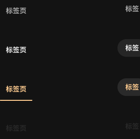

<!-- GEN:BEGIN 本段由 tools/gen-component-docs.py 依据 Figma 导出生成，勿手改；改 Figma 后重新生成 -->

## 概览

| 项 | 值 |
|---|---|
| Figma 组件集 | `Tabs`（node `56064:6651`） |
| 分类 | 导航类 |
| 变体数 | 8 |
| 默认变体 | `Type=line, State=default` |
| 参考尺寸 | 66×44 px（默认变体） |
| 主题 | 主库（深色中性 + 品牌砂色） |
| 预览图 | [assets/previews/tabs.png](../../assets/previews/tabs.png) |
| 代码实现 | [`components/Tabs/Tabs.tsx`](../../components/Tabs/Tabs.tsx) |
| Figma 链接 | [在 Figma 打开](https://www.figma.com/design/ZO4WH3sbVCj7lZIFMpiwV9/VibeMe-App---Web-Design-%E5%A4%87%E4%BB%BD?node-id=56064-6651) |



## 变体与属性

| Figma 属性 | 类型 | 取值 | 默认 | 代码 prop |
|---|---|---|---|---|
| `Type` | VARIANT | `line` / `pill` | `line` | `type` |
| `State` | VARIANT | `default` / `hover` / `selected` / `disabled` | `default` | `state` |

变体是属性轴的笛卡尔积：**8 = 2 × 4**（`Type` × `State`）。

## 各变体的事实

> 填充栈按 Figma 图层顺序排列（**靠右的是上层**，hover/pressed 的叠加层在最后）。
> `⚠无cssVar` 表示该组件引用了历史遗留变量，代码里不要照抄，按 `foundations.md` 的规则换成语义 token。

| 变体 | 尺寸 | 填充栈 | 描边 | 圆角 | 内边距 上/右/下/左 | 不透明度 |
|---|---|---|---|---|---|---|
| `Type=line, State=default` | 66×44 | — | — | — | 0/0/0/0 | — |
| `Type=line, State=hover` | 66×44 | — | — | — | 0/0/0/0 | — |
| `Type=line, State=selected` | 66×46 | — | — | — | 0/0/0/0 | — |
| `Type=line, State=disabled` | 66×44 | — | — | — | 0/0/0/0 | 0.38 |
| `Type=pill, State=default` | 60×36 | — | — | — | 0/0/0/0 | — |
| `Type=pill, State=hover` | 60×36 | — | — | — | 0/0/0/0 | — |
| `Type=pill, State=selected` | 60×36 | — | — | — | 0/0/0/0 | — |
| `Type=pill, State=disabled` | 60×36 | — | — | — | 0/0/0/0 | 0.38 |

## 结构（默认变体）

### Type=line, State=default

```text
`COMPONENT` Type=line, State=default 66×44 VERTICAL gap 0 pad 0/0/0/0
└─ `FRAME` Frame 66×44 HORIZONTAL gap 0 pad 12/12/12/12
  └─ `TEXT` 标签页 42×20 填充 `Text/Text-Secondary` #FFFFFF 64% `--vm-text-secondary` 文字样式 `Heading/S`（14 SemiBold /20） 内容 '标签页'
```

### Type=line, State=selected

```text
`COMPONENT` Type=line, State=selected 66×46 VERTICAL gap 0 pad 0/0/0/0
└─ `FRAME` Frame 66×44 HORIZONTAL gap 0 pad 12/12/12/12
  └─ `TEXT` 标签页 42×20 填充 `Brand/Brand` #FFCC90 `--vm-brand` 文字样式 `Heading/S`（14 SemiBold /20） 内容 '标签页'
└─ `FRAME` Frame 66×2 填充 `Brand/Brand` #FFCC90 `--vm-brand` 圆角 999
```


## 设计 token

| Figma 变量 | CSS 变量 | 值 |
|---|---|---|
| `Brand/Brand` | `--vm-brand` | `#FFCC90` |
| `Radious/radius-full` | `--vm-radius-full` | `999px` |
| `Text/Text-Secondary` | `--vm-text-secondary` | `rgba(255, 255, 255, 0.64)` |
| `opacity/disabled` | `--vm-opacity-disabled` | `0.38` |
| `space/space-3` | `--vm-space-3` | `12px` |

<!-- GEN:END -->


## 交互与状态

上面生成表里的「代码 prop = `state`」**只是索引里的机械映射，实际实现里没有 `state` 这个 prop**：四档 `State` 按 `foundations.md` §1.5 拆成两类，`default` / `hover` 用 CSS 伪类，`selected` / `disabled` 才是 prop。

| Figma State | 代码里由什么触发 | 视觉上变了什么 |
|---|---|---|
| `default` | 无 | 文字 `--vm-text-secondary`（`Text/Text-Secondary` 64% 白）；`line` 与 `pill` 都**没有底色** |
| `hover` | CSS `:hover:not(:disabled)` | `line`：文字换成 `--vm-text-primary`（`Text/Text-Primary` 92% 白），**不加任何底色**；`pill`：底色换成 `--vm-surface-hover`（`Background/Surface-hover` #262626）＋文字换成 `--vm-text-primary` |
| `selected` | prop `selected`（同步写 `aria-selected`） | `line`：文字换成 `--vm-brand`（`Brand/Brand` #FFCC90）＋底部 2px 品牌色指示条（`--vm-radius-full` 圆头）；`pill`：底色换成 `--vm-surface-selected`（`Background/Surface-selected` #2A2A2A）＋文字换成 `--vm-brand` |
| `disabled` | 原生 `disabled` | 只加 `opacity: var(--vm-opacity-disabled)`（`opacity/disabled` 0.38）＋ `cursor: not-allowed`，不换底色、不换文字色 |

hover 属于**前景/底色换 token** 那一族（和 Input / Search / Select 一样），**不是** Button 的白色叠加层手法：`tabs.variants.json` 里 8 个变体的顶层都没有任何填充栈，颜色变化全部发生在子节点上（`line` 改文字色、`pill` 换实体底色）。

几何：`line` 高 44px（12 上下内边距 `--vm-space-3` ＋ 20 行高），`pill` 高 36px（8 / 16 内边距 `--vm-space-2`、`--vm-space-4` ＋ 20 行高）。注意 Figma 的 `Type=line, State=selected` 变体是 **66×46**，比 default 高 2px（指示条另起一层，见结构段）；代码里指示条用 `::after` 绝对定位贴在底边，容器高度保持 44px，这样切换选中项时整行不会跳动。

Figma 没有 `focus` 变体，代码按无障碍底线补了 `:focus-visible` 的 `--vm-focus-ring-width`（2px）`--vm-border-selected` 焦点环。也没有「hover ＋ selected」组合变体，CSS 里 `selected` 规则写在 `hover` 之后，选中态优先。

## 代码用法

```tsx
import { useState } from 'react';
import { Tabs } from '../components/Tabs';

const ITEMS = [
  { value: 'all', label: '全部' },
  { value: 'draft', label: '草稿' },
  { value: 'done', label: '已完成' },
];

export function Example() {
  const [active, setActive] = useState('all');

  return (
    <>
      {/* line 型：自己包一层 role="tablist"，选中项 tabIndex=0，其余 -1（roving tabindex） */}
      <div role="tablist" aria-label="任务筛选" style={{ display: 'flex' }}>
        {ITEMS.map((it) => (
          <Tabs
            key={it.value}
            selected={active === it.value}
            onClick={() => setActive(it.value)}
            tabIndex={active === it.value ? 0 : -1}
            id={`tab-${it.value}`}
            aria-controls={`panel-${it.value}`}
          >
            {it.label}
          </Tabs>
        ))}
      </div>

      {/* pill 型：同一组数据只换样式 */}
      <div role="tablist" aria-label="视图切换" style={{ display: 'flex', gap: 'var(--vm-space-2)' }}>
        <Tabs type="pill" selected={active === 'all'} onClick={() => setActive('all')}>
          全部
        </Tabs>
        <Tabs type="pill" selected={active === 'draft'} onClick={() => setActive('draft')}>
          草稿
        </Tabs>
        <Tabs type="pill" disabled>
          已完成
        </Tabs>
      </div>

      <div role="tabpanel" id="panel-all" aria-labelledby="tab-all">
        …面板内容
      </div>
    </>
  );
}
```

CSS 引入方式：组件内部已 `import './Tabs.css'`，调用方只需 `import { Tabs } from '../components/Tabs'`（或从桶文件 `import { Tabs } from '../components'`，桶文件会连 `tokens.css` 一起加载）。
标签文字走 `.vm-type-heading-s`（Figma 的 `Heading/S` = Poppins SemiBold 14/20），不要在外面再套一层字号样式。原生 `type`（submit / reset / button）已从 props 里剔除，组件内部固定 `type="button"`，放进表单里不会误提交。

## 可访问性

- 根节点是真的 `<button type="button">`，带 `role="tab"`（不是把 `div` 样式化成标签页），`Enter` / `Space` 激活、焦点行为、`disabled` 全部沿用原生按钮语义。
- `aria-selected` **始终输出**（`true` / `false`）：`role="tab"` 要求该属性存在；选中态不要只靠品牌色表达。
- 调用方负责 `role="tablist"` 容器：给它 `aria-label`（或 `aria-labelledby`）说明这组标签是什么；面板用 `role="tabpanel"` ＋ `aria-labelledby` 指回对应的 tab。组件只画一个标签项，不管理选中索引。
- 键盘：`Tab` 进入 tablist、`Enter` / `Space` 激活由浏览器完成；左右方向键切换标签需要调用方在 tablist 上实现，并用 roving tabindex（选中项 `tabIndex={0}`，其余 `-1`）保证整组只占一个 Tab 位。
- `disabled` 用原生属性，会同时移出 Tab 序列；如果产品要求「可见、可聚焦、但不生效」（例如需要提示为什么不能点），请由调用方改用 `aria-disabled` 并自行拦截 `onClick`，注意此时 `:disabled` 样式不会生效。
- 焦点可见：`:focus-visible` 给 2px `--vm-border-selected` 环（`--vm-focus-ring-width`），`pill` 因为 `--vm-radius-full` 会得到圆角焦点环，`line` 是矩形环，都没有 `outline: none` 了事。
- 触控目标：`line` 高 44px，达标；`pill` 高 36px，小于 44px，移动端请靠外层容器给足间距或改用 `line`。
- 对比度：默认文字 `--vm-text-secondary`（64% 白）＋ 选中 `--vm-brand`（#FFCC90）在 `--vm-bg-app` / `--vm-bg-card` 深底上都可读；`pill` 的底色 `--vm-surface-hover` #262626 / `--vm-surface-selected` #2A2A2A 与页面底 `--vm-bg-app` 是刻意的浅一档，不要为了「更明显」加深它。

## 不要这样做

1. **不要把 `State` 做成 prop**。`<Tabs state="hover" />` 会和真实鼠标状态打架；`hover` 交给 CSS `:hover`，只保留 `selected` 与原生 `disabled`。同样不要给 `line` 型补一个「pressed」态——Figma 只有 4 档 State，没有按下变体。
2. **不要套用 Button 的 hover 叠加层**。Tabs 是前景/底色换 token 一族：`line` hover 只把文字换成 `--vm-text-primary`（**不叠** `--vm-white-7`），`pill` hover 是把底色换成实体 token `--vm-surface-hover`（不是 `--vm-white-7` 的 8% 白叠加）。
3. **不要给 disabled 再换一次文字色**。Figma 的 `State=disabled` 变体除了根节点 `opacity/disabled`（0.38），还把文字 fill 换成了 `Text/Text-Disable`（`--vm-text-disable` 24% 白）；两者叠起来只剩约 9% 白，既低于可读底线，也违反 `foundations.md`「disabled 只降不透明度、不换文字色」的硬规则。代码只保留 `opacity: var(--vm-opacity-disabled)`。
4. **不要用 `border-bottom` 做 `line` 的选中指示条**。那会让选中的标签项比其它项高 2px（Figma 的 selected 变体确实是 46px），整行会跳；用 `::after` 绝对定位贴底边，容器保持 44px。
5. **不要在组件内维护选中索引**。一次只渲染一个标签项，`selected` 由调用方受控传入；用内置的「全局 active」状态会让同一页面的两组 Tabs 互相串台。
6. **不要写死颜色和圆角**。`#262626`、`#2A2A2A`、`#FFCC90`、`999px` 必须走 `--vm-surface-hover`、`--vm-surface-selected`、`--vm-brand`、`--vm-radius-full`；`pill` 的 2px 指示条高度用 `--vm-border-width-thick`。
7. **不要用 `div` 或 `<a>` 伪装标签页**。没有原生按钮就没法用键盘激活；`<a>` 还会被读屏当成跳转链接。

## 相关组件

- **Breadcrumb / Pagination / MenuItem**：同属导航类，但语义不同——Breadcrumb 表示层级位置，Pagination 表示分页，MenuItem 是浮层里的可选项；它们和 Tabs 不要互换使用。
- **Steps**：表示流程的完成进度（有先后依赖），Tabs 表示同层视图切换（无依赖）；用 Steps 的地方不要塞 Tabs。
- **Card / Table / Empty**：`role="tabpanel"` 的常见内容；面板里放 `Table` 或 `Empty` 时，Tabs 只负责切换，不负责加载状态。
- **Badge**：标签项带数量或「NEW」时，把 Badge 放进 `children` 里（标签文字仍是 `.vm-type-heading-s`），不要另造一个带角标的 `type`。
- **Dropdown / MenuItem**：窄屏把标签组收进下拉时，用 Dropdown ＋ MenuItem 表达，别把 Tabs 做成可横向滚动的一行。
- **Divider**：`line` 型标签常配一条分隔线，注意 Figma 的 `line` 选中态自带 2px 品牌色指示条，不要再叠一条 Divider 造成双线。
- **Container / Stack**：横向排列一组标签时用 Stack 控制 `--vm-space-*` 间距，Tabs 自身只管单项尺寸。
