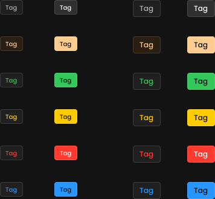

<!-- GEN:BEGIN 本段由 tools/gen-component-docs.py 依据 Figma 导出生成，勿手改；改 Figma 后重新生成 -->

## 概览

| 项 | 值 |
|---|---|
| Figma 组件集 | `Tag`（node `56061:6404`） |
| 分类 | 展示类 |
| 变体数 | 24 |
| 默认变体 | `Tone=neutral, Size=sm, Style=soft` |
| 参考尺寸 | 38×24 px（默认变体） |
| 主题 | 主库（深色中性 + 品牌砂色） |
| 预览图 | [assets/previews/tag.png](../../assets/previews/tag.png) |
| 代码实现 | [`components/Tag/Tag.tsx`](../../components/Tag/Tag.tsx) |
| Figma 链接 | [在 Figma 打开](https://www.figma.com/design/ZO4WH3sbVCj7lZIFMpiwV9/VibeMe-App---Web-Design-%E5%A4%87%E4%BB%BD?node-id=56061-6404) |



## 变体与属性

| Figma 属性 | 类型 | 取值 | 默认 | 代码 prop |
|---|---|---|---|---|
| `label` | TEXT（内容插槽） | — | — | `children` |
| `Tone` | VARIANT | `neutral` / `brand` / `success` / `warning` / `error` / `info` | `neutral` | `tone` |
| `Size` | VARIANT | `sm` / `md` | `sm` | `size` |
| `Style` | VARIANT | `soft` / `solid` | `soft` | `style` |

变体是属性轴的笛卡尔积：**24 = 6 × 2 × 2**（`Tone` × `Size` × `Style`）。

## 各变体的事实

> 填充栈按 Figma 图层顺序排列（**靠右的是上层**，hover/pressed 的叠加层在最后）。
> `⚠无cssVar` 表示该组件引用了历史遗留变量，代码里不要照抄，按 `foundations.md` 的规则换成语义 token。

| 变体 | 尺寸 | 填充栈 | 描边 | 圆角 | 内边距 上/右/下/左 | 不透明度 |
|---|---|---|---|---|---|---|
| `Tone=neutral, Size=sm, Style=soft` | 38×24 | `Background/bg-card` #202020 `--vm-bg-card` | `Background/border-default` #FFFFFF 12% `--vm-border-default` | 4 | 4/8/4/8 | — |
| `Tone=neutral, Size=sm, Style=solid` | 38×24 | `Neutral/Neutral-600` #303030 `--vm-neutral-600` | `Background/border-default` #FFFFFF 12% `--vm-border-default` | 4 | 4/8/4/8 | — |
| `Tone=neutral, Size=md, Style=soft` | 46×28 | `Background/bg-card` #202020 `--vm-bg-card` | `Background/border-default` #FFFFFF 12% `--vm-border-default` | 4 | 4/10/4/10 | — |
| `Tone=neutral, Size=md, Style=solid` | 46×28 | `Neutral/Neutral-600` #303030 `--vm-neutral-600` | `Background/border-default` #FFFFFF 12% `--vm-border-default` | 4 | 4/10/4/10 | — |
| `Tone=brand, Size=sm, Style=soft` | 38×24 | `Brand/Brand-950` #2B1F12 `--vm-brand-950` | `Background/border-default` #FFFFFF 12% `--vm-border-default` | 4 | 4/8/4/8 | — |
| `Tone=brand, Size=sm, Style=solid` | 38×24 | `Brand/Brand` #FFCC90 `--vm-brand` | `Background/border-default` #FFFFFF 12% `--vm-border-default` | 4 | 4/8/4/8 | — |
| `Tone=brand, Size=md, Style=soft` | 46×28 | `Brand/Brand-950` #2B1F12 `--vm-brand-950` | `Background/border-default` #FFFFFF 12% `--vm-border-default` | 4 | 4/10/4/10 | — |
| `Tone=brand, Size=md, Style=solid` | 46×28 | `Brand/Brand` #FFCC90 `--vm-brand` | `Background/border-default` #FFFFFF 12% `--vm-border-default` | 4 | 4/10/4/10 | — |
| `Tone=success, Size=sm, Style=soft` | 38×24 | `Background/bg-card` #202020 `--vm-bg-card` | `Background/border-default` #FFFFFF 12% `--vm-border-default` | 4 | 4/8/4/8 | — |
| `Tone=success, Size=sm, Style=solid` | 38×24 | `状态色/Success` #34C759 `--vm-status-success` | `Background/border-default` #FFFFFF 12% `--vm-border-default` | 4 | 4/8/4/8 | — |
| `Tone=success, Size=md, Style=soft` | 46×28 | `Background/bg-card` #202020 `--vm-bg-card` | `Background/border-default` #FFFFFF 12% `--vm-border-default` | 4 | 4/10/4/10 | — |
| `Tone=success, Size=md, Style=solid` | 46×28 | `状态色/Success` #34C759 `--vm-status-success` | `Background/border-default` #FFFFFF 12% `--vm-border-default` | 4 | 4/10/4/10 | — |
| `Tone=warning, Size=sm, Style=soft` | 38×24 | `Background/bg-card` #202020 `--vm-bg-card` | `Background/border-default` #FFFFFF 12% `--vm-border-default` | 4 | 4/8/4/8 | — |
| `Tone=warning, Size=sm, Style=solid` | 38×24 | `状态色/Warning` #FFCC00 `--vm-status-warning` | `Background/border-default` #FFFFFF 12% `--vm-border-default` | 4 | 4/8/4/8 | — |
| `Tone=warning, Size=md, Style=soft` | 46×28 | `Background/bg-card` #202020 `--vm-bg-card` | `Background/border-default` #FFFFFF 12% `--vm-border-default` | 4 | 4/10/4/10 | — |
| `Tone=warning, Size=md, Style=solid` | 46×28 | `状态色/Warning` #FFCC00 `--vm-status-warning` | `Background/border-default` #FFFFFF 12% `--vm-border-default` | 4 | 4/10/4/10 | — |
| `Tone=error, Size=sm, Style=soft` | 38×24 | `Background/bg-card` #202020 `--vm-bg-card` | `Background/border-default` #FFFFFF 12% `--vm-border-default` | 4 | 4/8/4/8 | — |
| `Tone=error, Size=sm, Style=solid` | 38×24 | `状态色/Error` #FF3B30 `--vm-status-error` | `Background/border-default` #FFFFFF 12% `--vm-border-default` | 4 | 4/8/4/8 | — |
| `Tone=error, Size=md, Style=soft` | 46×28 | `Background/bg-card` #202020 `--vm-bg-card` | `Background/border-default` #FFFFFF 12% `--vm-border-default` | 4 | 4/10/4/10 | — |
| `Tone=error, Size=md, Style=solid` | 46×28 | `状态色/Error` #FF3B30 `--vm-status-error` | `Background/border-default` #FFFFFF 12% `--vm-border-default` | 4 | 4/10/4/10 | — |
| `Tone=info, Size=sm, Style=soft` | 38×24 | `Background/bg-card` #202020 `--vm-bg-card` | `Background/border-default` #FFFFFF 12% `--vm-border-default` | 4 | 4/8/4/8 | — |
| `Tone=info, Size=sm, Style=solid` | 38×24 | `状态色/Info` #2797FF `--vm-status-info` | `Background/border-default` #FFFFFF 12% `--vm-border-default` | 4 | 4/8/4/8 | — |
| `Tone=info, Size=md, Style=soft` | 46×28 | `Background/bg-card` #202020 `--vm-bg-card` | `Background/border-default` #FFFFFF 12% `--vm-border-default` | 4 | 4/10/4/10 | — |
| `Tone=info, Size=md, Style=solid` | 46×28 | `状态色/Info` #2797FF `--vm-status-info` | `Background/border-default` #FFFFFF 12% `--vm-border-default` | 4 | 4/10/4/10 | — |

## 结构（默认变体）

### Tone=neutral, Size=sm, Style=soft

```text
`COMPONENT` Tone=neutral, Size=sm, Style=soft 38×24 HORIZONTAL gap 4 pad 4/8/4/8 填充 `Background/bg-card` #202020 `--vm-bg-card` 描边 `Background/border-default` #FFFFFF 12% `--vm-border-default` 圆角 4
└─ `TEXT` Tag 20×14 填充 `Text/Text-Secondary` #FFFFFF 64% `--vm-text-secondary` 文字样式 `Caption/Label`（10 Medium /14） 内容 'Tag'
```

### Tone=brand, Size=md, Style=solid

```text
`COMPONENT` Tone=brand, Size=md, Style=solid 46×28 HORIZONTAL gap 4 pad 4/10/4/10 填充 `Brand/Brand` #FFCC90 `--vm-brand` 描边 `Background/border-default` #FFFFFF 12% `--vm-border-default` 圆角 4
└─ `TEXT` Tag 24×18 填充 `Neutral/Neutral-950` #0E0E0E `--vm-neutral-950` 文字样式 `Caption/Caption`（12 Medium /18） 内容 'Tag'
```


## 设计 token

| Figma 变量 | CSS 变量 | 值 |
|---|---|---|
| `Background/bg-card` | `--vm-bg-card` | `#202020` |
| `Background/border-default` | `--vm-border-default` | `rgba(255, 255, 255, 0.12)` |
| `Brand/Brand` | `--vm-brand` | `#FFCC90` |
| `Brand/Brand-950` | `--vm-brand-950` | `#2B1F12` |
| `Neutral/Neutral-600` | `--vm-neutral-600` | `#303030` |
| `Neutral/Neutral-950` | `--vm-neutral-950` | `#0E0E0E` |
| `Semantic Radius/radius-badge` | `--vm-radius-badge` | `4px` |
| `Semantic Space/padding-badge-x` | `--vm-padding-badge-x` | `10px` |
| `Semantic Space/padding-badge-y` | `--vm-padding-badge-y` | `4px` |
| `Text/Text-Secondary` | `--vm-text-secondary` | `rgba(255, 255, 255, 0.64)` |
| `border/width/thin` | `--vm-border-width-thin` | `1px` |
| `space/space-1` | `--vm-space-1` | `4px` |
| `space/space-2` | `--vm-space-2` | `8px` |
| `状态色/Error` | `--vm-status-error` | `#FF3B30` |
| `状态色/Info` | `--vm-status-info` | `#2797FF` |
| `状态色/Success` | `--vm-status-success` | `#34C759` |
| `状态色/Warning` | `--vm-status-warning` | `#FFCC00` |

<!-- GEN:END -->

## 交互与状态

**Tag 没有 `State` 轴**：Figma 的 24 个变体全部由 `Tone` × `Size` × `Style` 组成，没有 hover / pressed /
focus / disabled / error 任何一档。所以代码里 `Tag` 是**纯展示的 `<span>`**，不写任何 `:hover` / `:active` 伪类，
也不接受 `onClick` 这类交互相关的东西——需要可点击的「标签」请用 Button 或 Dropdown 里的 MenuItem。

真正的「状态」是 `tone` × `style` 决定的**底色 + 文字色**（下表是 Figma 逐变体导出的绑定，不是推导值）：

| tone | `style="soft"` 底色 / 文字 | `style="solid"` 底色 / 文字 |
|---|---|---|
| `neutral` | `--vm-bg-card` #202020 ／ `--vm-text-secondary` | `--vm-neutral-600` #303030 ／ `--vm-white-0` |
| `brand` | `--vm-brand-950` #2B1F12 ／ `--vm-brand` #FFCC90 | `--vm-brand` #FFCC90 ／ `--vm-neutral-950` |
| `success` | `--vm-bg-card` ／ `--vm-status-success` #34C759 | `--vm-status-success` ／ `--vm-neutral-950` |
| `warning` | `--vm-bg-card` ／ `--vm-status-warning` #FFCC00 | `--vm-status-warning` ／ `--vm-neutral-950` |
| `error` | `--vm-bg-card` ／ `--vm-status-error` #FF3B30 | `--vm-status-error` ／ `--vm-white-0` |
| `info` | `--vm-bg-card` ／ `--vm-status-info` #2797FF | `--vm-status-info` ／ `--vm-neutral-950` |

注意两处「不对称」，都是 Figma 现状：**只有 `brand` 的 soft 有带色调的底**（`Brand/Brand-950`），
其余 4 个语义色的 soft 底色就是 `--vm-bg-card`；**solid 里只有 `error` 与 `neutral` 用白字**，
`brand` / `success` / `warning` / `info` 都用 `--vm-neutral-950` 深色字。

`size` 只改排版与内边距，不改颜色：`sm` 用 `.vm-type-caption-label`（10 Medium /14）+
`--vm-space-1`/`--vm-space-2` 内边距，成高 24px；`md` 用 `.vm-type-caption-caption`（12 Medium /18）+
`--vm-padding-badge-y`/`--vm-padding-badge-x` 内边距，成高 28px。**24 个变体的描边完全相同**：
`--vm-border-width-thin`（1px）+ `--vm-border-default`（12% 白），solid 也不去描边。

## 代码用法

```tsx
import { Tag } from './components/Tag';

export function TagList() {
  return (
    <div style={{ display: 'flex', gap: 8, flexWrap: 'wrap' }}>
      <Tag>草稿</Tag>                                  {/* 等于 tone="neutral" size="sm" style="soft" */}
      <Tag tone="brand" style="solid">推荐</Tag>
      <Tag tone="success">已发布</Tag>
      <Tag tone="warning" size="md">待审核</Tag>
      <Tag tone="error" style="solid" size="md">已下架</Tag>
      <Tag tone="info">新</Tag>
    </div>
  );
}
```

`Tag` 的 props 只有 4 个：`tone`（默认 `neutral`）、`size`（默认 `sm`）、`style`（默认 `soft`）与内容插槽
`children`（对应 Figma 的 TEXT 属性 `label`，默认文案 `Tag`）。其余原生属性（`id`、`aria-*`、`title`…）
透传到 `<span>`，`className` 合并到 `.vm-tag`；样式随 `components/Tag/Tag.css` 一起引入。
⚠️ 因为 Figma 的 `Style` 轴占用了 `style` 这个 prop 名，**这里不再接受 React 的行内 `style`**——
需要挪位置请套一层容器。

## 可访问性

`Tag` 渲染成 `<span>`，本身没有角色，屏幕阅读器把它当普通文本朗读，这正是标签该有的语义——
**不要**给它加 `role="button"`（它不可点）或 `role="status"`（它不是实时区域）。颜色是唯一区分 `tone` 的视觉手段，
所以**不能只用 Tag 传达关键状态**：`<Tag tone="error">已下架</Tag>` 里的「已下架」三个字是必须的，
不能做成只有颜色的空标签；如果业务要求只用颜色，就得补 `aria-label` 或视觉隐藏的说明文本。
作为一组标签使用时（例如表格里的多标签单元格）外层请用 `ul` / `li` 或明确的分隔符，
不要让多个 `<span>` 挤在一起被读成一串词。`title` 只用于补充说明，**不要**把 Tag 的全部信息塞进 `title`——
触摸端和键盘用户看不到它。对比度以深色底为准：`--vm-brand` #FFCC90 配 `--vm-brand-950`、
`--vm-neutral-950` 深色字配 `--vm-status-success` / `--vm-status-warning` / `--vm-status-info`，
都是 Figma 里已经配好的组合，不要自行换色。

## 不要这样做

1. **不要给 Tag 加 `:hover` / `:active`**。Figma 里 Tag 根本没有这些状态；照 Button 的「底色 + `--vm-white-7`」
   叠加手法写 hover 是错的，照 Input 的描边换色也一样错——它就不是交互控件。
2. **不要以为 `soft` 都带色调**。`success` / `warning` / `error` / `info` 的 soft 底色就是 `--vm-bg-card`，
   和 `neutral soft` 一模一样，只有 `brand soft` 是 `--vm-brand-950`。自己给它们加淡色底＝发明设计。
3. **不要统一 solid 的文字色**。`error solid` 是 `--vm-white-0` 白字，而 `brand` / `success` / `warning` /
   `info` 的 solid 是 `--vm-neutral-950` 深字；用同一条规则处理会出现「浅底白字」这种不可读的组合。
4. **不要改圆角**。Tag 用 `--vm-radius-badge`（`Semantic Radius/radius-badge`，4px），
   不是按钮的 `--vm-radius-button`（12px），也不要写成 999 的胶囊——那是文件里另一个旧版胶囊按钮的做法。
5. **不要去掉 solid 的描边**。Figma 里 24 个变体全是 1px 的 `--vm-border-default`（12% 白），
   包括看起来「实心」的 solid 档；去掉它会让 Tag 在深色底上失去边界。
6. **不要手写字号**。`sm` / `md` 两档的文字分别绑 `Caption/Label` 与 `Caption/Caption`，
   对应 `.vm-type-caption-label` / `.vm-type-caption-caption`；两档不要共用同一个字号，也不要写 `font-size: 10px`。
7. **不要用 Tag 承载正文或长句**。它是单行标签（`white-space: nowrap`），长文案会把布局撑破；
   多行长文本请用 Body 类文字，Tag 只放 1–4 个字的短状态。

## 相关组件

- **Table**：表格的状态列是 Tag 最主要的落点，单元格里直接放 `<Tag tone="success">已发布</Tag>`；
  Table 自身不重画标签样式，用的是同一个 `Tag`。
- **Badge**：和 Tag 分工明确——Badge 是 `dot` / `count` 的极小徽标（6px 圆点、数字），
  **只有颜色没有文字**，靠贴在其他元素角上表达「有新消息」；Tag 是带文字的完整标签。别用 Badge 代替 Tag 显示状态名。
- **List / MenuItem**：列表项右侧的状态位通常放 Tag；MenuItem 需要「可点标签」时用 MenuItem 而不是给 Tag 加 onClick。
- **Input / Select**：表单里的多选值（如「已选标签」）在 Figma 里没有对应组件，
  若要用 Tag 拼，请把 Tag 放在 Input 外部的容器里，不要塞进 input 元素内部。
- **Toast**：`tone` 与 Toast 的状态色共用 `--vm-status-*` 这四个 token，视觉语言一致；
  但「操作成功」的瞬时反馈走 Toast，常驻状态才用 Tag。
