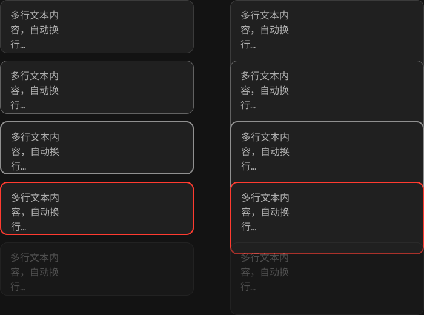

<!-- GEN:BEGIN 本段由 tools/gen-component-docs.py 依据 Figma 导出生成，勿手改；改 Figma 后重新生成 -->

## 概览

| 项 | 值 |
|---|---|
| Figma 组件集 | `Textarea`（node `56059:6287`） |
| 分类 | 表单控件 |
| 变体数 | 10 |
| 默认变体 | `Size=md, State=default` |
| 参考尺寸 | 320×88 px（默认变体） |
| 主题 | 主库（深色中性 + 品牌砂色） |
| 预览图 | [assets/previews/textarea.png](../../assets/previews/textarea.png) |
| 代码实现 | [`components/Textarea/Textarea.tsx`](../../components/Textarea/Textarea.tsx) |
| Figma 链接 | [在 Figma 打开](https://www.figma.com/design/ZO4WH3sbVCj7lZIFMpiwV9/VibeMe-App---Web-Design-%E5%A4%87%E4%BB%BD?node-id=56059-6287) |



## 变体与属性

| Figma 属性 | 类型 | 取值 | 默认 | 代码 prop |
|---|---|---|---|---|
| `placeholder` | TEXT（内容插槽） | — | — | `children` |
| `Size` | VARIANT | `md` / `lg` | `md` | `size` |
| `State` | VARIANT | `default` / `hover` / `focus` / `error` / `disabled` | `default` | `state` |

变体是属性轴的笛卡尔积：**10 = 2 × 5**（`Size` × `State`）。

## 各变体的事实

> 填充栈按 Figma 图层顺序排列（**靠右的是上层**，hover/pressed 的叠加层在最后）。
> `⚠无cssVar` 表示该组件引用了历史遗留变量，代码里不要照抄，按 `foundations.md` 的规则换成语义 token。

| 变体 | 尺寸 | 填充栈 | 描边 | 圆角 | 内边距 上/右/下/左 | 不透明度 |
|---|---|---|---|---|---|---|
| `Size=md, State=default` | 320×88 | `Background/bg-card` #202020 `--vm-bg-card` | `Background/border-default` #FFFFFF 12% `--vm-border-default` | 12 | 12/16/12/16 | — |
| `Size=md, State=hover` | 320×88 | `Background/bg-card` #202020 `--vm-bg-card` | `White/White-4` #FFFFFF 30% `--vm-white-4` | 12 | 12/16/12/16 | — |
| `Size=md, State=focus` | 320×88 | `Background/bg-card` #202020 `--vm-bg-card` | `Background/border-selected` #FFFFFF 50% `--vm-border-selected` | 12 | 12/16/12/16 | — |
| `Size=md, State=error` | 320×88 | `Background/bg-card` #202020 `--vm-bg-card` | `状态色/Error` #FF3B30 `--vm-status-error` | 12 | 12/16/12/16 | — |
| `Size=md, State=disabled` | 320×88 | `Background/bg-card` #202020 `--vm-bg-card` | `Background/border-default` #FFFFFF 12% `--vm-border-default` | 12 | 12/16/12/16 | 0.38 |
| `Size=lg, State=default` | 320×120 | `Background/bg-card` #202020 `--vm-bg-card` | `Background/border-default` #FFFFFF 12% `--vm-border-default` | 12 | 12/16/12/16 | — |
| `Size=lg, State=hover` | 320×120 | `Background/bg-card` #202020 `--vm-bg-card` | `White/White-4` #FFFFFF 30% `--vm-white-4` | 12 | 12/16/12/16 | — |
| `Size=lg, State=focus` | 320×120 | `Background/bg-card` #202020 `--vm-bg-card` | `Background/border-selected` #FFFFFF 50% `--vm-border-selected` | 12 | 12/16/12/16 | — |
| `Size=lg, State=error` | 320×120 | `Background/bg-card` #202020 `--vm-bg-card` | `状态色/Error` #FF3B30 `--vm-status-error` | 12 | 12/16/12/16 | — |
| `Size=lg, State=disabled` | 320×120 | `Background/bg-card` #202020 `--vm-bg-card` | `Background/border-default` #FFFFFF 12% `--vm-border-default` | 12 | 12/16/12/16 | 0.38 |

## 结构（默认变体）

### Size=md, State=default

```text
`COMPONENT` Size=md, State=default 320×88 VERTICAL gap 8 pad 12/16/12/16 填充 `Background/bg-card` #202020 `--vm-bg-card` 描边 `Background/border-default` #FFFFFF 12% `--vm-border-default` 圆角 12
└─ `TEXT` 多行文本内容，自动换行… 98×62 填充 `Text/Text-Secondary` #FFFFFF 64% `--vm-text-secondary` 文字样式 `Heading/Body/M/Regular`（16 Regular /24） 内容 '多行文本内容，自动换行…'
```

### Size=lg, State=error

```text
`COMPONENT` Size=lg, State=error 320×120 VERTICAL gap 8 pad 12/16/12/16 填充 `Background/bg-card` #202020 `--vm-bg-card` 描边 `状态色/Error` #FF3B30 `--vm-status-error` 圆角 12
└─ `TEXT` 多行文本内容，自动换行… 98×92 填充 `Text/Text-Secondary` #FFFFFF 64% `--vm-text-secondary` 文字样式 `Heading/Body/M/Regular`（16 Regular /24） 内容 '多行文本内容，自动换行…'
```


## 设计 token

| Figma 变量 | CSS 变量 | 值 |
|---|---|---|
| `Background/bg-card` | `--vm-bg-card` | `#202020` |
| `Background/border-default` | `--vm-border-default` | `rgba(255, 255, 255, 0.12)` |
| `Background/border-selected` | `--vm-border-selected` | `rgba(255, 255, 255, 0.5)` |
| `Semantic Radius/radius-input` | `--vm-radius-input` | `12px` |
| `Semantic Space/padding-input-x` | `--vm-padding-input-x` | `16px` |
| `Text/Text-Secondary` | `--vm-text-secondary` | `rgba(255, 255, 255, 0.64)` |
| `White/White-4` | `--vm-white-4` | `rgba(255, 255, 255, 0.3)` |
| `border/width/thick` | `--vm-border-width-thick` | `2px` |
| `border/width/thin` | `--vm-border-width-thin` | `1px` |
| `focus/ring-width` | `--vm-focus-ring-width` | `2px` |
| `opacity/disabled` | `--vm-opacity-disabled` | `0.38` |
| `space/space-2` | `--vm-space-2` | `8px` |
| `space/space-3` | `--vm-space-3` | `12px` |
| `状态色/Error` | `--vm-status-error` | `#FF3B30` |

<!-- GEN:END -->


## 交互与状态

五档 `State` 在代码里拆成两类，**不要把 `State` 原样做成 prop**：

| Figma State | 代码触发方式 | 视觉上变了什么 |
|---|---|---|
| `default` | 无 | 底色 `--vm-bg-card`（`Background/bg-card` #202020）＋ 1px 描边 `--vm-border-default`（`Background/border-default` 12% 白） |
| `hover` | CSS `:hover:not(:disabled)` | **只换描边的实体值**：`--vm-border-default` → `--vm-white-4`（`White/White-4`，30% 白）。底色没有任何叠加层 |
| `focus` | CSS `:focus-visible` | 描边换成 `--vm-border-selected`（`Background/border-selected` 50% 白），线宽 1px → `--vm-border-width-thick`（`border/width/thick` 2px），再叠 `--vm-focus-ring-width`（`focus/ring-width` 2px）的 ring |
| `error` | prop `error` | 描边换成 `--vm-status-error`（`状态色/Error` #FF3B30），线宽 2px；再传 `errorMessage` 时字段下方多一行 `role="alert"` 的红色说明 |
| `disabled` | 原生 `disabled` | 只有 `opacity: var(--vm-opacity-disabled)`（`opacity/disabled` 0.38）＋ `cursor: not-allowed`；描边、底色、文字色一个都不换 |

`Size` 两档只影响高度，**不影响任何状态的颜色**：`md` 320×88、`lg` 320×120（Figma 里两档都是 FIXED），
两档的内边距都是上/下 12、左/右 16，圆角都是 12。Figma 的 VERTICAL auto layout gap 是 8（`space/space-2`），
落地成包裹层 `.vm-textarea` 的 `flex` gap，即字段与错误说明之间的距离。过渡统一 `--vm-duration-fast`（100ms）。

⚠️ 与 Button 的差异（同一设计体系里两种 hover 手法，别互相套）：Button 的 `hover` 是在底色之上追加一层
`--vm-white-7`（8% 白叠加），而 Textarea 的 `hover` 是**把描边换成更实的白**（`--vm-white-4`），没有叠加层——
`textarea.variants.json` 里 hover 变体的 `fills` 只有一条 `Background/bg-card`，与 `default` 完全相同。
键盘聚焦时浏览器可能同时命中 `:hover`，CSS 顺序把 `:focus-visible` 写在 `:hover` 之后，聚焦的 2px 描边才不被 hover 覆盖。

## 代码用法

```tsx
import { useState } from 'react';
import { Textarea } from '../components/Textarea';

export function Example() {
  const [bio, setBio] = useState('');
  const tooLong = bio.length > 20;

  return (
    <>
      {/* 受控 + 错误态（应用态才是 prop）；错误文案经 aria-describedby 挂到控件上 */}
      <Textarea
        size="md"
        placeholder="介绍一下你自己"
        value={bio}
        onChange={(e) => setBio(e.target.value)}
        error={tooLong}
        errorMessage="最多 20 个字"
        aria-label="个人简介"
      />

      {/* 非受控：只给 defaultValue，其余交给原生属性（rows / maxLength / required 都从 ...rest 透传） */}
      <Textarea size="lg" defaultValue="VibeMe" placeholder="项目说明" rows={4} maxLength={200} />

      {/* 禁用态走原生 disabled */}
      <Textarea size="md" placeholder="不可编辑" disabled />

      {/* 需要 label 时，把 id 传进来再用 htmlFor 关联（组件不传 id 时自己生成一个） */}
      <label htmlFor="note">备注</label>
      <Textarea id="note" placeholder="选填" />
    </>
  );
}
```

CSS 引入方式：`import '../components/Textarea/Textarea.css'`（或整包 `import '../components/index'`，桶文件已
`import './tokens.css'`，token 与 `.vm-type-*` 工具类会一起加载）。组件**不锁宽**——给了 Figma 参考宽 `width: 320px`，
表单里用外层容器或内联 `style` 覆盖即可；高度用 `min-height`（md 88 / lg 120）起步，并保留 `resize: vertical`
让用户纵向拉伸（Figma 的静态稿没有 resize 手柄，这是实现增补）。`children` **不是**提示文本入口，
`Placeholder` 内容请用原生 `placeholder`。

## 可访问性

- 语义元素是真的 `<textarea>`（不是 `div` 假输入框，也没有隐藏的原生控件），外层 `div` 只承担排版与错误说明。
- 键盘行为完全交给浏览器：`Tab` 进入/离开，`Enter` 换行、`Ctrl/Cmd+Enter` 提交由表单层决定，文本选择、
  `Home`/`End`、`Shift+方向键` 都保持原生语义；控件自身不注册任何 `onKeyDown` 拦截。
- 错误态：`error` 会落到原生 `aria-invalid`（只在错误时输出该属性，不写 `aria-invalid="false"`）；
  `errorMessage` 渲染的 `<p role="alert">` 经 `aria-describedby` 自动关联，调用方自己传的 `aria-describedby`
  会被**拼接**而不是覆盖。`errorMessage` 来自可访问性要求（foundations §8），Figma 的 `State=error` 树里并没有这个节点。
- 焦点可见：`:focus-visible` 给 2px `--vm-border-selected` 描边 ＋ `--vm-focus-ring-width` 的 ring，
  **没有** `outline: none` 了事（`outline: none` 只在同一规则里用 ring 替代）。
- 对比度：placeholder 文本用 `--vm-text-secondary`（`Text/Text-Secondary` 64% 白，在 `--vm-bg-card` 上约 8:1），
  已输入文字用 `--vm-text-primary`（92% 白）；错误说明文字用 `--vm-status-error`，且状态不单靠颜色——文字本身在说哪里错了。
- 触控目标：`md` 视觉高 88px、`lg` 120px，都远超 40px；但**必须有 label**：持久可见的 `<label htmlFor>` 或 `aria-label`，
  不要只靠 placeholder 当标签（输入后提示文案就消失了）。

## 不要这样做

1. **不要把 `State` 做成 prop**。`hover` / `focus` 交给 `:hover` / `:focus-visible`；只保留 `error` 与原生 `disabled`。
   `<Textarea state="focus" />` 在真实浏览器里会和鼠标/键盘状态打架。
2. **hover 不要照抄 Button 的叠加层**。`--vm-white-7`（8% 白叠加）是 Button 一族的手法；Textarea 的 hover 是
   描边换成 `--vm-white-4`（30% 白）。在 `--vm-bg-card` 上再叠一层白会让底色变亮，与 `textarea.variants.json` 不符。
3. **不要把 `--vm-white-4` 当背景色用**。它在 tokens 里同时是 `Text/Text-Tertiary` 的解析值（30% 白），
   本组件只把它当**描边**；拿它填底会得到一个几乎看不见的灰块。
4. **不要用旧版胶囊按钮的思路改圆角**。文件里另有一个圆角 999、蓝底、MiSans 的历史遗留胶囊按钮组件；
   Textarea 的圆角是 `--vm-radius-input`（12px），两档都不变，不要写成 `--vm-radius-avatar`。
5. **不要手写字号/行高，也不要套用 Input 的高度**。Textarea 两档文字都是 `Heading/Body/M/Regular`（16/24，
   `.vm-type-heading-body-m-regular`）；但 `md` 这里是 **88 高**，不是 Input 的 `md`（40 高）——两者只是宽度同为 320、
   共用描边与圆角 token，高度刻度完全不同，不要互相套。
6. **不要给 Textarea 加 Figma 里没有的东西**：`Size=lg, State=error` 的树里只有一个 placeholder 文本节点，
   没有计数器、没有清除按钮、没有图标、没有错误文案节点；`children` 也不是文案入口（多行控件里没有可渲染的文本子节点）。
7. **不要重复显示错误文案**。`errorMessage` 已经渲染了 `role="alert"` 的说明；表单层如果也有错误文本，二者只能出现一个。

## 相关组件

- **Input**：单行兄弟组件，同为 320 宽、共用 `--vm-bg-card` / `--vm-border-default` / `--vm-white-4` / `--vm-radius-input`。
  Figma 里两者是独立组件集，多行场景直接用 `Textarea`；并排时对齐**宽度**（320），不要强行对齐高度（Input md 40 vs Textarea md 88）。
- **Search / Select**：同宽 320 的表单控件，一行里混排时保持 320 宽与一致描边；Search 内含 `search-line` 图标，Textarea 不含图标。
- **Upload**：拖拽区里嵌了只读 Input 显示文件名，属于「Upload 内嵌 Input」；说明性多行文字仍用 Textarea。
- **Form / FormItem**：由它们提供持久 label、必填标记与错误汇总；此时 `errorMessage` 只保留字段自己的即时提示，避免与表单级文案重复。
- **Modal / Drawer**：反馈表单里常把 Textarea 放在弹窗/抽屉内容区，宽度交给容器（覆盖默认 320），不要把 `md` 的 88 高当成内容区高度。
- **VibeMe AI / Prompt Field**：另一套 token（紫粉、`--vm-ai-*`）的多行输入区，**不要**与主库的 Textarea 混用变量值。
