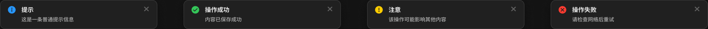

<!-- GEN:BEGIN 本段由 tools/gen-component-docs.py 依据 Figma 导出生成，勿手改；改 Figma 后重新生成 -->

## 概览

| 项 | 值 |
|---|---|
| Figma 组件集 | `Toast`（node `56063:6596`） |
| 分类 | 反馈类 |
| 变体数 | 4 |
| 默认变体 | `Type=info` |
| 参考尺寸 | 360×68 px（默认变体） |
| 主题 | 主库（深色中性 + 品牌砂色） |
| 预览图 | [assets/previews/toast.png](../../assets/previews/toast.png) |
| 代码实现 | [`components/Toast/Toast.tsx`](../../components/Toast/Toast.tsx) |
| Figma 链接 | [在 Figma 打开](https://www.figma.com/design/ZO4WH3sbVCj7lZIFMpiwV9/VibeMe-App---Web-Design-%E5%A4%87%E4%BB%BD?node-id=56063-6596) |



## 变体与属性

| Figma 属性 | 类型 | 取值 | 默认 | 代码 prop |
|---|---|---|---|---|
| `Type` | VARIANT | `info` / `success` / `warning` / `error` | `info` | `type` |

变体是属性轴的笛卡尔积：**4 = 4**（`Type`）。

内嵌组件：`Property 1=circle-alert-filled`×1、`Property 1=circle-check-filled`×1、`Property 1=circle-cross-filled`×1、`Property 1=circle-info-filled`×1、`Property 1=cross_filled`×4

## 各变体的事实

> 填充栈按 Figma 图层顺序排列（**靠右的是上层**，hover/pressed 的叠加层在最后）。
> `⚠无cssVar` 表示该组件引用了历史遗留变量，代码里不要照抄，按 `foundations.md` 的规则换成语义 token。

| 变体 | 尺寸 | 填充栈 | 描边 | 圆角 | 内边距 上/右/下/左 | 不透明度 |
|---|---|---|---|---|---|---|
| `Type=info` | 360×68 | `Background/bg-toast` #202020 `--vm-bg-toast` | `Background/border-default` #FFFFFF 12% `--vm-border-default` | 12 | 12/16/12/16 | — |
| `Type=success` | 360×68 | `Background/bg-toast` #202020 `--vm-bg-toast` | `Background/border-default` #FFFFFF 12% `--vm-border-default` | 12 | 12/16/12/16 | — |
| `Type=warning` | 360×68 | `Background/bg-toast` #202020 `--vm-bg-toast` | `Background/border-default` #FFFFFF 12% `--vm-border-default` | 12 | 12/16/12/16 | — |
| `Type=error` | 360×68 | `Background/bg-toast` #202020 `--vm-bg-toast` | `Background/border-default` #FFFFFF 12% `--vm-border-default` | 12 | 12/16/12/16 | — |

## 结构（默认变体）

### Type=info

```text
`COMPONENT` Type=info 360×68 HORIZONTAL gap 12 pad 12/16/12/16 填充 `Background/bg-toast` #202020 `--vm-bg-toast` 描边 `Background/border-default` #FFFFFF 12% `--vm-border-default` 圆角 12
└─ `INSTANCE` Filled icon 20×20 实例=Property 1=circle-info-filled
  └─ `VECTOR` icon 17.5×17.5 填充 `状态色/Info` #2797FF `--vm-status-info`
└─ `FRAME` Frame 266×42 VERTICAL gap 4 pad 0/0/0/0
  └─ `TEXT` 提示 28×20 填充 `Text/Text-Primary` #FFFFFF 92% `--vm-text-primary` 文字样式 `Heading/S`（14 SemiBold /20） 内容 '提示'
  └─ `TEXT` 这是一条普通提示信息 120×18 填充 `Text/Text-Secondary` #FFFFFF 64% `--vm-text-secondary` 文字样式 `Caption/Caption`（12 Medium /18） 内容 '这是一条普通提示信息'
└─ `INSTANCE` Filled icon 16×16 实例=Property 1=cross_filled
  └─ `VECTOR` icon 10.49×10.49 填充 `Text/Text-Tertiary` #FFFFFF 30% `--vm-text-tertiary`
```

### Type=error

```text
`COMPONENT` Type=error 360×68 HORIZONTAL gap 12 pad 12/16/12/16 填充 `Background/bg-toast` #202020 `--vm-bg-toast` 描边 `Background/border-default` #FFFFFF 12% `--vm-border-default` 圆角 12
└─ `INSTANCE` Filled icon 20×20 实例=Property 1=circle-cross-filled
  └─ `VECTOR` icon 17.5×17.5 填充 `状态色/Error` #FF3B30 `--vm-status-error`
└─ `FRAME` Frame 266×42 VERTICAL gap 4 pad 0/0/0/0
  └─ `TEXT` 操作失败 56×20 填充 `Text/Text-Primary` #FFFFFF 92% `--vm-text-primary` 文字样式 `Heading/S`（14 SemiBold /20） 内容 '操作失败'
  └─ `TEXT` 请检查网络后重试 96×18 填充 `Text/Text-Secondary` #FFFFFF 64% `--vm-text-secondary` 文字样式 `Caption/Caption`（12 Medium /18） 内容 '请检查网络后重试'
└─ `INSTANCE` Filled icon 16×16 实例=Property 1=cross_filled
  └─ `VECTOR` icon 10.49×10.49 填充 `Text/Text-Tertiary` #FFFFFF 30% `--vm-text-tertiary`
```


## 设计 token

| Figma 变量 | CSS 变量 | 值 |
|---|---|---|
| `Background/bg-toast` | `--vm-bg-toast` | `#202020` |
| `Background/border-default` | `--vm-border-default` | `rgba(255, 255, 255, 0.12)` |
| `Semantic Radius/radius-toast` | `--vm-radius-toast` | `12px` |
| `Semantic Space/padding-toast-x` | `--vm-padding-toast-x` | `16px` |
| `Semantic Space/padding-toast-y` | `--vm-padding-toast-y` | `12px` |
| `Text/Text-Primary` | `--vm-text-primary` | `rgba(255, 255, 255, 0.92)` |
| `Text/Text-Secondary` | `--vm-text-secondary` | `rgba(255, 255, 255, 0.64)` |
| `Text/Text-Tertiary` | `--vm-text-tertiary` | `rgba(255, 255, 255, 0.3)` |
| `border/width/thin` | `--vm-border-width-thin` | `1px` |
| `space/space-1` | `--vm-space-1` | `4px` |
| `space/space-3` | `--vm-space-3` | `12px` |
| `状态色/Error` | `--vm-status-error` | `#FF3B30` |
| `状态色/Info` | `--vm-status-info` | `#2797FF` |

<!-- GEN:END -->

## 交互与状态

Toast 在 Figma 里**只有 `Type` 一条轴，没有 `State` 轴**：`toast.variants.json` 里 4 个变体的 `fills`、`strokes`、
`radius`、`auto.pad` 逐字段完全相同，唯一的差异是内嵌的状态图标。所以面板本体**没有** `:hover` / `:active` 叠加层，
也没有 `disabled`、没有 `loading`——不要给 `.vm-toast` 写 `background-image: linear-gradient(var(--vm-white-7), …)`。

| 交互 | 代码里由什么触发 | 视觉/行为上变了什么 |
|---|---|---|
| 显示 | 消费方**挂载** `<Toast>` | 面板底色 `--vm-bg-toast`（`Background/bg-toast` #202020）、1px `--vm-border-default` 描边、`--vm-radius-toast` 12px 圆角、`--vm-elevation-3` 阴影；宽度固定 360 |
| 消失 | 消费方**卸载**，或点击右上角 × | × 触发 `onClose`；组件**不内置自动消失计时器**（Figma 没有这个事实），几秒后收起请由业务层定时卸载 |
| 语义切换 | prop `type` | 只有状态图标的图形与颜色变：`--vm-status-info` / `--vm-status-success` / `--vm-status-warning` / `--vm-status-error`；`title` / `children` 的文字色 `--vm-text-primary` / `--vm-text-secondary` 不随类型变 |
| 紧急度 | prop `type` | `warning` / `error` 自动落到 `role="alert"` ＋ `aria-live="assertive"`，其余两档是 `role="status"` ＋ `aria-live="polite"`；可用 `...rest` 覆盖 |
| focus | × 按钮 `:focus-visible` | 加一圈 `--vm-focus-ring-width`（2px）的 `--vm-border-selected` ring，圆角 `--vm-radius-xs` |
| disabled | 无 | 组件集没有这个变体，不要写 `opacity: var(--vm-opacity-disabled)` |

`type` 的四个取值来自 Figma 的 `Type` 变体，**不是**「四种配色」：底色和描边四档一模一样，
做设计时不要给 error 的 Toast 单独换底色——那会变成 Notification（那是另一个组件集，有 `Layout=banner|card`）。

状态图标的颜色逐变体核对过：`toast.tree.json`（默认 `Type=info`）里矢量填充是 `状态色/Info` → `--vm-status-info`；
`toast.tree.error.json` 里是 `状态色/Error` → `--vm-status-error`；`success` 与 `warning` 用同一次
Figma 逐变体读取确认，分别是 `状态色/Success` → `--vm-status-success`、`状态色/Warning` → `--vm-status-warning`
（这两个颜色没有单独的 tree 导出文件，因为除了图标填充，它们与 info 的结构逐字段相同）。

## 代码用法

```tsx
import { useEffect, useState } from 'react';
import { Toast, type ToastType } from '../components/Toast';

/** 最简单的用法：挂在页面右上角，由业务层控制挂载/卸载 */
export function SaveToast({ type = 'success', onDone }: { type?: ToastType; onDone: () => void }) {
  const [visible, setVisible] = useState(true);

  // 自动收起是业务行为，不是组件的 prop：Figma 里没有时长这一维
  useEffect(() => {
    const timer = window.setTimeout(() => {
      setVisible(false);
      onDone();
    }, 4000);
    return () => window.clearTimeout(timer);
  }, [onDone]);

  if (!visible) return null;

  return (
    <Toast type={type} title="操作成功" onClose={() => setVisible(false)}>
      内容已保存成功
    </Toast>
  );
}

/** 四种 Type 的示例文案与图标（Figma 默认变体的文字） */
export const examples = [
  <Toast key="i" type="info" title="提示">这是一条普通提示信息</Toast>,
  <Toast key="s" type="success" title="操作成功">内容已保存成功</Toast>,
  <Toast key="w" type="warning" title="注意">该操作可能影响其他内容</Toast>,
  <Toast key="e" type="error" title="操作失败">请检查网络后重试</Toast>,
];

/** 需要自己控制播报行为时，用 ...rest 覆盖默认的 role / aria-live */
export const silent = <Toast type="info" role="presentation" aria-live="off" title="提示">仅视觉提示</Toast>;
```

CSS 引入方式：`import '../components/Toast/Toast.css'`（或整包 `import '../components/index'`，桶文件已经
`import './tokens.css'`）。`title` 是 Figma 的第一个文字层「提示」（`Heading/S` → `.vm-type-heading-s`），
`children` 是第二个文字层「这是一条普通提示信息」（`Caption/Caption` → `.vm-type-caption-caption`）；
两层都没传时只剩图标与 ×，正常场景**不要**这么用。

## 可访问性

- 根节点是 `<div role="status" aria-live="polite">`（`type="warning" | "error"` 自动换成 `role="alert"` ＋
  `aria-live="assertive"`）。Toast 是**活区域**：info / success 不该打断用户正在读的内容，只有需要立刻纠正的
  失败与警告才用 assertive；把四种类型都设成 `alert` 是最常见的噪音源。
- 活区域的经典坑：**先把容器挂到 DOM，再往里写内容**。如果连同文字一起在异步回调里插入，
  部分读屏只在挂载时读一次 `role="status"` 的初始内容（此处为空），后续更新不会播报。所以推荐
  「常驻一个活区域容器 + 切换内容」，而不是「每次提示都新建一个 Toast」。
- 右上角 × 是真实的 `<button type="button">` ＋ `aria-label={closeLabel}`（默认「关闭」），内联 SVG 带
  `aria-hidden="true"`，不会被读成图形；它是 Toast 里唯一的可聚焦元素，Tab 到达后回车/空格即触发 `onClose`。
- 焦点管理：Toast 弹出时**不要**抢焦点（它不是 dialog，没有 `--vm-scrim-modal`，也不该有焦点陷阱）；
  只有内容里放了真实操作按钮、且操作是用户刚触发的动作时，才由业务层决定是否把焦点移过去。
- 对比度：标题 `--vm-text-primary`（92% 白）在 `--vm-bg-toast`（#202020）上约 12:1，描述 `--vm-text-secondary`
  （64% 白）约 7:1，都够用；状态图标是**纯装饰**，颜色（`--vm-status-info` 等）不承担唯一信息通道——
  「成功/失败」必须写在 `title` 文案里，不要让色盲用户靠图标颜色猜。

## 不要这样做

1. **不要给 Toast 加 `:hover` / 叠加层。** 4 个变体的 `fills` 都只有一条 `Background/bg-toast`，
   没有 `White/White-7` / `White/White-6`；`--vm-white-7` 只属于 Button / MenuItem / Card 一族的 hover 手法。
2. **不要把 `--vm-bg-toast` 换成 `--vm-bg-panel`。** 两者数值接近但不是一回事：Toast 是 `#202020`，
   面板/抽屉/弹窗是 `--vm-bg-panel`（#1A1A1A）；换错会让轻提示在深底页面上「陷」进去，且语义上就错了。
3. **不要拿 `--vm-radius-card` 顶替 `--vm-radius-toast`。** 现在恰好都是 12px，但一个是卡片语义、一个是 Toast 语义，
   真源调整时会分叉；`packages` 里出现「数值一样所以随便挑一个」是这套 token 体系最常见的漂移。
4. **不要手写状态色。** 图标颜色必须走 `--vm-status-info` / `--vm-status-success` / `--vm-status-warning` /
   `--vm-status-error`；写 `#34C759` 之类会被 `tools/validate.py` 判为字面量颜色，也不跟着主题走。
5. **不要给 Toast 加 `open` / `duration` / `position` / `closable` 这类 prop。** Figma 只有 `Type` 一维，
   可见性、时长、弹出的屏幕位置都是页面级编排，不属于这个组件集。
6. **不要四档类型各写一套底色/描边。** 变体事实表里 4 行的填充栈、描边、圆角、内边距完全一致；
   需要「更重的横幅」就用 Notification，不要在这里加第二条视觉规则。
7. **不要把图标色写在 `.vm-toast` 根上。** 根的文字色是给标题用的 `--vm-text-primary`，
   图标色只写在 `.vm-toast__icon` 上；否则「状态色字体」会顺带染到标题与描述。

## 相关组件

- **Notification**：同样是状态反馈，但它是**页面内**的通知条/通知卡（480 宽、有 `Layout=banner|card`、有标题区和操作区），
  Toast 是浮在页面上的短命提示。同一个信息不要既发 Toast 又放 Notification。
- **Modal / Drawer**：需要用户确认或输入时用它们，不要用「带按钮的 Toast」硬凑；Toast 没有遮罩、不拦焦点，
  放交互按钮会被用户在几秒内错过。
- **Button / IconButton**：Toast 内部如果需要「撤销」「重试」这类动作，用真实的 `<Button size="sm">` 放在描述下方，
  不要用样式化的 `span` 假装按钮。
- **Loading**：异步过程用 Loading 表达，结束后再换成对应 `type` 的 Toast；不要把 Toast 当作「正在加载」这个状态的替身。
- **Divider**：Toast 里**不要**放分隔线（Figma 结构只有「图标 ｜ 标题＋描述 ｜ ×」三段），要分段就用两行文案。
