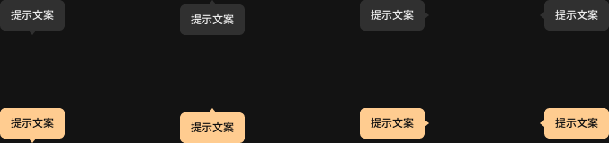

<!-- GEN:BEGIN 本段由 tools/gen-component-docs.py 依据 Figma 导出生成，勿手改；改 Figma 后重新生成 -->

## 概览

| 项 | 值 |
|---|---|
| Figma 组件集 | `Tooltip`（node `56063:6778`） |
| 分类 | 反馈类 |
| 变体数 | 8 |
| 默认变体 | `Placement=top, Tone=dark` |
| 参考尺寸 | 72×39 px（默认变体） |
| 主题 | 主库（深色中性 + 品牌砂色） |
| 预览图 | [assets/previews/tooltip.png](../../assets/previews/tooltip.png) |
| 代码实现 | [`components/Tooltip/Tooltip.tsx`](../../components/Tooltip/Tooltip.tsx) |
| Figma 链接 | [在 Figma 打开](https://www.figma.com/design/ZO4WH3sbVCj7lZIFMpiwV9/VibeMe-App---Web-Design-%E5%A4%87%E4%BB%BD?node-id=56063-6778) |



## 变体与属性

| Figma 属性 | 类型 | 取值 | 默认 | 代码 prop |
|---|---|---|---|---|
| `Placement` | VARIANT | `top` / `bottom` / `left` / `right` | `top` | `placement` |
| `Tone` | VARIANT | `dark` / `brand` | `dark` | `tone` |

变体是属性轴的笛卡尔积：**8 = 4 × 2**（`Placement` × `Tone`）。

## 各变体的事实

> 填充栈按 Figma 图层顺序排列（**靠右的是上层**，hover/pressed 的叠加层在最后）。
> `⚠无cssVar` 表示该组件引用了历史遗留变量，代码里不要照抄，按 `foundations.md` 的规则换成语义 token。

| 变体 | 尺寸 | 填充栈 | 描边 | 圆角 | 内边距 上/右/下/左 | 不透明度 |
|---|---|---|---|---|---|---|
| `Placement=top, Tone=dark` | 72×39 | — | — | — | 0/0/0/0 | — |
| `Placement=top, Tone=brand` | 72×39 | — | — | — | 0/0/0/0 | — |
| `Placement=bottom, Tone=dark` | 72×39 | — | — | — | 0/0/0/0 | — |
| `Placement=bottom, Tone=brand` | 72×39 | — | — | — | 0/0/0/0 | — |
| `Placement=left, Tone=dark` | 77×34 | — | — | — | 0/0/0/0 | — |
| `Placement=left, Tone=brand` | 77×34 | — | — | — | 0/0/0/0 | — |
| `Placement=right, Tone=dark` | 77×34 | — | — | — | 0/0/0/0 | — |
| `Placement=right, Tone=brand` | 77×34 | — | — | — | 0/0/0/0 | — |

## 结构（默认变体）

### Placement=top, Tone=dark

```text
`COMPONENT` Placement=top, Tone=dark 72×39 VERTICAL gap 0 pad 0/0/0/0
└─ `FRAME` Frame 72×34 HORIZONTAL gap 0 pad 8/12/8/12 填充 `Neutral/Neutral-600` #303030 `--vm-neutral-600` 圆角 6
  └─ `TEXT` 提示文案 48×18 填充 `Text/Text-Primary` #FFFFFF 92% `--vm-text-primary` 文字样式 `Caption/Caption`（12 Medium /18） 内容 '提示文案'
└─ `VECTOR` Vector 8×5 填充 `Neutral/Neutral-600` #303030 `--vm-neutral-600`
```

### Placement=top, Tone=brand

```text
`COMPONENT` Placement=top, Tone=brand 72×39 VERTICAL gap 0 pad 0/0/0/0
└─ `FRAME` Frame 72×34 HORIZONTAL gap 0 pad 8/12/8/12 填充 `Brand/Brand` #FFCC90 `--vm-brand` 圆角 6
  └─ `TEXT` 提示文案 48×18 填充 `Neutral/Neutral-950` #0E0E0E `--vm-neutral-950` 文字样式 `Caption/Caption`（12 Medium /18） 内容 '提示文案'
└─ `VECTOR` Vector 8×5 填充 `Brand/Brand` #FFCC90 `--vm-brand`
```


## 设计 token

| Figma 变量 | CSS 变量 | 值 |
|---|---|---|
| `Brand/Brand` | `--vm-brand` | `#FFCC90` |
| `Neutral/Neutral-600` | `--vm-neutral-600` | `#303030` |
| `Neutral/Neutral-950` | `--vm-neutral-950` | `#0E0E0E` |
| `Radious/radius-sm` | `--vm-radius-sm` | `6px` |
| `Text/Text-Primary` | `--vm-text-primary` | `rgba(255, 255, 255, 0.92)` |
| `space/space-2` | `--vm-space-2` | `8px` |
| `space/space-3` | `--vm-space-3` | `12px` |

<!-- GEN:END -->

## 交互与状态

**Tooltip 没有 `State` 轴，也没有 `disabled`。** 8 个变体全部是 `Placement`(4) × `Tone`(2) 的笛卡尔积，
导出里顶层既没有 `fills` / `strokes` 也没有 `opacity` —— 气泡与箭头是子节点 `Frame` 与 `Vector`，
所以「状态」在这套设计里根本不存在：`Tooltip` 是**纯展示**组件，代码里不写任何 `:hover` / `:active` /
`:focus-visible` / `[disabled]` 样式，也不接受 `disabled` / `open` 这类 prop。

真正会变的只有两件事实，都由 prop 决定：

| prop | 值 | root Auto Layout | 箭头位置 | 几何 |
|---|---|---|---|---|
| `placement` | `top`（默认） | VERTICAL | 气泡**之后**，朝下 | 72×39 = 气泡 34 高 + 箭头 5 高 |
| `placement` | `bottom` | VERTICAL | 气泡**之前**，朝上 | 同上，箭头与气泡对调顺序 |
| `placement` | `left` | HORIZONTAL | 气泡**之前**，朝左 | 77×34 = 箭头 5 宽 + 气泡 72 宽 |
| `placement` | `right` | HORIZONTAL | 气泡**之后**，朝右 | 同上，箭头与气泡对调顺序 |

| `tone` | 气泡底 / 箭头 | 文字 |
|---|---|---|
| `dark`（默认） | `Neutral/Neutral-600` → `--vm-neutral-600` #303030 | `Text/Text-Primary` → `--vm-text-primary` |
| `brand` | `Brand/Brand` → `--vm-brand` #FFCC90 | `Neutral/Neutral-950` → `--vm-neutral-950` #0E0E0E |

显隐时机、进出场动画、延迟**不在本组件职责内**：Figma 里没有任何 `State` 或动效标注，
所以代码里也没有 `opacity` 过渡。要淡入淡出请由调用方在包裹层做，不要往 `.vm-tooltip` 里加。

## 代码用法

```tsx
import { Tooltip } from './components/Tooltip';

// 1) 默认：Placement=top, Tone=dark
<Tooltip id="tip-save">保存后自动生成分享链接</Tooltip>

// 2) 品牌色气泡 + 放到触发元素右侧
<Tooltip placement="right" tone="brand" id="tip-brand">
  仅主账号可见
</Tooltip>

// 3) 真实用法：由触发元素用 aria-describedby 关联，显隐自己控制
<span>
  <button type="button" aria-describedby="tip-export">导出</button>
  {open ? <Tooltip id="tip-export">导出为 CSV，超过 1 万行会分片</Tooltip> : null}
</span>
```

样式随 `components/Tooltip/Tooltip.tsx` 一起从 `./Tooltip.css` 导入（组件内部 `import './Tooltip.css'`）。
气泡内边距是 `--vm-space-2`（上/下 8px）× `--vm-space-3`（左/右 12px），圆角 `--vm-radius-sm`（6px）；
文案挂 `.vm-type-caption-caption`（Figma `Caption/Caption`，Poppins 12 Medium / 行高 18）。
宽度**不要**写死：Figma 的 72px 只是「提示文案」四个字的 Hug 结果，真实文案长度不同，宽度应随内容增长。

## 可访问性

- 根节点是 `<div role="tooltip">`，这正是 WAI-ARIA 为非交互式文字提示定义的 role；
  `Tooltip` **不接管焦点**（不设 `tabIndex`、不 `autoFocus`），它只是一个可被描述的静态节点。
- 与触发元素的关系必须由调用方用 `id` + `aria-describedby` 建立：触发元素写 `aria-describedby="tip-x"`，
  `<Tooltip id="tip-x">` 负责被指向。**不要**把 `Tooltip` 塞进 `aria-labelledby` —— 那是给可访问名称用的。
- 键盘/指针：因为显隐由调用方控制，触发元素的 `:hover` **和** `:focus-visible` 都要显示提示
  （WCAG 1.4.13 Content on Hover or Focus）；`Escape` 必须能关掉，且提示不能遮住触发元素本身。
  auto-hide 计时器在悬停或聚焦期间要暂停。
- 文案要短、可朗读：`role="tooltip"` 的内容会被读屏在描述位置念出，写「点击这里」这类脱离上下文的文案
  等于没写。文字色 `--vm-text-primary` 92% 白 / `#303030` 底，对比度足够；
  `brand` 档 `--vm-neutral-950` 压 `--vm-brand`，是深字压浅底，**不要**反过来。
- 触发元素被禁用时不要挂 `aria-describedby`（`disabled` 元素不接收焦点，提示永远看不到）。

## 不要这样做

1. **不要给 `Tooltip` 加 `:hover` 换底**。Button / Card / MenuItem 那一族 hover 是在底色上叠 `--vm-white-7`，
   但 Tooltip 的导出里**没有任何 `State` 变体**，顶层连 `fills` 都没有；自己加一层叠加就是发明设计。
2. **不要把 `placement` 做成 CSS 类交给调用方**。四个方位的差别不只是箭头朝向，还包括 root 的 Auto Layout
   方向（`top`/`bottom` 是 VERTICAL，`left`/`right` 是 HORIZONTAL）和箭头前后顺序；只改一个 `transform: rotate`
   会让 77×34 这种横排几何错位。
3. **不要给气泡加阴影**。`Tooltip` 的导出里 `effects` 为空（Figma 没绑 `Elevation/*`）。文件里 `Elevation/3`
   属于 Popover / Modal 那一族，往 Tooltip 上加 `--vm-elevation-3` 属于串味。
4. **不要写死宽度 72px 或高度 34px**。它们是「提示文案」四个字的 Hug 结果，不是栅格常量；
   固定后换文案就被裁切（`Frame` 上是 `clip: true`）。
5. **不要用 Tooltip 承载可交互内容**。它是 `role="tooltip"` 的文字提示，里面放按钮/链接会立刻违反
   「提示必须能被 `Escape` 关掉且不抢焦点」的前提；要放内容请用 `Popover`。
6. **不要照抄历史遗留变量**。`Radious/radius-sm` 这个名字里的拼写错误是 Figma 原始命名（`Radious` 而非 `Radius`），
   代码里只认 `--vm-radius-sm`，不要自己在 CSS 里写 `6px`。

## 相关组件

- **`Popover`**：同族的弹出层。区别是 Popover 是 240px 面板 + `Elevation/3` + 可放交互内容（MenuItem / Button），
  Tooltip 只有一行文字、无阴影、无内嵌实例。二者共用 `top` / `bottom` 这类方位词，但值域不同 ——
  Popover 是 `bottom-start` / `bottom-end` / `top-start` / `top-end`（带对齐），Tooltip 只有 `top` / `bottom` / `left` / `right`（居中对齐）。
- **触发元素**：`Button`、图标按钮、`MenuItem`、`Table` 的表头文字都常挂 Tooltip；关系用 `aria-describedby` 建立。
- **`MenuItem` / `Dropdown`**：如果提示内容是「一条条可点的操作」，说明你要的是 `Dropdown` + `MenuItem`，不是 Tooltip。
- **`Modal` / `Drawer`**：长说明、需要用户确认的内容走它们；Tooltip 只承担一句话的补充说明。
- **`Tag`**：与 Tooltip 一样是**没有 `State` 轴**的纯展示组件，实现风格（`forwardRef` + 语义元素 + `vm-` 类）可直接对照。
