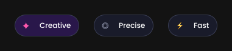

<!-- GEN:BEGIN 本段由 tools/gen-component-docs.py 依据 Figma 导出生成，勿手改；改 Figma 后重新生成 -->

## 概览

| 项 | 值 |
|---|---|
| Figma 组件集 | `VibeMe AI / Capability Chip`（node `56070:14790`） |
| 分类 | VibeMe AI（另一套 token） |
| 变体数 | 3 |
| 默认变体 | `Type=Creative` |
| 参考尺寸 | 106×36 px（默认变体） |
| 主题 | **VibeMe AI 主题（紫粉，另一套 token，不要与主库混用）** |
| 预览图 | [assets/previews/vibe-ai-capability-chip.png](../../assets/previews/vibe-ai-capability-chip.png) |
| 代码实现 | [`components/VibeAiCapabilityChip/VibeAiCapabilityChip.tsx`](../../components/VibeAiCapabilityChip/VibeAiCapabilityChip.tsx) |
| Figma 链接 | [在 Figma 打开](https://www.figma.com/design/ZO4WH3sbVCj7lZIFMpiwV9/VibeMe-App---Web-Design-%E5%A4%87%E4%BB%BD?node-id=56070-14790) |



## 变体与属性

| Figma 属性 | 类型 | 取值 | 默认 | 代码 prop |
|---|---|---|---|---|
| `Type` | VARIANT | `Creative` / `Precise` / `Fast` | `Creative` | `type` |

变体是属性轴的笛卡尔积：**3 = 3**（`Type`）。

## 各变体的事实

> 填充栈按 Figma 图层顺序排列（**靠右的是上层**，hover/pressed 的叠加层在最后）。
> `⚠无cssVar` 表示该组件引用了历史遗留变量，代码里不要照抄，按 `foundations.md` 的规则换成语义 token。

| 变体 | 尺寸 | 填充栈 | 描边 | 圆角 | 内边距 上/右/下/左 | 不透明度 |
|---|---|---|---|---|---|---|
| `Type=Creative` | 106×36 | `color/bg/brand-soft` #29174A `--vm-ai-color-bg-brand-soft` | `color/border/default` #383C52 `--vm-ai-color-border-default` | 999 | 7/12/7/12 | — |
| `Type=Precise` | 98×36 | `color/bg/raised` #191B2A `--vm-ai-color-bg-raised` | `color/border/default` #383C52 `--vm-ai-color-border-default` | 999 | 7/12/7/12 | — |
| `Type=Fast` | 81×36 | `color/bg/raised` #191B2A `--vm-ai-color-bg-raised` | `color/border/default` #383C52 `--vm-ai-color-border-default` | 999 | 7/12/7/12 | — |

## 结构（默认变体）

### Type=Creative

```text
`COMPONENT` Type=Creative 106×36 HORIZONTAL gap 16 pad 7/12/7/12 填充 `color/bg/brand-soft` #29174A `--vm-ai-color-bg-brand-soft` 描边 `color/border/default` #383C52 `--vm-ai-color-border-default` 圆角 999
└─ `TEXT` Chip Icon 12×20 填充 `color/accent/pink` #FF57AD `--vm-ai-color-accent-pink` 文字样式 `-`（13 SemiBold /20） 内容 '✦'
└─ `TEXT` Chip Label 52×18 填充 `color/text/primary` #FFFFFF `--vm-ai-color-text-primary` 文字样式 `-`（12 Medium /18） 内容 'Creative'
```


## 设计 token

| Figma 变量 | CSS 变量 | 值 |
|---|---|---|
| `color/accent/pink` | `--vm-ai-color-accent-pink` | `#FF57AD` |
| `color/bg/brand-soft` | `--vm-ai-color-bg-brand-soft` | `#29174A` |
| `color/bg/raised` | `--vm-ai-color-bg-raised` | `#191B2A` |
| `color/border/default` | `--vm-ai-color-border-default` | `#383C52` |
| `color/text/primary` | `--vm-ai-color-text-primary` | `#FFFFFF` |
| `radius/full` | `--vm-ai-radius-full` | `999px` |
| `spacing/12` | `--vm-ai-spacing-12` | `12px` |
| `spacing/16` | `--vm-ai-spacing-16` | `16px` |

<!-- GEN:END -->


## 交互与状态

这是一颗**可点的能力切换胶囊**（Figma 描述原文：`Use to switch AI modes without changing the primary task.`），
实现成原生 `<button type="button">`，所以键盘、焦点、点击都走浏览器原生行为。Figma 只给了 `Type` 一个轴，
**没有 hover / pressed / focus / disabled 变体**，代码里的状态拆解如下：

| 状态 | 代码来源 | 视觉事实 |
|---|---|---|
| 未选中（`Type=Precise` / `Type=Fast` 的画法） | `selected={false}`（或 `type` 为 `precise`/`fast` 时的默认值） | 底 `--vm-ai-color-bg-raised`（`color/bg/raised` #191B2A）＋ 1px `--vm-ai-color-border-default`（`color/border/default` #383C52）；图标 `--vm-ai-color-text-secondary`（`color/text/secondary` #8C91A8） |
| 选中（`Type=Creative` 的画法） | `selected`（默认 `type === 'creative'`，与 Figma `defaultVariant` 像素一致） | 底换成 `--vm-ai-color-bg-brand-soft`（`color/bg/brand-soft` #29174A），图标换成 `--vm-ai-color-accent-pink`（`color/accent/pink` #FF57AD）；**描边与文字色不变** |
| `:focus-visible` | 键盘 Tab 到达 | 描边换成 `--vm-ai-color-accent-pink` ＋ `--vm-focus-ring-width`（2px）的 ring。AI 主题没有主库的 `border-selected`（50% 白），所以用主题强调色 |
| `disabled` | 原生 `disabled` | 没有 Figma 事实；只按 foundations 的通用规则加 `opacity: var(--vm-opacity-disabled)`（0.38）＋ `cursor: not-allowed`，**不另造灰色** |

- **hover 不变色**：本组件没有任何 hover 变体，且 VibeMe AI 主题的 token 里**不存在**主库 `White/White-4`、`White/White-7`
  这一级别的叠加色（`--vm-ai-*` 只有中性色阶与语义色），所以实现里不写 `:hover` 换色，只用 `cursor: pointer` 表达可点。
- 三个 `type` 的差别**不只是文案**：图标字形不同（`✦` / `◎` / `⚡`，Figma 里是三个 TEXT 字形节点），
  选中时的图标颜色也不同；`creative` 是唯一在 Figma 里带 `color/bg/brand-soft` 底色的档。
- 尺寸是 HUG：81 / 98 / 106 × 36，宽度由文案撑开；36 = 8（`--vm-ai-spacing-8`）×2 ＋ 18 图标行盒 ＋ 1px 描边 ×2，
  Figma 的 7px 纵向内边距取整到 token `spacing/8`（见「不要这样做」第 2 条）。

## 代码用法

```tsx
import { useState } from 'react';
import { VibeAiCapabilityChip, type VibeAiCapabilityChipType } from '../components/VibeAiCapabilityChip';

export function Example() {
  const [mode, setMode] = useState<VibeAiCapabilityChipType>('creative');

  return (
    // 互斥模式组：外层给 role="group" + aria-label，键盘逐个 Tab 进入即可
    <div role="group" aria-label="AI 能力模式" style={{ display: 'flex', gap: 8 }}>
      {(['creative', 'precise', 'fast'] as const).map((t) => (
        <VibeAiCapabilityChip
          key={t}
          type={t}
          selected={mode === t}
          onClick={() => setMode(t)}
        >
          {t === 'creative' ? '创意' : t === 'precise' ? '精准' : '快速'}
        </VibeAiCapabilityChip>
      ))}
    </div>
  );
}
```

CSS 引入方式：`import '../components/VibeAiCapabilityChip/VibeAiCapabilityChip.css'`（或整包 `import '../components/index'`）。
`type` 同时决定图标与默认文案；`children` 只覆盖文案（中文/不同语言时用）；`selected` 是受控的选中态
（默认值 `type === 'creative'` 与 Figma 的 `defaultVariant` 一致）。注意 prop 名 `type` 指的是**能力类型**、
不是 `<button type>`，原生 `type` 已被实现固定为 `"button"`。

## 可访问性

- 语义是原生 `<button type="button">`：`Enter` / `Space` 都能触发 `onClick`，`Tab` 进入、`Tab` 离开，
  焦点顺序由 DOM 顺序决定；不使用 `div` + `onClick` 的假按钮。
- 选中态通过 **`aria-pressed`** 播报（`selected` 为 true 时输出 `aria-pressed="true"`），视觉上的
  `color/bg/brand-soft` 底色与粉图标只是辅助；读屏用户听到的是「Creative，切换按钮，已按下」。
- 一组互斥模式请像示例那样给外层容器 `role="group"` + `aria-label`；`aria-pressed` 是切换按钮语义，
  它不会告诉读屏「三选一」，所以组标签必须由调用方补上。真正需要单选语义时请在 Figma 补 `Selected` 轴 + Radio 组。
- 图标是装饰性的内联 `<svg aria-hidden="true" focusable="false">`，颜色走 `currentColor`；
  `type` 与 `children` 的文本才是可访问名称（默认 `Creative` / `Precise` / `Fast`），
  只放图标不放文字会得到一个没有名字的按钮。
- 焦点可见：`:focus-visible` 给 `--vm-ai-color-accent-pink`（#FF57AD）描边 ＋ `--vm-focus-ring-width` 的 ring，
  在全深色底（#121420 / #191B2A）上对比度约 **5.9:1**，并**没有**用 `outline: none` 把焦点抹掉。
- 对比度：标签 `--vm-ai-color-text-primary` #FFFFFF 在 `--vm-ai-color-bg-raised` #191B2A 上约 **17:1**、
  在 `--vm-ai-color-bg-brand-soft` #29174A 上约 **16:1**；选中图标 `--vm-ai-color-accent-pink` 在 #29174A 上约 **5.5:1**；
  未选中图标 `--vm-ai-color-text-secondary` #8C91A8 在 #191B2A 上约 **5.5:1**。
- 唯一需要注意的：描边 `--vm-ai-color-border-default` #383C52 在底色上只有约 **1.5:1**，属于「弱边界」，
  所以不要把它当成唯一的状态指示（选中/未选中还有底色与图标色两个通道）。

## 不要这样做

1. **不要把 `Type` 的选中样式理解为「Creative 天生高亮」而写死**。Figma 把选中样式烘焙进了 `Type=Creative` 变体
   （只有它用 `color/bg/brand-soft` ＋ `color/accent/pink`），没有独立的 `Selected` 轴；代码里用 `selected?: boolean`
   把这份视觉事实拆成受控状态，默认值与 Figma 像素一致。想要「Precise 被选中」，传 `type="precise" selected`，
   不要在调用方复制一份 CSS 覆盖底色。
2. **不要把 Figma 的 7px 纵向内边距照抄成字面量 `7px`**。VibeMe AI 的间距标尺是 4 / 8 / 12 / 16 / 20 / 24，
   没有 7；实现用 `padding-block: var(--vm-ai-spacing-8)`，同时把图标行盒压到 18px，让胶囊总高仍然是 Figma 的 **36px**。
   自己写 `7px` 会同时漂移间距体系与总高。
3. **不要给 hover 叠 `--vm-white-7`**。那是主库 Button 的手法；本组件在 Figma 里没有 hover 变体，
   AI 主题也没有对应的叠加 token。在 `color/bg/raised` 上叠一层白会让底色变成不存在的第 4 种色调。
4. **不要把图标写成 emoji 或引入图标库**（`⚡` 尤其容易被写成 emoji，会带来彩色字体、基线漂移与读屏念稿）。
   三个字形来自 Figma 的 TEXT 节点（`Chip Icon`：`✦` / `◎` / `⚡`），实现里换成同一形状的内联矢量。
5. **不要把 prop `type` 和 `<button type>` 混用**。`type` 在本组件里是能力枚举（`creative`/`precise`/`fast`），
   原生 `type` 已固定为 `"button"`；接口里已经 `Omit<'type'>`，传 `type="submit"` 不会生效也不会报错——
   要提交表单请用主库 `Button`。
6. **不要用主库 token 给它上色**（`--vm-bg-card` / `--vm-text-secondary` / `--vm-border-default`）。
   AI 主题是另一套变量集合，混用会出现「紫粉主题里混进灰蓝」的不一致；`color/bg/raised` 与 `Background/bg-card`
   在两边是**不同的集合、不同的解析来源**。

## 相关组件

- **`VibeAiPromptField` / `VibeAiTriggerButton`（同主题的输入与提交侧）**：本组件负责「切哪个能力」，
  它们负责「输入与提交」，三者共用 `--vm-ai-*` 一套 token，常见布局是输入框上方或下方排一行能力胶囊。
- **`VibeAiGenerationStatus`（同主题的过程反馈）**：模式选中后发起生成，用状态胶囊显示 `thinking → generating → complete`；
  两者都是胶囊形状（`--vm-ai-radius-full`），但本组件可点、有 `aria-pressed`，状态胶囊只读、用 `role="status"`。
- **`VibeAiResponseCard`（结果侧）**：生成完成后在卡片里展示结果，卡片自带 `Copy` / `Regenerate` 文本动作；
  本组件不要塞进卡片的 `Actions` 区（那里是文本型动作，没有胶囊底与描边）。
- **`Tag` / `Badge`（主库）**：语义是静态分类/计数，不可点、没有 `aria-pressed`；需要「切换模式」时不要用它们客串。
- **`Tabs`（主库，`Type=pill`）**：外观接近，但它是主库 token + 分组导航语义（`role="tablist"`）；
  AI 能力切换属于模式开关，走本组件，不要为了省事复用 Tabs 的样式。
