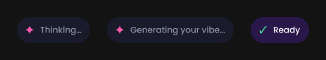

<!-- GEN:BEGIN 本段由 tools/gen-component-docs.py 依据 Figma 导出生成，勿手改；改 Figma 后重新生成 -->

## 概览

| 项 | 值 |
|---|---|
| Figma 组件集 | `VibeMe AI / Generation Status`（node `56070:14780`） |
| 分类 | VibeMe AI（另一套 token） |
| 变体数 | 3 |
| 默认变体 | `State=Thinking` |
| 参考尺寸 | 104×37 px（默认变体） |
| 主题 | **VibeMe AI 主题（紫粉，另一套 token，不要与主库混用）** |
| 预览图 | [assets/previews/vibe-ai-generation-status.png](../../assets/previews/vibe-ai-generation-status.png) |
| 代码实现 | [`components/VibeAiGenerationStatus/VibeAiGenerationStatus.tsx`](../../components/VibeAiGenerationStatus/VibeAiGenerationStatus.tsx) |
| Figma 链接 | [在 Figma 打开](https://www.figma.com/design/ZO4WH3sbVCj7lZIFMpiwV9/VibeMe-App---Web-Design-%E5%A4%87%E4%BB%BD?node-id=56070-14780) |



## 变体与属性

| Figma 属性 | 类型 | 取值 | 默认 | 代码 prop |
|---|---|---|---|---|
| `State` | VARIANT | `Thinking` / `Generating` / `Complete` | `Thinking` | `state` |

变体是属性轴的笛卡尔积：**3 = 3**（`State`）。

## 各变体的事实

> 填充栈按 Figma 图层顺序排列（**靠右的是上层**，hover/pressed 的叠加层在最后）。
> `⚠无cssVar` 表示该组件引用了历史遗留变量，代码里不要照抄，按 `foundations.md` 的规则换成语义 token。

| 变体 | 尺寸 | 填充栈 | 描边 | 圆角 | 内边距 上/右/下/左 | 不透明度 |
|---|---|---|---|---|---|---|
| `State=Thinking` | 104×37 | `color/bg/raised` #191B2A `--vm-ai-color-bg-raised` | — | 999 | 8/12/8/12 | — |
| `State=Generating` | 180×37 | `color/bg/raised` #191B2A `--vm-ai-color-bg-raised` | — | 999 | 8/12/8/12 | — |
| `State=Complete` | 83×37 | `color/bg/brand-soft` #29174A `--vm-ai-color-bg-brand-soft` | — | 999 | 8/12/8/12 | — |

## 结构（默认变体）

### State=Thinking

```text
`COMPONENT` State=Thinking 104×37 HORIZONTAL gap 8 pad 8/12/8/12 填充 `color/bg/raised` #191B2A `--vm-ai-color-bg-raised` 圆角 999
└─ `TEXT` AI Sparkle 13×21 填充 `color/accent/pink` #FF57AD `--vm-ai-color-accent-pink` 文字样式 `-`（14 SemiBold /21） 内容 '✦'
└─ `TEXT` Status Label 59×18 填充 `color/text/secondary` #8C91A8 `--vm-ai-color-text-secondary` 文字样式 `-`（12 Medium /18） 内容 'Thinking…'
```

### State=Generating

```text
`COMPONENT` State=Generating 180×37 HORIZONTAL gap 8 pad 8/12/8/12 填充 `color/bg/raised` #191B2A `--vm-ai-color-bg-raised` 圆角 999
└─ `TEXT` AI Sparkle 13×21 填充 `color/accent/pink` #FF57AD `--vm-ai-color-accent-pink` 文字样式 `-`（14 SemiBold /21） 内容 '✦'
└─ `TEXT` Status Label 135×18 填充 `color/text/secondary` #8C91A8 `--vm-ai-color-text-secondary` 文字样式 `-`（12 Medium /18） 内容 'Generating your vibe…'
```


## 设计 token

| Figma 变量 | CSS 变量 | 值 |
|---|---|---|
| `color/accent/pink` | `--vm-ai-color-accent-pink` | `#FF57AD` |
| `color/bg/brand-soft` | `--vm-ai-color-bg-brand-soft` | `#29174A` |
| `color/bg/raised` | `--vm-ai-color-bg-raised` | `#191B2A` |
| `color/text/secondary` | `--vm-ai-color-text-secondary` | `#8C91A8` |
| `radius/full` | `--vm-ai-radius-full` | `999px` |
| `spacing/12` | `--vm-ai-spacing-12` | `12px` |
| `spacing/8` | `--vm-ai-spacing-8` | `8px` |

<!-- GEN:END -->


## 交互与状态

这是一个**只读状态指示器**，不是控件：Figma 的组件集里只有 `State` 一个变体轴，没有 hover / pressed / focus 变体，
所以实现里**没有** `:hover` / `:active` / `cursor: pointer`，也没有 `disabled`。三种状态全部由 prop `state` 驱动：

| `state`（`State`） | 底色 | 图标 + 颜色 | 文案颜色 | Figma 里的文案 |
|---|---|---|---|---|
| `thinking`（默认，`State=Thinking`） | `--vm-ai-color-bg-raised`（`color/bg/raised` #191B2A） | `✦` + `--vm-ai-color-accent-pink`（`color/accent/pink` #FF57AD） | `--vm-ai-color-text-secondary`（`color/text/secondary` #8C91A8） | `Thinking…` |
| `generating`（`State=Generating`） | 同 `thinking` | `✦` + `--vm-ai-color-accent-pink` | `--vm-ai-color-text-secondary` | `Generating your vibe…` |
| `complete`（`State=Complete`） | `--vm-ai-color-bg-brand-soft`（`color/bg/brand-soft` #29174A） | `✓` + `--vm-ai-color-status-success`（`color/status/success` #40D694） | `--vm-ai-color-text-primary`（`color/text/primary` #FFFFFF） | `Ready` |

- `thinking` → `generating` **只换文案**：Figma 里两个变体的填充栈、圆角、内边距完全一致，胶囊从 104px 变宽到 180px 纯粹是
  `wSizing: HUG` 被更长的文案撑开的结果，代码里**不要写死宽度**。
- `complete` 是唯一换底色的状态，并且图标从 `✦` 变成 `✓`、颜色从粉换成绿；这不是「同一个图标换个色」，两个矢量形状不同。
- 状态流转由调用方的数据驱动（请求开始 → `thinking`，产出中 → `generating`，结束 → `complete`）；组件内部没有定时器、
  没有动画、没有 `setTimeout`。Figma 里也没有任何动效事实，所以 CSS 不写 `@keyframes`、不写 `transition`。
- 没有 `empty` / `loading` / `error` 变体：出错请用 `VibeAiResponseCard` 的 `state="error"`，不要给本组件硬塞 error 文案。

## 代码用法

```tsx
import { useState } from 'react';
import { VibeAiGenerationStatus } from '../components/VibeAiGenerationStatus';

export function Example() {
  const [phase, setPhase] = useState<'thinking' | 'generating' | 'complete'>('thinking');

  return (
    <>
      {/* 默认态：是 State=Thinking，文案用 Figma 里的 Thinking… */}
      <VibeAiGenerationStatus />

      {/* 三态流转：state 是唯一的内容型 prop，颜色与图标都由它决定 */}
      <VibeAiGenerationStatus state="generating" />
      <VibeAiGenerationStatus state="complete" />

      {/* 文案要覆盖时给 children（优先于 state 的默认文案），状态样式仍然跟着 state 走 */}
      <VibeAiGenerationStatus state="generating">正在生成第 2 版…</VibeAiGenerationStatus>

      {/* 原生属性透传：span 的 aria 属性、id、style 都能直接给 */}
      <VibeAiGenerationStatus state={phase} id="gen-status" aria-label={`AI 状态：${phase}`} />
    </>
  );
}
```

CSS 引入方式：`import '../components/VibeAiGenerationStatus/VibeAiGenerationStatus.css'`（或整包 `import '../components/index'`，
桶文件已带 `tokens.css`，`--vm-ai-*` 与 `.vm-type-*` 会一起加载）。组件是 `inline-flex` 的胶囊，宽度随内容撑开；
`children` 只承载状态文案，`state` 才是形状/配色开关，二者不要互相替代。

## 可访问性

- 根节点是真实 `<span role="status">`：`role="status"` 隐含 `aria-live="polite"` + `aria-atomic="true"`，
  所以从 `thinking` 切到 `complete` 时，屏幕阅读器会自动播报新文案；`role` 可以被 `...rest` 覆盖，
  嵌在已有的 live region 里时传 `role={undefined}` 即可避免重复播报。
- 图标是**纯装饰**：内联 `<svg aria-hidden="true" focusable="false">`，读屏只念文案（"Thinking…" / "Ready"），
  不会念出 `✦` 这个字形；Figma 里它是名为 `AI Sparkle` / `Status Icon` 的 TEXT 节点，这里换成了等价矢量。
- 组件本身不可聚焦、不响应键盘，因此不参与 Tab 序列、也不接管焦点；需要「可点」的 AI 入口请用
  `VibeAiTriggerButton` / `VibeAiCapabilityChip`。
- 对比度（实测）：`--vm-ai-color-text-secondary` #8C91A8 在 `--vm-ai-color-bg-raised` #191B2A 上约 **5.5:1**，
  `--vm-ai-color-text-primary` #FFFFFF 在 `--vm-ai-color-bg-brand-soft` #29174A 上约 **16:1**，
  `--vm-ai-color-status-success` #40D694 在 #29174A 上约 **8.6:1**，`--vm-ai-color-accent-pink` #FF57AD 在 #191B2A 上约 **5.9:1**，
  常规字号下都过 AA。
- 状态**不只靠颜色**表达：`Ready` / `Thinking…` / `Generating your vibe…` 的文案本身就说明了阶段，
  色觉障碍用户不会因为「绿变粉」而丢失信息。
- 高频更新（例如按 token 逐字刷文案）时请由调用方节流：`role="status"` 每次文本变化都会触发播报，
  逐字更新会把读屏刷成噪音；建议只在阶段切换时改 `children`/`state`。

## 不要这样做

1. **不要给它加 hover / 点击态**。Figma 里没有 `State=hover` / `pressed` 变体，加 `cursor: pointer` + `:hover` 会把它伪装成按钮；
   要可点的 AI 入口请用 `VibeAiTriggerButton`（同主题）或 `VibeAiCapabilityChip`。
2. **不要写死宽度**（104 / 180 / 83 只是三档文案 HUG 出来的结果）。写死 `width: 180px` 会把 `Thinking…` 撑出空白、
   把中文长文案截断；宽度交给 `inline-flex` 内容撑开。
3. **不要混用主库 token**。本组件属于 VibeMe AI 主题，底色/文字/强调色是 `--vm-ai-color-bg-raised`、
   `--vm-ai-color-text-secondary`、`--vm-ai-color-accent-pink` 这一套；换成主库的 `--vm-bg-card` / `--vm-text-secondary`
   会得到灰蓝底而不是紫粉主题，`color/bg/raised` 与 `Background/bg-card` 是两个不同集合的同名近似值。
4. **不要给 `complete` 用 `--vm-ai-color-bg-brand-soft` 以外的底色，也不要给 `thinking` 用它**。
   只有 `State=Complete` 的填充栈是 `color/bg/brand-soft`；`thinking` / `generating` 都是 `color/bg/raised`。
5. **不要自造 `disabled` / `error` 态**（Figma 没有这两个变体），也不要为了「禁用」把胶囊改灰或加 `opacity`
   ——真要弱化，请由调用方决定隐藏或换文案。
6. **不要把 `✦` / `✓` 做成 emoji 或引入图标库**。矢量路径来自 Figma 的两个字形节点，`currentColor` 继承状态色；
   用 emoji 会带来彩色字体、基线偏移和读屏念稿三件麻烦事。

## 相关组件

- **`VibeAiResponseCard`（内联显示状态）**：卡片的 `Header` 里有一段 `State` 文本（`Thinking` / `Complete` / `Error`）
  和同样的 `✦` 头像。卡片已经自带状态文字，**不要再把本组件塞进卡片头部**，否则同一状态会出现两遍；
  卡片外的流程提示才用本组件。
- **`VibeAiPromptField` / `VibeAiTriggerButton`（同主题的触发侧）**：用户在输入框/触发按钮提交后，用本组件在附近显示
  `thinking → generating → complete`，三者共用 `--vm-ai-*` 一套 token。
- **`Loading`（主库，非本主题）**：`Loading` 表现的是通用加载（骨架/转圈），用主库 token；
  本组件表达的是「AI 这一次生成走到哪一步」的语义状态胶囊，两者不要互相替代。
- **`Tag` / `Badge`（主库）**：它们是分类/计数标签，语义是静态属性；本组件是过程状态且有 `role="status"` 播报语义。
