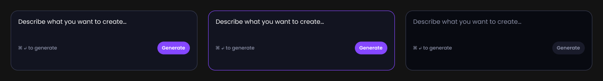

<!-- GEN:BEGIN 本段由 tools/gen-component-docs.py 依据 Figma 导出生成，勿手改；改 Figma 后重新生成 -->

## 概览

| 项 | 值 |
|---|---|
| Figma 组件集 | `VibeMe AI / Prompt Field`（node `56070:14761`） |
| 分类 | VibeMe AI（另一套 token） |
| 变体数 | 3 |
| 默认变体 | `State=Default` |
| 参考尺寸 | 420×136 px（默认变体） |
| 主题 | **VibeMe AI 主题（紫粉，另一套 token，不要与主库混用）** |
| 预览图 | [assets/previews/vibe-ai-prompt-field.png](../../assets/previews/vibe-ai-prompt-field.png) |
| 代码实现 | [`components/VibeAiPromptField/VibeAiPromptField.tsx`](../../components/VibeAiPromptField/VibeAiPromptField.tsx) |
| Figma 链接 | [在 Figma 打开](https://www.figma.com/design/ZO4WH3sbVCj7lZIFMpiwV9/VibeMe-App---Web-Design-%E5%A4%87%E4%BB%BD?node-id=56070-14761) |



## 变体与属性

| Figma 属性 | 类型 | 取值 | 默认 | 代码 prop |
|---|---|---|---|---|
| `State` | VARIANT | `Default` / `Focus` / `Disabled` | `Default` | `state` |

变体是属性轴的笛卡尔积：**3 = 3**（`State`）。

## 各变体的事实

> 填充栈按 Figma 图层顺序排列（**靠右的是上层**，hover/pressed 的叠加层在最后）。
> `⚠无cssVar` 表示该组件引用了历史遗留变量，代码里不要照抄，按 `foundations.md` 的规则换成语义 token。

| 变体 | 尺寸 | 填充栈 | 描边 | 圆角 | 内边距 上/右/下/左 | 不透明度 |
|---|---|---|---|---|---|---|
| `State=Default` | 420×136 | `color/bg/panel` #121420 `--vm-ai-color-bg-panel` | `color/border/default` #383C52 `--vm-ai-color-border-default` | 16 | 14/16/14/16 | — |
| `State=Focus` | 420×136 | `color/bg/panel` #121420 `--vm-ai-color-bg-panel` | `color/bg/brand` #8547FF `--vm-ai-color-bg-brand` | 16 | 14/16/14/16 | — |
| `State=Disabled` | 420×136 | `color/bg/canvas` #080A11 `--vm-ai-color-bg-canvas` | `color/border/default` #383C52 `--vm-ai-color-border-default` | 16 | 14/16/14/16 | — |

## 结构（默认变体）

### State=Default

```text
`COMPONENT` State=Default 420×136 VERTICAL gap 12 pad 14/16/14/16 填充 `color/bg/panel` #121420 `--vm-ai-color-bg-panel` 描边 `color/border/default` #383C52 `--vm-ai-color-border-default` 圆角 16
└─ `TEXT` Prompt 386×42 填充 `color/text/primary` #FFFFFF `--vm-ai-color-text-primary` 文字样式 `-`（14 Regular /21） 内容 'Describe what you want to create…'
└─ `FRAME` Actions 386×32 HORIZONTAL gap 8 pad 0/0/0/0
  └─ `TEXT` Hint 88×17 填充 `color/text/secondary` #8C91A8 `--vm-ai-color-text-secondary` 文字样式 `-`（11 Medium /17） 内容 '⌘ ↵ to generate'
  └─ `FRAME` Send 73×29 HORIZONTAL gap 4 pad 6/10/6/10 填充 `color/bg/brand` #8547FF `--vm-ai-color-bg-brand` 圆角 999
    └─ `TEXT` Send Label 53×17 填充 `color/text/primary` #FFFFFF `--vm-ai-color-text-primary` 文字样式 `-`（11 SemiBold /17） 内容 'Generate'
```

### State=Disabled

```text
`COMPONENT` State=Disabled 420×136 VERTICAL gap 12 pad 14/16/14/16 填充 `color/bg/canvas` #080A11 `--vm-ai-color-bg-canvas` 描边 `color/border/default` #383C52 `--vm-ai-color-border-default` 圆角 16
└─ `TEXT` Prompt 386×42 填充 `color/text/secondary` #8C91A8 `--vm-ai-color-text-secondary` 文字样式 `-`（14 Regular /21） 内容 'Describe what you want to create…'
└─ `FRAME` Actions 386×32 HORIZONTAL gap 8 pad 0/0/0/0
  └─ `TEXT` Hint 88×17 填充 `color/text/secondary` #8C91A8 `--vm-ai-color-text-secondary` 文字样式 `-`（11 Medium /17） 内容 '⌘ ↵ to generate'
  └─ `FRAME` Send 73×29 HORIZONTAL gap 4 pad 6/10/6/10 填充 `color/bg/raised` #191B2A `--vm-ai-color-bg-raised` 圆角 999
    └─ `TEXT` Send Label 53×17 填充 `color/text/secondary` #8C91A8 `--vm-ai-color-text-secondary` 文字样式 `-`（11 SemiBold /17） 内容 'Generate'
```


## 设计 token

| Figma 变量 | CSS 变量 | 值 |
|---|---|---|
| `color/bg/brand` | `--vm-ai-color-bg-brand` | `#8547FF` |
| `color/bg/canvas` | `--vm-ai-color-bg-canvas` | `#080A11` |
| `color/bg/panel` | `--vm-ai-color-bg-panel` | `#121420` |
| `color/bg/raised` | `--vm-ai-color-bg-raised` | `#191B2A` |
| `color/border/default` | `--vm-ai-color-border-default` | `#383C52` |
| `color/text/primary` | `--vm-ai-color-text-primary` | `#FFFFFF` |
| `color/text/secondary` | `--vm-ai-color-text-secondary` | `#8C91A8` |
| `radius/16` | `--vm-ai-radius-16` | `16px` |
| `spacing/12` | `--vm-ai-spacing-12` | `12px` |
| `spacing/16` | `--vm-ai-spacing-16` | `16px` |

<!-- GEN:END -->


## 交互与状态

`State` 的三个值分两类：`Focus` 是交互态（CSS `:focus-within`，**不做 prop**），`Default` / `Disabled`
是应用态（默认值 + `disabled` prop）。生成段落把 `State` 机械映射成了 `state` prop，代码里**没有**
`state` prop：`State=Default` → 默认样式，`State=Focus` → 容器 `:focus-within`，`State=Disabled` → `disabled`。

- **Default**（420×136，宽高都是 FIXED）：容器 `--vm-ai-color-bg-panel`（`color/bg/panel` #121420）+
  1px `--vm-ai-color-border-default`（`color/border/default` #383C52），圆角 `--vm-ai-radius-16`（`radius/16` 16px），
  内边距上下 14 / 左右 `--vm-ai-spacing-16`（16），纵向 gap `--vm-ai-spacing-12`（12）。
- **Focus**（容器 `:focus-within`，也就是点进 textarea 时）：**只换描边颜色** ——
  `color/border/default` 换成 `color/bg/brand`（`--vm-ai-color-bg-brand` #8547FF），
  线宽仍是 1px（Figma 三个变体 `strokeWeight` 都是 1，**没有**主库那种 1px → 2px 的变化），
  底色、圆角、内边距都不动。实现另外补了一圈 2px 同色 `box-shadow` 外环（可访问性补充：
  Figma 只画了 1px 描边，在深底上作键盘焦点指示偏弱）。
- **Disabled**（`disabled` prop，会同时落到 textarea 与 Generate 按钮）：容器底色换成
  `--vm-ai-color-bg-canvas`（`color/bg/canvas` #080A11），Prompt 文字与 `::placeholder` 换成
  `--vm-ai-color-text-secondary`（`color/text/secondary` #8C91A8），Hint 本来就是 secondary 不变，
  Generate 按钮底色换成 `--vm-ai-color-bg-raised`（`color/bg/raised` #191B2A）、文字换成 secondary，
  textarea 与按钮 `cursor: not-allowed`。**整组没有任何 `opacity`**：三个变体的
  `opacity` 都是 1、`opVar` 都是 null，这与主库「disabled 只降 38%（`--vm-opacity-disabled`）」的
  做法不同，是 AI 主题自己的「换 token」手法。
- Generate 按钮在 Figma 里（`Send` 框）**没有 hover / pressed 变体**：代码里因此不写 `:hover`
  叠色（不要照 Button 那样加 `--vm-white-7`），只保留 `:focus-visible` 的
  `--vm-border-width-thick`（2px）`--vm-ai-color-bg-brand-hover` 焦点环。
- 过渡只有 `border-color` / `background-color` / `color`，时长 `--vm-duration-fast`（100ms）；
  `prefers-reduced-motion: reduce` 时关闭。

## 代码用法

```tsx
import { useState } from 'react';
import { VibeAiPromptField } from '../../components/VibeAiPromptField'; // 单引组件时先自行加载 ../../components/tokens.css

export function PromptComposer() {
  const [prompt, setPrompt] = useState('');

  return (
    <>
      {/* Figma: State=Default（默认变体，Hint 与 Generate 用 Figma 字面文案） */}
      <VibeAiPromptField
        value={prompt}
        onChange={(e) => setPrompt(e.target.value)}
        placeholder="Describe what you want to create…"
        aria-label="提示词"
        onKeyDown={(e) => {
          if (e.key === 'Enter' && (e.metaKey || e.ctrlKey)) console.log('generate', prompt);
        }}
        onSend={() => console.log('generate', prompt)}
      />

      {/* Figma: State=Disabled —— disabled 会同时禁用输入与 Generate 按钮 */}
      <VibeAiPromptField disabled placeholder="当前套餐不支持自定义提示词" onSend={() => {}} />

      {/* 非受控 + 自定义文案：原生 textarea 属性（rows / name / maxLength…）照常透传 */}
      <VibeAiPromptField
        defaultValue="一段 15 秒的赛博朋克城市空镜"
        hint="⌘ ↵ 生成"
        submitLabel="开始生成"
        rows={3}
        name="prompt"
      />
    </>
  );
}
```

`VibeAiPromptField.tsx` 自己 `import './VibeAiPromptField.css'`。容器是 `<div>`、输入是真实
`<textarea>`（`ref` 指向它）、右下角是真实 `<button type="button">`；`className` 落到**最外层容器**，
其余原生属性透传给 textarea。默认宽 420（Figma FIXED），`max-width: 100%` 兜窄容器，
高度用 `min-height: 136px` + 可增长的 textarea 复刻 Figma 的固定高度。默认两行（`rows={2}`，
对应 Figma 的 42 = 21×2）。回车提交由调用方在 `onKeyDown` 里处理——Figma 的 `Hint` 文案
（`⌘ ↵ to generate`）就是在说这个快捷键，组件不替业务决定「什么时候算提交」。

## 可访问性

- 输入是**真实 `<textarea>`**（读屏播报「多行文本框」），Generate 是**真实 `<button>`**，
  两者分别可聚焦、可 Tab、`Enter`/`Space` 行为原生；不要把整块容器做成 `div` + `onClick`。
- 容器必须给可访问名：`placeholder` 不能当初标签（输入后消失）。请传 `aria-label`
  （如上面示例）或在外部用 `<label htmlFor>` + `id` 关联——`id` 会透传到 textarea 上。
- 焦点环来自容器 `:focus-within` 的 brand 描边 + 2px 外环；`textarea:focus` 自身 `outline: none`
  是被刻意去掉的（否则会出现「容器一圈 + 输入区又一圈」的双焦点环），**不要**把容器的
  `:focus-within` 规则删掉，那会让键盘用户完全看不到焦点。
- Disabled 由 `disabled` prop 传递到 textarea 与按钮本身（不是 `aria-disabled`）：
  两个控件都会移出 Tab 序列并播报「不可用」，容器只是同步换 token 变暗。
- `Hint` 只是提示性文字，不要给它 `role="alert"`；需要播报「正在生成」请另起一个
  `aria-live="polite"` 的区域，不要把提示文案变成 live region。
- 生成失败时不要只把描边变红：Figma 的 AI 主题有 `color/status/error`，但本组件集没有 error 变体，
  错误请用 `Notification` / 文字说明表达（见「不要这样做」第 5 条）。

## 不要这样做

1. **不要把 `State=Focus` 做成 prop 或写成 `:focus`**。它是「容器内有焦点」这件事的视觉结果，
   代码用 `.vm-vibe-ai-prompt-field:focus-within`；挂到 textarea 自己的 `:focus` 上会因为
   点击按钮等子元素而闪烁，做成 `state="focus"` prop 更是把设计状态错当业务状态。
2. **不要在 Focus 时把线宽改成 2px**。主库 Input/Search 的 focus 是「2px + `--vm-border-selected`」，
   但 AI 主题这个组件集的三个变体 `strokeWeight` 全是 1，只换颜色（`color/bg/brand`）；
   照搬主库写法会撑开内边距、让文字位置跳动。
3. **不要给 Disabled 叠 `opacity`**。Figma 三个变体的 `opacity` 都是 1、没有任何 opacity 变量绑定，
   禁用靠 `color/bg/canvas` + `color/bg/raised` + `color/text/secondary` 这组换色表达；
   再叠 `--vm-opacity-disabled` 会比设计稿淡一层，还会把 `#8C91A8` 压到不可读。
4. **不要混用主库 token**。`--vm-bg-panel`（#1A1A1A）与 AI 主题的 `--vm-ai-color-bg-panel`（#121420）
   是两个不同的面板色；`--vm-radius-input`（12px）也不是这里的 `--vm-ai-radius-16`（16px）。
5. **不要加 Figma 里没有的状态**：没有 `error` / `loading` / `dragover` 变体，也没有 `Size` 轴
   （只有 420×136 一档）。要「生成中」就禁用按钮并另起文案/`Loading`，不要私改描边配色。
6. **不要给 `Send` 按钮加 hover 叠色**。Figma 的 `Send` 只有 Default / Disabled 两种外观
   （由外层 `State` 驱动），没有 hover 变体；照 Button 那一族加 `--vm-white-7` 会造出设计稿里
   不存在的第四种紫色。需要 hover 请先补 Figma 变体。
7. **不要手写 11px 字号**。Figma 里 `Hint`（11 Medium/17）与 `Send Label`（11 SemiBold/17）的
   11px 不在 19 个文字样式里，代码取最近的 `Caption/Label`（10 Medium/14，
   `--vm-type-caption-label-*`）；要完全一致请先在 Figma 补一个 11px 样式再刷新导出。
8. **不要把 `Hint` 的 `⌘ ↵` 写成 emoji 或图片**，它是普通文字（含 `⌘` / `↵` 两个 Unicode 字符），
   照原样作为文本传入即可。

## 相关组件

- **VibeAiTriggerButton**：同主题的 AI 入口按钮，点它展开这个 `Prompt Field`；两者必须共用
  `--vm-ai-*` 命名空间（`color/bg/brand`、`color/bg/raised`、`radius/full` 都来自同一套变量）。
- **Textarea / Input**：主库的对应组件，用 `--vm-*` 与 `resize` / `padding-input-y` 那一套；
  AI 场景用 `VibeAiPromptField`，两者不要互相粘贴样式（圆角 12 vs 16、底色也不同）。
- **Button**：`Send` 是组件内自带的胶囊小按钮（Figma 里就是一个 frame，不是 Button 实例）；
  如果你要的是标准尺寸按钮，请在组合层用 `Button`，不要再往 Prompt Field 里塞一套按钮样式。
- **Loading / Notification**：生成过程用 `Loading`（AI 主题里没有 loading 变体，需在外层组合），
  失败提示用 `Notification`；本组件只负责「输入 + 一个提交入口」，不内置结果区。
- **Modal / Drawer**：需要更大的写作面板时把 `VibeAiPromptField` 放进 `Modal`，不要为了塞内容
  私自改它的 420 固定宽——宽度请用 `className` 覆盖（会与内部类合并）。

