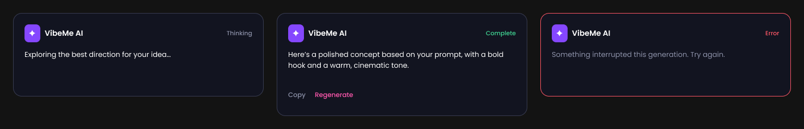

<!-- GEN:BEGIN 本段由 tools/gen-component-docs.py 依据 Figma 导出生成，勿手改；改 Figma 后重新生成 -->

## 概览

| 项 | 值 |
|---|---|
| Figma 组件集 | `VibeMe AI / Response Card`（node `56070:14800`） |
| 分类 | VibeMe AI（另一套 token） |
| 变体数 | 3 |
| 默认变体 | `State=Thinking` |
| 参考尺寸 | 460×154 px（默认变体） |
| 主题 | **VibeMe AI 主题（紫粉，另一套 token，不要与主库混用）** |
| 预览图 | [assets/previews/vibe-ai-response-card.png](../../assets/previews/vibe-ai-response-card.png) |
| 代码实现 | [`components/VibeAiResponseCard/VibeAiResponseCard.tsx`](../../components/VibeAiResponseCard/VibeAiResponseCard.tsx) |
| Figma 链接 | [在 Figma 打开](https://www.figma.com/design/ZO4WH3sbVCj7lZIFMpiwV9/VibeMe-App---Web-Design-%E5%A4%87%E4%BB%BD?node-id=56070-14800) |



## 变体与属性

| Figma 属性 | 类型 | 取值 | 默认 | 代码 prop |
|---|---|---|---|---|
| `State` | VARIANT | `Thinking` / `Complete` / `Error` | `Thinking` | `state` |

变体是属性轴的笛卡尔积：**3 = 3**（`State`）。

## 各变体的事实

> 填充栈按 Figma 图层顺序排列（**靠右的是上层**，hover/pressed 的叠加层在最后）。
> `⚠无cssVar` 表示该组件引用了历史遗留变量，代码里不要照抄，按 `foundations.md` 的规则换成语义 token。

| 变体 | 尺寸 | 填充栈 | 描边 | 圆角 | 内边距 上/右/下/左 | 不透明度 |
|---|---|---|---|---|---|---|
| `State=Thinking` | 460×154 | `color/bg/panel` #121420 `--vm-ai-color-bg-panel` | `color/border/default` #383C52 `--vm-ai-color-border-default` | 16 | 20/20/20/20 | — |
| `State=Complete` | 460×190 | `color/bg/panel` #121420 `--vm-ai-color-bg-panel` | `color/border/default` #383C52 `--vm-ai-color-border-default` | 16 | 20/20/20/20 | — |
| `State=Error` | 460×154 | `color/bg/panel` #121420 `--vm-ai-color-bg-panel` | `color/status/error` #FF5766 `--vm-ai-color-status-error` | 16 | 20/20/20/20 | — |

## 结构（默认变体）

### State=Thinking

```text
`COMPONENT` State=Thinking 460×154 VERTICAL gap 12 pad 20/20/20/20 填充 `color/bg/panel` #121420 `--vm-ai-color-bg-panel` 描边 `color/border/default` #383C52 `--vm-ai-color-border-default` 圆角 16
└─ `FRAME` Header 418×33 HORIZONTAL gap 8 pad 0/0/0/0
  └─ `FRAME` Identity 108×33 HORIZONTAL gap 8 pad 0/0/0/0
    └─ `FRAME` AI Avatar 29×33 HORIZONTAL gap 0 pad 6/8/6/8 填充 `color/bg/brand` #8547FF `--vm-ai-color-bg-brand` 圆角 8
      └─ `TEXT` AI Sparkle 13×21 填充 `color/text/primary` #FFFFFF `--vm-ai-color-text-primary` 文字样式 `-`（14 SemiBold /21） 内容 '✦'
    └─ `TEXT` Title 71×21 填充 `color/text/primary` #FFFFFF `--vm-ai-color-text-primary` 文字样式 `-`（14 SemiBold /21） 内容 'VibeMe AI'
  └─ `TEXT` State 47×17 填充 `color/text/secondary` #8C91A8 `--vm-ai-color-text-secondary` 文字样式 `-`（11 Medium /17） 内容 'Thinking'
└─ `TEXT` Response 418×44 填充 `color/text/primary` #FFFFFF `--vm-ai-color-text-primary` 文字样式 `-`（13 Regular /20） 内容 'Exploring the best direction for your idea…'
```


## 设计 token

| Figma 变量 | CSS 变量 | 值 |
|---|---|---|
| `color/bg/brand` | `--vm-ai-color-bg-brand` | `#8547FF` |
| `color/bg/panel` | `--vm-ai-color-bg-panel` | `#121420` |
| `color/border/default` | `--vm-ai-color-border-default` | `#383C52` |
| `color/status/error` | `--vm-ai-color-status-error` | `#FF5766` |
| `color/text/primary` | `--vm-ai-color-text-primary` | `#FFFFFF` |
| `color/text/secondary` | `--vm-ai-color-text-secondary` | `#8C91A8` |
| `radius/16` | `--vm-ai-radius-16` | `16px` |
| `spacing/12` | `--vm-ai-spacing-12` | `12px` |
| `spacing/20` | `--vm-ai-spacing-20` | `20px` |

<!-- GEN:END -->


## 交互与状态

卡片本身**不可点**（没有 hover / pressed 变体），状态由受控 prop `state` 驱动；Figma 描述原文是
`Displays AI thinking, completed output, and recoverable errors.`。三档差异如下：

| `state`（`State`） | 卡片外框 | `State` 文本颜色 | 正文（`Response`） | 多出来的东西 |
|---|---|---|---|---|
| `thinking`（默认，`State=Thinking`） | 1px `--vm-ai-color-border-default`（`color/border/default` #383C52） | `--vm-ai-color-text-secondary`（`color/text/secondary` #8C91A8）＋文案 `Thinking` | `--vm-ai-color-text-primary` #FFFFFF | — |
| `complete`（`State=Complete`） | 同上 | `--vm-ai-color-status-success`（`color/status/success` #40D694）＋文案 `Complete` | `--vm-ai-color-text-primary` | 底部出现 `Actions` 帧：`Copy` ＋ `Regenerate` |
| `error`（`State=Error`） | **描边换成 `--vm-ai-color-status-error`（`color/status/error` #FF5766）**，底色不变 | `--vm-ai-color-status-error` ＋文案 `Error` | **降级成 `--vm-ai-color-text-secondary`**，不再是纯白 | — |

- 底色三档都是 `--vm-ai-color-bg-panel`（`color/bg/panel` #121420），圆角 `--vm-ai-radius-16`，内边距 `--vm-ai-spacing-20`，
  卡片间距 `--vm-ai-spacing-12`；**只有 error 换描边**，这是本组件唯一「换描边」的状态变化。
- 头部（`Header`）是 `SPACE_BETWEEN`：左侧 `Identity`（`AI Avatar` 紫底方块 ＋ `Title`），右侧 `State` 文本；
  `AI Avatar` 用 `--vm-ai-color-bg-brand`（`color/bg/brand` #8547FF）＋ `--vm-ai-radius-8`，里面是一个白色 `✦`。
- 生成过程没有进度条/骨架：Figma 只有这三档，`thinking` 档的正文就是一句提示性文案（`Exploring the best direction…`），
  需要骨架屏请另外用主库 `Skeleton`，不要往卡片里塞。
- 两个文本动作是真实 `<button type="button">`，只有 `complete` 档默认渲染；`Copy` 用 `--vm-ai-color-text-secondary`，
  `Regenerate` 用 `--vm-ai-color-accent-pink`（`color/accent/pink` #FF57AD），两者都是 12 Medium / 18。
- hover / focus / pressed：Figma 未定义，实现里 `Regenerate` / `Copy` 只保留原生按钮行为 ＋ `:focus-visible` 焦点环；
  卡片外框不随 hover 变化。

## 代码用法

```tsx
import { useState } from 'react';
import { VibeAiResponseCard } from '../components/VibeAiResponseCard';

export function Example() {
  const [state, setState] = useState<'thinking' | 'complete' | 'error'>('thinking');

  return (
    <>
      {/* thinking（默认）：正文缺省时用 Figma 原文案 */}
      <VibeAiResponseCard state="thinking" />

      {/* complete：底部默认出现 Copy / Regenerate，两个回调都是可选的 */}
      <VibeAiResponseCard
        state="complete"
        title="VibeMe AI"
        stateLabel="Complete"
        onCopy={() => navigator.clipboard.writeText(text)}
        onRegenerate={() => setState('thinking')}
      >
        {text}
      </VibeAiResponseCard>

      {/* error：描边自动换成 --vm-ai-color-status-error，正文降为次要色 */}
      <VibeAiResponseCard state="error">这次生成被中断了，可以重试。</VibeAiResponseCard>

      {/* 要自定义动作区（换文案/加按钮）时用 actions 插槽整体替换默认的两个按钮 */}
      <VibeAiResponseCard state="complete" actions={<button type="button">重试</button>}>
        {text}
      </VibeAiResponseCard>
    </>
  );
}
```

CSS 引入方式：`import '../components/VibeAiResponseCard/VibeAiResponseCard.css'`（或整包 `import '../components/index'`）。
宽度与 Figma 一致写死 `460px`（`wSizing=FIXED`，Figma 明确固定尺寸），需要自适应时由调用方覆盖 `width`；
`children` 是正文（`Response`），`title` / `stateLabel` 分别覆盖 `Title` 与 `State` 两段文本。

## 可访问性

- 根节点是 `<article aria-labelledby={titleId}>`：`article` 是自成一体的内容单元，标题通过 `useId` 自动生成并关联，
  读屏进入卡片时会先念出 `VibeMe AI`；`title` 传进来的是内容，不是原生 `title` 提示（接口里已 `Omit<'title'>`，
  不会和浏览器 tooltip 打架）。
- `thinking` 档自动带 `aria-busy="true"`（其余档不输出该属性），告诉辅助技术这块内容还在生成中；
  `State` 文本是 `<span role="status">`，状态从 `Thinking` 切到 `Complete` / `Error` 时会被礼貌播报一次。
- 两个文本动作是原生 `<button type="button">`：`Tab` 可达、`Enter` / `Space` 可触发，焦点顺序 = DOM 顺序
  （先 `Copy` 后 `Regenerate`）；`:focus-visible` 给 `--vm-focus-ring-width` 的 ring，没有用 `outline: none` 抹掉焦点。
  可访问名称直接来自按钮文字 `Copy` / `Regenerate`，不做图标按钮、也不需要额外的 `aria-label`。
- 正文用 `<p>`、头部用 `div`，没有把整卡做成 `role="button"`，也不会拦截键盘事件。
- 对比度（实测）：正文 `--vm-ai-color-text-primary` #FFFFFF 在 `--vm-ai-color-bg-panel` #121420 上约 **18:1**；
  `State` / 正文次要色 #8C91A8 约 **5.9:1**；成功色 #40D694 约 **9.8:1**；错误色 `--vm-ai-color-status-error` #FF5766 约 **5.9:1**；
  `Regenerate` 的 `--vm-ai-color-accent-pink` 约 **6.3:1**。头像里的白 `✦` 在 `--vm-ai-color-bg-brand` #8547FF 上约 **4.8:1**，
  作为图形元素（非文本）达标。
- 状态**不单靠颜色**：`State` 文本本身就写着 `Thinking` / `Complete` / `Error`，色觉障碍用户不会因为描边变色而误读；
  错误信息（`children`）也应当是**可读的文字**，不要只留一个红框。

## 不要这样做

1. **不要把 `Response` 正文在 error 档继续用纯白**。Figma `State=Error` 的正文是 `color/text/secondary`（#8C91A8），
   只有 `thinking` / `complete` 才是 `color/text/primary`；错误档同时还有描边换色，两处一起变才是 Figma 的事实。
2. **不要在非 error 档把描边换成状态色**。三档里只有 `State=Error` 的描边是 `color/status/error`，
   `thinking` / `complete` 都是 `color/border/default`；也不要给描边加粗（三档 `strokeWeight` 都是 1）。
3. **不要照抄 Figma 的 13px / 11px 字号**。这套 token 的字号标尺没有 13 与 11：正文 13 Regular / 20 落到
   `.vm-type-heading-body-s-regular`（14 / 400 / 20，行高与字重一致，只有字号 +1），`State` 11 Medium / 17 落到
   `.vm-type-caption-caption`（12 / 500 / 18）。手写 `font-size: 13px` 会绕过 `.vm-type-*` 体系。
4. **不要把 `AI Avatar` 的内边距写成 6px 字面量**。Figma 是 6/8，实现里横向用 `--vm-ai-spacing-8`、
   纵向用 `calc(var(--vm-ai-spacing-8) - var(--vm-ai-spacing-4) / 2)`（= 6px）从标尺推出来，头像仍是 29×33，
   头部仍是 33 高；写 `6px` 会让间距体系出现第 4 种取值。
5. **不要把 `Copy` / `Regenerate` 做成 prop 枚举或图标按钮**。Figma 里它们是 `Actions` 帧里的两个 TEXT 节点，
   实现里是原生 `<button>`；要换语言用 `children`/`actions` 插槽，不要新增 `copyLabel` / `showCopy` 这类开关。
6. **不要用主库 token 给卡片上色**（`--vm-bg-card` / `--vm-border-default` / `--vm-text-primary`）。
   本组件属于 VibeMe AI 主题，对应的是 `--vm-ai-color-bg-panel` / `--vm-ai-color-border-default` / `--vm-ai-color-text-primary`，
   两套集合的解析值不同（例如面板底 #121420 与主库卡片底 #202020）。
7. **不要在卡片里再嵌一颗 `VibeAiGenerationStatus`**。卡片的 `Header` 已经有 `State` 文本表达同一件事，
   重复显示会让读屏播报两遍状态；状态胶囊留给卡片外的流程提示。

## 相关组件

- **`VibeAiPromptField` / `VibeAiTriggerButton`（输入侧）**：用户提交提示词后，本卡片负责展示 AI 的
  `thinking → complete / error` 结果；三者共用 `--vm-ai-*` 一套 token，卡片宽 460 与输入区同栏排布。
- **`VibeAiGenerationStatus`（过程侧）**：卡片外的轻量状态胶囊。它只表达「走到哪一步」，本卡片承载正文与动作；
  两者不要同时把状态文字暴露给读屏（卡片已有 `role="status"` 的 `State` 文本）。
- **`VibeAiCapabilityChip`（模式侧）**：`Regenerate` 之前通常需要先切换能力模式，胶囊的 `aria-pressed` 与本卡片互不依赖。
- **`Skeleton` / `Loading`（主库）**：`thinking` 档如果要更明确的加载反馈，用主库骨架屏放在**卡片外**
  或替换正文区；不要把主库 token 混进卡片内部。
- **`Card`（主库）**：通用容器卡片（主库 token、`Background/bg-card` #202020）；AI 回复请用本组件，
  不要为了省事给 `Card` 覆盖一堆 CSS 去模拟紫粉主题。
