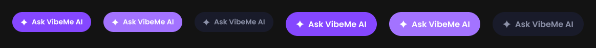

<!-- GEN:BEGIN 本段由 tools/gen-component-docs.py 依据 Figma 导出生成，勿手改；改 Figma 后重新生成 -->

## 概览

| 项 | 值 |
|---|---|
| Figma 组件集 | `VibeMe AI / Trigger Button`（node `56070:14742`） |
| 分类 | VibeMe AI（另一套 token） |
| 变体数 | 6 |
| 默认变体 | `Size=Medium, State=Default` |
| 参考尺寸 | 154×40 px（默认变体） |
| 主题 | **VibeMe AI 主题（紫粉，另一套 token，不要与主库混用）** |
| 预览图 | [assets/previews/vibe-ai-trigger-button.png](../../assets/previews/vibe-ai-trigger-button.png) |
| 代码实现 | [`components/VibeAiTriggerButton/VibeAiTriggerButton.tsx`](../../components/VibeAiTriggerButton/VibeAiTriggerButton.tsx) |
| Figma 链接 | [在 Figma 打开](https://www.figma.com/design/ZO4WH3sbVCj7lZIFMpiwV9/VibeMe-App---Web-Design-%E5%A4%87%E4%BB%BD?node-id=56070-14742) |



## 变体与属性

| Figma 属性 | 类型 | 取值 | 默认 | 代码 prop |
|---|---|---|---|---|
| `Size` | VARIANT | `Medium` / `Large` | `Medium` | `size` |
| `State` | VARIANT | `Default` / `Hover` / `Disabled` | `Default` | `state` |

变体是属性轴的笛卡尔积：**6 = 2 × 3**（`Size` × `State`）。

## 各变体的事实

> 填充栈按 Figma 图层顺序排列（**靠右的是上层**，hover/pressed 的叠加层在最后）。
> `⚠无cssVar` 表示该组件引用了历史遗留变量，代码里不要照抄，按 `foundations.md` 的规则换成语义 token。

| 变体 | 尺寸 | 填充栈 | 描边 | 圆角 | 内边距 上/右/下/左 | 不透明度 |
|---|---|---|---|---|---|---|
| `Size=Medium, State=Default` | 154×40 | `color/bg/brand` #8547FF `--vm-ai-color-bg-brand` | — | 999 | 10/16/10/16 | — |
| `Size=Medium, State=Hover` | 154×40 | `color/bg/brand-hover` #A373FF `--vm-ai-color-bg-brand-hover` | — | 999 | 10/16/10/16 | — |
| `Size=Medium, State=Disabled` | 154×40 | `color/bg/raised` #191B2A `--vm-ai-color-bg-raised` | — | 999 | 10/16/10/16 | — |
| `Size=Large, State=Default` | 178×48 | `color/bg/brand` #8547FF `--vm-ai-color-bg-brand` | — | 999 | 12/20/12/20 | — |
| `Size=Large, State=Hover` | 178×48 | `color/bg/brand-hover` #A373FF `--vm-ai-color-bg-brand-hover` | — | 999 | 12/20/12/20 | — |
| `Size=Large, State=Disabled` | 178×48 | `color/bg/raised` #191B2A `--vm-ai-color-bg-raised` | — | 999 | 12/20/12/20 | — |

## 结构（默认变体）

### Size=Medium, State=Default

```text
`COMPONENT` Size=Medium, State=Default 154×40 HORIZONTAL gap 8 pad 10/16/10/16 填充 `color/bg/brand` #8547FF `--vm-ai-color-bg-brand` 圆角 999
└─ `TEXT` AI Sparkle 14×24 填充 `color/text/primary` #FFFFFF `--vm-ai-color-text-primary` 文字样式 `-`（16 SemiBold /24） 内容 '✦'
└─ `TEXT` Label 100×21 填充 `color/text/primary` #FFFFFF `--vm-ai-color-text-primary` 文字样式 `-`（14 SemiBold /21） 内容 'Ask VibeMe AI'
```

### Size=Large, State=Disabled

```text
`COMPONENT` Size=Large, State=Disabled 178×48 HORIZONTAL gap 8 pad 12/20/12/20 填充 `color/bg/raised` #191B2A `--vm-ai-color-bg-raised` 圆角 999
└─ `TEXT` AI Sparkle 16×27 填充 `color/text/secondary` #8C91A8 `--vm-ai-color-text-secondary` 文字样式 `-`（18 SemiBold /27） 内容 '✦'
└─ `TEXT` Label 114×24 填充 `color/text/secondary` #8C91A8 `--vm-ai-color-text-secondary` 文字样式 `-`（16 SemiBold /24） 内容 'Ask VibeMe AI'
```


## 设计 token

| Figma 变量 | CSS 变量 | 值 |
|---|---|---|
| `color/bg/brand` | `--vm-ai-color-bg-brand` | `#8547FF` |
| `color/bg/brand-hover` | `--vm-ai-color-bg-brand-hover` | `#A373FF` |
| `color/bg/raised` | `--vm-ai-color-bg-raised` | `#191B2A` |
| `color/text/primary` | `--vm-ai-color-text-primary` | `#FFFFFF` |
| `color/text/secondary` | `--vm-ai-color-text-secondary` | `#8C91A8` |
| `radius/full` | `--vm-ai-radius-full` | `999px` |
| `spacing/16` | `--vm-ai-spacing-16` | `16px` |
| `spacing/20` | `--vm-ai-spacing-20` | `20px` |
| `spacing/8` | `--vm-ai-spacing-8` | `8px` |

<!-- GEN:END -->


## 交互与状态

`State` 的三个值分两类：`Hover` 是交互态（CSS 伪类，**不做 prop**），`Default` / `Disabled` 是
应用态（默认值 + 原生 `disabled`）。生成段落里把 `State` 机械映射成 `state`，但代码里**没有 `state` prop**，
实际对应关系是：`State=Default` → 默认样式，`State=Hover` → `:hover`，`State=Disabled` → `<button disabled>`。

- **Default**（154×40 / 178×48）：填充 `--vm-ai-color-bg-brand`（`color/bg/brand` #8547FF），
  文字与图标 `--vm-ai-color-text-primary`（`color/text/primary` #FFFFFF），圆角 `--vm-ai-radius-full`（`radius/full` 999）。
- **Hover**（CSS `:hover`，`:disabled` 时不生效）：**整体换填充变量** —— `color/bg/brand` 换成
  `color/bg/brand-hover`（`--vm-ai-color-bg-brand-hover` #A373FF），文字色不变。
  这是 AI 主题的第三种 hover 手法：既不是主库 Button 的「底色 + `--vm-white-7` 叠加」，
  也不是 Input/Search 的「描边换色」，而是**替换填充 token 本身**——`<slug>.variants.json` 里
  `State=Hover` 的 `fills` 只有一层 paint（`v` 指向 `color/bg/brand-hover`），没有任何叠加层。
- **Disabled**（原生 `disabled`）：底色换成 `--vm-ai-color-bg-raised`（`color/bg/raised` #191B2A），
  图标与文字换成 `--vm-ai-color-text-secondary`（`color/text/secondary` #8C91A8），
  `cursor: not-allowed`。**这里不写 `opacity`**：Figma 的 `State=Disabled` 变体实测
  `opacity = 1`、`opVar = null`（整份导出里没有任何 opacity 变量），它在 AI 主题里是
  「换色」而不是主库的「降到 38%（`--vm-opacity-disabled`）」；两者叠起来会比设计稿淡一层。
- **Focus**（CSS `:focus-visible`）：Figma 没有 Focus 变体，焦点环是可访问性补充 ——
  2px（`--vm-border-width-thick`）`--vm-ai-white-1000`（`white/1000`）外框 +
  `outline-offset: --vm-ai-spacing-4`，保证在 `color/bg/canvas` #080A11 底上看清。
- 过渡只有 `background-color` / `color`，时长 `--vm-duration-fast`（100ms），
  `prefers-reduced-motion: reduce` 时整体关闭；没有位移或缩放，不需要额外的 reduced-motion 规则。

## 代码用法

```tsx
import { VibeAiTriggerButton } from '../../components/VibeAiTriggerButton'; // 单引组件时先自行加载 ../../components/tokens.css

export function AiEntry() {
  return (
    <>
      {/* Figma: Size=Medium, State=Default（默认变体，Label 默认文案 Ask VibeMe AI） */}
      <VibeAiTriggerButton />

      {/* Figma: Size=Large —— 文案换成业务语言，其余属性原生透传 */}
      <VibeAiTriggerButton size="large" onClick={() => console.log('open ai')}>
        用 AI 生成 MV
      </VibeAiTriggerButton>

      {/* Figma: State=Disabled —— 走原生 disabled，会自动移出 tab 序列 */}
      <VibeAiTriggerButton size="large" disabled>
        额度已用完
      </VibeAiTriggerButton>

      {/* 表单里用：submit 语义请显式传 type，其余原生属性（name/value/aria-*）照常透传 */}
      <VibeAiTriggerButton type="submit" aria-label="提交并开始生成">
        开始生成
      </VibeAiTriggerButton>
    </>
  );
}
```

`VibeAiTriggerButton.tsx` 自己 `import './VibeAiTriggerButton.css'`，并按尺寸渲染内联的星形 SVG
（`currentColor` + `aria-hidden`，宽度 14 / 16）。`size` 默认 `medium`，`children` 默认 `Ask VibeMe AI`
（Figma 图层 `Label` 的字面文案）；`className` 与内部类合并而不是覆盖。宽度是 HUG（内容撑开），
只有高度是 Figma 固定的 40 / 48，**不要**给它设 `width`。

## 可访问性

- 根节点是**真实 `<button type="button">`**，`Enter` / `Space` 触发、可 Tab、可被表单提交拦到，
  原生行为全部保留；不要用 `div` + `onClick` 复刻。
- 图标是 `aria-hidden="true"` + `focusable="false"` 的装饰 SVG（Figma 里它只是 `✦` 字形），
  不要给它 `role="img"` 或 `aria-label`，否则读屏会把「星形」重复播报一遍。
- 按钮的可访问名来自文字内容；如果业务上要用纯图标形态（Figma 没有这个变体，需要先补设计），
  必须自己补 `aria-label`，否则读屏只能读出「按钮」。
- 禁用用原生 `disabled`（不是 `aria-disabled`）：它能同时移出 Tab 序列并播报「不可用」；
  `aria-disabled` 只适合「看起来禁用但仍需可聚焦」的场景，本组件没有这种需求。
- `disabled` 的对比度：`--vm-ai-color-text-secondary`（#8C91A8）在 `--vm-ai-color-bg-raised`
  （#191B2A）上约 5.1:1，仍满足 WCAG AA 的 4.5:1；这也是它可以不用 opacity 的原因之一。
- 焦点环不要写 `outline: none`：AI 主题的紫色填充与深底之间对比不高，没有外环时键盘用户会「丢失焦点」。

## 不要这样做

1. **不要把 hover 做成 `state="hover"` prop，也不要叠加 `--vm-white-7`**。这个组件集的
   `State=Hover` 变体只有一层 paint、变量是 `color/bg/brand-hover`；主库 Button 那套
   「底色 + `White/White-7` 叠加」不能搬到这里，叠加后会比 #A373FF 更亮。
2. **不要给 disabled 加 `opacity: var(--vm-opacity-disabled)`**。Figma 的 `State=Disabled`
   变体 `opacity=1`、没有任何 opacity 变量绑定，设计意图是换成 `color/bg/raised` +
   `color/text/secondary`；再叠 38% 会变成设计稿里不存在的第四种颜色。
3. **不要混用两套 token**。这个组件属于 `VibeMe AI` 主题（`VibeMe AI / Semantic` +
   `VibeMe AI / Dimensions`），必须用 `--vm-ai-*`；把主库的 `--vm-bg-card` / `--vm-text-primary`
   搬进来会出现灰色系与紫粉系同屏，`--vm-radius-button`（12px）也会破坏胶囊外形。
4. **不要看到圆角 999 就以为踩了「旧版胶囊按钮」的坑**。主库那个蓝色 MiSans 胶囊按钮是历史遗留；
   但 AI 主题的 `radius/full` 999 是它自己 `Dimensions` 里的正式 token（`--vm-ai-radius-full`），
   这里必须照用，不许改成 12px。
5. **不要把 `✦` 当文字或 emoji 渲染**。Figma 确实用了一个 Poppins 文字图层画图标，但实现规范要求
   图标走内联 SVG：代码里是可随尺寸缩放的星形路径、`fill="currentColor"`；**示意，建议从 Figma
   取原始矢量**。同时不要给图标单独设色，它必须跟 `color/text/*` 一起变（含 disabled）。
6. **不要在 AI 主题组件上引用主库文字样式以外的字号**。`Label` 在 Figma 里是硬编码的
   14 SemiBold /21（Medium）与 16 SemiBold /24（Large），代码映射到 `Heading/S` 与 `Heading/M`
   的三件套变量（`--vm-type-heading-s-*` / `--vm-type-heading-m-*`），不要手写 `font-size`。
7. **不要暴露 `Size` 以外的尺寸轴**，也不要加 `loading` / `icon` / `fullWidth` 等 Figma 不存在的状态；
   需要这些能力请先改 Figma 组件集，再回来刷新导出。

## 相关组件

- **VibeAiPromptField**：同一个 `VibeMe AI` 主题的兄弟组件，「触发器 + 输入区」通常成对出现
  （点 `VibeAiTriggerButton` 展开 `Prompt Field`），两者必须共用 `--vm-ai-*` 命名空间。
- **Button**：主库按钮是另一套主题（`--vm-brand` 砂色、`radius-button` 12px、hover 叠加
  `--vm-white-7`、disabled 用 `opacity: --vm-opacity-disabled`）；主库页面里用 `Button`，
  只有在紫粉 AI 场景才用 `VibeAiTriggerButton`，**不要互相套用样式**。
- **Tag / Badge**：AI 入口旁边标「Beta / 内测」这类标签时用主库 `Tag`（`color/accent/pink`
  对应 AI 主题的粉色强调，若要 AI 主题标签请确认 Figma 是否已有该组件集）。
- **Modal / Drawer**：点击后弹出 AI 面板用 `Modal`，触发按钮留在原地；当前组件集里没有内嵌实例
  （导出 `instances` 为空），不要假设它自带任何子组件。

